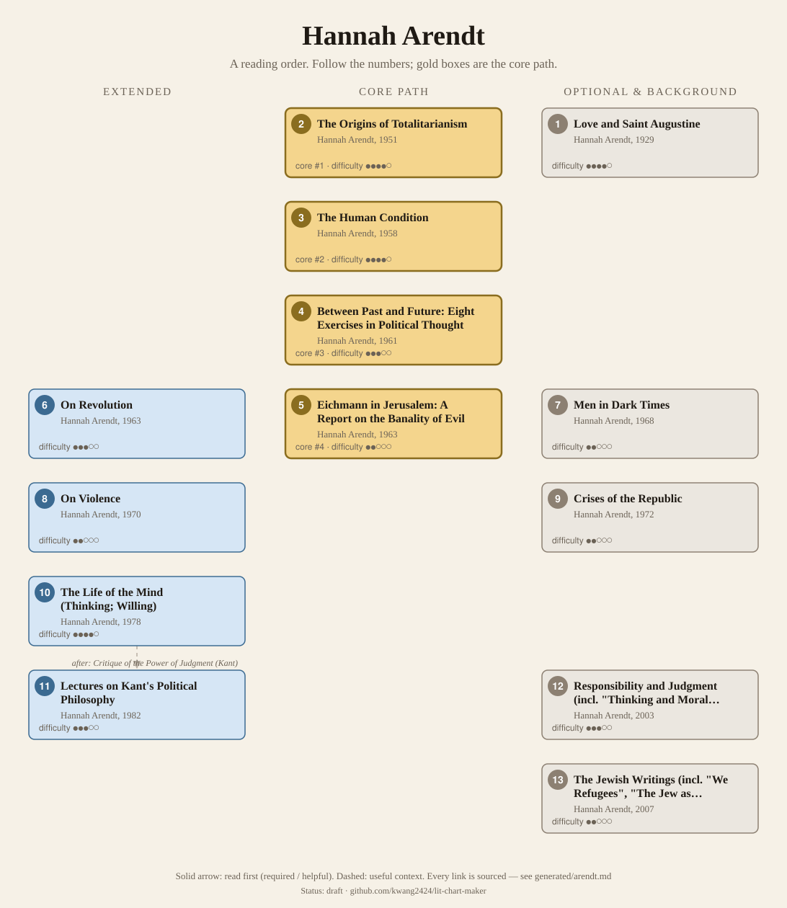

<!-- Generated by tools/build.py from lists/arendt.yaml. Do not edit by hand. -->
# Hannah Arendt: reading order

**Status:** draft · **Citations checked:** 14/14

**Scope:** Arendt's books and essay collections, from her dissertation on Augustine to the unfinished Life of the Mind. Political philosophy: totalitarianism, action, freedom, revolution, judgment.

## Core path

The shortest route through the essentials.

1. **The Origins of Totalitarianism** (1951) · difficulty ●●●●○ · first book in 2 surveyed sources
2. **The Human Condition** (1958) · difficulty ●●●●○ · first book in 1 surveyed source
3. **Between Past and Future: Eight Exercises in Political Thought** (1961) · difficulty ●●●○○
4. **Eichmann in Jerusalem: A Report on the Banality of Evil** (1963) · difficulty ●●○○○

## What the sources say

We surveyed 6 independent sources (6 course syllabi and teaching lists) and recorded which books each one assigns or recommends, and where it starts.

| Book | Recommended by | First book in |
|---|---|---|
| The Human Condition | 6/6 | 1 |
| Eichmann in Jerusalem: A Report on the Banality of Evil | 6/6 |  |
| The Origins of Totalitarianism | 5/6 | 2 |
| Between Past and Future: Eight Exercises in Political Thought | 4/6 |  |
| Crises of the Republic | 2/6 |  |
| Lectures on Kant's Political Philosophy | 2/6 |  |
| The Life of the Mind (Thinking; Willing) | 2/6 |  |
| On Revolution | 2/6 |  |
| On Violence | 2/6 |  |
| The Jewish Writings (incl. "We Refugees", "The Jew as Pariah") | 1/6 | 1 |
| Love and Saint Augustine | 1/6 | 1 |
| Responsibility and Judgment (incl. "Thinking and Moral Considerations") | 1/6 |  |

**Sources surveyed**

- **Antonio Calcagno, Western University, CSTC 9154A: The Philosophy of Hannah Arendt (2020)** [teaching]: Love and Saint Augustine → The Origins of Totalitarianism → The Human Condition → Eichmann in Jerusalem: A Report on the Banality of Evil → The Life of the Mind (Thinking; Willing). ✓ checked in Course syllabus (PDF), accessed 2026-11
- **Richard Wolin, CUNY Graduate Center, The Political Thought of Hannah Arendt (Spring 2020)** [teaching]: The Origins of Totalitarianism, The Human Condition, Eichmann in Jerusalem: A Report on the Banality of Evil, On Revolution. ✓ checked in Course syllabus (PDF), accessed 2026-11
- **Alice Crary, The New School, Hannah Arendt (Spring 2021)** [teaching]: The Jewish Writings (incl. "We Refugees", "The Jew as Pariah") → The Origins of Totalitarianism → The Human Condition → On Revolution → Between Past and Future: Eight Exercises in Political Thought → Crises of the Republic → Eichmann in Jerusalem: A Report on the Banality of Evil → Lectures on Kant's Political Philosophy. ✓ checked in Course syllabus (PDF), accessed 2026-11
- **Alice MacLachlan, PHIL 6150: History of Continental Philosophy (Hannah Arendt)** [teaching]: The Human Condition → Between Past and Future: Eight Exercises in Political Thought → On Violence → Responsibility and Judgment (incl. "Thinking and Moral Considerations") → Eichmann in Jerusalem: A Report on the Banality of Evil → Lectures on Kant's Political Philosophy. ✓ checked in Course syllabus (PDF), accessed 2026-11
- **Bonnie Mann, University of Oregon, PHIL 453/553: Hannah Arendt (Winter 2012)** [teaching]: The Origins of Totalitarianism → The Human Condition → Eichmann in Jerusalem: A Report on the Banality of Evil → Between Past and Future: Eight Exercises in Political Thought → On Violence → The Life of the Mind (Thinking; Willing). ✓ checked in Course syllabus (PDF), accessed 2026-11
- **Jason Frank, Cornell University, Government 6586: Schmitt, Strauss, Arendt (Spring 2017)** [teaching]: The Origins of Totalitarianism, The Human Condition, Eichmann in Jerusalem: A Report on the Banality of Evil, Between Past and Future: Eight Exercises in Political Thought, Crises of the Republic. ✓ checked in Course syllabus (PDF), accessed 2026-11

## Full path

Every work, in order. Extended and optional works are placed where they fit best.

### 1. Love and Saint Augustine (1929)

`optional · primary · difficulty ●●●●○` · Hannah Arendt

Her doctoral dissertation, written under Karl Jaspers.

**Reading tips:**

- The IEP notes she remained close to Jaspers all her life, though Heidegger's influence proved the greater.
  - Internet Encyclopedia of Philosophy, *"Hannah Arendt (1906–1975)"*, §1 Chronology of Life and Works [scholarly] ✓ checked in IEP online, accessed 2026-11

### 2. The Origins of Totalitarianism (1951)

`core · primary · difficulty ●●●●○` · Hannah Arendt

Antisemitism, imperialism and totalitarianism: her study of the Nazi and Stalinist regimes. Several courses concentrate on Part III, "Totalitarianism".

### 3. The Human Condition (1958)

`core · primary · difficulty ●●●●○` · Hannah Arendt

Labor, work and action, the three activities of the vita activa.

**Read first:**

- *Being and Time* (from the [Martin Heidegger list](heidegger.md)) — *context*. Heidegger's phenomenology had "the greater... lasting influence upon Arendt's work", and one Arendt course opens with Being and Time.
  - Internet Encyclopedia of Philosophy, *"Hannah Arendt (1906–1975)"*, §1 Chronology of Life and Works [scholarly] ✓ checked in IEP online, accessed 2026-11
  - Richard Wolin, CUNY Graduate Center, *The Political Thought of Hannah Arendt (Spring 2020)*, schedule (Feb. 10, Arendt and Heidegger I) [teaching] ✓ checked in Course syllabus (PDF), accessed 2026-11
- *Capital, Volume 1* (from the [Karl Marx list](marx.md)) — *context*. She is "highly critical of Marx's elevation of animal laborans" to the highest end of human life.
  - Internet Encyclopedia of Philosophy, *"Hannah Arendt (1906–1975)"*, §4.a.i Labor [scholarly] ✓ checked in IEP online, accessed 2026-11
- *Republic* (from the [Plato list](plato.md)) — *context*. It argues against the tradition in which "Platonism, Stoicism and Christianity elevated the sphere of contemplation above the sphere of action".
  - Stanford Encyclopedia of Philosophy, *"Hannah Arendt", Stanford Encyclopedia of Philosophy*, §4.7 The Unpredictability and Irreversibility of Action [scholarly] ✓ checked in SEP online, accessed 2026-11

### 4. Between Past and Future: Eight Exercises in Political Thought (1961)

`core · primary · difficulty ●●●○○` · Hannah Arendt

Essays including "What Is Freedom?", "The Crisis in Culture" and "Truth and Politics".

**Read first:**

- *"Two Concepts of Liberty"* (from the [Isaiah Berlin list](berlin.md)) — *context*. MacLachlan's course reads "What Is Freedom?" in the same session as Berlin's "Two Concepts of Liberty" (1958), the best-known modern statement of the question.
  - Alice MacLachlan, *PHIL 6150: History of Continental Philosophy (Hannah Arendt)*, schedule, 21/10 ("Freedom") [teaching] ✓ checked in Course syllabus (PDF), accessed 2026-11

### 5. Eichmann in Jerusalem: A Report on the Banality of Evil (1963)

`core · primary · difficulty ●●○○○` · Hannah Arendt

Her report on the Eichmann trial for The New Yorker, which caused a deep controversy.

### 6. On Revolution (1963)

`extended · primary · difficulty ●●●○○` · Hannah Arendt

The American and French revolutions compared.

### 7. Men in Dark Times (1968)

`optional · primary · difficulty ●●○○○` · Hannah Arendt

Essays on individual writers and thinkers.

### 8. On Violence (1970)

`extended · primary · difficulty ●●○○○` · Hannah Arendt

A short essay; also included in Crises of the Republic.

### 9. Crises of the Republic (1972)

`optional · primary · difficulty ●●○○○` · Hannah Arendt

Essays including "Lying in Politics" and "On Violence".

### 10. The Life of the Mind (Thinking; Willing) (1978)

`extended · primary · difficulty ●●●●○` · Hannah Arendt

Her last major work; two of the planned three volumes were finished.

### 11. Lectures on Kant's Political Philosophy (1982)

`extended · primary · difficulty ●●●○○` · Hannah Arendt

Lecture notes standing in for the unwritten third volume, on judging.

**Read first:**

- *The Life of the Mind (Thinking; Willing)* — *context*. The volume on Judging was left unfinished; background material and lecture notes were published as these Lectures.
  - Stanford Encyclopedia of Philosophy, *"Hannah Arendt", Stanford Encyclopedia of Philosophy*, §1 Biographical Sketch [scholarly] ✓ checked in SEP online, accessed 2026-11
- *Critique of the Power of Judgment* (from the [Immanuel Kant list](kant.md)) — *helpful*. She "based her theory of political judgment on Kant's aesthetics in his Critique of Judgment, which she claimed contained Kant's unwritten political philosophy".
  - Stanford Encyclopedia of Philosophy, *"Hannah Arendt", Stanford Encyclopedia of Philosophy*, §6.4 Judgment and Politics: Two Models [scholarly] ✓ checked in SEP online, accessed 2026-11

### 12. Responsibility and Judgment (incl. "Thinking and Moral Considerations") (2003)

`optional · primary · difficulty ●●●○○` · Hannah Arendt

Late essays and lectures on moral thinking, collected after her death.

### 13. The Jewish Writings (incl. "We Refugees", "The Jew as Pariah") (2007)

`optional · primary · difficulty ●●○○○` · Hannah Arendt

Her essays on Jewish politics and identity, collected after her death.

## Map

Solid arrows: required or helpful. Dotted: context.

```mermaid
graph TD
  love_augustine["Love and Saint Augustine"]:::optional
  origins["The Origins of Totalitarianism"]:::core
  human_condition["The Human Condition"]:::core
  between_past_future["Between Past and Future: Eight Exercises in Political Thought"]:::core
  eichmann["Eichmann in Jerusalem: A Report on the Banality of Evil"]:::core
  on_revolution["On Revolution"]:::extended
  men_dark_times["Men in Dark Times"]:::optional
  on_violence["On Violence"]:::extended
  crises_republic["Crises of the Republic"]:::optional
  life_of_mind["The Life of the Mind (Thinking; Willing)"]:::extended
  lectures_kant["Lectures on Kant's Political Philosophy"]:::extended
  responsibility_judgment["Responsibility and Judgment (incl. 'Thinking and Moral Considerations')"]:::optional
  jewish_writings["The Jewish Writings (incl. 'We Refugees', 'The Jew as Pariah')"]:::optional
  life_of_mind -.-> lectures_kant
  classDef core fill:#f4d58d,stroke:#8a6d1f,color:#000
  classDef extended fill:#cfe3f5,stroke:#3b6a91,color:#000
  classDef optional fill:#eeeeee,stroke:#888,color:#000
```

## Connections

**Builds on**

- *Being and Time* (Martin Heidegger) → *The Human Condition* — context. Heidegger's phenomenology had "the greater... lasting influence upon Arendt's work", and one Arendt course opens with Being and Time.
- *Capital, Volume 1* (Karl Marx) → *The Human Condition* — context. She is "highly critical of Marx's elevation of animal laborans" to the highest end of human life.
- *Republic* (Plato) → *The Human Condition* — context. It argues against the tradition in which "Platonism, Stoicism and Christianity elevated the sphere of contemplation above the sphere of action".
- *"Two Concepts of Liberty"* (Isaiah Berlin) → *Between Past and Future: Eight Exercises in Political Thought* — context. MacLachlan's course reads "What Is Freedom?" in the same session as Berlin's "Two Concepts of Liberty" (1958), the best-known modern statement of the question.
- *Critique of the Power of Judgment* (Immanuel Kant) → *Lectures on Kant's Political Philosophy* — helpful. She "based her theory of political judgment on Kant's aesthetics in his Critique of Judgment, which she claimed contained Kant's unwritten political philosophy".

## Sources

- **[scholarly]** Internet Encyclopedia of Philosophy, *"Hannah Arendt (1906–1975)"* — <https://iep.utm.edu/arendt/>
- **[scholarly]** Stanford Encyclopedia of Philosophy, *"Hannah Arendt", Stanford Encyclopedia of Philosophy* — <https://plato.stanford.edu/entries/arendt/>
- **[teaching]** Jason Frank, Cornell University, *Government 6586: Schmitt, Strauss, Arendt (Spring 2017)* — <https://jasonfrank.info/wp-content/uploads/2017/05/Schmitt-Strauss-Arendt-Syllabus.pdf>
- **[teaching]** Richard Wolin, CUNY Graduate Center, *The Political Thought of Hannah Arendt (Spring 2020)* — <https://www.gc.cuny.edu/sites/default/files/2022-05/Political-Thought-of-HA_history_syllabus.pdf>
- **[teaching]** Alice MacLachlan, *PHIL 6150: History of Continental Philosophy (Hannah Arendt)* — <https://www.alicemaclachlan.com/PDF/PHIL6150Syllabus.pdf>
- **[teaching]** Alice Crary, The New School, *Hannah Arendt (Spring 2021)* — <https://alicecrary.com/wp-content/uploads/2021/01/syllabus-hannah-arendt-s21_web.pdf>
- **[teaching]** Bonnie Mann, University of Oregon, *PHIL 453/553: Hannah Arendt (Winter 2012)* — <https://pages.uoregon.edu/uophil/files/PHIL_453-553_Arendt.pdf>
- **[teaching]** Antonio Calcagno, Western University, *CSTC 9154A: The Philosophy of Hannah Arendt (2020)* — <https://www.uwo.ca/theory/current_students/course_descriptions/Calcagno-9154A-2020.pdf>
