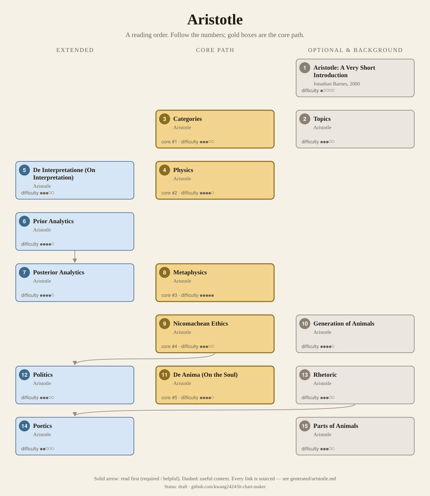

<!-- Generated by tools/build.py from lists/aristotle.yaml. Do not edit by hand. -->
# Aristotle: reading order

**Status:** draft · **Citations checked:** 13/13

**Scope:** Aristotle's main surviving treatises, grouped as he divided the sciences: the logical works (the Organon), the theoretical sciences (nature, soul, first philosophy), the practical (ethics and politics) and the productive (rhetoric and poetics). The works are lecture notes rather than finished books, and cannot be dated reliably, so no years are given.

## Core path

The shortest route through the essentials.

1. **Categories** · difficulty ●●●○○ · first book in 1 surveyed source
2. **Physics** · difficulty ●●●●○ · first book in 1 surveyed source
3. **Metaphysics** · difficulty ●●●●● · first book in 1 surveyed source
4. **Nicomachean Ethics** · difficulty ●●●○○ · first book in 1 surveyed source
5. **De Anima (On the Soul)** · difficulty ●●●●○

## What the sources say

We surveyed 7 independent sources (7 course syllabi and teaching lists) and recorded which books each one assigns or recommends, and where it starts.

| Book | Recommended by | First book in |
|---|---|---|
| Nicomachean Ethics | 6/7 | 1 |
| Metaphysics | 5/7 | 1 |
| Physics | 5/7 | 1 |
| Categories | 4/7 | 1 |
| De Anima (On the Soul) | 4/7 |  |
| Politics | 3/7 |  |
| Topics | 2/7 | 1 |
| De Interpretatione (On Interpretation) | 2/7 |  |
| Generation of Animals | 2/7 |  |
| Parts of Animals | 2/7 |  |
| Poetics | 2/7 |  |
| Posterior Analytics | 2/7 |  |
| Prior Analytics | 2/7 |  |
| Rhetoric | 2/7 |  |

**Sources surveyed**

- **J. Bailly, University of Vermont, Aristotle on Everything (Fall 2024)** [teaching]: Categories → Physics → Metaphysics → De Interpretatione (On Interpretation) → Prior Analytics → Posterior Analytics → De Anima (On the Soul) → Nicomachean Ethics → Politics → Poetics → Rhetoric. ✓ checked in Course syllabus (web page, Fall 2024), accessed 2026-11
- **Monte Ransome Johnson, UC San Diego, PHIL 101: Aristotle (Winter 2019)** [teaching]: Metaphysics → Categories → De Interpretatione (On Interpretation) → Prior Analytics → Topics → Rhetoric → Posterior Analytics → Physics → De Anima (On the Soul) → Parts of Animals → Generation of Animals → Nicomachean Ethics → Poetics → Politics. ✓ checked in Course syllabus (PDF, Winter 2019), accessed 2026-11
- **M. Deslauriers, McGill University, PHIL 355: Aristotle (Winter 2012)** [teaching]: Physics → Categories → Generation of Animals → Nicomachean Ethics → Politics. ✓ checked in Course syllabus (PDF, Winter 2012), accessed 2026-11
- **Directed Studies, Yale University, Philosophy, Fall 2018** [teaching]: Nicomachean Ethics → Physics → Categories → De Anima (On the Soul) → Metaphysics. ✓ checked in Course syllabus (PDF, Fall 2018), accessed 2026-11
- **Katja Maria Vogt, Columbia University, Ancient Philosophy: Pre-Socratics through Augustine (Fall 2017)** [teaching]: Topics → Nicomachean Ethics → Metaphysics. ✓ checked in Course syllabus (PDF, Fall 2017), accessed 2026-11
- **University of Oxford, Faculty of Philosophy, Course Descriptions: Finals** [teaching]: Nicomachean Ethics, Physics, De Anima (On the Soul), Parts of Animals. ✓ checked in Course descriptions (web page), accessed 2026-11
- **University of Cambridge, Faculty of Philosophy, Philosophy Tripos Guide to Courses (Syllabus) 2025–2026** [teaching]: Metaphysics. ✓ checked in Guide to Courses 2025–26 (PDF), accessed 2026-11

## Full path

Every work, in order. Extended and optional works are placed where they fit best.

### 1. Aristotle: A Very Short Introduction (2000)

`optional · secondary · difficulty ●○○○○` · Jonathan Barnes

A short overview; Oxford's Ethics paper lists one of its chapters as introductory reading.

**Reading tips:**

- The SEP warns that "Aristotle's writings tend to present formidable difficulties to his novice readers": they are lecture notes and drafts, with heavy technical vocabulary, and "Aristotle's prose requires some acclimatization".
  - Stanford Encyclopedia of Philosophy (Christopher Shields), *"Aristotle"*, §2 The Aristotelian Corpus [scholarly] ✓ checked in SEP entry, accessed 2026-11

### 2. Topics

`optional · primary · difficulty ●●●○○` · Aristotle

On dialectical argument; Columbia's course uses excerpts as "a book on method".

### 3. Categories

`core · primary · difficulty ●●●○○` · Aristotle

On substance and accidents, subjects and predicates (McGill's course description). McGill and Yale assign chapters 1–5.

**Translation:** Edghill (free online)

### 4. Physics

`core · primary · difficulty ●●●●○` · Aristotle

Nature, explanation (including teleology), chance, change, time, place and the infinite (Oxford's paper description). Courses concentrate on Books I–II; Oxford adds III and IV.

### 5. De Interpretatione (On Interpretation)

`extended · primary · difficulty ●●●○○` · Aristotle

On propositions and terms; part of the Organon (SEP §2).

### 6. Prior Analytics

`extended · primary · difficulty ●●●●○` · Aristotle

The syllogism; with the Topics, the main treatment of logic and argument (SEP §2).

### 7. Posterior Analytics

`extended · primary · difficulty ●●●●○` · Aristotle

The structure of scientific knowledge and demonstration (SEP §2). UCSD's course reads I.1–3 and II.19.

**Read first:**

- *Prior Analytics* — *helpful*. Both ordered courses that teach the logic read the Prior Analytics, on the syllogism, before the Posterior Analytics, on demonstration.
  - Monte Ransome Johnson, UC San Diego, *PHIL 101: Aristotle (Winter 2019)*, weeks 3–4 [teaching] ✓ checked in Course syllabus (PDF, Winter 2019), accessed 2026-11
  - J. Bailly, University of Vermont, *Aristotle on Everything (Fall 2024)*, weeks 6–8 [teaching] ✓ checked in Course syllabus (web page, Fall 2024), accessed 2026-11

### 8. Metaphysics

`core · primary · difficulty ●●●●●` · Aristotle

"First philosophy" (SEP §2). Book I opens with the claim that all human beings desire to know, and reviews his predecessors (Columbia's course). Courses read selections, among them Books I, IV, VII and XII.

### 9. Nicomachean Ethics

`core · primary · difficulty ●●●○○` · Aristotle

Happiness, the virtues, responsibility, practical wisdom, weakness of will, pleasure and friendship. Oxford's paper calls it "one of the most important works in the history of philosophy".

**Translation:** Irwin (Hackett), Oxford's set text; older free version (Project Gutenberg)

### 10. Generation of Animals

`optional · primary · difficulty ●●●●○` · Aristotle

Reproduction and inheritance; McGill's course reads it on sexual difference and resemblance.

### 11. De Anima (On the Soul)

`core · primary · difficulty ●●●●○` · Aristotle

The soul and its relation to the body; perception, emotion and thought (Oxford's paper description).

### 12. Politics

`extended · primary · difficulty ●●●○○` · Aristotle

The household and the city, citizenship and constitutions (McGill's schedule).

**Translation:** Ellis (free online)

**Read first:**

- *Nicomachean Ethics* — *helpful*. The Ethics ends by turning to legislation and "the whole subject of Polity, that thus what we may call Human Philosophy may be completed", announcing the study of constitutions that the Politics carries out.
  - Aristotle, *The Nicomachean Ethics (Project Gutenberg edition)*, Book X, last chapter [author] ✓ checked in Project Gutenberg
- *Republic* (from the [Plato list](plato.md)) — *context*. It argues with Plato's Republic directly: "when Socrates, in Plato's Republic, says that a city is necessarily composed of four sorts of people, he speaks elegantly but not correctly".
  - Aristotle, *Politics: A Treatise on Government (Ellis trans.)*, Book IV, ch. 4 [author] ✓ checked in Ellis trans. (1912), Project Gutenberg

### 13. Rhetoric

`optional · primary · difficulty ●●●○○` · Aristotle

The principles of persuasive speech, including in political assemblies (SEP §2).

### 14. Poetics

`extended · primary · difficulty ●●○○○` · Aristotle

On tragedy; UVM's course reads it with the Rhetoric.

**Translation:** Butcher (free online)

**Read first:**

- *Rhetoric* — *helpful*. On "Thought" in tragedy, Aristotle writes: "we may assume what is said in the Rhetoric, to which inquiry the subject more strictly belongs."
  - Aristotle, *The Poetics (Butcher trans.)*, ch. XIX [author] ✓ checked in Butcher trans., Project Gutenberg

### 15. Parts of Animals

`optional · primary · difficulty ●●●○○` · Aristotle

Book I is the part Oxford's and UCSD's courses assign.

## Map

Solid arrows: required or helpful. Dotted: context.

```mermaid
graph TD
  barnes_vsi["Aristotle: A Very Short Introduction"]:::optional
  topics["Topics"]:::optional
  categories["Categories"]:::core
  physics["Physics"]:::core
  de_interpretatione["De Interpretatione (On Interpretation)"]:::extended
  prior_analytics["Prior Analytics"]:::extended
  posterior_analytics["Posterior Analytics"]:::extended
  metaphysics["Metaphysics"]:::core
  ne["Nicomachean Ethics"]:::core
  generation_animals["Generation of Animals"]:::optional
  de_anima["De Anima (On the Soul)"]:::core
  politics["Politics"]:::extended
  rhetoric["Rhetoric"]:::optional
  poetics["Poetics"]:::extended
  parts_animals["Parts of Animals"]:::optional
  prior_analytics --> posterior_analytics
  ne --> politics
  rhetoric --> poetics
  classDef core fill:#f4d58d,stroke:#8a6d1f,color:#000
  classDef extended fill:#cfe3f5,stroke:#3b6a91,color:#000
  classDef optional fill:#eeeeee,stroke:#888,color:#000
```

## Connections

**Builds on**

- *Republic* (Plato) → *Politics* — context. It argues with Plato's Republic directly: "when Socrates, in Plato's Republic, says that a city is necessarily composed of four sorts of people, he speaks elegantly but not correctly".

**Who builds on Aristotle**

- *Metaphysics* → *Encyclopaedia of the Philosophical Sciences (esp. Part I, the "Lesser Logic")* (G. W. F. Hegel) — context. The Encyclopaedia closes (§577) with a long Greek quotation from Aristotle's Metaphysics, Book XII, on thought thinking itself; the Philosophy of Mind also credits Aristotle's "entelechy of thought" with "surmounting the Platonic Idea".
- *Physics* → *Being and Time* (Martin Heidegger) — context. Its planned Part 2 was to show that "the ontologies of Aristotle, Descartes, and Kant all rest on a conception of time"; Aristotle's account of time is in Physics IV.
- *Categories* → *Critique of Pure Reason* (Immanuel Kant) — context. Kant names his table of pure concepts after Aristotle's: "These conceptions we shall, with Aristotle, call categories, our purpose being originally identical with his, notwithstanding the great difference in the execution."
- *Politics* → *The Social Contract* (Jean-Jacques Rousseau) — context. Book I ch. 2 answers Aristotle's claim that "some are born for slavery, and others for dominion": "Aristotle was right; but he took the effect for the cause."
- *Politics* → *The City and Man* (Leo Strauss) — helpful. Its first essay is on Aristotle's Politics, "especially important as one of Strauss's few writings on the philosopher who largely shaped Strauss's conception of antiquity".

## Sources

- **[author]** Aristotle, *The Nicomachean Ethics (Project Gutenberg edition)* — <https://www.gutenberg.org/ebooks/8438>
- **[author]** Aristotle, *The Poetics (Butcher trans.)* — <https://www.gutenberg.org/ebooks/1974>
- **[author]** Aristotle, *Politics: A Treatise on Government (Ellis trans.)* — <https://www.gutenberg.org/ebooks/6762>
- **[scholarly]** Stanford Encyclopedia of Philosophy (Christopher Shields), *"Aristotle"* — <https://plato.stanford.edu/entries/aristotle/>
- **[teaching]** University of Cambridge, Faculty of Philosophy, *Philosophy Tripos Guide to Courses (Syllabus) 2025–2026* — <https://www.phil.cam.ac.uk/files/gtc_2025-26_-_final_2025_07.pdf>
- **[teaching]** University of Oxford, Faculty of Philosophy, *Course Descriptions: Finals* — <https://www.philosophy.ox.ac.uk/course-descriptions-finals>
- **[teaching]** Katja Maria Vogt, Columbia University, *Ancient Philosophy: Pre-Socratics through Augustine (Fall 2017)* — <https://katjavogt.github.io/wp-content/uploads/syllabus-vogt-ancient-intro.pdf>
- **[teaching]** M. Deslauriers, McGill University, *PHIL 355: Aristotle (Winter 2012)* — <https://www.mcgill.ca/philosophy/files/philosophy/355b12sylnew_0.pdf>
- **[teaching]** Monte Ransome Johnson, UC San Diego, *PHIL 101: Aristotle (Winter 2019)* — <https://hh-philosophy.ucsd.edu/_files/courses/19winter/W19_Phil%20101_Johnson.pdf>
- **[teaching]** J. Bailly, University of Vermont, *Aristotle on Everything (Fall 2024)* — <https://www.uvm.edu/~jbailly/courses/Aristotle/aristotleSyllabusFall2024.html>
- **[teaching]** Directed Studies, Yale University, *Philosophy, Fall 2018* — <https://directedstudies.yale.edu/sites/default/files/files/Syllabus%20philosophy%20Fall%202018-3.pdf>
