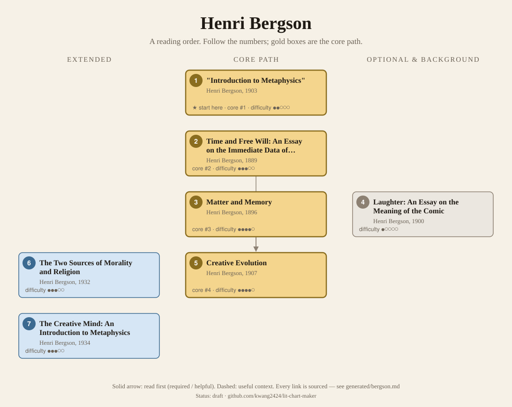
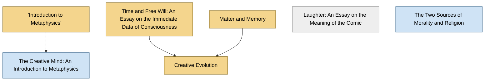

<!-- Generated by tools/build.py from lists/bergson.yaml. Do not edit by hand. -->
# Henri Bergson: reading order

**Status:** draft · **Citations checked:** 8/8

**Scope:** Bergson's major books, which courses read in publication order, and the essay the SEP calls the reading guide to his whole philosophy. Background for Deleuze (Bergsonism) and for Jung's idea of psychic energy.

## Core path

The shortest route through the essentials.

1. **"Introduction to Metaphysics"** (1903) · difficulty ●●○○○ · ★ start here · first book in 1 surveyed source
2. **Time and Free Will: An Essay on the Immediate Data of Consciousness** (1889) · difficulty ●●●○○ · first book in 2 surveyed sources
3. **Matter and Memory** (1896) · difficulty ●●●●○
4. **Creative Evolution** (1907) · difficulty ●●●●○

## What the sources say

We surveyed 3 independent sources (3 course syllabi and teaching lists) and recorded which books each one assigns or recommends, and where it starts.

| Book | Recommended by | First book in |
|---|---|---|
| Time and Free Will: An Essay on the Immediate Data of Consciousness | 3/3 | 2 |
| Creative Evolution | 3/3 |  |
| Matter and Memory | 3/3 |  |
| "Introduction to Metaphysics" | 1/3 | 1 |
| The Creative Mind: An Introduction to Metaphysics | 1/3 |  |
| Laughter: An Essay on the Meaning of the Comic | 1/3 |  |

**Sources surveyed**

- **John Protevi, Louisiana State University, Bergson Course (Spring 2008)** [teaching]: Time and Free Will: An Essay on the Immediate Data of Consciousness → Matter and Memory → Creative Evolution. ✓ checked in Course syllabus, accessed 2026-11
- **Melbourne School of Continental Philosophy, Henri Bergson: Tendency and Time (seminar)** [teaching]: "Introduction to Metaphysics" → Time and Free Will: An Essay on the Immediate Data of Consciousness → Matter and Memory → Creative Evolution. ✓ checked in Seminar web page, accessed 2026-11
- **Western University, Centre for the Study of Theory and Criticism, Bergson: Cine-Perception (9202)** [teaching]: Time and Free Will: An Essay on the Immediate Data of Consciousness → Laughter: An Essay on the Meaning of the Comic → Matter and Memory → Creative Evolution → The Creative Mind: An Introduction to Metaphysics. ✓ checked in Course syllabus, accessed 2026-11

## Full path

Every work, in order. Extended and optional works are placed where they fit best.

### 1. "Introduction to Metaphysics" (1903)

`core · primary · difficulty ●●○○○` · Henri Bergson

A short essay on intuition versus analysis. Now the centrepiece of The Creative Mind.

**Translation:** in The Creative Mind (trans. Andison), or Hulme's 1912 translation

**★ Good place to start.** The SEP says it "became a crucial reading guide for Bergson's philosophy as a whole", and one surveyed seminar opens with it.

- Leonard Lawlor and Valentine Moulard-Leonard, *"Henri Bergson", Stanford Encyclopedia of Philosophy*, §1 Life and works [scholarly] ✓ checked in SEP online, accessed 2026-11

### 2. Time and Free Will: An Essay on the Immediate Data of Consciousness (1889)

`core · primary · difficulty ●●●○○` · Henri Bergson

His doctoral thesis. Duration versus spatialized time, and freedom.

**Translation:** Pogson (free online)

**Read first:**

- *Critique of Pure Reason* (from the [Immanuel Kant list](kant.md)) — *context*. Its conclusion: "Kant's great mistake was to take time as a homogeneous medium"; Kant "clung to freedom, but put the self which is free outside both space and time".
  - Henri Bergson, *Time and Free Will: An Essay on the Immediate Data of Consciousness (Pogson trans., 1910)*, Conclusion [author] ✓ checked in Pogson trans. (1910), Project Gutenberg

### 3. Matter and Memory (1896)

`core · primary · difficulty ●●●●○` · Henri Bergson

Perception, memory and the body; pure memory as "virtual".

**Translation:** Paul & Palmer (Zone)

### 4. Laughter: An Essay on the Meaning of the Comic (1900)

`optional · primary · difficulty ●○○○○` · Henri Bergson

Short and entertaining. A good side door into his thought.

### 5. Creative Evolution (1907)

`core · primary · difficulty ●●●●○` · Henri Bergson

Life as a creative "élan vital" rather than mechanism or design.

**Translation:** Mitchell (free online)

**Read first:**

- *Time and Free Will: An Essay on the Immediate Data of Consciousness* — *helpful*. Bergson says his views here are "those that we expressed long ago" in the Essai (Time and Free Will).
  - Henri Bergson, *Creative Evolution*, Chapter I [author] ✓ checked in Mitchell trans. (1911), Project Gutenberg
- *Matter and Memory* — *helpful*. It repeatedly refers back to Matter and Memory ("We have developed this point in Matière et mémoire").
  - Henri Bergson, *Creative Evolution*, footnotes to Chapters I–III [author] ✓ checked in Mitchell trans. (1911), Project Gutenberg

### 6. The Two Sources of Morality and Religion (1932)

`extended · primary · difficulty ●●●○○` · Henri Bergson

His last major book, on closed and open societies and religion.

### 7. The Creative Mind: An Introduction to Metaphysics (1934)

`extended · primary · difficulty ●●●○○` · Henri Bergson

Late essays on method, including the 1903 essay and a long introduction looking back on his work.

**Read first:**

- *"Introduction to Metaphysics"* — *context*. The 1903 essay was "later reproduced as the centerpiece of The Creative Mind".
  - Leonard Lawlor and Valentine Moulard-Leonard, *"Henri Bergson", Stanford Encyclopedia of Philosophy*, §1 Life and works [scholarly] ✓ checked in SEP online, accessed 2026-11

## Map

Solid arrows: required or helpful. Dotted: context.

## Connections

**Builds on**

- *Critique of Pure Reason* (Immanuel Kant) → *Time and Free Will: An Essay on the Immediate Data of Consciousness* — context. Its conclusion: "Kant's great mistake was to take time as a homogeneous medium"; Kant "clung to freedom, but put the self which is free outside both space and time".

**Who builds on Henri Bergson**

- *Time and Free Will: An Essay on the Immediate Data of Consciousness* → *Bergsonism* (Gilles Deleuze) — context. It builds on arguments from Bergson's Creative Evolution and Time and Free Will.
- *Creative Evolution* → *Bergsonism* (Gilles Deleuze) — context. It builds on arguments from Bergson's Creative Evolution and Time and Free Will.

## Sources

- **[author]** Henri Bergson, *Creative Evolution*, 1907
- **[author]** Henri Bergson, *Time and Free Will: An Essay on the Immediate Data of Consciousness (Pogson trans., 1910)* — <https://www.gutenberg.org/ebooks/56852>
- **[scholarly]** Leonard Lawlor and Valentine Moulard-Leonard, *"Henri Bergson", Stanford Encyclopedia of Philosophy* — <https://plato.stanford.edu/entries/bergson/>
- **[teaching]** Melbourne School of Continental Philosophy, *Henri Bergson: Tendency and Time (seminar)* — <https://mscp.org.au/past-courses/henri-bergson-tendency-and-time>
- **[teaching]** John Protevi, Louisiana State University, *Bergson Course (Spring 2008)* — <https://www.protevi.com/john/Bergson/index.html>
- **[teaching]** Western University, Centre for the Study of Theory and Criticism, *Bergson: Cine-Perception (9202)* — <https://www.uwo.ca/theory/current_students/course_descriptions/Blankenship-Bergson_CinePerception_9202.pdf>
