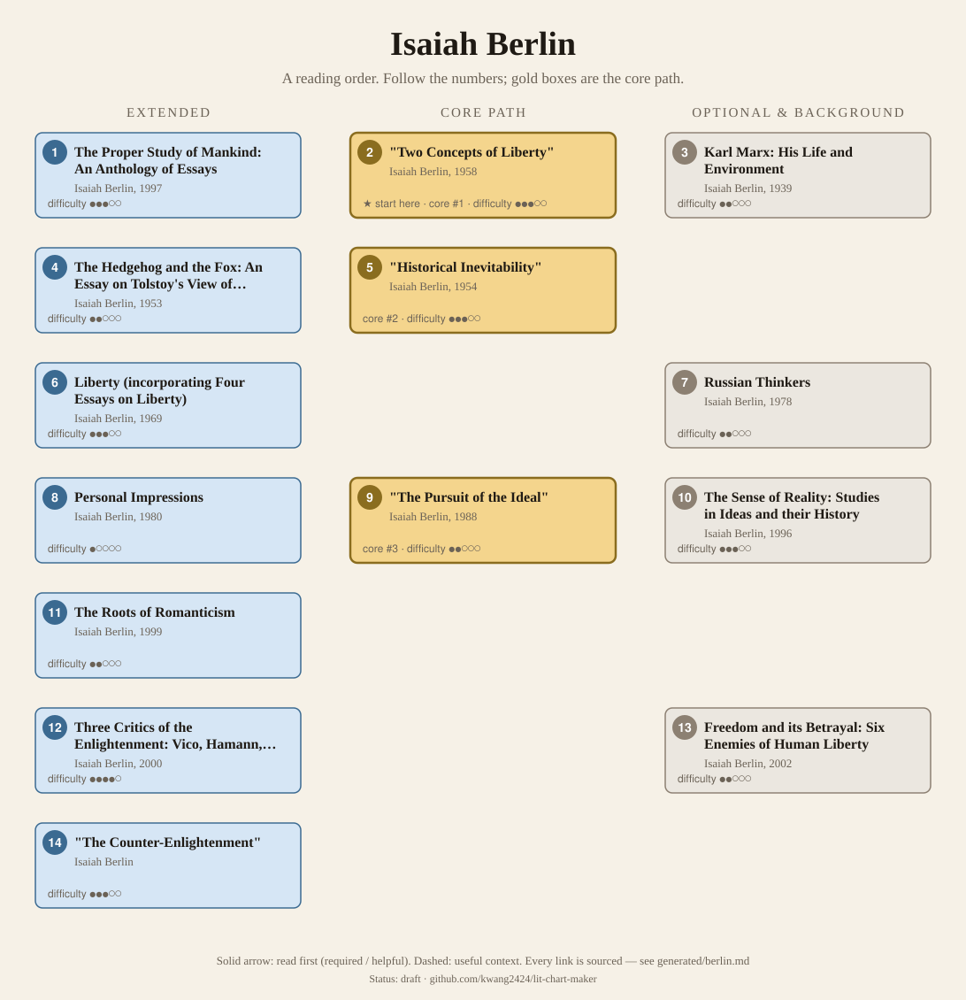

<!-- Generated by tools/build.py from lists/berlin.yaml. Do not edit by hand. -->
# Isaiah Berlin: reading order

**Status:** draft · **Citations checked:** 9/9

**Scope:** Berlin's main essays and books on liberty, pluralism and the history of ideas, with the anthologies that collect them. Most of his work is essays, many gathered by his editor Henry Hardy after the fact. Few public Berlin syllabi exist, so the survey has only two sources.

## Core path

The shortest route through the essentials.

1. **"Two Concepts of Liberty"** (1958) · difficulty ●●●○○ · ★ start here · first book in 1 surveyed source
2. **"Historical Inevitability"** (1954) · difficulty ●●●○○
3. **"The Pursuit of the Ideal"** (1988) · difficulty ●●○○○

## What the sources say

We surveyed 2 independent sources (1 scholarly guide and 1 course or teaching list) and recorded which books each one assigns or recommends, and where it starts.

| Book | Recommended by | First book in |
|---|---|---|
| The Proper Study of Mankind: An Anthology of Essays | 1/2 | 1 |
| "Two Concepts of Liberty" | 1/2 | 1 |
| "The Counter-Enlightenment" | 1/2 |  |
| The Hedgehog and the Fox: An Essay on Tolstoy's View of History | 1/2 |  |
| "Historical Inevitability" | 1/2 |  |
| Liberty (incorporating Four Essays on Liberty) | 1/2 |  |
| Personal Impressions | 1/2 |  |
| "The Pursuit of the Ideal" | 1/2 |  |
| The Sense of Reality: Studies in Ideas and their History | 1/2 |  |

**Sources surveyed**

- **Steven B. Smith, Yale University, HUM 329/PHIL 656: The Revival of Political Theory (Spring 2025)** [teaching]: "Two Concepts of Liberty" → "Historical Inevitability" → "The Pursuit of the Ideal" → "The Counter-Enlightenment" → The Sense of Reality: Studies in Ideas and their History. ✓ checked in Course page (coursetexts.org), accessed 2026-11
- **Henry Hardy (Berlin's editor), interviewed by Five Books, The Best Isaiah Berlin Books** [scholarly]: Liberty (incorporating Four Essays on Liberty), The Proper Study of Mankind: An Anthology of Essays, Personal Impressions, The Hedgehog and the Fox: An Essay on Tolstoy's View of History. ✓ checked in Five Books interview (web page), accessed 2026-11

## Full path

Every work, in order. Extended and optional works are placed where they fit best.

### 1. The Proper Study of Mankind: An Anthology of Essays (1997)

`extended · primary · difficulty ●●●○○` · Isaiah Berlin (ed. Henry Hardy and Roger Hausheer)

A one-volume selection across his career. It holds "Two Concepts of Liberty", "Historical Inevitability", "Herder and the Enlightenment", "The Counter-Enlightenment" and "Winston Churchill in 1940", so it covers most of this list.

**Reading tips:**

- His editor: for "a serious person who wants to understand, across the whole range of his thought, what it is that Berlin is up to … The Proper Study of Mankind is the book I would start with." He advises beginning with "the more informal, personal essays before turning to the meatier, more philosophical pieces"; for less philosophical readers, Personal Impressions.
  - Henry Hardy (Berlin's editor), interviewed by Five Books, *The Best Isaiah Berlin Books*, on The Proper Study of Mankind [scholarly] ✓ checked in Five Books interview (web page), accessed 2026-11

### 2. "Two Concepts of Liberty" (1958)

`core · primary · difficulty ●●●○○` · Isaiah Berlin

His Oxford inaugural lecture: negative liberty ("freedom from" constraints imposed by others) and positive liberty (self-rule), which he argued had been subject to "greater and more sinister transformation" (SEP §5.1). Section VI discusses national self-rule. In Liberty and The Proper Study of Mankind.

**★ Good place to start.** The SEP calls it "Berlin's best-known contribution to political theory" and "one of the most influential and widely discussed texts" in the field; Yale's 2025 course opens its Berlin weeks with it.

- Stanford Encyclopedia of Philosophy (Joshua Cherniss and Henry Hardy), *"Isaiah Berlin"*, preamble; §5.1 The Concept of Liberty [scholarly] ✓ checked in SEP entry, accessed 2026-11
- Steven B. Smith, Yale University, *HUM 329/PHIL 656: The Revival of Political Theory (Spring 2025)*, week 2, "Freedom and Its Enemies" [teaching] ✓ checked in Course page (coursetexts.org), accessed 2026-11

**Read first:**

- *Groundwork of the Metaphysics of Morals* (from the [Immanuel Kant list](kant.md)) — *context*. Berlin traces positive liberty through Rousseau and Kant, who "identified 'positive' freedom with autonomy", to Kant's German successors.
  - Stanford Encyclopedia of Philosophy (Joshua Cherniss and Henry Hardy), *"Isaiah Berlin"*, §5.1 [scholarly] ✓ checked in SEP entry, accessed 2026-11
- *Lectures on the Philosophy of World History (esp. the Introduction)* (from the [G. W. F. Hegel list](hegel.md)) — *context*. It criticises Hegel's definition of liberty as "recognition of, and obedience to, the laws of history as revealed by reason".
  - Stanford Encyclopedia of Philosophy (Joshua Cherniss and Henry Hardy), *"Isaiah Berlin"*, §5.1 [scholarly] ✓ checked in SEP entry, accessed 2026-11

### 3. Karl Marx: His Life and Environment (1939)

`optional · primary · difficulty ●●○○○` · Isaiah Berlin

An intellectual biography of Marx.

**Translation:** 5th ed., ed. Hardy (Princeton 2013)

**Read first:**

- *Manifesto of the Communist Party* (from the [Karl Marx list](marx.md)) — *context*. It is an intellectual biography of Marx; the SEP notes it is still in print in its fifth edition (2013).
  - Stanford Encyclopedia of Philosophy (Joshua Cherniss and Henry Hardy), *"Isaiah Berlin"*, §1 Life [scholarly] ✓ checked in SEP entry, accessed 2026-11

### 4. The Hedgehog and the Fox: An Essay on Tolstoy's View of History (1953)

`extended · primary · difficulty ●●○○○` · Isaiah Berlin

An essay on Tolstoy's view of history. It divides thinkers into hedgehogs, who "pursue one single vision", and foxes, natural pluralists (Hardy). Also in Russian Thinkers.

### 5. "Historical Inevitability" (1954)

`core · primary · difficulty ●●●○○` · Isaiah Berlin

It "radically questioned" determinism and historical inevitability, and argued that belief in inevitability served as an "alibi" for evading responsibility (SEP §2.4). In Liberty and The Proper Study of Mankind.

### 6. Liberty (incorporating Four Essays on Liberty) (1969)

`extended · primary · difficulty ●●●○○` · Isaiah Berlin (ed. Henry Hardy)

Four Essays on Liberty (1969), expanded by Hardy in 2002 as Liberty: his principal essays on liberty, including "Two Concepts of Liberty" and "Historical Inevitability", with material on pluralism.

**Reading tips:**

- Asked for his most important book, Berlin named Four Essays on Liberty; Hardy: "I don't disagree with that."
  - Henry Hardy (Berlin's editor), interviewed by Five Books, *The Best Isaiah Berlin Books*, on Liberty [scholarly] ✓ checked in Five Books interview (web page), accessed 2026-11

### 7. Russian Thinkers (1978)

`optional · primary · difficulty ●●○○○` · Isaiah Berlin (ed. Henry Hardy and Aileen Kelly)

Essays on Russian writers and thinkers, including The Hedgehog and the Fox.

### 8. Personal Impressions (1980)

`extended · primary · difficulty ●○○○○` · Isaiah Berlin (ed. Henry Hardy)

Portraits of contemporaries. Hardy calls it "the most assimilable and digestible" of his books.

### 9. "The Pursuit of the Ideal" (1988)

`core · primary · difficulty ●●○○○` · Isaiah Berlin

His Agnelli Prize lecture explaining value pluralism, which the SEP calls "the most eloquent and concentrated summary of pluralism" (§4.3). In The Crooked Timber of Humanity (1990).

### 10. The Sense of Reality: Studies in Ideas and their History (1996)

`optional · primary · difficulty ●●●○○` · Isaiah Berlin (ed. Henry Hardy)

Includes the title essay and "Political Judgement", which Yale's course reads on political theory and judgement.

### 11. The Roots of Romanticism (1999)

`extended · primary · difficulty ●●○○○` · Isaiah Berlin (ed. Henry Hardy)

Lectures from 1965 (SEP), edited by Hardy.

### 12. Three Critics of the Enlightenment: Vico, Hamann, Herder (2000)

`extended · primary · difficulty ●●●●○` · Isaiah Berlin (ed. Henry Hardy)

Studies from 1960–5 (SEP). On Herder, Yale's course reads "Herder and the Enlightenment" in The Proper Study of Mankind.

### 13. Freedom and its Betrayal: Six Enemies of Human Liberty (2002)

`optional · primary · difficulty ●●○○○` · Isaiah Berlin (ed. Henry Hardy)

Lectures from 1952 (SEP), edited by Hardy.

### 14. "The Counter-Enlightenment"

`extended · primary · difficulty ●●●○○` · Isaiah Berlin

On the critics of the Enlightenment he called the "Counter-Enlightenment"; he was most interested in German Romanticism (SEP §3). In Against the Current and The Proper Study of Mankind.

## Map

Solid arrows: required or helpful. Dotted: context.

```mermaid
graph TD
  proper_study["The Proper Study of Mankind: An Anthology of Essays"]:::extended
  two_concepts["'Two Concepts of Liberty'"]:::core
  karl_marx["Karl Marx: His Life and Environment"]:::optional
  hedgehog_fox["The Hedgehog and the Fox: An Essay on Tolstoy's View of History"]:::extended
  historical_inevitability["'Historical Inevitability'"]:::core
  liberty["Liberty (incorporating Four Essays on Liberty)"]:::extended
  russian_thinkers["Russian Thinkers"]:::optional
  personal_impressions["Personal Impressions"]:::extended
  pursuit_ideal["'The Pursuit of the Ideal'"]:::core
  sense_of_reality["The Sense of Reality: Studies in Ideas and their History"]:::optional
  roots_romanticism["The Roots of Romanticism"]:::extended
  three_critics["Three Critics of the Enlightenment: Vico, Hamann, Herder"]:::extended
  freedom_betrayal["Freedom and its Betrayal: Six Enemies of Human Liberty"]:::optional
  counter_enlightenment["'The Counter-Enlightenment'"]:::extended
  classDef core fill:#f4d58d,stroke:#8a6d1f,color:#000
  classDef extended fill:#cfe3f5,stroke:#3b6a91,color:#000
  classDef optional fill:#eeeeee,stroke:#888,color:#000
```

## Connections

**Builds on**

- *Manifesto of the Communist Party* (Karl Marx) → *Karl Marx: His Life and Environment* — context. It is an intellectual biography of Marx; the SEP notes it is still in print in its fifth edition (2013).
- *Groundwork of the Metaphysics of Morals* (Immanuel Kant) → *"Two Concepts of Liberty"* — context. Berlin traces positive liberty through Rousseau and Kant, who "identified 'positive' freedom with autonomy", to Kant's German successors.
- *Lectures on the Philosophy of World History (esp. the Introduction)* (G. W. F. Hegel) → *"Two Concepts of Liberty"* — context. It criticises Hegel's definition of liberty as "recognition of, and obedience to, the laws of history as revealed by reason".

**Who builds on Isaiah Berlin**

- *"Two Concepts of Liberty"* → *Between Past and Future: Eight Exercises in Political Thought* (Hannah Arendt) — context. MacLachlan's course reads "What Is Freedom?" in the same session as Berlin's "Two Concepts of Liberty" (1958), the best-known modern statement of the question.

## Sources

- **[scholarly]** Henry Hardy (Berlin's editor), interviewed by Five Books, *The Best Isaiah Berlin Books* — <https://fivebooks.com/best-books/henry-hardy-on-isaiah-berlin/>
- **[scholarly]** Stanford Encyclopedia of Philosophy (Joshua Cherniss and Henry Hardy), *"Isaiah Berlin"* — <https://plato.stanford.edu/entries/berlin/>
- **[teaching]** Steven B. Smith, Yale University, *HUM 329/PHIL 656: The Revival of Political Theory (Spring 2025)* — <https://coursetexts.org/the-revival-of-political-theory-hum-329phil-656>
