<!-- Generated by tools/build.py from lists/deleuze.yaml. Do not edit by hand. -->
# Gilles Deleuze: reading order

**Status:** draft · **Citations checked:** 20/22

**Scope:** Deleuze's books, alone and with Félix Guattari, the philosophers he wrote about, and standard secondary guides. Links into the Nietzsche list mark where that list's books help.

> ⚠️ Some citations haven't been checked against the actual text yet. See [CONTRIBUTING.md](../CONTRIBUTING.md) to help verify them.

## Core path

The shortest route through the essentials.

1. **Nietzsche and Philosophy** (1962) · difficulty ●●●○○
2. **Bergsonism** (1966) · difficulty ●●●○○
3. **Difference and Repetition** (1968) · difficulty ●●●●●
4. **Anti-Oedipus (Capitalism and Schizophrenia, vol. 1)** (1972) · difficulty ●●●●○
5. **A Thousand Plateaus (Capitalism and Schizophrenia, vol. 2)** (1980) · difficulty ●●●●○

## Full path

Every work, in order. Extended and optional works are placed where they fit best.

### 1. Gilles Deleuze: An Introduction (2005)

`extended · secondary · difficulty ●●○○○` · Todd May

A readable overview organised around one question. Good before or alongside the first Deleuze book.

### 2. A Treatise of Human Nature (1739)

`optional · background · difficulty ●●●○○` · David Hume

Book I is the part that matters for Deleuze's first book.

### 3. Empiricism and Subjectivity (1953)

`optional · primary · difficulty ●●●○○` · Gilles Deleuze

His first book, on Hume.

**Read first:**

- *A Treatise of Human Nature* — *context*. It is a study of Hume.
  - Daniel Smith, John Protevi, Daniela Voss, *"Gilles Deleuze", Stanford Encyclopedia of Philosophy*, §1 Life and Works [scholarly] ✓ checked in SEP online (2022 revision), accessed 2026-11

### 4. Nietzsche and Philosophy (1962)

`core · primary · difficulty ●●●○○` · Gilles Deleuze

The book that made his name. Reads Nietzsche as completing and overturning Kant, and against Hegel. Useful even if you mostly care about Nietzsche.

**Translation:** Tomlinson (Columbia / Bloomsbury)

**Read first:**

- *On the Genealogy of Morality* (from the [Friedrich Nietzsche list](nietzsche.md)) — *helpful*. It reads the Genealogy's method and its "noble" forces as the core of Nietzsche's philosophy.
  - Daniel Smith, John Protevi, Daniela Voss, *"Gilles Deleuze", Stanford Encyclopedia of Philosophy*, §2 Deleuze's Readings of Other Philosophers [scholarly] ✓ checked in SEP online (2022 revision), accessed 2026-11

### 5. Time and Free Will; Creative Evolution (1889)

`optional · background · difficulty ●●●○○` · Henri Bergson

Where Deleuze gets "multiplicity" and "the virtual".

### 6. Proust and Signs (1964)

`optional · primary · difficulty ●●○○○` · Gilles Deleuze

### 7. Bergsonism (1966)

`core · primary · difficulty ●●●○○` · Gilles Deleuze

Short. Introduces the virtual and multiplicity, the two ideas his later work runs on.

**Translation:** Tomlinson & Habberjam (Zone Books)

**Read first:**

- *Time and Free Will; Creative Evolution* — *context*. It builds on arguments from Bergson's Creative Evolution and Time and Free Will.
  - Daniel Smith, John Protevi, Daniela Voss, *"Gilles Deleuze", Stanford Encyclopedia of Philosophy*, §2 Deleuze's Readings of Other Philosophers [scholarly] ✓ checked in SEP online (2022 revision), accessed 2026-11

### 8. Ethics (1677)

`optional · background · difficulty ●●●●○` · Baruch Spinoza

### 9. Critique of Pure Reason (1781)

`optional · background · difficulty ●●●●●` · Immanuel Kant

Deleuze's whole project is a rewrite of Kant's. A good guide or summary is enough for most readers.

### 10. Kant's Critical Philosophy (1963)

`extended · primary · difficulty ●●●○○` · Gilles Deleuze

A short, dense survey of all three Critiques.

**Read first:**

- *Critique of Pure Reason* — *context*. It is a reading of Kant, and Deleuze's later work starts from this reading.
  - Daniel Smith, John Protevi, Daniela Voss, *"Gilles Deleuze", Stanford Encyclopedia of Philosophy*, §2 Deleuze's Readings of Other Philosophers [scholarly] ✓ checked in SEP online (2022 revision), accessed 2026-11

### 11. Expressionism in Philosophy: Spinoza (1968)

`extended · primary · difficulty ●●●●○` · Gilles Deleuze

His secondary doctoral thesis, written alongside Difference and Repetition.

**Read first:**

- *Ethics* — *context*. It is a reading of Spinoza, whom Deleuze called the "prince" of philosophers.
  - Daniel Smith, John Protevi, Daniela Voss, *"Gilles Deleuze", Stanford Encyclopedia of Philosophy*, §1 Life and Works; §2 [scholarly] ✓ checked in SEP online (2022 revision), accessed 2026-11

### 12. Difference and Repetition (1968)

`core · primary · difficulty ●●●●●` · Gilles Deleuze

His major solo work, and the hardest book on this list. Go slowly.

**Translation:** Patton (Columbia / Bloomsbury)

**Reading tips:**

- Chapter 3, "The Image of Thought", is the turning point from his readings of other philosophers to his own philosophy. Some readers start there.
  - Daniel Smith, John Protevi, Daniela Voss, *"Gilles Deleuze", Stanford Encyclopedia of Philosophy*, §3.1 Difference and Repetition [scholarly] ✓ checked in SEP online (2022 revision), accessed 2026-11

**Read first:**

- *Nietzsche and Philosophy* — *helpful*. His studies of other philosophers were "preliminary sketches" for this book, and he credited Nietzsche with getting him out of plain history of philosophy.
  - Daniel Smith, John Protevi, Daniela Voss, *"Gilles Deleuze", Stanford Encyclopedia of Philosophy*, §3.1 Difference and Repetition [scholarly] ✓ checked in SEP online (2022 revision), accessed 2026-11
  - Gilles Deleuze, *"Letter to a Harsh Critic" (1973), in Negotiations*, p. 6 [author] ⚠️ unverified
- *Bergsonism* — *helpful*. Bergsonism develops the virtual and multiplicity, which this book depends on.
  - Daniel Smith, John Protevi, Daniela Voss, *"Gilles Deleuze", Stanford Encyclopedia of Philosophy*, §2 Deleuze's Readings of Other Philosophers [scholarly] ✓ checked in SEP online (2022 revision), accessed 2026-11
- *Kant's Critical Philosophy* — *context*. The book is still a (rewritten) Kantian, transcendental project.
  - Daniel Smith, John Protevi, Daniela Voss, *"Gilles Deleuze", Stanford Encyclopedia of Philosophy*, §3.1 Difference and Repetition [scholarly] ✓ checked in SEP online (2022 revision), accessed 2026-11

### 13. The Logic of Sense (1969)

`extended · primary · difficulty ●●●●●` · Gilles Deleuze

On how meaning arises. Built from short "series"; draws on Lewis Carroll and the Stoics.

**Read first:**

- *Difference and Repetition* — *context*. His second major work of the late 1960s, continuing the philosophy of difference.
  - Daniel Smith, John Protevi, Daniela Voss, *"Gilles Deleuze", Stanford Encyclopedia of Philosophy*, §3.2 Logic of Sense [scholarly] ✓ checked in SEP online (2022 revision), accessed 2026-11

### 14. Freud and Marx (any good introduction to each)

`optional · background · difficulty ●●○○○`

Anti-Oedipus is a critique of both. Knowing the Oedipus complex and Marx's idea of production is enough.

### 15. Gilles Deleuze's Difference and Repetition: A Critical Introduction and Guide (2004)

`extended · secondary · difficulty ●●●○○` · James Williams

Best read alongside Difference and Repetition, chapter by chapter.

**Read first:**

- *Difference and Repetition* — *required*. It is a guide to Difference and Repetition.
  - James Williams, *Gilles Deleuze's Difference and Repetition: A Critical Introduction and Guide*, title [scholarly] ✓ checked in SEP bibliography entry

### 16. Anti-Oedipus (Capitalism and Schizophrenia, vol. 1) (1972)

`core · primary · difficulty ●●●●○` · Gilles Deleuze & Félix Guattari

Deliberately shocking in style. Foucault's preface to the English edition is a good way in.

**Translation:** Hurley, Seem & Lane (Minnesota / Penguin)

**Read first:**

- *Difference and Repetition* — *helpful*. The books with Guattari take the framework of Difference and Repetition and make it material and political.
  - Daniel Smith, John Protevi, Daniela Voss, *"Gilles Deleuze", Stanford Encyclopedia of Philosophy*, §4 Collaboration with Guattari [scholarly] ✓ checked in SEP online (2022 revision), accessed 2026-11
- *Freud and Marx (any good introduction to each)* — *context*. Its central idea, "desiring-production", is a critique of both Freud and Marx.
  - Daniel Smith, John Protevi, Daniela Voss, *"Gilles Deleuze", Stanford Encyclopedia of Philosophy*, §4.1 Anti-Oedipus [scholarly] ✓ checked in SEP online (2022 revision), accessed 2026-11

### 17. Kafka: Toward a Minor Literature (1975)

`optional · primary · difficulty ●●●○○` · Gilles Deleuze & Félix Guattari

### 18. Dialogues (with Claire Parnet) (1977)

`extended · primary · difficulty ●●○○○` · Gilles Deleuze & Claire Parnet

Conversational; covers his main ideas in his own voice.

### 19. Deleuze and Guattari's Anti-Oedipus: Introduction to Schizoanalysis (1999)

`optional · secondary · difficulty ●●●○○` · Eugene Holland

**Read first:**

- *Anti-Oedipus (Capitalism and Schizophrenia, vol. 1)* — *required*. It is a guide to Anti-Oedipus.
  - Eugene Holland, *Deleuze and Guattari's Anti-Oedipus: Introduction to Schizoanalysis*, title [scholarly] ✓ checked in SEP bibliography entry

### 20. A Thousand Plateaus (Capitalism and Schizophrenia, vol. 2) (1980)

`core · primary · difficulty ●●●●○` · Gilles Deleuze & Félix Guattari

Some consider it his masterwork alongside Difference and Repetition. Start with the introduction, "Rhizome".

**Translation:** Massumi (Minnesota)

**Reading tips:**

- The authors say the plateaus "may be read independently of one another, except the conclusion, which should be read at the end."
  - Gilles Deleuze & Félix Guattari, *A Thousand Plateaus ("Author's Note")*, Author's Note [author] ✓ checked in Massumi trans. (1987), The Anarchist Library edition

**Read first:**

- *Anti-Oedipus (Capitalism and Schizophrenia, vol. 1)* — *helpful*. It is the second volume of Capitalism and Schizophrenia and reworks the first.
  - Daniel Smith, John Protevi, Daniela Voss, *"Gilles Deleuze", Stanford Encyclopedia of Philosophy*, §4.2 A Thousand Plateaus [scholarly] ✓ checked in SEP online (2022 revision), accessed 2026-11

### 21. Monadology; Theodicy (1710)

`optional · background · difficulty ●●●○○` · G. W. Leibniz

### 22. Spinoza: Practical Philosophy (1981)

`optional · primary · difficulty ●●○○○` · Gilles Deleuze

A shorter companion to the Spinoza book, with a glossary of Spinoza's terms.

### 23. Francis Bacon: The Logic of Sensation (1981)

`optional · primary · difficulty ●●●○○` · Gilles Deleuze

### 24. Cinema 1: The Movement-Image (1983)

`optional · primary · difficulty ●●●●○` · Gilles Deleuze

Easier if you know the films he discusses.

### 25. Cinema 2: The Time-Image (1985)

`optional · primary · difficulty ●●●●○` · Gilles Deleuze

**Read first:**

- *Cinema 1: The Movement-Image* — *helpful*. The two volumes are one book on space and time in film.
  - Daniel Smith, John Protevi, Daniela Voss, *"Gilles Deleuze", Stanford Encyclopedia of Philosophy*, §5 Deleuze and the Arts [scholarly] ✓ checked in SEP online (2022 revision), accessed 2026-11

### 26. Foucault (1986)

`optional · primary · difficulty ●●●●○` · Gilles Deleuze

### 27. The Fold: Leibniz and the Baroque (1988)

`optional · primary · difficulty ●●●●○` · Gilles Deleuze

**Read first:**

- *Monadology; Theodicy* — *context*. It is a reading of Leibniz, built around the concept of the fold.
  - Daniel Smith, John Protevi, Daniela Voss, *"Gilles Deleuze", Stanford Encyclopedia of Philosophy*, §2 Deleuze's Readings of Other Philosophers [scholarly] ✓ checked in SEP online (2022 revision), accessed 2026-11

### 28. Negotiations (1990)

`extended · primary · difficulty ●●○○○` · Gilles Deleuze

Interviews and short pieces, including "Letter to a Harsh Critic", where he explains his path. Good to dip into at any point.

### 29. What Is Philosophy? (1991)

`extended · primary · difficulty ●●●○○` · Gilles Deleuze & Félix Guattari

Philosophy as the creation of concepts, compared with science and art.

**Read first:**

- *A Thousand Plateaus (Capitalism and Schizophrenia, vol. 2)* — *context*. Their last collaboration, after a long gap.
  - Daniel Smith, John Protevi, Daniela Voss, *"Gilles Deleuze", Stanford Encyclopedia of Philosophy*, §4.3 What is Philosophy? [scholarly] ✓ checked in SEP online (2022 revision), accessed 2026-11

### 30. A User's Guide to Capitalism and Schizophrenia (1992)

`optional · secondary · difficulty ●●●○○` · Brian Massumi

By the translator of A Thousand Plateaus.

**Read first:**

- *Anti-Oedipus (Capitalism and Schizophrenia, vol. 1)* — *required*. It is a guide to the two-volume Capitalism and Schizophrenia.
  - Brian Massumi, *A User's Guide to Capitalism and Schizophrenia*, title [scholarly] ✓ checked in SEP bibliography entry
- *A Thousand Plateaus (Capitalism and Schizophrenia, vol. 2)* — *context*. It covers both volumes, though it leans on A Thousand Plateaus.
  - Brian Massumi, *A User's Guide to Capitalism and Schizophrenia*, title [scholarly] ⚠️ unverified

## Map

Solid arrows: required or helpful. Dotted: context.

```mermaid
graph TD
  may_intro["Gilles Deleuze: An Introduction"]:::extended
  hume_treatise["A Treatise of Human Nature"]:::optional
  empiricism_subjectivity["Empiricism and Subjectivity"]:::optional
  nietzsche_and_philosophy["Nietzsche and Philosophy"]:::core
  bergson["Time and Free Will; Creative Evolution"]:::optional
  proust_signs["Proust and Signs"]:::optional
  bergsonism["Bergsonism"]:::core
  spinoza_ethics["Ethics"]:::optional
  kant_cpr["Critique of Pure Reason"]:::optional
  kants_critical_philosophy["Kant's Critical Philosophy"]:::extended
  expressionism_spinoza["Expressionism in Philosophy: Spinoza"]:::extended
  difference_and_repetition["Difference and Repetition"]:::core
  logic_of_sense["The Logic of Sense"]:::extended
  freud_marx["Freud and Marx (any good introduction to each)"]:::optional
  williams_dr_guide["Gilles Deleuze's Difference and Repetition: A Critical Introduction and Guide"]:::extended
  anti_oedipus["Anti-Oedipus (Capitalism and Schizophrenia, vol. 1)"]:::core
  kafka["Kafka: Toward a Minor Literature"]:::optional
  dialogues["Dialogues (with Claire Parnet)"]:::extended
  holland_ao_guide["Deleuze and Guattari's Anti-Oedipus: Introduction to Schizoanalysis"]:::optional
  thousand_plateaus["A Thousand Plateaus (Capitalism and Schizophrenia, vol. 2)"]:::core
  leibniz["Monadology; Theodicy"]:::optional
  spinoza_practical["Spinoza: Practical Philosophy"]:::optional
  francis_bacon["Francis Bacon: The Logic of Sensation"]:::optional
  cinema_1["Cinema 1: The Movement-Image"]:::optional
  cinema_2["Cinema 2: The Time-Image"]:::optional
  foucault["Foucault"]:::optional
  the_fold["The Fold: Leibniz and the Baroque"]:::optional
  negotiations["Negotiations"]:::extended
  what_is_philosophy["What Is Philosophy?"]:::extended
  massumi_guide["A User's Guide to Capitalism and Schizophrenia"]:::optional
  hume_treatise -.-> empiricism_subjectivity
  kant_cpr -.-> kants_critical_philosophy
  bergson -.-> bergsonism
  spinoza_ethics -.-> expressionism_spinoza
  nietzsche_and_philosophy --> difference_and_repetition
  bergsonism --> difference_and_repetition
  kants_critical_philosophy -.-> difference_and_repetition
  difference_and_repetition -.-> logic_of_sense
  difference_and_repetition --> anti_oedipus
  freud_marx -.-> anti_oedipus
  anti_oedipus --> thousand_plateaus
  cinema_1 --> cinema_2
  leibniz -.-> the_fold
  thousand_plateaus -.-> what_is_philosophy
  difference_and_repetition --> williams_dr_guide
  anti_oedipus --> holland_ao_guide
  anti_oedipus --> massumi_guide
  thousand_plateaus -.-> massumi_guide
  classDef core fill:#f4d58d,stroke:#8a6d1f,color:#000
  classDef extended fill:#cfe3f5,stroke:#3b6a91,color:#000
  classDef optional fill:#eeeeee,stroke:#888,color:#000
```

## Sources

- **[author]** Gilles Deleuze & Félix Guattari, *A Thousand Plateaus ("Author's Note")*, 1980
- **[author]** Gilles Deleuze, *"Letter to a Harsh Critic" (1973), in Negotiations*, Columbia University Press, 1995
- **[scholarly]** Eugene Holland, *Deleuze and Guattari's Anti-Oedipus: Introduction to Schizoanalysis*, Routledge, 1999
- **[scholarly]** Brian Massumi, *A User's Guide to Capitalism and Schizophrenia*, MIT Press, 1992
- **[scholarly]** Daniel Smith, John Protevi, Daniela Voss, *"Gilles Deleuze", Stanford Encyclopedia of Philosophy* — <https://plato.stanford.edu/entries/deleuze/>
- **[scholarly]** James Williams, *Gilles Deleuze's Difference and Repetition: A Critical Introduction and Guide*, Edinburgh University Press, 2004
