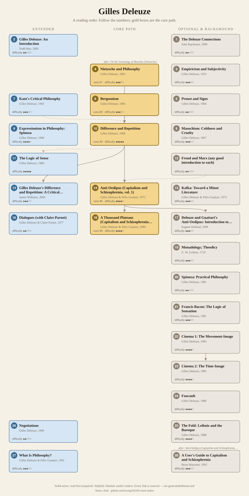

<!-- Generated by tools/build.py from lists/deleuze.yaml. Do not edit by hand. -->
# Gilles Deleuze: reading order

**Status:** draft · **Citations checked:** 39/39

**Scope:** Deleuze's books, alone and with Félix Guattari, the philosophers he wrote about, and standard secondary guides. Links into the Nietzsche list mark where that list's books help.

## Core path

The shortest route through the essentials.

1. **Nietzsche and Philosophy** (1962) · difficulty ●●●○○
2. **Bergsonism** (1966) · difficulty ●●●○○ · first book in 1 surveyed source
3. **Difference and Repetition** (1968) · difficulty ●●●●● · first book in 1 surveyed source
4. **Anti-Oedipus (Capitalism and Schizophrenia, vol. 1)** (1972) · difficulty ●●●●○ · first book in 2 surveyed sources
5. **A Thousand Plateaus (Capitalism and Schizophrenia, vol. 2)** (1980) · difficulty ●●●●○

## What the sources say

We surveyed 4 independent sources (4 course syllabi and teaching lists) and recorded which books each one assigns or recommends, and where it starts.

| Book | Recommended by | First book in |
|---|---|---|
| Anti-Oedipus (Capitalism and Schizophrenia, vol. 1) | 3/4 | 2 |
| Difference and Repetition | 2/4 | 1 |
| The Logic of Sense | 2/4 |  |
| A Thousand Plateaus (Capitalism and Schizophrenia, vol. 2) | 2/4 |  |
| Bergsonism | 1/4 | 1 |
| Masochism: Coldness and Cruelty | 1/4 |  |
| Dialogues (with Claire Parnet) | 1/4 |  |
| Foucault | 1/4 |  |
| Francis Bacon: The Logic of Sensation | 1/4 |  |
| Kant's Critical Philosophy | 1/4 |  |
| Negotiations | 1/4 |  |
| Nietzsche and Philosophy | 1/4 |  |
| Proust and Signs | 1/4 |  |
| What Is Philosophy? | 1/4 |  |

**Sources surveyed**

- **John Protevi, Louisiana State University, French 7410: Deleuze and Guattari (Fall 2013)** [teaching]: Anti-Oedipus (Capitalism and Schizophrenia, vol. 1) → A Thousand Plateaus (Capitalism and Schizophrenia, vol. 2). ✓ checked in Course syllabus (PDF), accessed 2026-11
- **Colin Koopman, University of Oregon, PHIL 463/563: Michel Foucault & Gilles Deleuze (Fall 2012)** [teaching]: Bergsonism → Difference and Repetition → The Logic of Sense → Masochism: Coldness and Cruelty → Anti-Oedipus (Capitalism and Schizophrenia, vol. 1). ✓ checked in Course syllabus (PDF), accessed 2026-11
- **Thomas Nail, University of Denver, PHIL 2145: Between Deleuze and Foucault (Spring 2013)** [teaching]: Anti-Oedipus (Capitalism and Schizophrenia, vol. 1) → A Thousand Plateaus (Capitalism and Schizophrenia, vol. 2) → Negotiations → Foucault. ✓ checked in Course syllabus (PDF), accessed 2026-11
- **Emma Ingala Gómez, Universidad Complutense de Madrid, Current Approaches in Philosophy I: Deleuze (2015–16)** [teaching]: Difference and Repetition, Nietzsche and Philosophy, Kant's Critical Philosophy, Proust and Signs, The Logic of Sense, Francis Bacon: The Logic of Sensation, Dialogues (with Claire Parnet), What Is Philosophy?. ✓ checked in Course syllabus (PDF), accessed 2026-11

## Full path

Every work, in order. Extended and optional works are placed where they fit best.

### 1. The Deleuze Connections (2000)

`optional · secondary · difficulty ●●○○○` · John Rajchman

**Reading tips:**

- The IEP calls it a good text that deals systematically with the whole body of Deleuze's work and is "quite easy to read".
  - Internet Encyclopedia of Philosophy, *"Gilles Deleuze (1925–1995)"*, §8b Secondary texts [scholarly] ✓ checked in IEP online, accessed 2026-11

### 2. Gilles Deleuze: An Introduction (2005)

`extended · secondary · difficulty ●●○○○` · Todd May

A readable overview organised around one question. Good before or alongside the first Deleuze book.

### 3. Empiricism and Subjectivity (1953)

`optional · primary · difficulty ●●●○○` · Gilles Deleuze

His first book, on Hume.

**Read first:**

- *A Treatise of Human Nature* (from the [David Hume list](hume.md)) — *context*. It is a study of Hume.
  - Daniel Smith, John Protevi, Daniela Voss, *"Gilles Deleuze", Stanford Encyclopedia of Philosophy*, §1 Life and Works [scholarly] ✓ checked in SEP online (2022 revision), accessed 2026-11

### 4. Nietzsche and Philosophy (1962)

`core · primary · difficulty ●●●○○` · Gilles Deleuze

The book that made his name. Reads Nietzsche as completing and overturning Kant, and against Hegel. Useful even if you mostly care about Nietzsche.

*Why this tier:* Kept in the core path although only one surveyed course assigns it: most courses found pair Deleuze with Foucault and skip his early monographs, which the SEP calls "preliminary sketches" for Difference and Repetition.

**Translation:** Tomlinson (Columbia / Bloomsbury)

**Read first:**

- *Phenomenology of Spirit* (from the [G. W. F. Hegel list](hegel.md)) — *context*. It is written against Hegel: the SEP describes Deleuze's early books as trying to "accelerate however he could a departure from Hegel".
  - Daniel Smith, John Protevi, Daniela Voss, *"Gilles Deleuze", Stanford Encyclopedia of Philosophy*, §2 Deleuze's Readings of Other Philosophers [scholarly] ✓ checked in SEP online (2022 revision), accessed 2026-11
- *On the Genealogy of Morality* (from the [Friedrich Nietzsche list](nietzsche.md)) — *helpful*. It reads the Genealogy's method and its "noble" forces as the core of Nietzsche's philosophy.
  - Daniel Smith, John Protevi, Daniela Voss, *"Gilles Deleuze", Stanford Encyclopedia of Philosophy*, §2 Deleuze's Readings of Other Philosophers [scholarly] ✓ checked in SEP online (2022 revision), accessed 2026-11

### 5. Proust and Signs (1964)

`optional · primary · difficulty ●●○○○` · Gilles Deleuze

### 6. Bergsonism (1966)

`core · primary · difficulty ●●●○○` · Gilles Deleuze

Short. Introduces the virtual and multiplicity, the two ideas his later work runs on.

*Why this tier:* Kept in the core path although only one surveyed course assigns it: most courses found pair Deleuze with Foucault and skip his early monographs, which the SEP calls "preliminary sketches" for Difference and Repetition.

**Translation:** Tomlinson & Habberjam (Zone Books)

**Read first:**

- *Time and Free Will: An Essay on the Immediate Data of Consciousness* (from the [Henri Bergson list](bergson.md)) — *context*. It builds on arguments from Bergson's Creative Evolution and Time and Free Will.
  - Daniel Smith, John Protevi, Daniela Voss, *"Gilles Deleuze", Stanford Encyclopedia of Philosophy*, §2 Deleuze's Readings of Other Philosophers [scholarly] ✓ checked in SEP online (2022 revision), accessed 2026-11
- *Creative Evolution* (from the [Henri Bergson list](bergson.md)) — *context*. It builds on arguments from Bergson's Creative Evolution and Time and Free Will.
  - Daniel Smith, John Protevi, Daniela Voss, *"Gilles Deleuze", Stanford Encyclopedia of Philosophy*, §2 Deleuze's Readings of Other Philosophers [scholarly] ✓ checked in SEP online (2022 revision), accessed 2026-11

### 7. Kant's Critical Philosophy (1963)

`extended · primary · difficulty ●●●○○` · Gilles Deleuze

A short, dense survey of all three Critiques.

**Read first:**

- *Critique of Pure Reason* (from the [Immanuel Kant list](kant.md)) — *context*. It is a reading of Kant, and Deleuze's later work starts from this reading.
  - Daniel Smith, John Protevi, Daniela Voss, *"Gilles Deleuze", Stanford Encyclopedia of Philosophy*, §2 Deleuze's Readings of Other Philosophers [scholarly] ✓ checked in SEP online (2022 revision), accessed 2026-11

### 8. Masochism: Coldness and Cruelty (1967)

`optional · primary · difficulty ●●●○○` · Gilles Deleuze

A reading of Sacher-Masoch against Sade; published with Venus in Furs.

### 9. Expressionism in Philosophy: Spinoza (1968)

`extended · primary · difficulty ●●●●○` · Gilles Deleuze

His secondary doctoral thesis, written alongside Difference and Repetition.

**Read first:**

- *Ethics* (from the [Baruch Spinoza list](spinoza.md)) — *context*. It is a reading of Spinoza, whom Deleuze called the "prince" of philosophers.
  - Daniel Smith, John Protevi, Daniela Voss, *"Gilles Deleuze", Stanford Encyclopedia of Philosophy*, §1 Life and Works; §2 [scholarly] ✓ checked in SEP online (2022 revision), accessed 2026-11

### 10. Difference and Repetition (1968)

`core · primary · difficulty ●●●●●` · Gilles Deleuze

His major solo work, and the hardest book on this list. Go slowly.

**Translation:** Patton (Columbia / Bloomsbury)

**Reading tips:**

- Chapter 3, "The Image of Thought", is the turning point from his readings of other philosophers to his own philosophy. Some readers start there, and at least one university course is built around it.
  - Emma Ingala Gómez, Universidad Complutense de Madrid, *Current Approaches in Philosophy I: Deleuze (2015–16)*, course description [teaching] ✓ checked in Course syllabus (PDF), accessed 2026-11
  - Daniel Smith, John Protevi, Daniela Voss, *"Gilles Deleuze", Stanford Encyclopedia of Philosophy*, §3.1 Difference and Repetition [scholarly] ✓ checked in SEP online (2022 revision), accessed 2026-11

**Read first:**

- *Republic* (from the [Plato list](plato.md)) — *context*. It attacks Plato's three-tiered system of Idea, copy and simulacrum (DR 59–63).
  - Internet Encyclopedia of Philosophy, *"Gilles Deleuze (1925–1995)"*, §4 Difference and Repetition [scholarly] ✓ checked in IEP online, accessed 2026-11
- *Nietzsche and Philosophy* — *helpful*. His studies of other philosophers were "preliminary sketches" for this book, and he said "It was Nietzsche who extricated me" from academic history of philosophy.
  - Daniel Smith, John Protevi, Daniela Voss, *"Gilles Deleuze", Stanford Encyclopedia of Philosophy*, §3.1 Difference and Repetition [scholarly] ✓ checked in SEP online (2022 revision), accessed 2026-11
  - Wendy Grace, *"Foucault and Deleuze: Making a Difference with Nietzsche", Foucault Studies 17*, p. 99 (quoting Deleuze, "Letter to a Harsh Critic", Negotiations p. 6) [scholarly] ✓ checked in Foucault Studies 17 (2014), open-access PDF
- *Bergsonism* — *helpful*. Bergsonism develops the virtual and multiplicity, which this book depends on.
  - Daniel Smith, John Protevi, Daniela Voss, *"Gilles Deleuze", Stanford Encyclopedia of Philosophy*, §2 Deleuze's Readings of Other Philosophers [scholarly] ✓ checked in SEP online (2022 revision), accessed 2026-11
- *Kant's Critical Philosophy* — *context*. The book is still a (rewritten) Kantian, transcendental project.
  - Daniel Smith, John Protevi, Daniela Voss, *"Gilles Deleuze", Stanford Encyclopedia of Philosophy*, §3.1 Difference and Repetition [scholarly] ✓ checked in SEP online (2022 revision), accessed 2026-11

### 11. The Logic of Sense (1969)

`extended · primary · difficulty ●●●●●` · Gilles Deleuze

On how meaning arises. Built from short "series"; draws on Lewis Carroll and the Stoics.

**Read first:**

- *Republic* (from the [Plato list](plato.md)) — *context*. It attacks Plato's three-tiered system of Idea, copy and simulacrum (the appendix, LS 253–65).
  - Internet Encyclopedia of Philosophy, *"Gilles Deleuze (1925–1995)"*, §4 Difference and Repetition [scholarly] ✓ checked in IEP online, accessed 2026-11
- *Difference and Repetition* — *context*. His second major work of the late 1960s, continuing the philosophy of difference.
  - Daniel Smith, John Protevi, Daniela Voss, *"Gilles Deleuze", Stanford Encyclopedia of Philosophy*, §3.2 Logic of Sense [scholarly] ✓ checked in SEP online (2022 revision), accessed 2026-11

### 12. Gilles Deleuze's Difference and Repetition: A Critical Introduction and Guide (2004)

`extended · secondary · difficulty ●●●○○` · James Williams

Best read alongside Difference and Repetition, chapter by chapter.

**Read first:**

- *Difference and Repetition* — *required*. It is a guide to Difference and Repetition.
  - James Williams, *Gilles Deleuze's Difference and Repetition: A Critical Introduction and Guide*, title [scholarly] ✓ checked in SEP bibliography entry

### 13. Anti-Oedipus (Capitalism and Schizophrenia, vol. 1) (1972)

`core · primary · difficulty ●●●●○` · Gilles Deleuze & Félix Guattari

Deliberately shocking in style. The English edition has a preface by Foucault.

**Translation:** Hurley, Seem & Lane (Minnesota / Penguin)

**Read first:**

- *Difference and Repetition* — *helpful*. The books with Guattari take the framework of Difference and Repetition and make it material and political.
  - Daniel Smith, John Protevi, Daniela Voss, *"Gilles Deleuze", Stanford Encyclopedia of Philosophy*, §4 Collaboration with Guattari [scholarly] ✓ checked in SEP online (2022 revision), accessed 2026-11
- *On the Genealogy of Morality* (from the [Friedrich Nietzsche list](nietzsche.md)) — *context*. A Deleuze and Guattari course recommends reading Nietzsche's Genealogy beforehand, and assigns it alongside Anti-Oedipus.
  - John Protevi, Louisiana State University, *French 7410: Deleuze and Guattari (Fall 2013)*, Suggested Readings; schedule week 4 [teaching] ✓ checked in Course page and syllabus PDF, accessed 2026-11
- *Preface to A Contribution to the Critique of Political Economy* (from the [Karl Marx list](marx.md)) — *context*. Its central idea, "desiring-production", is a critique of both Marx and Freud. A Deleuze and Guattari course suggests reading Marx's 1859 Preface beforehand.
  - John Protevi, Louisiana State University, *French 7410: Deleuze and Guattari (Fall 2013)*, Suggested Readings [teaching] ✓ checked in Course page, accessed 2026-11
  - Daniel Smith, John Protevi, Daniela Voss, *"Gilles Deleuze", Stanford Encyclopedia of Philosophy*, §4.1 Anti-Oedipus [scholarly] ✓ checked in SEP online (2022 revision), accessed 2026-11
- *Value, Price and Profit* (from the [Karl Marx list](marx.md)) — *context*. The same course also suggests Marx's Value, Price and Profit as preparation.
  - John Protevi, Louisiana State University, *French 7410: Deleuze and Guattari (Fall 2013)*, Suggested Readings [teaching] ✓ checked in Course page, accessed 2026-11
- *Three Essays on the Theory of Sexuality* (from the [Sigmund Freud list](freud.md)) — *context*. The Freud side of its critique: the same course suggests Freud's Three Essays on sexuality as preparation.
  - John Protevi, Louisiana State University, *French 7410: Deleuze and Guattari (Fall 2013)*, Suggested Readings [teaching] ✓ checked in Course page, accessed 2026-11
  - Daniel Smith, John Protevi, Daniela Voss, *"Gilles Deleuze", Stanford Encyclopedia of Philosophy*, §4.1 Anti-Oedipus [scholarly] ✓ checked in SEP online (2022 revision), accessed 2026-11

### 14. Kafka: Toward a Minor Literature (1975)

`optional · primary · difficulty ●●●○○` · Gilles Deleuze & Félix Guattari

### 15. Dialogues (with Claire Parnet) (1977)

`extended · primary · difficulty ●●○○○` · Gilles Deleuze & Claire Parnet

Conversational; covers his main ideas in his own voice.

### 16. Deleuze and Guattari's Anti-Oedipus: Introduction to Schizoanalysis (1999)

`optional · secondary · difficulty ●●●○○` · Eugene Holland

**Read first:**

- *Anti-Oedipus (Capitalism and Schizophrenia, vol. 1)* — *required*. It is a guide to Anti-Oedipus.
  - Eugene Holland, *Deleuze and Guattari's Anti-Oedipus: Introduction to Schizoanalysis*, title [scholarly] ✓ checked in SEP bibliography entry

### 17. A Thousand Plateaus (Capitalism and Schizophrenia, vol. 2) (1980)

`core · primary · difficulty ●●●●○` · Gilles Deleuze & Félix Guattari

Some consider it his masterwork alongside Difference and Repetition. Start with the introduction, "Rhizome".

**Translation:** Massumi (Minnesota)

**Reading tips:**

- The authors say the plateaus "may be read independently of one another, except the conclusion, which should be read at the end."
  - Gilles Deleuze & Félix Guattari, *A Thousand Plateaus ("Author's Note")*, Author's Note [author] ✓ checked in Massumi trans. (1987), The Anarchist Library edition

**Read first:**

- *Anti-Oedipus (Capitalism and Schizophrenia, vol. 1)* — *helpful*. It is the second volume of Capitalism and Schizophrenia and reworks the first.
  - Daniel Smith, John Protevi, Daniela Voss, *"Gilles Deleuze", Stanford Encyclopedia of Philosophy*, §4.2 A Thousand Plateaus [scholarly] ✓ checked in SEP online (2022 revision), accessed 2026-11

### 18. Monadology; Theodicy (1710)

`optional · background · difficulty ●●●○○` · G. W. Leibniz

### 19. Spinoza: Practical Philosophy (1981)

`optional · primary · difficulty ●●○○○` · Gilles Deleuze

A shorter companion to the Spinoza book, with a glossary of Spinoza's terms.

### 20. Francis Bacon: The Logic of Sensation (1981)

`optional · primary · difficulty ●●●○○` · Gilles Deleuze

### 21. Cinema 1: The Movement-Image (1983)

`optional · primary · difficulty ●●●●○` · Gilles Deleuze

Easier if you know the films he discusses.

### 22. Cinema 2: The Time-Image (1985)

`optional · primary · difficulty ●●●●○` · Gilles Deleuze

**Read first:**

- *Cinema 1: The Movement-Image* — *helpful*. The two volumes are one book on space and time in film.
  - Daniel Smith, John Protevi, Daniela Voss, *"Gilles Deleuze", Stanford Encyclopedia of Philosophy*, §5 Deleuze and the Arts [scholarly] ✓ checked in SEP online (2022 revision), accessed 2026-11

### 23. Foucault (1986)

`optional · primary · difficulty ●●●●○` · Gilles Deleuze

### 24. The Fold: Leibniz and the Baroque (1988)

`optional · primary · difficulty ●●●●○` · Gilles Deleuze

**Read first:**

- *Monadology; Theodicy* — *context*. It is a reading of Leibniz, built around the concept of the fold.
  - Daniel Smith, John Protevi, Daniela Voss, *"Gilles Deleuze", Stanford Encyclopedia of Philosophy*, §2 Deleuze's Readings of Other Philosophers [scholarly] ✓ checked in SEP online (2022 revision), accessed 2026-11

### 25. Negotiations (1990)

`extended · primary · difficulty ●●○○○` · Gilles Deleuze

Interviews and short pieces, including "Letter to a Harsh Critic", where he explains his path. Good to dip into at any point.

### 26. What Is Philosophy? (1991)

`extended · primary · difficulty ●●●○○` · Gilles Deleuze & Félix Guattari

Philosophy as the creation of concepts, compared with science and art.

**Read first:**

- *A Thousand Plateaus (Capitalism and Schizophrenia, vol. 2)* — *context*. Their last collaboration, after a long gap.
  - Daniel Smith, John Protevi, Daniela Voss, *"Gilles Deleuze", Stanford Encyclopedia of Philosophy*, §4.3 What is Philosophy? [scholarly] ✓ checked in SEP online (2022 revision), accessed 2026-11

### 27. A User's Guide to Capitalism and Schizophrenia (1992)

`optional · secondary · difficulty ●●●○○` · Brian Massumi

By the translator of A Thousand Plateaus.

**Reading tips:**

- The IEP calls it "perhaps the best known and most consistent" commentary on Capitalism and Schizophrenia, while warning that all secondary texts in this area are very difficult.
  - Internet Encyclopedia of Philosophy, *"Gilles Deleuze (1925–1995)"*, §8b Secondary texts [scholarly] ✓ checked in IEP online, accessed 2026-11

**Read first:**

- *Anti-Oedipus (Capitalism and Schizophrenia, vol. 1)* — *required*. It is a guide to the two-volume Capitalism and Schizophrenia.
  - Brian Massumi, *A User's Guide to Capitalism and Schizophrenia*, title [scholarly] ✓ checked in SEP bibliography entry
- *A Thousand Plateaus (Capitalism and Schizophrenia, vol. 2)* — *context*. It is a guide to all of Capitalism and Schizophrenia, and A Thousand Plateaus is that project's second volume.
  - Brian Massumi, *A User's Guide to Capitalism and Schizophrenia*, title [scholarly] ✓ checked in SEP bibliography entry
  - Gilles Deleuze & Félix Guattari, *A Thousand Plateaus ("Author's Note")*, Authors' Note ("Together they make up Capitalism and Schizophrenia") [author] ✓ checked in Massumi trans. (1987), The Anarchist Library edition

## Map

Solid arrows: required or helpful. Dotted: context.

```mermaid
graph TD
  rajchman_connections["The Deleuze Connections"]:::optional
  may_intro["Gilles Deleuze: An Introduction"]:::extended
  empiricism_subjectivity["Empiricism and Subjectivity"]:::optional
  nietzsche_and_philosophy["Nietzsche and Philosophy"]:::core
  proust_signs["Proust and Signs"]:::optional
  bergsonism["Bergsonism"]:::core
  kants_critical_philosophy["Kant's Critical Philosophy"]:::extended
  coldness_cruelty["Masochism: Coldness and Cruelty"]:::optional
  expressionism_spinoza["Expressionism in Philosophy: Spinoza"]:::extended
  difference_and_repetition["Difference and Repetition"]:::core
  logic_of_sense["The Logic of Sense"]:::extended
  williams_dr_guide["Gilles Deleuze's Difference and Repetition: A Critical Introduction and Guide"]:::extended
  anti_oedipus["Anti-Oedipus (Capitalism and Schizophrenia, vol. 1)"]:::core
  kafka["Kafka: Toward a Minor Literature"]:::optional
  dialogues["Dialogues (with Claire Parnet)"]:::extended
  holland_ao_guide["Deleuze and Guattari's Anti-Oedipus: Introduction to Schizoanalysis"]:::optional
  thousand_plateaus["A Thousand Plateaus (Capitalism and Schizophrenia, vol. 2)"]:::core
  leibniz["Monadology; Theodicy"]:::optional
  spinoza_practical["Spinoza: Practical Philosophy"]:::optional
  francis_bacon["Francis Bacon: The Logic of Sensation"]:::optional
  cinema_1["Cinema 1: The Movement-Image"]:::optional
  cinema_2["Cinema 2: The Time-Image"]:::optional
  foucault["Foucault"]:::optional
  the_fold["The Fold: Leibniz and the Baroque"]:::optional
  negotiations["Negotiations"]:::extended
  what_is_philosophy["What Is Philosophy?"]:::extended
  massumi_guide["A User's Guide to Capitalism and Schizophrenia"]:::optional
  nietzsche_and_philosophy --> difference_and_repetition
  bergsonism --> difference_and_repetition
  kants_critical_philosophy -.-> difference_and_repetition
  difference_and_repetition -.-> logic_of_sense
  difference_and_repetition --> anti_oedipus
  anti_oedipus --> thousand_plateaus
  cinema_1 --> cinema_2
  leibniz -.-> the_fold
  thousand_plateaus -.-> what_is_philosophy
  difference_and_repetition --> williams_dr_guide
  anti_oedipus --> holland_ao_guide
  anti_oedipus --> massumi_guide
  thousand_plateaus -.-> massumi_guide
  classDef core fill:#f4d58d,stroke:#8a6d1f,color:#000
  classDef extended fill:#cfe3f5,stroke:#3b6a91,color:#000
  classDef optional fill:#eeeeee,stroke:#888,color:#000
```

## Sources

- **[author]** Gilles Deleuze & Félix Guattari, *A Thousand Plateaus ("Author's Note")*, 1980
- **[scholarly]** Wendy Grace, *"Foucault and Deleuze: Making a Difference with Nietzsche", Foucault Studies 17*, 2014 — <https://rauli.cbs.dk/index.php/foucault-studies/article/view/4255>
- **[scholarly]** Eugene Holland, *Deleuze and Guattari's Anti-Oedipus: Introduction to Schizoanalysis*, Routledge, 1999
- **[scholarly]** Internet Encyclopedia of Philosophy, *"Gilles Deleuze (1925–1995)"* — <https://iep.utm.edu/gilles-deleuze/>
- **[scholarly]** Brian Massumi, *A User's Guide to Capitalism and Schizophrenia*, MIT Press, 1992
- **[scholarly]** Daniel Smith, John Protevi, Daniela Voss, *"Gilles Deleuze", Stanford Encyclopedia of Philosophy* — <https://plato.stanford.edu/entries/deleuze/>
- **[scholarly]** James Williams, *Gilles Deleuze's Difference and Repetition: A Critical Introduction and Guide*, Edinburgh University Press, 2004
- **[teaching]** Thomas Nail, University of Denver, *PHIL 2145: Between Deleuze and Foucault (Spring 2013)* — <https://mysite.du.edu/~tnail2/Thomas_Nail/Teaching._files/Between%20Deleuze%20and%20Foucault%20(syllabus).pdf>
- **[teaching]** John Protevi, Louisiana State University, *French 7410: Deleuze and Guattari (Fall 2013)* — <https://protevi.com/john/DG/index.html>
- **[teaching]** Colin Koopman, University of Oregon, *PHIL 463/563: Michel Foucault & Gilles Deleuze (Fall 2012)* — <https://pages.uoregon.edu/uophil/files/syll_authors_fouc-dlz_cult_crit_FINAL.pdf>
- **[teaching]** Emma Ingala Gómez, Universidad Complutense de Madrid, *Current Approaches in Philosophy I: Deleuze (2015–16)* — <https://filosofia.ucm.es/data/cont/docs/25-2015-11-18-SYLLABUS%20Current%20Approaches%20in%20Philosophy%20I.pdf>
