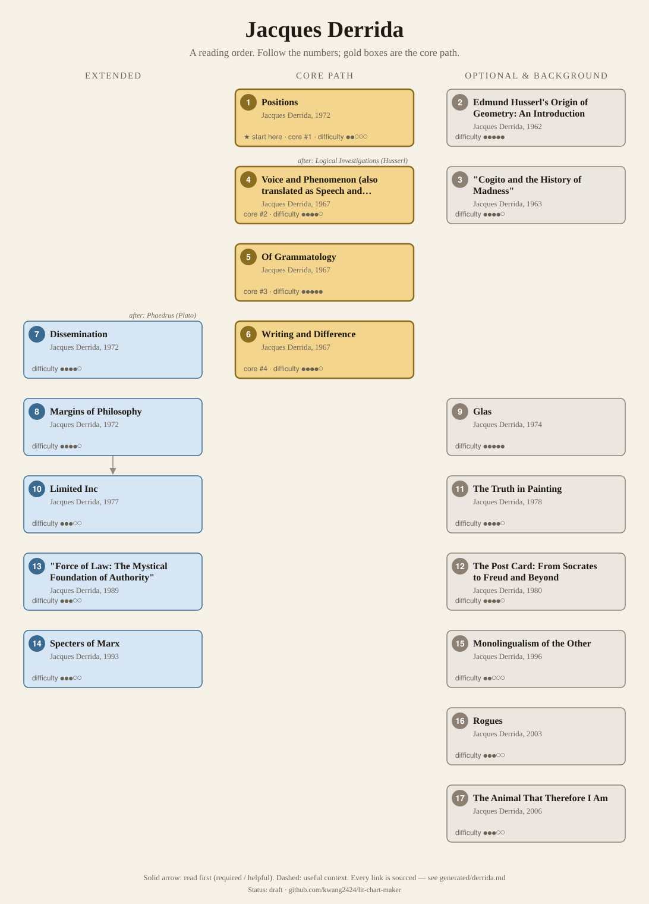

<!-- Generated by tools/build.py from lists/derrida.yaml. Do not edit by hand. -->
# Jacques Derrida: reading order

**Status:** draft · **Citations checked:** 10/10

**Scope:** Derrida's main books and essays: the three books of 1967, the 1972 collections and interviews, the experimental works of the 1970s, and the later writing on law, politics and religion. Years are first French publication, from the SEP.

## Core path

The shortest route through the essentials.

1. **Positions** (1972) · difficulty ●●○○○ · ★ start here · first book in 2 surveyed sources
2. **Voice and Phenomenon (also translated as Speech and Phenomena)** (1967) · difficulty ●●●●○ · first book in 1 surveyed source
3. **Writing and Difference** (1967) · difficulty ●●●●○
4. **Of Grammatology** (1967) · difficulty ●●●●●

## What the sources say

We surveyed 3 independent sources (3 course syllabi and teaching lists) and recorded which books each one assigns or recommends, and where it starts.

| Book | Recommended by | First book in |
|---|---|---|
| Positions | 3/3 | 2 |
| Dissemination | 2/3 |  |
| "Force of Law: The Mystical Foundation of Authority" | 2/3 |  |
| Of Grammatology | 2/3 |  |
| Voice and Phenomenon (also translated as Speech and Phenomena) | 1/3 | 1 |
| Limited Inc | 1/3 |  |
| Margins of Philosophy | 1/3 |  |
| Monolingualism of the Other | 1/3 |  |
| The Truth in Painting | 1/3 |  |
| Writing and Difference | 1/3 |  |

**Sources surveyed**

- **Beata Stawarska, University of Oregon, PHIL 463/563: Author: Jacques Derrida (Fall 2016)** [teaching]: Voice and Phenomenon (also translated as Speech and Phenomena) → Positions → Dissemination → Limited Inc → "Force of Law: The Mystical Foundation of Authority" → Monolingualism of the Other. ✓ checked in Course syllabus (PDF), accessed 2026-11
- **Deree – The American College of Greece, PH 4032: Postmodern Philosophy: Foucault and Derrida (updated Fall 2022)** [teaching]: Positions, Of Grammatology. ✓ checked in Course outline (PDF, updated Fall 2022), accessed 2026-11
- **Jon Roffe, Melbourne School of Continental Philosophy, Introduction to the Thought of Jacques Derrida (Summer School 2025)** [teaching]: Positions → Margins of Philosophy → Of Grammatology → The Truth in Painting → Dissemination → Writing and Difference → "Force of Law: The Mystical Foundation of Authority". ✓ checked in Course page, accessed 2026-11

## Full path

Every work, in order. Extended and optional works are placed where they fit best.

### 1. Positions (1972)

`core · primary · difficulty ●●○○○` · Jacques Derrida

Three interviews. The SEP takes one of its three "classical" definitions of deconstruction, as having "two phases", from "Positions".

**Translation:** Bass (Chicago 1981)

**★ Good place to start.** Short interviews in which Derrida explains deconstruction. The SEP draws its first classical definition of deconstruction from them, and two of the three courses found open with them.

- Stanford Encyclopedia of Philosophy, *"Jacques Derrida"*, §5 Deconstruction [scholarly] ✓ checked in SEP entry, accessed 2026-11
- Jon Roffe, Melbourne School of Continental Philosophy, *Introduction to the Thought of Jacques Derrida (Summer School 2025)*, lecture 1 readings ("Semiology and Grammatology", Positions) [teaching] ✓ checked in Course page, accessed 2026-11

### 2. Edmund Husserl's Origin of Geometry: An Introduction (1962)

`optional · primary · difficulty ●●●●●` · Jacques Derrida

A 150-page introduction to his translation of Husserl's "The Origin of Geometry", stressing the problem of language in Husserl's thought of history (SEP §1).

### 3. "Cogito and the History of Madness" (1963)

`optional · primary · difficulty ●●●●○` · Jacques Derrida

An essay written from a seminar taught by Foucault, on Foucault's History of Madness.

**Read first:**

- *History of Madness* (from the [Michel Foucault list](foucault.md)) — *context*. "Cogito and the History of Madness" criticises Foucault's early thought, especially his reading of Descartes, and caused a lasting rupture between them.
  - Stanford Encyclopedia of Philosophy, *"Jacques Derrida"*, §1 Life and Works [scholarly] ✓ checked in SEP entry, accessed 2026-11

### 4. Voice and Phenomenon (also translated as Speech and Phenomena) (1967)

`core · primary · difficulty ●●●●○` · Jacques Derrida

A deconstructive reading of Husserl's phenomenology of consciousness and its commitment to the primacy of the voice (Oregon), and of the present "now" (IEP §4). His main Husserl book; it drew many criticisms of his reading of Husserl (SEP §1).

**Translation:** Lawlor (Northwestern 2011)

**Read first:**

- *Logical Investigations* (from the [Edmund Husserl list](husserl.md)) — *helpful*. It reads Husserl's phenomenology; Oregon's course assigns Logical Investigations §§1–8 alongside its first chapters.
  - Beata Stawarska, University of Oregon, *PHIL 463/563: Author: Jacques Derrida (Fall 2016)*, weeks 1–2 [teaching] ✓ checked in Course syllabus (PDF), accessed 2026-11

### 5. Writing and Difference (1967)

`core · primary · difficulty ●●●●○` · Jacques Derrida

Essays including "Violence and Metaphysics" on Levinas, which the SEP calls a leading candidate for his most important early essay.

**Translation:** Bass (Chicago 1978)

### 6. Of Grammatology (1967)

`core · primary · difficulty ●●●●●` · Jacques Derrida

"His most famous work" (IEP §1): it reveals and then undermines the opposition of speech and writing, through readings of Saussure, Lévi-Strauss and Rousseau.

**Translation:** Spivak (Johns Hopkins 1974)

**Reading tips:**

- MSCP's introductory course reads an extract (pp. 6–15) and the remarks on ethnocentrism that open the book, rather than the whole.
  - Jon Roffe, Melbourne School of Continental Philosophy, *Introduction to the Thought of Jacques Derrida (Summer School 2025)*, lectures 2 and 4 [teaching] ✓ checked in Course page, accessed 2026-11

### 7. Dissemination (1972)

`extended · primary · difficulty ●●●●○` · Jacques Derrida

Includes "Plato's Pharmacy", on Plato's Phaedrus and the undecidable status of writing as a pharmakon (remedy and/or poison). Its preface gives the "two phases" definition of deconstruction (SEP §5).

**Translation:** Johnson (Chicago 1981)

**Read first:**

- *Phaedrus* (from the [Plato list](plato.md)) — *helpful*. "Plato's Pharmacy" is a reading of the Phaedrus; Oregon's course teaches it as "Reading Plato with Derrida".
  - Beata Stawarska, University of Oregon, *PHIL 463/563: Author: Jacques Derrida (Fall 2016)*, course description; weeks 3–5 [teaching] ✓ checked in Course syllabus (PDF), accessed 2026-11

### 8. Margins of Philosophy (1972)

`extended · primary · difficulty ●●●●○` · Jacques Derrida

Essays; the last is "Signature Event Context", on Austin's speech act theory, which started his dispute with John Searle (SEP §1).

### 9. Glas (1974)

`optional · primary · difficulty ●●●●●` · Jacques Derrida

Written in two columns, the left on Hegel and the right on Jean Genet; the clearest example of the style he developed in the 1970s (SEP §1).

### 10. Limited Inc (1977)

`extended · primary · difficulty ●●●○○` · Jacques Derrida

"Signature Event Context", John Searle's reply, and Derrida's ninety-page response "Limited Inc a b c" (1977). Oregon's edition adds an Afterword.

**Translation:** Weber (Northwestern 1988)

**Read first:**

- *Margins of Philosophy* — *helpful*. "Limited Inc a b c" answers Searle's reply to "Signature Event Context", the last essay in Margins.
  - Stanford Encyclopedia of Philosophy, *"Jacques Derrida"*, §1 Life and Works [scholarly] ✓ checked in SEP entry, accessed 2026-11

### 11. The Truth in Painting (1978)

`optional · primary · difficulty ●●●●○` · Jacques Derrida

Essays on art; the SEP dates his intensified reading of Heidegger from this book.

**Translation:** Bennington and McLeod (Chicago 1987)

### 12. The Post Card: From Socrates to Freud and Beyond (1980)

`optional · primary · difficulty ●●●●○` · Jacques Derrida

Its opening two hundred pages are love letters addressed to no one in particular (SEP §1).

### 13. "Force of Law: The Mystical Foundation of Authority" (1989)

`extended · primary · difficulty ●●●○○` · Jacques Derrida

Justice, law and three aporias of being just. The SEP sees his turn to politics and religion "first clearly evident" here. In Acts of Religion.

### 14. Specters of Marx (1993)

`extended · primary · difficulty ●●●○○` · Jacques Derrida

Argues that a deconstructed Marxist thought is still relevant despite globalization, as a messianism of a "democracy to come" (SEP §1).

**Translation:** Kamuf (Routledge 1994)

### 15. Monolingualism of the Other (1996)

`optional · primary · difficulty ●●○○○` · Jacques Derrida

Partly autobiographical: language, identity and his Algerian schooling under the Vichy regime's laws (SEP §1).

**Translation:** Mensah (Stanford 1998)

### 16. Rogues (2003)

`optional · primary · difficulty ●●●○○` · Jacques Derrida

On sovereignty and democracy; the law always contains the possibility of its suspension (SEP §1).

### 17. The Animal That Therefore I Am (2006)

`optional · primary · difficulty ●●●○○` · Jacques Derrida

Lectures from 1998 on animality; his first posthumous book (SEP §1).

## Map

Solid arrows: required or helpful. Dotted: context.

```mermaid
graph TD
  positions["Positions"]:::core
  origin_geometry["Edmund Husserl's Origin of Geometry: An Introduction"]:::optional
  cogito_madness["'Cogito and the History of Madness'"]:::optional
  voice_phenomenon["Voice and Phenomenon (also translated as Speech and Phenomena)"]:::core
  writing_difference["Writing and Difference"]:::core
  grammatology["Of Grammatology"]:::core
  dissemination["Dissemination"]:::extended
  margins["Margins of Philosophy"]:::extended
  glas["Glas"]:::optional
  limited_inc["Limited Inc"]:::extended
  truth_painting["The Truth in Painting"]:::optional
  postcard["The Post Card: From Socrates to Freud and Beyond"]:::optional
  force_of_law["'Force of Law: The Mystical Foundation of Authority'"]:::extended
  specters_marx["Specters of Marx"]:::extended
  monolingualism["Monolingualism of the Other"]:::optional
  rogues["Rogues"]:::optional
  animal["The Animal That Therefore I Am"]:::optional
  margins --> limited_inc
  classDef core fill:#f4d58d,stroke:#8a6d1f,color:#000
  classDef extended fill:#cfe3f5,stroke:#3b6a91,color:#000
  classDef optional fill:#eeeeee,stroke:#888,color:#000
```

## Connections

**Builds on**

- *Logical Investigations* (Edmund Husserl) → *Voice and Phenomenon (also translated as Speech and Phenomena)* — helpful. It reads Husserl's phenomenology; Oregon's course assigns Logical Investigations §§1–8 alongside its first chapters.
- *History of Madness* (Michel Foucault) → *"Cogito and the History of Madness"* — context. "Cogito and the History of Madness" criticises Foucault's early thought, especially his reading of Descartes, and caused a lasting rupture between them.
- *Phaedrus* (Plato) → *Dissemination* — helpful. "Plato's Pharmacy" is a reading of the Phaedrus; Oregon's course teaches it as "Reading Plato with Derrida".

## Sources

- **[scholarly]** Stanford Encyclopedia of Philosophy, *"Jacques Derrida"* — <https://plato.stanford.edu/entries/derrida/>
- **[teaching]** Jon Roffe, Melbourne School of Continental Philosophy, *Introduction to the Thought of Jacques Derrida (Summer School 2025)* — <https://mscp.org.au/past-courses/introduction-to-the-thought-of-jacques-derrida>
- **[teaching]** Deree – The American College of Greece, *PH 4032: Postmodern Philosophy: Foucault and Derrida (updated Fall 2022)* — <https://www.acg.edu/dereeacg/files/pdfs/PH4032.pdf>
- **[teaching]** Beata Stawarska, University of Oregon, *PHIL 463/563: Author: Jacques Derrida (Fall 2016)* — <https://casprofile.uoregon.edu/sites/casprofile2.uoregon.edu/files/Derrida%20SYLLABUS.pdf>
