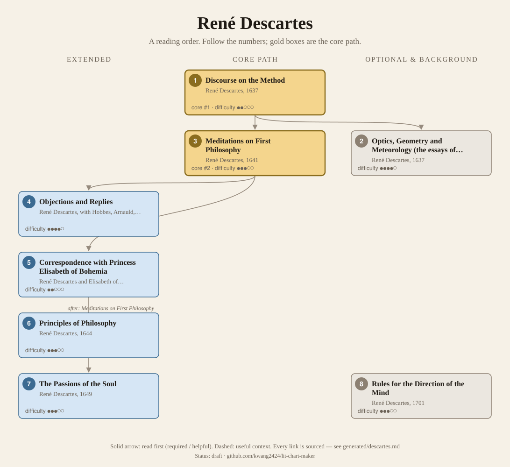
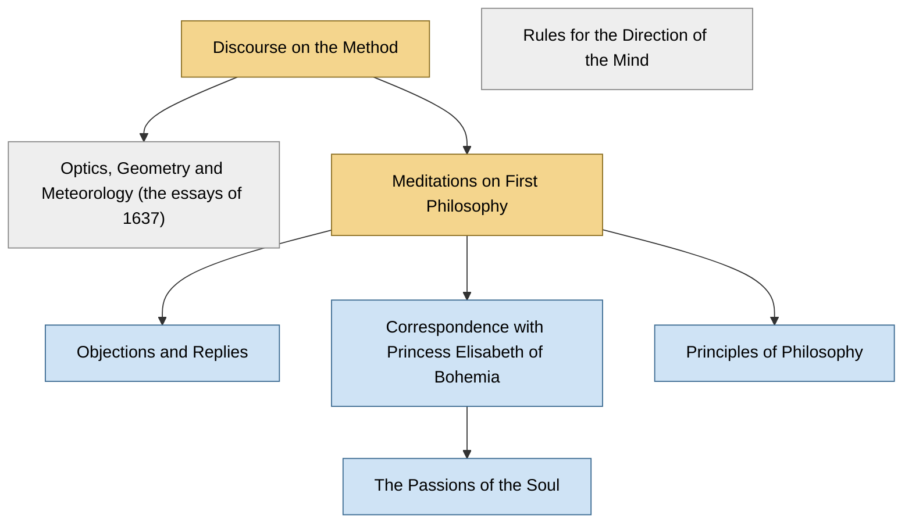

<!-- Generated by tools/build.py from lists/descartes.yaml. Do not edit by hand. -->
# René Descartes: reading order

**Status:** draft · **Citations:** 16 citations · 16 checked by Claude (AI) · 0 reviewed by a person

**Scope:** Descartes's philosophical works, from the unfinished Rules to the Passions of the Soul, with the Objections and Replies and the correspondence with Elisabeth. The mathematics and physics appear only as the essays published with the Discourse. Few dedicated syllabi were reachable, so the survey is thin; his own prefaces carry the order.

> Citations marked "checked by Claude (AI)" were read against the named edition by an AI and have not yet been reviewed by a person. See [CONTRIBUTING.md](../CONTRIBUTING.md) to help review them.

## Core path

The shortest route through the essentials.

1. **Discourse on the Method** (1637) · difficulty ●●○○○ · first book in 2 surveyed sources
2. **Meditations on First Philosophy** (1641) · difficulty ●●●○○ · first book in 3 surveyed sources

## What the sources say

We surveyed 8 independent sources (1 scholarly guide and 7 course syllabi and teaching lists) and recorded which books each one assigns or recommends, and where it starts.

| Book | Recommended by | First book in |
|---|---|---|
| Meditations on First Philosophy | 7/8 | 3 |
| Discourse on the Method | 3/8 | 2 |
| Optics, Geometry and Meteorology (the essays of 1637) | 1/8 |  |
| Objections and Replies | 1/8 |  |
| Rules for the Direction of the Mind | 1/8 |  |

**Sources surveyed**

- **Kenneth Surin, Duke University, LIT 284: Descartes, Spinoza, and Leibniz (Fall 2001)** [teaching]: Discourse on the Method → Meditations on First Philosophy. ✓ checked by Claude (AI) in Course syllabus, accessed 2026-11; not yet reviewed by a person
- **Jagdish Hattiangadi, York University, AP/PHIL 4011: Seminar in the History of Modern Philosophy (Descartes, Fall 2019)** [teaching]: Discourse on the Method, Optics, Geometry and Meteorology (the essays of 1637). ✓ checked by Claude (AI) in Course outline (web page, Fall 2019), accessed 2026-11; not yet reviewed by a person
- **Lisa Shapiro, Simon Fraser University, PHIL 354: Descartes and Rationalism (Fall 2002)** [teaching]: Meditations on First Philosophy → Objections and Replies. ✓ checked by Claude (AI) in Course syllabus (web page, Fall 2002), accessed 2026-11; not yet reviewed by a person
- **University of Cambridge, Faculty of Philosophy, Philosophy Tripos Guide to Courses (Syllabus) 2025–2026** [teaching]: Meditations on First Philosophy. ✓ checked by Claude (AI) in Guide to Courses 2025–26 (PDF), accessed 2026-11; not yet reviewed by a person
- **Nigel Warburton, Philosophy: The Classics (4th ed.)** [scholarly] (expert's shortlist): Meditations on First Philosophy. ✓ checked by Claude (AI) in Routledge book page (table of contents), accessed 2026-11; not yet reviewed by a person
- **Faculty of Philosophy, University of Cambridge, Suggested reading for prospective undergraduates (July 2015)** [teaching] (beginner's list): Meditations on First Philosophy. ✓ checked by Claude (AI) in Reading list (PDF, July 2015), accessed 2026-11; not yet reviewed by a person
- **Somerville College, Oxford, Pre-arrival reading letter, Philosophy (PPE), 2026** [teaching] (beginner's list): Meditations on First Philosophy. ✓ checked by Claude (AI) in Pre-arrival letter (PDF, 2026), accessed 2026-11; not yet reviewed by a person
- **St. John's College (Annapolis and Santa Fe), Undergraduate program reading list, by class year** [teaching] (expert's shortlist): Discourse on the Method, Meditations on First Philosophy, Rules for the Direction of the Mind. ✓ checked by Claude (AI) in Reading list web page, accessed 2026-11; not yet reviewed by a person

## Full path

Every work, in order. Extended and optional works are placed where they fit best.

### 1. Discourse on the Method (1637)

`core · primary · difficulty ●●○○○` · René Descartes

Six parts: considerations on the sciences, the rules of his method, a provisional morality, and in Part IV his arguments for God and the soul. It was published as the first part of a volume of three scientific essays.

**Translation:** Veitch (free online)

**Reading tips:**

- Descartes's own note: "If this Discourse appear too long to be read at once, it may be divided into six Parts", and he lists what each contains; Part IV holds "the reasonings by which he establishes the existence of God and of the human soul, which are the foundations of his Metaphysic".
  - René Descartes, *Discourse on the Method (Veitch trans.)*, Prefatory Note by the Author [author] ✓ checked by Claude (AI) in Veitch trans., Project Gutenberg #59; not yet reviewed by a person

### 2. Optics, Geometry and Meteorology (the essays of 1637) (1637)

`optional · primary · difficulty ●●●●○` · René Descartes

The three scientific treatises the Discourse was written to introduce.

**Read first:**

- *Discourse on the Method* — *helpful*. The Discourse was "the first part of these Essays"; "the other parts were three treatises", on optics, meteorology and geometry.
  - René Descartes, *Selections from the Principles of Philosophy, with the Author's Letter (Veitch trans.)*, Author's Letter (Preface) [author] ✓ checked by Claude (AI) in Veitch trans., Project Gutenberg #4391; not yet reviewed by a person

### 3. Meditations on First Philosophy (1641)

`core · primary · difficulty ●●●○○` · René Descartes

It opens with sceptical questions about knowledge and, meditation by meditation, establishes the groundwork for it. "By far Descartes's most popular work" today (SEP, "Life and Works" §3).

**Translation:** Molyneux (1680, free online) or a modern translation

**Read first:**

- *Discourse on the Method* — *helpful*. Descartes explains that he wrote the Meditations "anticipating the difficulty which many would experience in apprehending the foundations of the Metaphysics" he had sketched in the Discourse (Part IV).
  - René Descartes, *Selections from the Principles of Philosophy, with the Author's Letter (Veitch trans.)*, Author's Letter (Preface) [author] ✓ checked by Claude (AI) in Veitch trans., Project Gutenberg #4391; not yet reviewed by a person

### 4. Objections and Replies (1641)

`extended · primary · difficulty ●●●●○` · René Descartes, with Hobbes, Arnauld, Gassendi and others

Objections to the Meditations gathered by Mersenne from Caterus, Hobbes, Arnauld, Gassendi and others, with Descartes's replies; printed with the Meditations, seven sets in the second edition (SEP, "Life and Works" §3).

**Read first:**

- *Meditations on First Philosophy* — *required*. The objections and replies discuss the Meditations passage by passage.
  - Stanford Encyclopedia of Philosophy, *"Descartes' Life and Works"*, §3 The Meditations [scholarly] ✓ checked by Claude (AI) in SEP entry, accessed 2026-11; not yet reviewed by a person

### 5. Correspondence with Princess Elisabeth of Bohemia (1643)

`extended · primary · difficulty ●●○○○` · René Descartes and Elisabeth of Bohemia

Letters from 1643 on in which Elisabeth probes the implications of his mind–body dualism (SEP, "Life and Works" §4).

**Read first:**

- *Meditations on First Philosophy* — *helpful*. Elisabeth's questions probe "the implications of his commitment to mind-body dualism", the dualism of the Meditations.
  - Stanford Encyclopedia of Philosophy, *"Descartes' Life and Works"*, §4 The Principles [scholarly] ✓ checked by Claude (AI) in SEP entry, accessed 2026-11; not yet reviewed by a person

### 6. Principles of Philosophy (1644)

`extended · primary · difficulty ●●●○○` · René Descartes

A textbook in four parts: Part One restates the metaphysics, Parts Two to Four the physics built on it. Dedicated to Princess Elisabeth.

**Translation:** Veitch selections (free online)

**Reading tips:**

- Descartes's advice: go "over the whole of it, as he would a romance, without greatly straining his attention", then read it a second time "to observe the connection of my reasonings".
  - René Descartes, *Selections from the Principles of Philosophy, with the Author's Letter (Veitch trans.)*, Author's Letter (Preface) [author] ✓ checked by Claude (AI) in Veitch trans., Project Gutenberg #4391; not yet reviewed by a person

**Read first:**

- *Meditations on First Philosophy* — *required*. Descartes on Part One: "that this part accordingly may be properly understood, it will be necessary to read beforehand the book of Meditations I wrote on the same subject".
  - René Descartes, *Selections from the Principles of Philosophy, with the Author's Letter (Veitch trans.)*, Author's Letter (Preface) [author] ✓ checked by Claude (AI) in Veitch trans., Project Gutenberg #4391; not yet reviewed by a person

### 7. The Passions of the Soul (1649)

`extended · primary · difficulty ●●●○○` · René Descartes

How the emotional, and so moral, life is connected to the soul's union with the body (SEP, "Life and Works" §5).

**Read first:**

- *Correspondence with Princess Elisabeth of Bohemia* — *helpful*. The work "emerged primarily from his correspondence with Princess Elisabeth".
  - Stanford Encyclopedia of Philosophy, *"Descartes' Life and Works"*, §5 The Passions [scholarly] ✓ checked by Claude (AI) in SEP entry, accessed 2026-11; not yet reviewed by a person

### 8. Rules for the Direction of the Mind (1701)

`optional · primary · difficulty ●●●○○` · René Descartes

An early, unfinished treatise on method, abandoned around 1628 and published only after his death (SEP, "Life and Works" §2).

## Map

Solid arrows: required or helpful. Dotted: context.

## Connections

**Who builds on René Descartes**

- *Meditations on First Philosophy* → *"Cogito and the History of Madness"* (Jacques Derrida) — context. It criticises Foucault's early thought, "especially Foucault's interpretation of Descartes".
- *Discourse on the Method* → *Foundation of the Entire Wissenschaftslehre (Science of Knowledge)* (J. G. Fichte) — context. Its first principle is compared with Descartes: "Before Kant, Descartes has suggested a similar one, Cogito, ergo sum."
- *Discourse on the Method* → *Encyclopaedia of the Philosophical Sciences (esp. Part I, the "Lesser Logic")* (G. W. F. Hegel) — context. It discusses the "'Cogito, ergo sum,' of Descartes, the maxim on which may be said to hinge the whole interest of Modern Philosophy", and denies that it is a syllogism.
- *Meditations on First Philosophy* → *Being and Time* (Martin Heidegger) — context. It contrasts Dasein's being-in-the-world with "the Cartesian distinction between disembodied subjects and a spatially-extended material world"; a planned Part 2 was to examine the ontology of Descartes.
- *Meditations on First Philosophy* → *An Enquiry concerning Human Understanding* (David Hume) — context. Section XII discusses the "antecedent" scepticism "much inculcated by Des Cartes", a universal doubt of all our opinions "but also of our very faculties", which Hume argues would be incurable.
- *Meditations on First Philosophy* → *Cartesian Meditations: An Introduction to Phenomenology* (Edmund Husserl) — helpful. For Husserl, Descartes "inaugurated a new epoch-making type of philosophy" with a first-personal turn "from naïve Objectivism to transcendental subjectivism", though he rejects "nearly all the well-known doctrinal content of the Cartesian philosophy" (Hua 1, the Cartesian Meditations).
- *Meditations on First Philosophy* → *Critique of Pure Reason* (Immanuel Kant) — context. The Refutation of Idealism answers "the problematical idealism of Descartes, who admits the undoubted certainty of only one empirical assertion (assertio), to wit, 'I am'".
- *Meditations on First Philosophy* → *An Essay Concerning Human Understanding* (John Locke) — context. The SEP: "In writing An Essay Concerning Human Understanding Locke adopted Descartes' 'way of ideas'", though it is "transformed so as to become an organic part of Locke's philosophy".
- *Meditations on First Philosophy* → *The World as Will and Representation, vol. 1* (Arthur Schopenhauer) — context. Its opening claim, "The world is idea", was "implicitly involved in the sceptical reflections from which Descartes started".
- *Principles of Philosophy* → *Principles of Cartesian Philosophy* (Baruch Spinoza) — helpful. It is his critical exposition of Descartes's Principles of Philosophy.
- *Principles of Philosophy* → *Ethics* (Baruch Spinoza) — helpful. Courses read Part I's definitions alongside Descartes's Principles, or read the Meditations first; Spinoza's vocabulary of substance and attribute is Cartesian.

## Sources

- **[author]** René Descartes, *Discourse on the Method (Veitch trans.)* — <https://www.gutenberg.org/ebooks/59>
- **[author]** René Descartes, *Selections from the Principles of Philosophy, with the Author's Letter (Veitch trans.)* — <https://www.gutenberg.org/ebooks/4391>
- **[scholarly]** Stanford Encyclopedia of Philosophy, *"Descartes' Life and Works"* — <https://plato.stanford.edu/entries/descartes-works/>
- **[scholarly]** Nigel Warburton, *Philosophy: The Classics (4th ed.)*, Routledge, 2014 — <https://www.routledge.com/Philosophy-The-Classics/Warburton/p/book/9780415534666>
- **[teaching]** University of Cambridge, Faculty of Philosophy, *Philosophy Tripos Guide to Courses (Syllabus) 2025–2026* — <https://www.phil.cam.ac.uk/files/gtc_2025-26_-_final_2025_07.pdf>
- **[teaching]** Faculty of Philosophy, University of Cambridge, *Suggested reading for prospective undergraduates (July 2015)* — <https://www.phil.cam.ac.uk/system/files/documents/prosp-ugrad-readlinglist.pdf>
- **[teaching]** St. John's College (Annapolis and Santa Fe), *Undergraduate program reading list, by class year* — <https://www.sjc.edu/reading-list>
- **[teaching]** Somerville College, Oxford, *Pre-arrival reading letter, Philosophy (PPE), 2026* — <https://www.some.ox.ac.uk/wp-content/uploads/2026/08/Prelim-Philosophy-PPE-letter-2026.pdf>
- **[teaching]** Kenneth Surin, Duke University, *LIT 284: Descartes, Spinoza, and Leibniz (Fall 2001)* — <https://people.duke.edu/~ksurin/Lit284fall01.html>
- **[teaching]** Lisa Shapiro, Simon Fraser University, *PHIL 354: Descartes and Rationalism (Fall 2002)* — <https://www.sfu.ca/~lshapiro/PHIL354/PHIL354Syllabus.html>
- **[teaching]** Jagdish Hattiangadi, York University, *AP/PHIL 4011: Seminar in the History of Modern Philosophy (Descartes, Fall 2019)* — <https://course-outlines.laps.yorku.ca/outlines/2019f-apphil4011a-03/>
