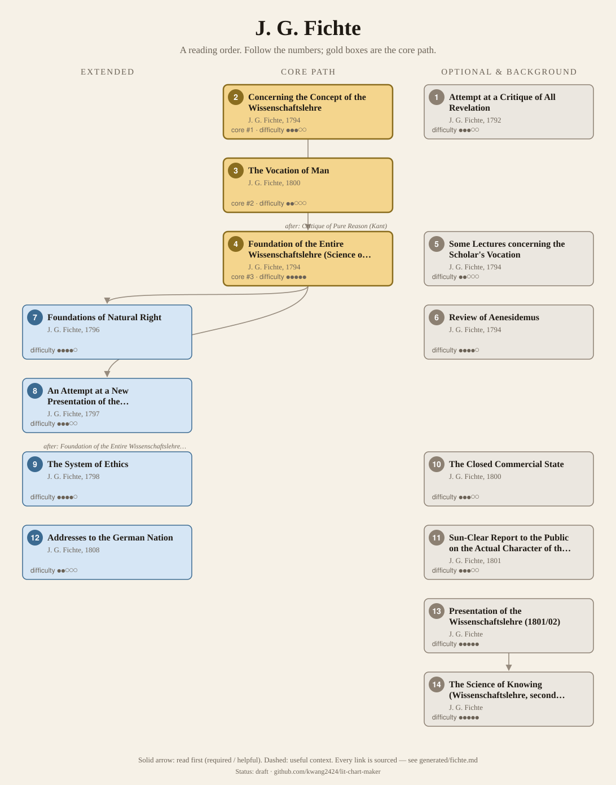
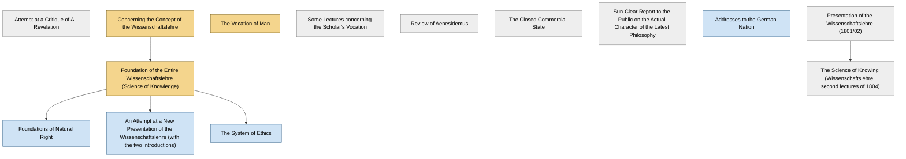

<!-- Generated by tools/build.py from lists/fichte.yaml. Do not edit by hand. -->
# J. G. Fichte: reading order

**Status:** draft · **Citations checked:** 15/15

**Scope:** Fichte's main works, from the Critique of All Revelation to the Addresses to the German Nation: the Jena Wissenschaftslehre (Doctrine of Science) and its branches in right and ethics, the popular Berlin writings, and two of the later lecture versions of the system. Years are first publication, from the SEP.

## Core path

The shortest route through the essentials.

1. **Concerning the Concept of the Wissenschaftslehre** (1794) · difficulty ●●●○○ · first book in 2 surveyed sources
2. **The Vocation of Man** (1800) · difficulty ●●○○○ · first book in 1 surveyed source
3. **Foundation of the Entire Wissenschaftslehre (Science of Knowledge)** (1794) · difficulty ●●●●●

## What the sources say

We surveyed 5 independent sources (5 course syllabi and teaching lists) and recorded which books each one assigns or recommends, and where it starts.

| Book | Recommended by | First book in |
|---|---|---|
| Concerning the Concept of the Wissenschaftslehre | 3/5 | 2 |
| Foundation of the Entire Wissenschaftslehre (Science of Knowledge) | 2/5 |  |
| Presentation of the Wissenschaftslehre (1801/02) | 2/5 |  |
| The Science of Knowing (Wissenschaftslehre, second lectures of 1804) | 2/5 |  |
| Review of Aenesidemus | 1/5 | 1 |
| The Vocation of Man | 1/5 | 1 |
| Foundations of Natural Right | 1/5 |  |
| An Attempt at a New Presentation of the Wissenschaftslehre (with the two Introductions) | 1/5 |  |
| The System of Ethics | 1/5 |  |

**Sources surveyed**

- **Thomas Sören Hoffmann, FernUniversität in Hagen, Fichtes transzendentaler Idealismus: Grundlegung und Entfaltung (seminar, November 2024)** [teaching]: Concerning the Concept of the Wissenschaftslehre → Foundation of the Entire Wissenschaftslehre (Science of Knowledge) → Foundations of Natural Right → The System of Ethics → Presentation of the Wissenschaftslehre (1801/02). ✓ checked in Seminar page (FernUniversität in Hagen, November 2024), accessed 2026-11
- **Thomas Land, University of Victoria, PHIL 314: 19th Century Philosophy (Spring 2019)** [teaching]: Review of Aenesidemus → Concerning the Concept of the Wissenschaftslehre → An Attempt at a New Presentation of the Wissenschaftslehre (with the two Introductions). ✓ checked in Course outline (PDF, Spring 2019), accessed 2026-11
- **Simon R. Gurofsky, Carleton University, PHIL 3005 (Winter 2020)** [teaching]: Concerning the Concept of the Wissenschaftslehre → Foundation of the Entire Wissenschaftslehre (Science of Knowledge). ✓ checked in Course syllabus (PDF, Winter 2020), accessed 2026-11
- **George di Giovanni, McGill University, PHIL 567: Seminar on the post-Jena Fichte (January 2012)** [teaching]: The Vocation of Man → Presentation of the Wissenschaftslehre (1801/02) → The Science of Knowing (Wissenschaftslehre, second lectures of 1804). ✓ checked in Seminar syllabus (PDF, January 2012), accessed 2026-11
- **Georgy Chernavin, Higher School of Economics (Moscow), Transcendental Philosophy: From German Idealism to Phenomenology (2015)** [teaching]: The Science of Knowing (Wissenschaftslehre, second lectures of 1804). ✓ checked in Course syllabus (PDF, 2015), accessed 2026-11

## Full path

Every work, in order. Extended and optional works are placed where they fit best.

### 1. Attempt at a Critique of All Revelation (1792)

`optional · primary · difficulty ●●●○○` · J. G. Fichte

His first book, written to show Kant his mastery of the Critical philosophy. It first appeared without his name and was widely taken for a work by Kant (SEP §1).

**Translation:** Green (Cambridge)

**Read first:**

- *Critique of Practical Reason* (from the [Immanuel Kant list](kant.md)) — *context*. It concludes that "the only revelation consistent with the Critical philosophy is the moral law itself".
  - Stanford Encyclopedia of Philosophy (Daniel Breazeale), *"Johann Gottlieb Fichte"*, §1 Life and Work [scholarly] ✓ checked in SEP entry, accessed 2026-11

### 2. Concerning the Concept of the Wissenschaftslehre (1794)

`core · primary · difficulty ●●●○○` · J. G. Fichte

A short manifesto introducing his new philosophy to students at Jena: mainly about the form of a system and how philosophy relates to its object (SEP §1).

**Translation:** Breazeale, in Early Philosophical Writings; Kroeger (1889, free online)

### 3. The Vocation of Man (1800)

`core · primary · difficulty ●●○○○` · J. G. Fichte

A popular presentation of his system, with a strong moral and religious emphasis, and an indirect reply to Jacobi's charge of "nihilism". The SEP calls it "perhaps Fichte's greatest literary achievement".

*Why this tier:* Only McGill's seminar assigns it: the courses surveyed teach the technical Jena works. It stays core because Fichte wrote it for readers outside philosophy and the SEP ranks it among his greatest achievements.

**Translation:** Smith (free online)

**Reading tips:**

- Fichte's preface: "This book is therefore not intended for philosophers by profession ... It ought to be intelligible to all readers who are able to understand a book at all." Courses mostly begin with the 1794 texts instead.
  - J. G. Fichte, *Popular Works: The Nature of the Scholar, The Vocation of Man, The Doctrine of Religion (Smith trans., 1873)*, The Vocation of Man, Preface [author] ✓ checked in Smith trans. (1873), archive.org/details/johanngottlieb00fichuoft

### 4. Foundation of the Entire Wissenschaftslehre (Science of Knowledge) (1794)

`core · primary · difficulty ●●●●●` · J. G. Fichte

His "best-known philosophical treatise", written as a handout for students and meant only as the first principles of the system (SEP §1). Hagen's seminar reads the first three principles (§§1–3) and the practical part (§5).

**Translation:** Breazeale (Oxford); Heath and Lachs, as Science of Knowledge; Kroeger (1889, free online)

**Read first:**

- *Concerning the Concept of the Wissenschaftslehre* — *helpful*. The manifesto announcing the system came first, and courses read it first: Hagen's seminar opens with an overview of its argument before the Foundation's principles.
  - Thomas Sören Hoffmann, FernUniversität in Hagen, *Fichtes transzendentaler Idealismus: Grundlegung und Entfaltung (seminar, November 2024)*, sessions 1–4 [teaching] ✓ checked in Seminar page (FernUniversität in Hagen, November 2024), accessed 2026-11
- *Critique of Pure Reason* (from the [Immanuel Kant list](kant.md)) — *helpful*. Fichte presents it as completing Kant: "Kant's celebrated question, which he placed at the head of his Critic of Pure Reason, How are synthetical judgments à priori possible? has now been answered."
  - J. G. Fichte, *The Science of Knowledge, with Concerning the Concept (Kroeger trans., 1889)*, Part I, §3 [author] ✓ checked in Kroeger trans. (1889), archive.org/details/scienceofknowle00fich
- *Discourse on the Method* (from the [René Descartes list](descartes.md)) — *context*. Its first principle is compared with Descartes: "Before Kant, Descartes has suggested a similar one, Cogito, ergo sum."
  - J. G. Fichte, *The Science of Knowledge, with Concerning the Concept (Kroeger trans., 1889)*, Part I, §1, Remarks [author] ✓ checked in Kroeger trans. (1889), archive.org/details/scienceofknowle00fich
- *Ethics* (from the [Baruch Spinoza list](spinoza.md)) — *context*. The first section's remarks discuss "Kant, Reinhold, and Spinoza, on the Ego", and the theoretical part is set against "dogmatic Spinozism".
  - J. G. Fichte, *The Science of Knowledge, with Concerning the Concept (Kroeger trans., 1889)*, Part I, §1 Remarks; §3 [author] ✓ checked in Kroeger trans. (1889), archive.org/details/scienceofknowle00fich

### 5. Some Lectures concerning the Scholar's Vocation (1794)

`optional · primary · difficulty ●●○○○` · J. G. Fichte

The first five of his popular public lectures at Jena on "Morality for Scholars" (SEP §1).

### 6. Review of Aenesidemus (1794)

`optional · primary · difficulty ●●●●○` · J. G. Fichte

A review of G. E. Schulze's sceptical attack on Kant and Reinhold, in which Fichte first hints at his own position (SEP §1).

**Translation:** Breazeale, in Early Philosophical Writings

### 7. Foundations of Natural Right (1796)

`extended · primary · difficulty ●●●●○` · J. G. Fichte

The system extended to law and social philosophy; Hagen's seminar reads §§1–7, on right, embodiment and recognition.

**Read first:**

- *Foundation of the Entire Wissenschaftslehre (Science of Knowledge)* — *helpful*. It is the first extension of the system "in accordance with the Principles of the Wissenschaftslehre", into philosophy of law (SEP §1).
  - Stanford Encyclopedia of Philosophy (Daniel Breazeale), *"Johann Gottlieb Fichte"*, §1 Life and Work [scholarly] ✓ checked in SEP entry, accessed 2026-11

### 8. An Attempt at a New Presentation of the Wissenschaftslehre (with the two Introductions) (1797)

`extended · primary · difficulty ●●●○○` · J. G. Fichte

Only the two Introductions and the first chapter of this new version appeared (1797/98) (SEP §1).

**Translation:** Breazeale, in Introductions to the Wissenschaftslehre

**Read first:**

- *Foundation of the Entire Wissenschaftslehre (Science of Knowledge)* — *helpful*. He began it "shocked by the virtually universal misunderstanding of his published Foundation", as an entirely new exposition of the same ground.
  - Stanford Encyclopedia of Philosophy (Daniel Breazeale), *"Johann Gottlieb Fichte"*, §1 Life and Work [scholarly] ✓ checked in SEP entry, accessed 2026-11

### 9. The System of Ethics (1798)

`extended · primary · difficulty ●●●●○` · J. G. Fichte

The system extended to moral philosophy (SEP §1).

**Translation:** Kroeger, as The Science of Ethics (1897, free online)

**Read first:**

- *Foundation of the Entire Wissenschaftslehre (Science of Knowledge)* — *helpful*. The second extension of the system "in accordance with the Principles of the Wissenschaftslehre", into moral philosophy.
  - Stanford Encyclopedia of Philosophy (Daniel Breazeale), *"Johann Gottlieb Fichte"*, §1 Life and Work [scholarly] ✓ checked in SEP entry, accessed 2026-11

### 10. The Closed Commercial State (1800)

`optional · primary · difficulty ●●●○○` · J. G. Fichte

Political economy combining socialist political ideas with autarkic economics (SEP §1).

### 11. Sun-Clear Report to the Public on the Actual Character of the Latest Philosophy (1801)

`optional · primary · difficulty ●●●○○` · J. G. Fichte

Subtitled "An Attempt to Force the Reader to Understand": a more direct reply to Jacobi and to misreadings of his philosophy (SEP §1).

### 12. Addresses to the German Nation (1808)

`extended · primary · difficulty ●●○○○` · J. G. Fichte

Lectures given in occupied Berlin in the winter of 1807/8, later treated as founding documents of German nationalism (SEP §1).

### 13. Presentation of the Wissenschaftslehre (1801/02)

`optional · primary · difficulty ●●●●●` · J. G. Fichte

Lecture notes rethinking the foundations of the system, from the period when Fichte was "defining his position deliberately in opposition to that of Schelling" (McGill's seminar).

### 14. The Science of Knowing (Wissenschaftslehre, second lectures of 1804)

`optional · primary · difficulty ●●●●●` · J. G. Fichte

The second of his three new versions of 1804 (SEP §1); "the only extensive posthumous text of Fichte which we have in English translation" (McGill's seminar).

**Translation:** Wright (SUNY)

**Read first:**

- *Presentation of the Wissenschaftslehre (1801/02)* — *helpful*. The 1801/02 lectures began the rethinking of the system that "culminated" in the three versions of 1804.
  - Stanford Encyclopedia of Philosophy (Daniel Breazeale), *"Johann Gottlieb Fichte"*, §1 Life and Work [scholarly] ✓ checked in SEP entry, accessed 2026-11

## Map

Solid arrows: required or helpful. Dotted: context.

## Connections

**Builds on**

- *Critique of Practical Reason* (Immanuel Kant) → *Attempt at a Critique of All Revelation* — context. It concludes that "the only revelation consistent with the Critical philosophy is the moral law itself".
- *Critique of Pure Reason* (Immanuel Kant) → *Foundation of the Entire Wissenschaftslehre (Science of Knowledge)* — helpful. Fichte presents it as completing Kant: "Kant's celebrated question, which he placed at the head of his Critic of Pure Reason, How are synthetical judgments à priori possible? has now been answered."
- *Discourse on the Method* (René Descartes) → *Foundation of the Entire Wissenschaftslehre (Science of Knowledge)* — context. Its first principle is compared with Descartes: "Before Kant, Descartes has suggested a similar one, Cogito, ergo sum."
- *Ethics* (Baruch Spinoza) → *Foundation of the Entire Wissenschaftslehre (Science of Knowledge)* — context. The first section's remarks discuss "Kant, Reinhold, and Spinoza, on the Ego", and the theoretical part is set against "dogmatic Spinozism".

**Who builds on J. G. Fichte**

- *Foundation of the Entire Wissenschaftslehre (Science of Knowledge)* → *Encyclopaedia of the Philosophical Sciences (esp. Part I, the "Lesser Logic")* (G. W. F. Hegel) — context. The Logic credits Fichte: "To the philosophy of Fichte belongs the great merit of having called attention to the need of exhibiting the necessity of these categories and giving a genuine deduction of them."
- *Foundation of the Entire Wissenschaftslehre (Science of Knowledge)* → *Of the I as Principle of Philosophy* (F. W. J. Schelling) — helpful. Fichte's Wissenschaftslehre, "along with Kant's Critique of Judgment ... proved to be of decisive importance for Schelling's early philosophical career".
- *Foundation of the Entire Wissenschaftslehre (Science of Knowledge)* → *System of Transcendental Idealism* (F. W. J. Schelling) — helpful. With the Naturphilosophie it "wavers between a Spinozist and a Fichtean approach to the 'unconditioned'"; the SEP's Fichte here is the Wissenschaftslehre of 1794.
- *Foundation of the Entire Wissenschaftslehre (Science of Knowledge)* → *The World as Will and Representation, vol. 1* (Arthur Schopenhauer) — context. §7 sets its starting point against "the idealism of Fichte", which "reduces the object to the effect of the subject", and calls Fichte's "philosophy of appearance" the one example of deriving the object from the subject.

## Sources

- **[author]** J. G. Fichte, *Popular Works: The Nature of the Scholar, The Vocation of Man, The Doctrine of Religion (Smith trans., 1873)* — <https://archive.org/details/johanngottlieb00fichuoft>
- **[author]** J. G. Fichte, *The Science of Knowledge, with Concerning the Concept (Kroeger trans., 1889)* — <https://archive.org/details/scienceofknowle00fich>
- **[scholarly]** Stanford Encyclopedia of Philosophy (Daniel Breazeale), *"Johann Gottlieb Fichte"* — <https://plato.stanford.edu/entries/johann-fichte/>
- **[teaching]** Simon R. Gurofsky, Carleton University, *PHIL 3005 (Winter 2020)* — <https://carleton.ca/philosophy/wp-content/uploads/sites/200/Phil-3005-S.-Gurofsky-W.20-1.pdf>
- **[teaching]** Thomas Sören Hoffmann, FernUniversität in Hagen, *Fichtes transzendentaler Idealismus: Grundlegung und Entfaltung (seminar, November 2024)* — <https://www.fernuni-hagen.de/philosophie/praesenzen/119359.shtml>
- **[teaching]** Georgy Chernavin, Higher School of Economics (Moscow), *Transcendental Philosophy: From German Idealism to Phenomenology (2015)* — <https://www.hse.ru/data/2015/10/09/1097657033/Chernavin_Transcendental_Philosophy_3.07.15.pdf>
- **[teaching]** George di Giovanni, McGill University, *PHIL 567: Seminar on the post-Jena Fichte (January 2012)* — <https://www.mcgill.ca/philosophy/files/philosophy/567b12.pdf>
- **[teaching]** Thomas Land, University of Victoria, *PHIL 314: 19th Century Philosophy (Spring 2019)* — <https://www.uvic.ca/humanities/philosophy/assets/docs/courseoutlines/2019_spring/phil314tl19.pdf>
