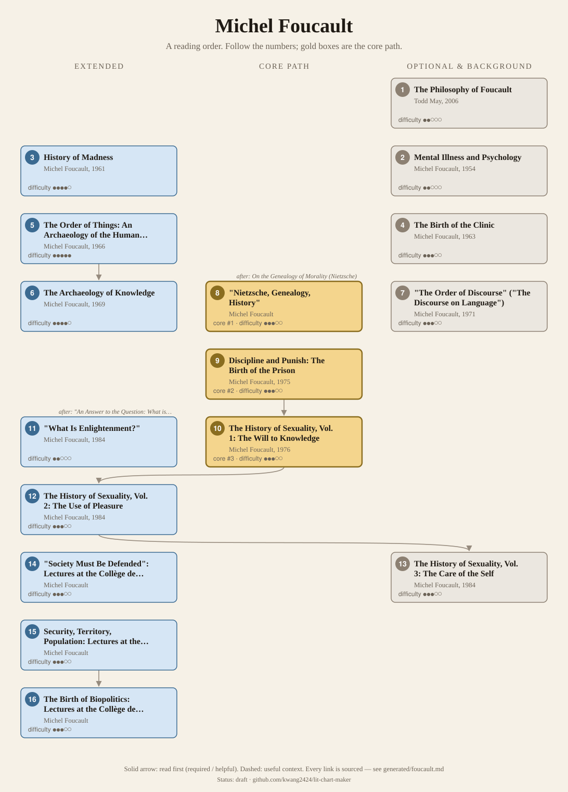
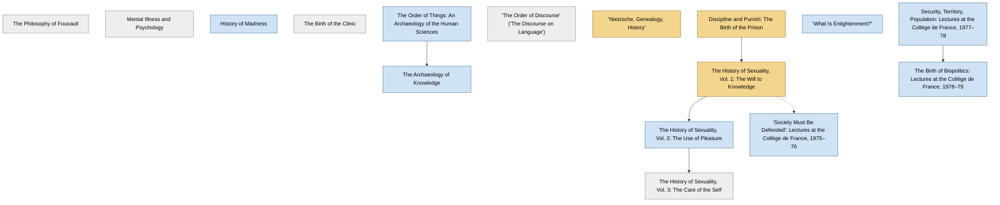

<!-- Generated by tools/build.py from lists/foucault.yaml. Do not edit by hand. -->
# Michel Foucault: reading order

**Status:** draft · **Citations checked:** 17/17

**Scope:** Foucault's books, the key essays and the most-read Collège de France lectures, from the History of Madness to the late volumes on ancient sexuality. Most courses found centre on the genealogical books (Discipline and Punish, History of Sexuality vol. 1), which tilts the survey away from the archaeological ones.

## Core path

The shortest route through the essentials.

1. **"Nietzsche, Genealogy, History"** · difficulty ●●●○○ · first book in 1 surveyed source
2. **Discipline and Punish: The Birth of the Prison** (1975) · difficulty ●●●○○ · first book in 1 surveyed source
3. **The History of Sexuality, Vol. 1: The Will to Knowledge** (1976) · difficulty ●●●○○

## What the sources say

We surveyed 4 independent sources (4 course syllabi and teaching lists) and recorded which books each one assigns or recommends, and where it starts.

| Book | Recommended by | First book in |
|---|---|---|
| Discipline and Punish: The Birth of the Prison | 4/4 | 1 |
| "Nietzsche, Genealogy, History" | 3/4 | 1 |
| The History of Sexuality, Vol. 1: The Will to Knowledge | 3/4 |  |
| The Archaeology of Knowledge | 1/4 |  |
| The Birth of Biopolitics: Lectures at the Collège de France, 1978–79 | 1/4 |  |
| The History of Sexuality, Vol. 3: The Care of the Self | 1/4 |  |
| History of Madness | 1/4 |  |
| The Philosophy of Foucault | 1/4 |  |
| "The Order of Discourse" ("The Discourse on Language") | 1/4 |  |
| The Order of Things: An Archaeology of the Human Sciences | 1/4 |  |
| Security, Territory, Population: Lectures at the Collège de France, 1977–78 | 1/4 |  |
| "Society Must Be Defended": Lectures at the Collège de France, 1975–76 | 1/4 |  |
| The History of Sexuality, Vol. 2: The Use of Pleasure | 1/4 |  |

**Sources surveyed**

- **Colin Koopman, UC Santa Cruz, PHIL 190P: Michel Foucault: Thought, Context, Critique (Spring 2009)** [teaching]: History of Madness → The Order of Things: An Archaeology of the Human Sciences → The Archaeology of Knowledge → "The Order of Discourse" ("The Discourse on Language") → "Nietzsche, Genealogy, History" → Discipline and Punish: The Birth of the Prison → The History of Sexuality, Vol. 1: The Will to Knowledge → Security, Territory, Population: Lectures at the Collège de France, 1977–78 → The Birth of Biopolitics: Lectures at the Collège de France, 1978–79 → The History of Sexuality, Vol. 2: The Use of Pleasure. ✓ checked in Course web page, accessed 2026-11
- **John Protevi, Louisiana State University, Foucault and Biopower (Honors, Spring 2013)** [teaching]: Discipline and Punish: The Birth of the Prison → The History of Sexuality, Vol. 1: The Will to Knowledge → "Society Must Be Defended": Lectures at the Collège de France, 1975–76. ✓ checked in Course syllabus (PDF), accessed 2026-11
- **Deree – The American College of Greece, PH 4032: Postmodern Philosophy: Foucault and Derrida (updated Fall 2022)** [teaching]: Discipline and Punish: The Birth of the Prison, "Nietzsche, Genealogy, History". ✓ checked in Course outline (PDF, updated Fall 2022), accessed 2026-11
- **Christina Hendricks, University of British Columbia, PHIL 449A: Continental Philosophy (Nietzsche and Foucault, Winter 2014)** [teaching]: "Nietzsche, Genealogy, History" → Discipline and Punish: The Birth of the Prison → The History of Sexuality, Vol. 1: The Will to Knowledge → The History of Sexuality, Vol. 3: The Care of the Self → The Philosophy of Foucault. ✓ checked in Course syllabus (PDF), accessed 2026-11

## Full path

Every work, in order. Extended and optional works are placed where they fit best.

### 1. The Philosophy of Foucault (2006)

`optional · secondary · difficulty ●●○○○` · Todd May

An introduction; UBC's course assigns its chapters alongside the primary texts.

### 2. Mental Illness and Psychology (1954)

`optional · primary · difficulty ●●○○○` · Michel Foucault

A short early book, first published as Maladie mentale et personnalité (1954) and significantly revised in 1962; written, the SEP says, "in the grip of" Marxism.

**Translation:** Sheridan (Harper and Row 1976)

### 3. History of Madness (1961)

`extended · primary · difficulty ●●●●○` · Michel Foucault

His doctoral thesis, on how the modern concept of "mental illness" emerged, and his "first canonical monograph". For decades English readers had only the abridged Madness and Civilization (IEP §3.a).

**Translation:** Murphy and Khalfa (Routledge 2006); abridged as Madness and Civilization

**Read first:**

- *The Birth of Tragedy* (from the [Friedrich Nietzsche list](nietzsche.md)) — *context*. The IEP: it "resembles Friedrich Nietzsche's Birth of Tragedy in style and form", with a reason/unreason split like the Apollonian/Dionysian one.
  - Internet Encyclopedia of Philosophy, *"Michel Foucault (1926–1984)"*, §3.a The History of Madness [scholarly] ✓ checked in IEP entry, accessed 2026-11

### 4. The Birth of the Clinic (1963)

`optional · primary · difficulty ●●●○○` · Michel Foucault

On the origins of modern medicine; one of his "structuralist histories" (SEP §2).

**Translation:** Sheridan (Pantheon 1973)

### 5. The Order of Things: An Archaeology of the Human Sciences (1966)

`extended · primary · difficulty ●●●●●` · Michel Foucault

"The book that made Foucault famous": an analysis of what knowledge meant, and how that changed, "in Western thought from the Renaissance to the present" (SEP §3.2). Koopman's course reads the preface and selected passages.

*Why this tier:* The SEP gives it the longest treatment of any of his books, but only one of the three courses surveyed assigns it (in selections). Courses that focus on genealogy skip it.

**Translation:** Sheridan (Routledge 1970)

**Read first:**

- *Critique of Pure Reason* (from the [Immanuel Kant list](kant.md)) — *context*. For Foucault "the great 'turn' in modern philosophy occurs with Kant", who asks whether and how ideas represent their objects.
  - Stanford Encyclopedia of Philosophy, *"Michel Foucault"*, §3.2.2 [scholarly] ✓ checked in SEP entry, accessed 2026-11

### 6. The Archaeology of Knowledge (1969)

`extended · primary · difficulty ●●●●○` · Michel Foucault

A methodological treatise; the only one of his major works that is not a historical study, "and thus his most theoretical work" (IEP §3.e).

**Translation:** Sheridan (Harper and Row 1972)

**Read first:**

- *The Order of Things: An Archaeology of the Human Sciences* — *helpful*. It "explicitly formulates" the archaeological method he had used in The Order of Things and, implicitly, in the earlier histories.
  - Stanford Encyclopedia of Philosophy, *"Michel Foucault"*, §3.3 From Archaeology to Genealogy [scholarly] ✓ checked in SEP entry, accessed 2026-11

### 7. "The Order of Discourse" ("The Discourse on Language") (1971)

`optional · primary · difficulty ●●●○○` · Michel Foucault

His inaugural lecture at the Collège de France. The IEP notes he began talking about power here, as soon as he began to do genealogy.

### 8. "Nietzsche, Genealogy, History"

`core · primary · difficulty ●●●○○` · Michel Foucault

An essay on Nietzsche's idea of genealogy.

**Read first:**

- *On the Genealogy of Morality* (from the [Friedrich Nietzsche list](nietzsche.md)) — *helpful*. His term "genealogy" was meant "to evoke Nietzsche's genealogy of morals"; UBC's course reads this essay straight after On the Genealogy of Morality.
  - Stanford Encyclopedia of Philosophy, *"Michel Foucault"*, §3.3 [scholarly] ✓ checked in SEP entry, accessed 2026-11
  - Christina Hendricks, University of British Columbia, *PHIL 449A: Continental Philosophy (Nietzsche and Foucault, Winter 2014)*, weekly schedule, week 6 [teaching] ✓ checked in Course syllabus (PDF), accessed 2026-11

### 9. Discipline and Punish: The Birth of the Prison (1975)

`core · primary · difficulty ●●●○○` · Michel Foucault

The emergence of the prison and of disciplinary power, including Bentham's Panopticon and "docile bodies". The first book to use his genealogical method (SEP §3.3).

**Translation:** Sheridan (Pantheon 1977)

**Read first:**

- *On the Genealogy of Morality* (from the [Friedrich Nietzsche list](nietzsche.md)) — *context*. Genealogy, "first deployed in Discipline and Punish", was meant to evoke Nietzsche's genealogy of morals.
  - Stanford Encyclopedia of Philosophy, *"Michel Foucault"*, §3.3 [scholarly] ✓ checked in SEP entry, accessed 2026-11

### 10. The History of Sexuality, Vol. 1: The Will to Knowledge (1976)

`core · primary · difficulty ●●●○○` · Michel Foucault

Intended as the introduction to a series on modern sexuality; it sets out the viewpoint and methods (SEP §3.5).

**Translation:** Hurley (Pantheon 1978), as An Introduction

**Read first:**

- *Discipline and Punish: The Birth of the Prison* — *helpful*. The history of sexuality "was originally projected as a fairly straightforward extension of the genealogical approach of Discipline and Punish". All three courses surveyed read it straight after.
  - Stanford Encyclopedia of Philosophy, *"Michel Foucault"*, §3.5 History of Modern Sexuality [scholarly] ✓ checked in SEP entry, accessed 2026-11

### 11. "What Is Enlightenment?" (1984)

`extended · primary · difficulty ●●○○○` · Michel Foucault

A late essay that takes up the question of Kant's 1784 essay of the same name.

**Read first:**

- *"An Answer to the Question: What is Enlightenment?"* (from the [Immanuel Kant list](kant.md)) — *helpful*. It "takes up the same question 200 years later"; Edinburgh's course reads the two essays together.
  - University of Edinburgh, *PHIL10047: The Early Continentals: Hegel and Nietzsche, course guide (2017–18)*, Week 2 tutorials [teaching] ✓ checked in Course guide (PDF), accessed 2026-11

### 12. The History of Sexuality, Vol. 2: The Use of Pleasure (1984)

`extended · primary · difficulty ●●●○○` · Michel Foucault

Greek sexuality and the ethical self. Koopman's course reads the Introduction (pp. 3–32) on its own first.

**Translation:** Hurley (Pantheon 1985)

**Read first:**

- *The History of Sexuality, Vol. 1: The Will to Knowledge* — *helpful*. Volume 1 was "a general introduction" to the history of sexuality; the late volumes move to ancient conceptions of the ethical self.
  - Stanford Encyclopedia of Philosophy, *"Michel Foucault"*, §3.6 Sex in the Ancient World [scholarly] ✓ checked in SEP entry, accessed 2026-11

### 13. The History of Sexuality, Vol. 3: The Care of the Self (1984)

`optional · primary · difficulty ●●●○○` · Michel Foucault

Roman sexuality; published with volume 2 in 1984.

**Translation:** Hurley (Pantheon 1986)

**Read first:**

- *The History of Sexuality, Vol. 2: The Use of Pleasure* — *helpful*. The SEP treats volumes 2 and 3 as his last two books, a pair on Greek and Roman sexuality.
  - Stanford Encyclopedia of Philosophy, *"Michel Foucault"*, §3.6 [scholarly] ✓ checked in SEP entry, accessed 2026-11

### 14. "Society Must Be Defended": Lectures at the Collège de France, 1975–76

`extended · primary · difficulty ●●●○○` · Michel Foucault

On the genealogy of racism. The IEP: "a useful companion to The Will to Knowledge" with "perhaps the clearest exposition" of his thoughts on biopower.

**Read first:**

- *The History of Sexuality, Vol. 1: The Will to Knowledge* — *context*. The IEP calls it "a useful companion to The Will to Knowledge".
  - Internet Encyclopedia of Philosophy, *"Michel Foucault (1926–1984)"*, §4.c Lecture Series [scholarly] ✓ checked in IEP entry, accessed 2026-11

### 15. Security, Territory, Population: Lectures at the Collège de France, 1977–78

`extended · primary · difficulty ●●●○○` · Michel Foucault

With The Birth of Biopolitics, "especially influential"; they introduce his ideas on government and governmentality (SEP §4).

### 16. The Birth of Biopolitics: Lectures at the Collège de France, 1978–79

`extended · primary · difficulty ●●●○○` · Michel Foucault

Governmentality continued, with "a lengthy examination of neoliberal governmentality" (SEP §4).

**Read first:**

- *Security, Territory, Population: Lectures at the Collège de France, 1977–78* — *helpful*. It is the next year's course; Koopman's seminar reads the two together, and the SEP treats them as a pair introducing governmentality.
  - Stanford Encyclopedia of Philosophy, *"Michel Foucault"*, §4 Foucault after Foucault [scholarly] ✓ checked in SEP entry, accessed 2026-11
  - Colin Koopman, UC Santa Cruz, *PHIL 190P: Michel Foucault: Thought, Context, Critique (Spring 2009)*, May 14, "Genealogy of Governmentality" [teaching] ✓ checked in Course web page, accessed 2026-11

## Map

Solid arrows: required or helpful. Dotted: context.

## Connections

**Builds on**

- *The Birth of Tragedy* (Friedrich Nietzsche) → *History of Madness* — context. The IEP: it "resembles Friedrich Nietzsche's Birth of Tragedy in style and form", with a reason/unreason split like the Apollonian/Dionysian one.
- *Critique of Pure Reason* (Immanuel Kant) → *The Order of Things: An Archaeology of the Human Sciences* — context. For Foucault "the great 'turn' in modern philosophy occurs with Kant", who asks whether and how ideas represent their objects.
- *On the Genealogy of Morality* (Friedrich Nietzsche) → *"Nietzsche, Genealogy, History"* — helpful. His term "genealogy" was meant "to evoke Nietzsche's genealogy of morals"; UBC's course reads this essay straight after On the Genealogy of Morality.
- *On the Genealogy of Morality* (Friedrich Nietzsche) → *Discipline and Punish: The Birth of the Prison* — context. Genealogy, "first deployed in Discipline and Punish", was meant to evoke Nietzsche's genealogy of morals.
- *"An Answer to the Question: What is Enlightenment?"* (Immanuel Kant) → *"What Is Enlightenment?"* — helpful. It "takes up the same question 200 years later"; Edinburgh's course reads the two essays together.

**Who builds on Michel Foucault**

- *History of Madness* → *"Cogito and the History of Madness"* (Jacques Derrida) — context. "Cogito and the History of Madness" criticises Foucault's early thought, especially his reading of Descartes, and caused a lasting rupture between them.

## Sources

- **[scholarly]** Internet Encyclopedia of Philosophy, *"Michel Foucault (1926–1984)"* — <https://iep.utm.edu/foucault/>
- **[scholarly]** Stanford Encyclopedia of Philosophy, *"Michel Foucault"* — <https://plato.stanford.edu/entries/foucault/>
- **[teaching]** University of Edinburgh, *PHIL10047: The Early Continentals: Hegel and Nietzsche, course guide (2017–18)* — <https://edwebcontent.ed.ac.uk/sites/default/files/atoms/files/the_early_continentals_course_guide_2017_18.pdf>
- **[teaching]** Deree – The American College of Greece, *PH 4032: Postmodern Philosophy: Foucault and Derrida (updated Fall 2022)* — <https://www.acg.edu/dereeacg/files/pdfs/PH4032.pdf>
- **[teaching]** John Protevi, Louisiana State University, *Foucault and Biopower (Honors, Spring 2013)* — <https://protevi.com/Foucault/S2013syllabus.pdf>
- **[teaching]** Christina Hendricks, University of British Columbia, *PHIL 449A: Continental Philosophy (Nietzsche and Foucault, Winter 2014)* — <https://blogs.ubc.ca/phil449/files/2014/01/ContSyllabus-S14.pdf>
- **[teaching]** Colin Koopman, UC Santa Cruz, *PHIL 190P: Michel Foucault: Thought, Context, Critique (Spring 2009)* — <https://pages.uoregon.edu/koopman/courses_ucsc_foucault.html>
