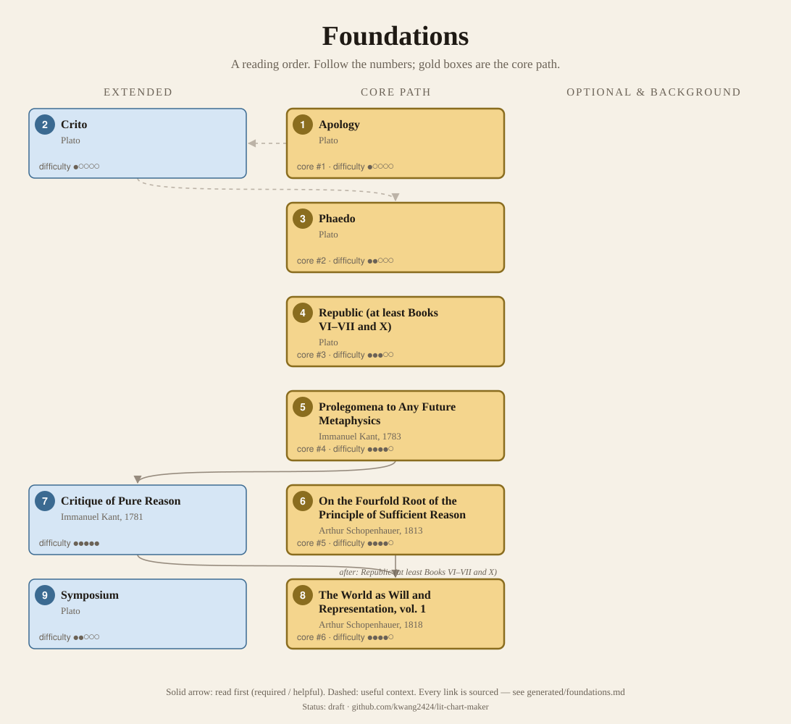
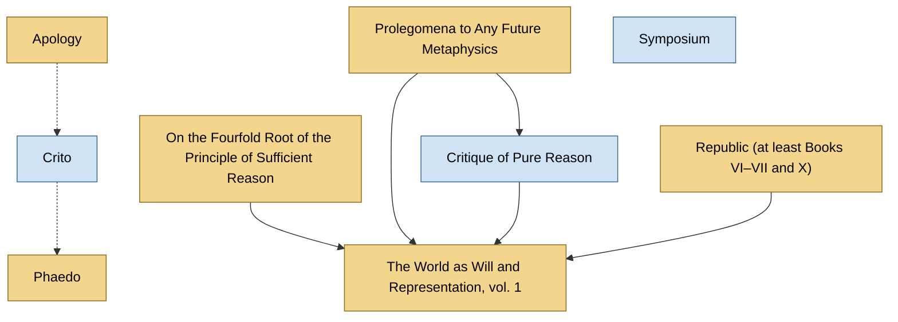

<!-- Generated by tools/build.py from lists/foundations.yaml. Do not edit by hand. -->
# Foundations: reading order

**Status:** draft · **Citations checked:** 9/9

**Scope:** The predecessors that Nietzsche, Deleuze and Jung most depend on, read only as far as they need: a handful of Plato dialogues, Kant through his own short introduction, and Schopenhauer. The author lists link here.

## Core path

The shortest route through the essentials.

1. **Apology** · difficulty ●○○○○
2. **Phaedo** · difficulty ●●○○○
3. **Republic (at least Books VI–VII and X)** · difficulty ●●●○○
4. **Prolegomena to Any Future Metaphysics** (1783) · difficulty ●●●●○
5. **On the Fourfold Root of the Principle of Sufficient Reason** (1813) · difficulty ●●●●○
6. **The World as Will and Representation, vol. 1** (1818) · difficulty ●●●●○

## Full path

Every work, in order. Extended and optional works are placed where they fit best.

### 1. Apology

`core · primary · difficulty ●○○○○` · Plato

Socrates' defence at his trial. Short, readable, and the Socrates Nietzsche argues with.

**Translation:** Grube (in Hackett's Complete Works) or Jowett (free online)

### 2. Crito

`extended · primary · difficulty ●○○○○` · Plato

Socrates in prison refuses to escape. Very short.

**Read first:**

- *Apology* — *context*. It is set in prison after the trial, while Socrates waits for "the ship from Delos" whose return means his execution.
  - Plato, *Crito (with Jowett's introduction)*, opening exchange; Jowett's introduction (on the trial) [author] ✓ checked in Jowett trans., Project Gutenberg

### 3. Phaedo

`core · primary · difficulty ●●○○○` · Plato

Socrates' last day: arguments that the soul is immortal and belongs to a truer world than the body. Ends with his death.

**Read first:**

- *Crito* — *context*. It tells how the sacred ship's voyage delayed the execution, then narrates the death.
  - Plato, *Phaedo*, opening (the ship to Delos) and ending [author] ✓ checked in Jowett trans., Project Gutenberg

### 4. Republic (at least Books VI–VII and X)

`core · primary · difficulty ●●●○○` · Plato

The sun, the divided line and the cave (Books VI–VII) and the Ideas and their copies (Book X): the "true world" Nietzsche mocks and Deleuze sets out to overturn.

**Translation:** Grube rev. Reeve (Hackett) or Jowett (free online)

**Reading tips:**

- Book VII opens with the cave; Book X explains Ideas and copies with the example of beds and tables.
  - Plato, *Republic*, Book VII opening; Book X [author] ✓ checked in Jowett trans., Project Gutenberg

### 5. Prolegomena to Any Future Metaphysics (1783)

`core · primary · difficulty ●●●●○` · Immanuel Kant

Kant's own short version of the Critique of Pure Reason. For most readers of Nietzsche, Deleuze or Jung this, plus a good guide, is enough Kant.

**Translation:** Hatfield (Cambridge) or Carus (free online)

### 6. On the Fourfold Root of the Principle of Sufficient Reason (1813)

`core · primary · difficulty ●●●●○` · Arthur Schopenhauer

His dissertation, which he insisted is the introduction to his main work.

### 7. Critique of Pure Reason (1781)

`extended · background · difficulty ●●●●●` · Immanuel Kant

The book Schopenhauer and Deleuze rework. Very hard; read with a guide.

**Translation:** Guyer & Wood or Pluhar

**Read first:**

- *Prolegomena to Any Future Metaphysics* — *helpful*. Kant wrote the Prolegomena as the Critique's "plan" and "a preliminary exercise", because readers found the Critique too diffuse to follow.
  - Immanuel Kant, *Prolegomena to Any Future Metaphysics (Preface)*, Preface [author] ✓ checked in Carus trans. (Open Court, 1912), Project Gutenberg

### 8. The World as Will and Representation, vol. 1 (1818)

`core · primary · difficulty ●●●●○` · Arthur Schopenhauer

Nietzsche's starting point, which he later turned against, and a major influence on Jung. Book IV (on the will and pessimism) matters most.

**Translation:** Payne (Dover) or Norman, Welchman & Janaway (Cambridge)

**Reading tips:**

- Schopenhauer advises reading his appendix, "Criticism of the Kantian Philosophy", first, and warns that the appendix and the book "must be read twice".
  - Arthur Schopenhauer, *The World as Will and Representation, Preface to the first edition*, Preface to the first edition [author] ✓ checked in Haldane & Kemp trans., Project Gutenberg

**Read first:**

- *On the Fourfold Root of the Principle of Sufficient Reason* — *required*. He says that without this "introduction and propaedeutic" it is "absolutely impossible to understand the present work properly".
  - Arthur Schopenhauer, *The World as Will and Representation, Preface to the first edition*, Preface to the first edition [author] ✓ checked in Haldane & Kemp trans., Project Gutenberg
- *Prolegomena to Any Future Metaphysics* — *required*. "The philosophy of Kant ... is the only philosophy with which a thorough acquaintance is directly presupposed." The Prolegomena is Kant's own summary.
  - Arthur Schopenhauer, *The World as Will and Representation, Preface to the first edition*, Preface to the first edition [author] ✓ checked in Haldane & Kemp trans., Project Gutenberg
- *Critique of Pure Reason* — *helpful*. The book he presupposes and criticizes in his appendix is above all the Critique.
  - Arthur Schopenhauer, *The World as Will and Representation, Preface to the first edition*, Preface to the first edition [author] ✓ checked in Haldane & Kemp trans., Project Gutenberg
- *Republic (at least Books VI–VII and X)* — *helpful*. A reader who "has lingered in the school of the divine Plato" will be "so much the better prepared".
  - Arthur Schopenhauer, *The World as Will and Representation, Preface to the first edition*, Preface to the first edition [author] ✓ checked in Haldane & Kemp trans., Project Gutenberg

### 9. Symposium

`extended · primary · difficulty ●●○○○` · Plato

Speeches on love at a drinking party, crashed at the end by a drunk Alcibiades. Read it any time after the Apology; it matters most for The Birth of Tragedy.

## Map

Solid arrows: required or helpful. Dotted: context.

## Sources

- **[author]** Immanuel Kant, *Prolegomena to Any Future Metaphysics (Preface)*, 1783
- **[author]** Plato, *Crito (with Jowett's introduction)*
- **[author]** Plato, *Phaedo*
- **[author]** Plato, *Republic*
- **[author]** Arthur Schopenhauer, *The World as Will and Representation, Preface to the first edition*, 1818
