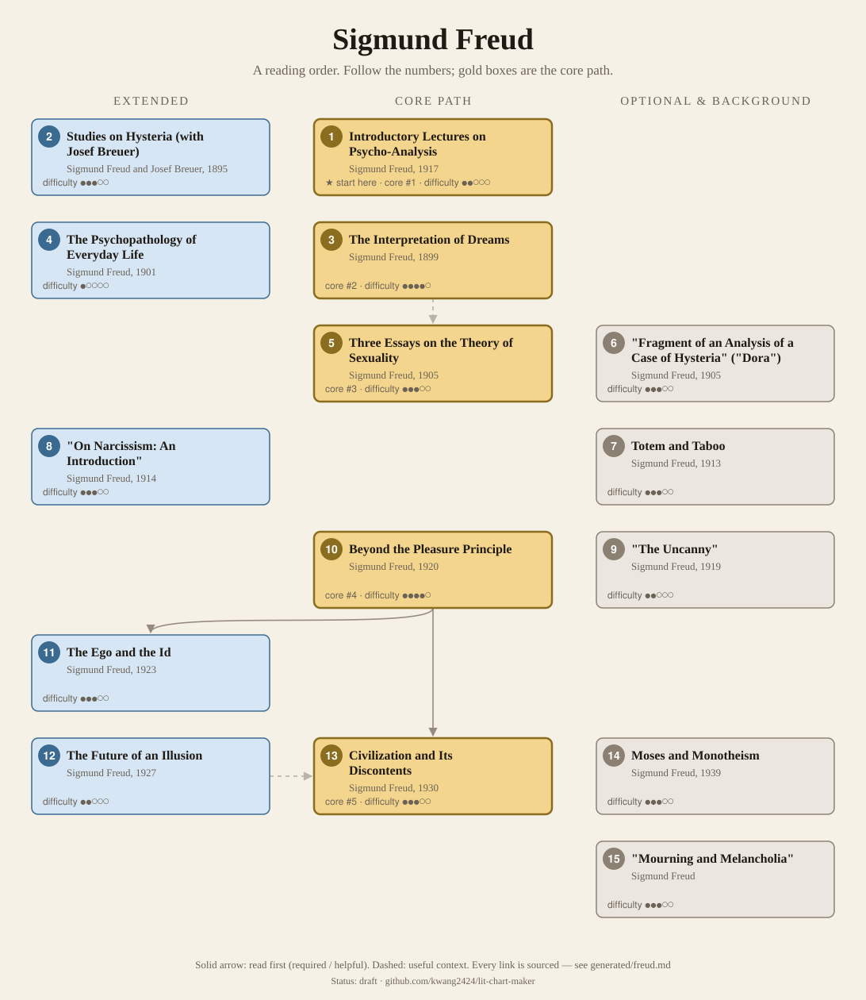

<!-- Generated by tools/build.py from lists/freud.yaml. Do not edit by hand. -->
# Sigmund Freud: reading order

**Status:** draft · **Citations:** 14 citations · 14 checked by Claude (AI) · 0 reviewed by a person

**Scope:** Freud's major books and the shorter papers most often taught. Background for Jung, who began as his closest collaborator, and for Deleuze and Guattari's Anti-Oedipus.

> Citations marked "checked by Claude (AI)" were read against the named edition by an AI and have not yet been reviewed by a person. See [CONTRIBUTING.md](../CONTRIBUTING.md) to help review them.

## Core path

The shortest route through the essentials.

1. **Introductory Lectures on Psycho-Analysis** (1917) · difficulty ●●○○○ · ★ start here
2. **The Interpretation of Dreams** (1899) · difficulty ●●●●○
3. **Three Essays on the Theory of Sexuality** (1905) · difficulty ●●●○○
4. **Beyond the Pleasure Principle** (1920) · difficulty ●●●●○
5. **Civilization and Its Discontents** (1930) · difficulty ●●●○○

## What the sources say

We surveyed 5 independent sources (5 course syllabi and teaching lists) and recorded which books each one assigns or recommends, and where it starts.

| Book | Recommended by | First book in |
|---|---|---|
| The Interpretation of Dreams | 3/5 |  |
| Three Essays on the Theory of Sexuality | 3/5 |  |
| Beyond the Pleasure Principle | 3/5 |  |
| Studies on Hysteria (with Josef Breuer) | 2/5 | 1 |
| Civilization and Its Discontents | 2/5 |  |
| "Fragment of an Analysis of a Case of Hysteria" ("Dora") | 2/5 |  |
| "On Narcissism: An Introduction" | 2/5 |  |
| The Ego and the Id | 1/5 |  |
| Moses and Monotheism | 1/5 |  |
| The Psychopathology of Everyday Life | 1/5 |  |
| "The Uncanny" | 1/5 |  |
| Introductory Lectures on Psycho-Analysis | 1/5 |  |
| "Mourning and Melancholia" | 1/5 |  |

**Sources surveyed**

- **Columbia University, Institute for Comparative Literature and Society, Freud (course page)** [teaching]: Studies on Hysteria (with Josef Breuer) → The Interpretation of Dreams → Three Essays on the Theory of Sexuality → "On Narcissism: An Introduction" → Beyond the Pleasure Principle. ✓ checked by Claude (AI) in Course web page, accessed 2026-11; not yet reviewed by a person
- **University of Warwick, EN3E8: Freud and psychoanalysis (2025 module outline)** [teaching]: Studies on Hysteria (with Josef Breuer), Three Essays on the Theory of Sexuality, "On Narcissism: An Introduction", The Ego and the Id, The Interpretation of Dreams, Moses and Monotheism. ✓ checked by Claude (AI) in Course web page, accessed 2026-11; not yet reviewed by a person
- **University of Washington, Freud and the Literary Imagination** [teaching]: Civilization and Its Discontents → "The Uncanny" → "Fragment of an Analysis of a Case of Hysteria" ("Dora"). ✓ checked by Claude (AI) in Course web page, accessed 2026-11; not yet reviewed by a person
- **Brooklyn Institute for Social Research, Strangers to Ourselves: An Introduction to Freud (2025)** [teaching]: The Interpretation of Dreams, The Psychopathology of Everyday Life, Three Essays on the Theory of Sexuality, Beyond the Pleasure Principle, Civilization and Its Discontents, "Fragment of an Analysis of a Case of Hysteria" ("Dora"). ✓ checked by Claude (AI) in Course web page, accessed 2026-11; not yet reviewed by a person
- **St. John's College (Annapolis and Santa Fe), Undergraduate program reading list, by class year** [teaching] (expert's shortlist): Introductory Lectures on Psycho-Analysis, "Mourning and Melancholia", Beyond the Pleasure Principle. ✓ checked by Claude (AI) in Reading list web page, accessed 2026-11; not yet reviewed by a person

## Full path

Every work, in order. Extended and optional works are placed where they fit best.

### 1. Introductory Lectures on Psycho-Analysis (1917)

`core · primary · difficulty ●●○○○` · Sigmund Freud

Lectures for a general audience on slips, dreams and the neuroses.

*Why this tier:* Kept core as the way in, though the surveyed courses go straight to the major works.

**Translation:** Riviere (free online, 1922) or Strachey (Norton)

**★ Good place to start.** Ernest Jones introduced it as the "suitable text-book with which [beginners] could begin their studies" that the field had lacked.

- Ernest Jones, *Preface to Freud, Introductory Lectures on Psycho-Analysis (trans. Riviere)*, Preface [scholarly] ✓ checked by Claude (AI) in Riviere trans. (1922), Project Gutenberg #75810; not yet reviewed by a person

**Reading tips:**

- Parts I (slips) and II (dreams) "presuppose absolutely no knowledge of the subject"; Part III, on the neuroses, assumes more.
  - Ernest Jones, *Preface to Freud, Introductory Lectures on Psycho-Analysis (trans. Riviere)*, Preface [scholarly] ✓ checked by Claude (AI) in Riviere trans. (1922), Project Gutenberg #75810; not yet reviewed by a person

### 2. Studies on Hysteria (with Josef Breuer) (1895)

`extended · primary · difficulty ●●●○○` · Sigmund Freud and Josef Breuer

The case histories, including "Anna O.", from which psychoanalysis grew.

### 3. The Interpretation of Dreams (1899)

`core · primary · difficulty ●●●●○` · Sigmund Freud

Dreams as disguised wish-fulfilments; chapter VII lays out his model of the mind.

**Translation:** Strachey (Basic Books) or Crick (Oxford); Brill (free online)

**Reading tips:**

- The IEP calls it his masterpiece, "generally regarded as his greatest work".
  - Internet Encyclopedia of Philosophy, *"Sigmund Freud (1856–1939)"*, §1 Life [scholarly] ✓ checked by Claude (AI) in IEP online, accessed 2026-11; not yet reviewed by a person

### 4. The Psychopathology of Everyday Life (1901)

`extended · primary · difficulty ●○○○○` · Sigmund Freud

Slips of the tongue, forgetting and mistakes. Light and readable.

### 5. Three Essays on the Theory of Sexuality (1905)

`core · primary · difficulty ●●●○○` · Sigmund Freud

Infantile sexuality and the drives; the other pillar of early psychoanalysis.

**Read first:**

- *The Interpretation of Dreams* — *context*. Freud notes that when he wrote the dream book in 1899 the "Sexual Theories" did not yet exist, and that later work on the neuroses changed how he saw dreams.
  - Sigmund Freud, *The Interpretation of Dreams, Preface to the third edition*, Preface to the third edition [author] ✓ checked by Claude (AI) in Brill trans., Project Gutenberg #66048; not yet reviewed by a person

### 6. "Fragment of an Analysis of a Case of Hysteria" ("Dora") (1905)

`optional · primary · difficulty ●●●○○` · Sigmund Freud

The most discussed of his case histories.

### 7. Totem and Taboo (1913)

`optional · primary · difficulty ●●●○○` · Sigmund Freud

Psychoanalysis applied to the origins of religion and morality.

### 8. "On Narcissism: An Introduction" (1914)

`extended · primary · difficulty ●●●○○` · Sigmund Freud

A short paper that reshapes his theory of the drives.

### 9. "The Uncanny" (1919)

`optional · primary · difficulty ●●○○○` · Sigmund Freud

An essay on literature and the eerie, much read outside psychology.

### 10. Beyond the Pleasure Principle (1920)

`core · primary · difficulty ●●●●○` · Sigmund Freud

Repetition and the death drive. Short but speculative.

**Read first:**

- *Symposium* (from the [Plato list](plato.md)) — *context*. To derive an instinct from the need to restore an earlier state, Freud turns to "the theory that Plato in his Symposium puts into the mouth of Aristophanes".
  - Sigmund Freud, *Beyond the Pleasure Principle (Hubback trans., 1922)*, Chapter VI [author] ✓ checked by Claude (AI) in Hubback trans. (1922), Project Gutenberg #76031; not yet reviewed by a person
- *The World as Will and Representation, vol. 1* (from the [Arthur Schopenhauer list](schopenhauer.md)) — *context*. Freud: "we have steered unawares into the haven of Schopenhauer's philosophy, for whom death is the 'real result' of life", while the sexual instinct is "the incarnation of the will to live".
  - Sigmund Freud, *Beyond the Pleasure Principle (Hubback trans., 1922)*, Chapter VI [author] ✓ checked by Claude (AI) in Hubback trans. (1922), Project Gutenberg #76031; not yet reviewed by a person

### 11. The Ego and the Id (1923)

`extended · primary · difficulty ●●●○○` · Sigmund Freud

The structural model of ego, id and super-ego.

**Read first:**

- *Beyond the Pleasure Principle* — *helpful*. Freud says it takes the train of thought begun in Beyond the Pleasure Principle and develops it "further".
  - Sigmund Freud, *The Ego and the Id, Introduction*, Introduction [author] ✓ checked by Claude (AI) in Riviere trans. (1927), Project Gutenberg #79682; not yet reviewed by a person

### 12. The Future of an Illusion (1927)

`extended · primary · difficulty ●●○○○` · Sigmund Freud

Religion as wish-fulfilment. Short.

### 13. Civilization and Its Discontents (1930)

`core · primary · difficulty ●●●○○` · Sigmund Freud

Why civilization makes us unhappy; guilt, aggression and the death drive.

**Read first:**

- *The Future of an Illusion* — *context*. It opens by recalling the reply to "my little book which treats of religion as an illusion".
  - Sigmund Freud, *Civilization and Its Discontents*, Chapter I [author] ✓ checked by Claude (AI) in Riviere trans. (1930), Project Gutenberg #78221; not yet reviewed by a person
- *Beyond the Pleasure Principle* — *helpful*. Its argument about aggression rests on the death instinct; Freud recalls that he "made the next step in Beyond the Pleasure Principle (1920)".
  - Sigmund Freud, *Civilization and Its Discontents*, Chapter VI [author] ✓ checked by Claude (AI) in Riviere trans. (1930), Project Gutenberg #78221; not yet reviewed by a person

### 14. Moses and Monotheism (1939)

`optional · primary · difficulty ●●●○○` · Sigmund Freud

His last book.

### 15. "Mourning and Melancholia"

`optional · primary · difficulty ●●●○○` · Sigmund Freud

A short paper distinguishing mourning from melancholia. St John's reads it in the senior year between the Introductory Lectures and Beyond the Pleasure Principle; Edinburgh's psychoanalysis and literature course reads it with Studies on Hysteria.

## Map

Solid arrows: required or helpful. Dotted: context.

```mermaid
graph TD
  introductory_lectures["Introductory Lectures on Psycho-Analysis"]:::core
  studies_hysteria["Studies on Hysteria (with Josef Breuer)"]:::extended
  interpretation_of_dreams["The Interpretation of Dreams"]:::core
  psychopathology["The Psychopathology of Everyday Life"]:::extended
  three_essays["Three Essays on the Theory of Sexuality"]:::core
  dora["'Fragment of an Analysis of a Case of Hysteria' ('Dora')"]:::optional
  totem_and_taboo["Totem and Taboo"]:::optional
  on_narcissism["'On Narcissism: An Introduction'"]:::extended
  uncanny["'The Uncanny'"]:::optional
  beyond_pleasure["Beyond the Pleasure Principle"]:::core
  ego_and_id["The Ego and the Id"]:::extended
  future_of_an_illusion["The Future of an Illusion"]:::extended
  civilization["Civilization and Its Discontents"]:::core
  moses["Moses and Monotheism"]:::optional
  mourning_melancholia["'Mourning and Melancholia'"]:::optional
  interpretation_of_dreams -.-> three_essays
  beyond_pleasure --> ego_and_id
  future_of_an_illusion -.-> civilization
  beyond_pleasure --> civilization
  classDef core fill:#f4d58d,stroke:#8a6d1f,color:#000
  classDef extended fill:#cfe3f5,stroke:#3b6a91,color:#000
  classDef optional fill:#eeeeee,stroke:#888,color:#000
```

## Connections

**Builds on**

- *Symposium* (Plato) → *Beyond the Pleasure Principle* — context. To derive an instinct from the need to restore an earlier state, Freud turns to "the theory that Plato in his Symposium puts into the mouth of Aristophanes".
- *The World as Will and Representation, vol. 1* (Arthur Schopenhauer) → *Beyond the Pleasure Principle* — context. Freud: "we have steered unawares into the haven of Schopenhauer's philosophy, for whom death is the 'real result' of life", while the sexual instinct is "the incarnation of the will to live".

**Who builds on Sigmund Freud**

- *Three Essays on the Theory of Sexuality* → *Anti-Oedipus (Capitalism and Schizophrenia, vol. 1)* (Gilles Deleuze) — context. The Freud side of its critique: the same course suggests Freud's Three Essays on sexuality as preparation.
- *The Interpretation of Dreams* → *The Theory of Psychoanalysis* (C. G. Jung) — helpful. Jung says these lectures are where he first defines his own theoretical position toward Freud's principles.
- *The Interpretation of Dreams* → *Symbols of Transformation (first published as Psychology of the Unconscious)* (C. G. Jung) — helpful. It is Jung's "first important statement of his independent position"; it widens Freud's idea of libido from sexuality to psychic energy in general.
- *The Interpretation of Dreams* → *Discourse, Figure* (Jean-François Lyotard) — context. The second part "uses Freudian psychoanalysis to undermine both Lacanian psychoanalysis and certain aspects of phenomenology".

## Sources

- **[author]** Sigmund Freud, *Beyond the Pleasure Principle (Hubback trans., 1922)* — <https://www.gutenberg.org/ebooks/76031>
- **[author]** Sigmund Freud, *Civilization and Its Discontents*, 1930
- **[author]** Sigmund Freud, *The Interpretation of Dreams, Preface to the third edition*, 1911
- **[author]** Sigmund Freud, *The Ego and the Id, Introduction*, 1923
- **[scholarly]** Internet Encyclopedia of Philosophy, *"Sigmund Freud (1856–1939)"* — <https://iep.utm.edu/freud/>
- **[scholarly]** Ernest Jones, *Preface to Freud, Introductory Lectures on Psycho-Analysis (trans. Riviere)*, 1922
- **[teaching]** Brooklyn Institute for Social Research, *Strangers to Ourselves: An Introduction to Freud (2025)* — <https://thebrooklyninstitute.com/items/courses/strangers-to-ourselves-an-introduction-to-freud-4/>
- **[teaching]** St. John's College (Annapolis and Santa Fe), *Undergraduate program reading list, by class year* — <https://www.sjc.edu/reading-list>
- **[teaching]** Columbia University, Institute for Comparative Literature and Society, *Freud (course page)* — <https://icls.columbia.edu/courses/freud-4>
- **[teaching]** University of Washington, *Freud and the Literary Imagination* — <https://courses.washington.edu/freudlit/Syllabus.html>
- **[teaching]** University of Warwick, *EN3E8: Freud and psychoanalysis (2025 module outline)* — <https://courses.warwick.ac.uk/modules/2025/EN3E8-30>
