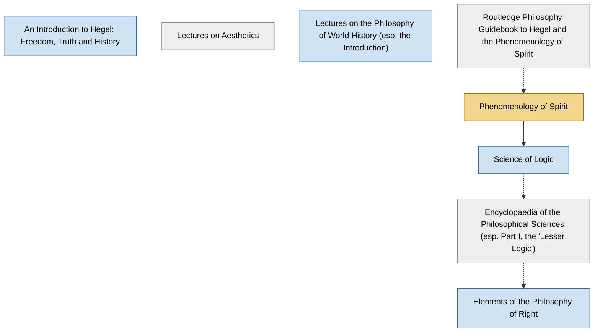

<!-- Generated by tools/build.py from lists/hegel.yaml. Do not edit by hand. -->
# G. W. F. Hegel: reading order

**Status:** draft · **Citations:** 32 citations · 32 checked by Claude (AI) · 0 reviewed by a person

**Scope:** Hegel's books and the lecture courses published after his death, with the two guides courses most often recommend. Nietzsche and Deleuze both define themselves against him, so a summary-level grasp is enough for most readers of this site.

> Citations marked "checked by Claude (AI)" were read against the named edition by an AI and have not yet been reviewed by a person. See [CONTRIBUTING.md](../CONTRIBUTING.md) to help review them.

## Core path

The shortest route through the essentials.

1. **Phenomenology of Spirit** (1807) · difficulty ●●●●● · ★ start here · first book in 5 surveyed sources

## What the sources say

We surveyed 9 independent sources (2 scholarly guides and 7 course syllabi and teaching lists) and recorded which books each one assigns or recommends, and where it starts.

| Book | Recommended by | First book in |
|---|---|---|
| Phenomenology of Spirit | 9/9 | 5 |
| Elements of the Philosophy of Right | 2/9 |  |
| Lectures on the Philosophy of World History (esp. the Introduction) | 1/9 | 1 |
| Lectures on Aesthetics | 1/9 |  |
| Science of Logic | 1/9 |  |

**Sources surveyed**

- **Rocío Zambrana, University of Oregon, PHIL 453/553: Hegel's Phenomenology of Spirit (Spring 2019)** [teaching]: Phenomenology of Spirit. ✓ checked by Claude (AI) in Course syllabus (PDF), accessed 2026-11; not yet reviewed by a person
- **Michael Hardimon, UC San Diego, Philosophy 107: Hegel, The Phenomenology of Spirit (Winter 2019)** [teaching]: Phenomenology of Spirit. ✓ checked by Claude (AI) in Course syllabus (PDF), accessed 2026-11; not yet reviewed by a person
- **Caroline Bowman, NYU, From Hegel to Nietzsche: Freedom and Alienation in 19th-Century German Philosophy** [teaching]: Lectures on the Philosophy of World History (esp. the Introduction) → Phenomenology of Spirit → Elements of the Philosophy of Right. ✓ checked by Claude (AI) in Course syllabus (PDF), accessed 2026-11; not yet reviewed by a person
- **McGill University, PHIL 460: Hegel's Phenomenology of Spirit (Winter 2012)** [teaching]: Phenomenology of Spirit. ✓ checked by Claude (AI) in Course syllabus (PDF), accessed 2026-11; not yet reviewed by a person
- **UC Riverside, PHIL 282: Graduate Seminar, Hegel's Phenomenology of Spirit** [teaching]: Phenomenology of Spirit. ✓ checked by Claude (AI) in Course syllabus (PDF), accessed 2026-11; not yet reviewed by a person
- **University of Edinburgh, PHIL10047: The Early Continentals: Hegel and Nietzsche, course guide (2017–18)** [teaching]: Phenomenology of Spirit. ✓ checked by Claude (AI) in Course guide (PDF), accessed 2026-11; not yet reviewed by a person
- **Stephen Houlgate, interviewed by Five Books, The Best Hegel Books (2018)** [scholarly] (expert's shortlist): Phenomenology of Spirit, Science of Logic, Lectures on Aesthetics. ✓ checked by Claude (AI) in Five Books interview (web page), accessed 2026-11; not yet reviewed by a person
- **Nigel Warburton, Philosophy: The Classics (4th ed.)** [scholarly] (expert's shortlist): Phenomenology of Spirit. ✓ checked by Claude (AI) in Routledge book page (table of contents), accessed 2026-11; not yet reviewed by a person
- **St. John's College (Annapolis and Santa Fe), Undergraduate program reading list, by class year** [teaching] (expert's shortlist): Elements of the Philosophy of Right, Phenomenology of Spirit. ✓ checked by Claude (AI) in Reading list web page, accessed 2026-11; not yet reviewed by a person

## Full path

Every work, in order. Extended and optional works are placed where they fit best.

### 1. An Introduction to Hegel: Freedom, Truth and History (2005)

`extended · secondary · difficulty ●●○○○` · Stephen Houlgate

An overview of the whole philosophy. Good before or instead of the primary texts.

**Reading tips:**

- Recommended as background reading in two surveyed courses and listed in the SEP bibliography.
  - Rocío Zambrana, University of Oregon, *PHIL 453/553: Hegel's Phenomenology of Spirit (Spring 2019)*, recommended reading [teaching] ✓ checked by Claude (AI) in Course syllabus (PDF), accessed 2026-11; not yet reviewed by a person
  - McGill University, *PHIL 460: Hegel's Phenomenology of Spirit (Winter 2012)*, recommended reading [teaching] ✓ checked by Claude (AI) in Course syllabus (PDF), accessed 2026-11; not yet reviewed by a person

### 2. Phenomenology of Spirit (1807)

`core · primary · difficulty ●●●●●` · G. W. F. Hegel

Consciousness climbs from sense-certainty to absolute knowing; includes the famous master–slave ("lordship and bondage") section. Courses begin with the Preface and Introduction.

**Translation:** Pinkard (Cambridge) or Miller (Oxford)

**★ Good place to start.** Every surveyed course assigns it, and the SEP describes it as "a type of propaedeutic to philosophy", an education of the reader into Hegel's standpoint.

- Paul Redding, *"Georg Wilhelm Friedrich Hegel", Stanford Encyclopedia of Philosophy*, §3.1.1 Phenomenology of Spirit [scholarly] ✓ checked by Claude (AI) in SEP online, accessed 2026-11; not yet reviewed by a person

**Reading tips:**

- Stephen Houlgate: "The Phenomenology is an introduction to Hegel's system, but it doesn't tell you what's going to come later"; the Logic "is the start of Hegel's system".
  - Stephen Houlgate, interviewed by Five Books, *The Best Hegel Books (2018)*, pick 1 [scholarly] ✓ checked by Claude (AI) in Five Books interview (web page), accessed 2026-11; not yet reviewed by a person

**Read first:**

- *Presentation of My System of Philosophy* (from the [F. W. J. Schelling list](schelling.md)) — *context*. Its Preface mocks an Absolute that is, in the IEP's words, "the night where all cows are black"; the IEP and SEP read this as aimed at Schelling's identity philosophy (Schelling asked Hegel whether it was meant for him).
  - Internet Encyclopedia of Philosophy, *"Friedrich Wilhelm Joseph von Schelling (1775—1854)"*, on Hegel's Phenomenology (§1) [scholarly] ✓ checked by Claude (AI) in IEP entry, accessed 2026-11; not yet reviewed by a person
- *Routledge Philosophy Guidebook to Hegel and the Phenomenology of Spirit* — *context*. Two surveyed courses recommend Stern's guidebook as a commentary to read alongside.
  - Rocío Zambrana, University of Oregon, *PHIL 453/553: Hegel's Phenomenology of Spirit (Spring 2019)*, commentaries on the Phenomenology [teaching] ✓ checked by Claude (AI) in Course syllabus (PDF), accessed 2026-11; not yet reviewed by a person
  - UC Riverside, *PHIL 282: Graduate Seminar, Hegel's Phenomenology of Spirit*, secondary literature [teaching] ✓ checked by Claude (AI) in Course syllabus (PDF), accessed 2026-11; not yet reviewed by a person
  - University of Edinburgh, *PHIL10047: The Early Continentals: Hegel and Nietzsche, course guide (2017–18)*, course guide (Stern's guidebook 'is really helpful') [teaching] ✓ checked by Claude (AI) in Course guide (PDF), accessed 2026-11; not yet reviewed by a person
- *Critique of Pure Reason* (from the [Immanuel Kant list](kant.md)) — *context*. The SEP traces Hegel's idea of a "phenomenology" as a propaedeutic to Kant, and Edinburgh's course spends two weeks on Kant "setting us up to see how Hegel's Phenomenology is shaped by it".
  - University of Edinburgh, *PHIL10047: The Early Continentals: Hegel and Nietzsche, course guide (2017–18)*, Week 2: From Kant to Hegel [teaching] ✓ checked by Claude (AI) in Course guide (PDF), accessed 2026-11; not yet reviewed by a person
  - Paul Redding, *"Georg Wilhelm Friedrich Hegel", Stanford Encyclopedia of Philosophy*, §2.1 and §3.1.1 [scholarly] ✓ checked by Claude (AI) in SEP online, accessed 2026-11; not yet reviewed by a person

### 3. Science of Logic (1812)

`extended · primary · difficulty ●●●●●` · G. W. F. Hegel

The core of the system, and one of the hardest books in philosophy.

**Read first:**

- *Parmenides* (from the [Plato list](plato.md)) — *context*. In his lectures on the history of philosophy, the dialectic "familiar from the Phenomenology and the Logic, comes to fruition in Plato's dialogue Parmenides".
  - Paul Redding, *"Georg Wilhelm Friedrich Hegel", Stanford Encyclopedia of Philosophy*, Lectures on the History of Philosophy (LHP I: 261) [scholarly] ✓ checked by Claude (AI) in SEP entry, accessed 2026-11; not yet reviewed by a person
- *Phenomenology of Spirit* — *helpful*. The Phenomenology is meant to bring the reader to the standpoint of "purely conceptual thought" from which the Logic proceeds.
  - Paul Redding, *"Georg Wilhelm Friedrich Hegel", Stanford Encyclopedia of Philosophy*, §3.1.1 Phenomenology of Spirit [scholarly] ✓ checked by Claude (AI) in SEP online, accessed 2026-11; not yet reviewed by a person
  - McGill University, *PHIL 460: Hegel's Phenomenology of Spirit (Winter 2012)*, course description ("Hegel's introduction to his science of logic") [teaching] ✓ checked by Claude (AI) in Course syllabus (PDF), accessed 2026-11; not yet reviewed by a person

### 4. Encyclopaedia of the Philosophical Sciences (esp. Part I, the "Lesser Logic") (1817)

`optional · primary · difficulty ●●●●●` · G. W. F. Hegel

A teaching handbook of the whole system; Part I is an abbreviated Science of Logic.

**Read first:**

- *Foundation of the Entire Wissenschaftslehre (Science of Knowledge)* (from the [J. G. Fichte list](fichte.md)) — *context*. The Logic credits Fichte: "To the philosophy of Fichte belongs the great merit of having called attention to the need of exhibiting the necessity of these categories and giving a genuine deduction of them."
  - G. W. F. Hegel, *The Logic of Hegel (Encyclopaedia, Part I), Wallace trans.*, §42 (The Critical Philosophy) [author] ✓ checked by Claude (AI) in Wallace trans., The Logic of Hegel, Project Gutenberg #55108; not yet reviewed by a person
- *Metaphysics* (from the [Aristotle list](aristotle.md)) — *context*. The Encyclopaedia closes (§577) with a long Greek quotation from Aristotle's Metaphysics, Book XII, on thought thinking itself; the Philosophy of Mind also credits Aristotle's "entelechy of thought" with "surmounting the Platonic Idea".
  - G. W. F. Hegel, *Hegel's Philosophy of Mind (Encyclopaedia, Part III), Wallace trans.*, §577 (end of the Encyclopaedia) [author] ✓ checked by Claude (AI) in Wallace trans., Hegel's Philosophy of Mind, Project Gutenberg #39064; not yet reviewed by a person
- *Discourse on the Method* (from the [René Descartes list](descartes.md)) — *context*. It discusses the "'Cogito, ergo sum,' of Descartes, the maxim on which may be said to hinge the whole interest of Modern Philosophy", and denies that it is a syllogism.
  - G. W. F. Hegel, *The Logic of Hegel (Encyclopaedia, Part I), Wallace trans.*, §64 [author] ✓ checked by Claude (AI) in Wallace trans., The Logic of Hegel, Project Gutenberg #55108; not yet reviewed by a person
- *Ethics* (from the [Baruch Spinoza list](spinoza.md)) — *context*. It discusses the charges of pantheism and atheism against Spinoza: "The absolute Substance of Spinoza certainly falls short of absolute spirit".
  - G. W. F. Hegel, *The Logic of Hegel (Encyclopaedia, Part I), Wallace trans.*, §50 [author] ✓ checked by Claude (AI) in Wallace trans., The Logic of Hegel, Project Gutenberg #55108; not yet reviewed by a person
- *Critique of Pure Reason* (from the [Immanuel Kant list](kant.md)) — *helpful*. The Logic's preliminary part has a chapter on "The Critical Philosophy" (§§40–60), a sustained critique of Kant's first Critique, starting from Hume's criticism.
  - G. W. F. Hegel, *The Logic of Hegel (Encyclopaedia, Part I), Wallace trans.*, §§40–60 [author] ✓ checked by Claude (AI) in Wallace trans., The Logic of Hegel, Project Gutenberg #55108; not yet reviewed by a person
- *Science of Logic* — *context*. Its first part is "an abbreviated version of the earlier Science of Logic".
  - Paul Redding, *"Georg Wilhelm Friedrich Hegel", Stanford Encyclopedia of Philosophy*, §1 Life, Work, and Influence [scholarly] ✓ checked by Claude (AI) in SEP online, accessed 2026-11; not yet reviewed by a person

### 5. Elements of the Philosophy of Right (1820)

`extended · primary · difficulty ●●●●○` · G. W. F. Hegel

His political philosophy (family, civil society, the state). The Preface has the "owl of Minerva".

**Translation:** Nisbet, ed. Wood (Cambridge)

**Read first:**

- *The Social Contract* (from the [Jean-Jacques Rousseau list](rousseau.md)) — *context*. The SEP reads its account of the rational state as a way of answering "Rousseau's question of the form of association needed for the formation and expression of the general will".
  - Paul Redding, *"Georg Wilhelm Friedrich Hegel", Stanford Encyclopedia of Philosophy*, §3.2.2 Philosophy of Subjective and Objective Spirit [scholarly] ✓ checked by Claude (AI) in SEP entry, accessed 2026-11; not yet reviewed by a person
- *The Metaphysics of Morals* (from the [Immanuel Kant list](kant.md)) — *context*. Its account of punishment continues Kant's: "Kant too, in his Metaphysics of Morals had employed the idea of the state's punitive action as a negating of the original criminal act".
  - Paul Redding, *"Georg Wilhelm Friedrich Hegel", Stanford Encyclopedia of Philosophy*, section on punishment (Philosophy of Right) [scholarly] ✓ checked by Claude (AI) in SEP entry, accessed 2026-11; not yet reviewed by a person
- *Encyclopaedia of the Philosophical Sciences (esp. Part I, the "Lesser Logic")* — *context*. The SEP calls it effectively an expansion of the Encyclopaedia's section on objective spirit.
  - Paul Redding, *"Georg Wilhelm Friedrich Hegel", Stanford Encyclopedia of Philosophy*, §1 and §3.1 [scholarly] ✓ checked by Claude (AI) in SEP online, accessed 2026-11; not yet reviewed by a person

### 6. Lectures on Aesthetics (1835)

`optional · primary · difficulty ●●●●○` · G. W. F. Hegel

Art as a form of absolute spirit, alongside religion and philosophy.

### 7. Lectures on the Philosophy of World History (esp. the Introduction) (1837)

`extended · primary · difficulty ●●●○○` · G. W. F. Hegel

Published from lecture notes after his death. The Introduction is the most approachable Hegel.

**Translation:** Sibree (free online) or Nisbet ("Introduction: Reason in History")

**Reading tips:**

- One surveyed course starts with passages from its Introduction before turning to the Phenomenology.
  - Caroline Bowman, NYU, *From Hegel to Nietzsche: Freedom and Alienation in 19th-Century German Philosophy*, schedule (first meeting) [teaching] ✓ checked by Claude (AI) in Course syllabus (PDF), accessed 2026-11; not yet reviewed by a person

### 8. Routledge Philosophy Guidebook to Hegel and the Phenomenology of Spirit (2002)

`optional · secondary · difficulty ●●●○○` · Robert Stern

A section-by-section guide to the Phenomenology.

## Map

Solid arrows: required or helpful. Dotted: context.

## Connections

**Builds on**

- *Presentation of My System of Philosophy* (F. W. J. Schelling) → *Phenomenology of Spirit* — context. Its Preface mocks an Absolute that is, in the IEP's words, "the night where all cows are black"; the IEP and SEP read this as aimed at Schelling's identity philosophy (Schelling asked Hegel whether it was meant for him).
- *Critique of Pure Reason* (Immanuel Kant) → *Phenomenology of Spirit* — context. The SEP traces Hegel's idea of a "phenomenology" as a propaedeutic to Kant, and Edinburgh's course spends two weeks on Kant "setting us up to see how Hegel's Phenomenology is shaped by it".
- *Parmenides* (Plato) → *Science of Logic* — context. In his lectures on the history of philosophy, the dialectic "familiar from the Phenomenology and the Logic, comes to fruition in Plato's dialogue Parmenides".
- *Foundation of the Entire Wissenschaftslehre (Science of Knowledge)* (J. G. Fichte) → *Encyclopaedia of the Philosophical Sciences (esp. Part I, the "Lesser Logic")* — context. The Logic credits Fichte: "To the philosophy of Fichte belongs the great merit of having called attention to the need of exhibiting the necessity of these categories and giving a genuine deduction of them."
- *Metaphysics* (Aristotle) → *Encyclopaedia of the Philosophical Sciences (esp. Part I, the "Lesser Logic")* — context. The Encyclopaedia closes (§577) with a long Greek quotation from Aristotle's Metaphysics, Book XII, on thought thinking itself; the Philosophy of Mind also credits Aristotle's "entelechy of thought" with "surmounting the Platonic Idea".
- *Discourse on the Method* (René Descartes) → *Encyclopaedia of the Philosophical Sciences (esp. Part I, the "Lesser Logic")* — context. It discusses the "'Cogito, ergo sum,' of Descartes, the maxim on which may be said to hinge the whole interest of Modern Philosophy", and denies that it is a syllogism.
- *Ethics* (Baruch Spinoza) → *Encyclopaedia of the Philosophical Sciences (esp. Part I, the "Lesser Logic")* — context. It discusses the charges of pantheism and atheism against Spinoza: "The absolute Substance of Spinoza certainly falls short of absolute spirit".
- *Critique of Pure Reason* (Immanuel Kant) → *Encyclopaedia of the Philosophical Sciences (esp. Part I, the "Lesser Logic")* — helpful. The Logic's preliminary part has a chapter on "The Critical Philosophy" (§§40–60), a sustained critique of Kant's first Critique, starting from Hume's criticism.
- *The Social Contract* (Jean-Jacques Rousseau) → *Elements of the Philosophy of Right* — context. The SEP reads its account of the rational state as a way of answering "Rousseau's question of the form of association needed for the formation and expression of the general will".
- *The Metaphysics of Morals* (Immanuel Kant) → *Elements of the Philosophy of Right* — context. Its account of punishment continues Kant's: "Kant too, in his Metaphysics of Morals had employed the idea of the state's punitive action as a negating of the original criminal act".

**Who builds on G. W. F. Hegel**

- *Lectures on the Philosophy of World History (esp. the Introduction)* → *"Two Concepts of Liberty"* (Isaiah Berlin) — context. It criticises Hegel's definition of liberty as "recognition of, and obedience to, the laws of history as revealed by reason".
- *Phenomenology of Spirit* → *Nietzsche and Philosophy* (Gilles Deleuze) — context. It is written against Hegel: the SEP describes Deleuze's early books as trying to "accelerate however he could a departure from Hegel".
- *Phenomenology of Spirit* → *Hegel's Phenomenology of Spirit (lecture course, 1930–31)* (Martin Heidegger) — required. It is a lecture course on Hegel's Phenomenology of Spirit.
- *Phenomenology of Spirit* → *Either/Or: A Fragment of Life* (Søren Kierkegaard) — context. The IEP: "The Unhappiest One", in volume 1, is "an echo of Hegel's 'unhappy consciousness'".
- *Phenomenology of Spirit* → *The Sickness Unto Death* (Søren Kierkegaard) — context. The SEP: "Like Hegel, Anti-Climacus holds both that human beings are to be understood as 'spirit', and that spirit must become itself through a process"; unlike Hegel, he focuses on the individual self.
- *Elements of the Philosophy of Right* → *Contribution to the Critique of Hegel's Philosophy of Right: Introduction* (Karl Marx) — context. It is a critique of Hegel's Philosophy of Right, as its title says.
- *Science of Logic* → *Capital, Volume 1* (Karl Marx) — context. He "openly avowed myself the pupil of that mighty thinker" Hegel, whose dialectic "is standing on its head. It must be turned right side up again."
- *Phenomenology of Spirit* → *Being and Nothingness: An Essay on Phenomenological Ontology* (Jean-Paul Sartre) — context. Its chapter on concrete relations with others is "essentially a restatement of the 'master-slave' stage of Hegel's struggle for recognition without the possibility of its overcoming".

## Sources

- **[author]** G. W. F. Hegel, *The Logic of Hegel (Encyclopaedia, Part I), Wallace trans.* — <https://www.gutenberg.org/ebooks/55108>
- **[author]** G. W. F. Hegel, *Hegel's Philosophy of Mind (Encyclopaedia, Part III), Wallace trans.* — <https://www.gutenberg.org/ebooks/39064>
- **[scholarly]** Stephen Houlgate, interviewed by Five Books, *The Best Hegel Books (2018)* — <https://fivebooks.com/best-books/hegel-stephen-houlgate/>
- **[scholarly]** Internet Encyclopedia of Philosophy, *"Friedrich Wilhelm Joseph von Schelling (1775—1854)"* — <https://iep.utm.edu/schellin/>
- **[scholarly]** Paul Redding, *"Georg Wilhelm Friedrich Hegel", Stanford Encyclopedia of Philosophy* — <https://plato.stanford.edu/entries/hegel/>
- **[scholarly]** Nigel Warburton, *Philosophy: The Classics (4th ed.)*, Routledge, 2014 — <https://www.routledge.com/Philosophy-The-Classics/Warburton/p/book/9780415534666>
- **[teaching]** University of Edinburgh, *PHIL10047: The Early Continentals: Hegel and Nietzsche, course guide (2017–18)* — <https://edwebcontent.ed.ac.uk/sites/default/files/atoms/files/the_early_continentals_course_guide_2017_18.pdf>
- **[teaching]** St. John's College (Annapolis and Santa Fe), *Undergraduate program reading list, by class year* — <https://www.sjc.edu/reading-list>
- **[teaching]** McGill University, *PHIL 460: Hegel's Phenomenology of Spirit (Winter 2012)* — <https://www.mcgill.ca/philosophy/files/philosophy/460b12.pdf>
- **[teaching]** Caroline Bowman, NYU, *From Hegel to Nietzsche: Freedom and Alienation in 19th-Century German Philosophy* — <https://www.carolinebowman.org/wp-content/uploads/2022/07/Hegel-Nietzsche-Syllabus.pdf>
- **[teaching]** Rocío Zambrana, University of Oregon, *PHIL 453/553: Hegel's Phenomenology of Spirit (Spring 2019)* — <https://profile.uoregon.edu/sites/default/files/hegel,%20syllabus,%202019.pdf>
- **[teaching]** UC Riverside, *PHIL 282: Graduate Seminar, Hegel's Phenomenology of Spirit* — <https://static1.squarespace.com/static/5b074ab54611a0bebe31f7b3/t/67929c6d2e34e948ae14cfed/1737661549403/Hegel+Syllabus.pdf>
- **[teaching]** Michael Hardimon, UC San Diego, *Philosophy 107: Hegel, The Phenomenology of Spirit (Winter 2019)* — <https://philosophy.ucsd.edu/_files/courses/19winter/W19_Phil%20107_Hardimon.pdf>
