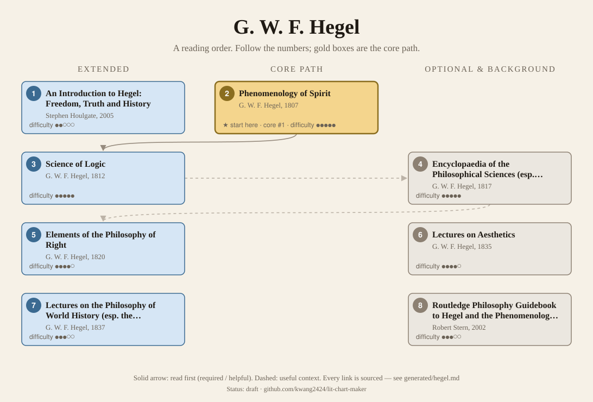
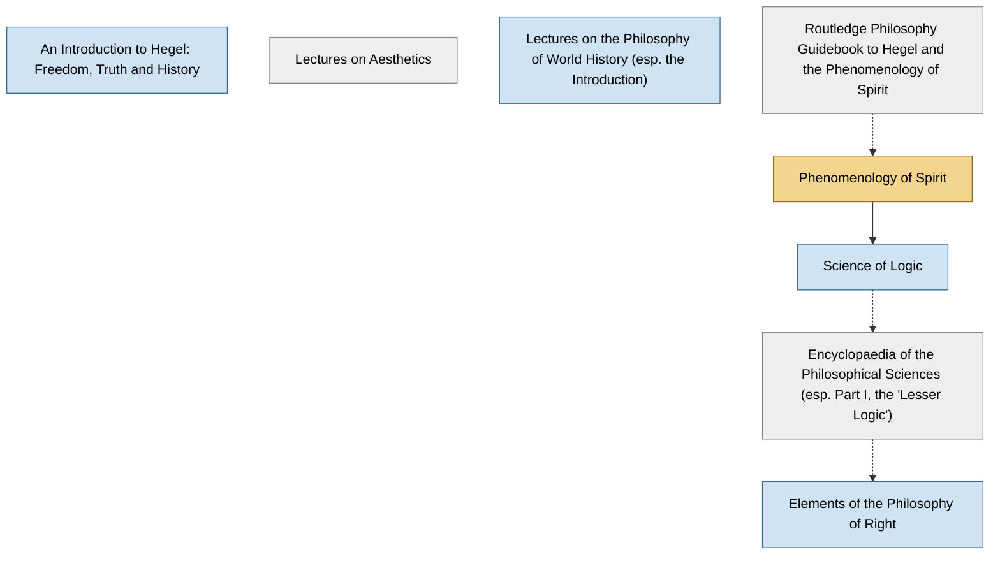

<!-- Generated by tools/build.py from lists/hegel.yaml. Do not edit by hand. -->
# G. W. F. Hegel: reading order

**Status:** draft · **Citations checked:** 19/19

**Scope:** Hegel's books and the lecture courses published after his death, with the two guides courses most often recommend. Nietzsche and Deleuze both define themselves against him, so a summary-level grasp is enough for most readers of this site.

## Core path

The shortest route through the essentials.

1. **Phenomenology of Spirit** (1807) · difficulty ●●●●● · ★ start here · first book in 5 surveyed sources

## What the sources say

We surveyed 6 independent sources (6 course syllabi and teaching lists) and recorded which books each one assigns or recommends, and where it starts.

| Book | Recommended by | First book in |
|---|---|---|
| Phenomenology of Spirit | 6/6 | 5 |
| Lectures on the Philosophy of World History (esp. the Introduction) | 1/6 | 1 |
| Elements of the Philosophy of Right | 1/6 |  |

**Sources surveyed**

- **Rocío Zambrana, University of Oregon, PHIL 453/553: Hegel's Phenomenology of Spirit (Spring 2019)** [teaching]: Phenomenology of Spirit. ✓ checked in Course syllabus (PDF), accessed 2026-11
- **Michael Hardimon, UC San Diego, Philosophy 107: Hegel, The Phenomenology of Spirit (Winter 2019)** [teaching]: Phenomenology of Spirit. ✓ checked in Course syllabus (PDF), accessed 2026-11
- **Caroline Bowman, NYU, From Hegel to Nietzsche: Freedom and Alienation in 19th-Century German Philosophy** [teaching]: Lectures on the Philosophy of World History (esp. the Introduction) → Phenomenology of Spirit → Elements of the Philosophy of Right. ✓ checked in Course syllabus (PDF), accessed 2026-11
- **McGill University, PHIL 460: Hegel's Phenomenology of Spirit (Winter 2012)** [teaching]: Phenomenology of Spirit. ✓ checked in Course syllabus (PDF), accessed 2026-11
- **UC Riverside, PHIL 282: Graduate Seminar, Hegel's Phenomenology of Spirit** [teaching]: Phenomenology of Spirit. ✓ checked in Course syllabus (PDF), accessed 2026-11
- **University of Edinburgh, PHIL10047: The Early Continentals: Hegel and Nietzsche, course guide (2017–18)** [teaching]: Phenomenology of Spirit. ✓ checked in Course guide (PDF), accessed 2026-11

## Full path

Every work, in order. Extended and optional works are placed where they fit best.

### 1. An Introduction to Hegel: Freedom, Truth and History (2005)

`extended · secondary · difficulty ●●○○○` · Stephen Houlgate

An overview of the whole philosophy. Good before or instead of the primary texts.

**Reading tips:**

- Recommended as background reading in two surveyed courses and listed in the SEP bibliography.
  - Rocío Zambrana, University of Oregon, *PHIL 453/553: Hegel's Phenomenology of Spirit (Spring 2019)*, recommended reading [teaching] ✓ checked in Course syllabus (PDF), accessed 2026-11
  - McGill University, *PHIL 460: Hegel's Phenomenology of Spirit (Winter 2012)*, recommended reading [teaching] ✓ checked in Course syllabus (PDF), accessed 2026-11

### 2. Phenomenology of Spirit (1807)

`core · primary · difficulty ●●●●●` · G. W. F. Hegel

Consciousness climbs from sense-certainty to absolute knowing; includes the famous master–slave ("lordship and bondage") section. Courses begin with the Preface and Introduction.

**Translation:** Pinkard (Cambridge) or Miller (Oxford)

**★ Good place to start.** Every surveyed course assigns it, and the SEP describes it as "a type of propaedeutic to philosophy", an education of the reader into Hegel's standpoint.

- Paul Redding, *"Georg Wilhelm Friedrich Hegel", Stanford Encyclopedia of Philosophy*, §3.1.1 Phenomenology of Spirit [scholarly] ✓ checked in SEP online, accessed 2026-11

**Read first:**

- *Routledge Philosophy Guidebook to Hegel and the Phenomenology of Spirit* — *context*. Two surveyed courses recommend Stern's guidebook as a commentary to read alongside.
  - Rocío Zambrana, University of Oregon, *PHIL 453/553: Hegel's Phenomenology of Spirit (Spring 2019)*, commentaries on the Phenomenology [teaching] ✓ checked in Course syllabus (PDF), accessed 2026-11
  - UC Riverside, *PHIL 282: Graduate Seminar, Hegel's Phenomenology of Spirit*, secondary literature [teaching] ✓ checked in Course syllabus (PDF), accessed 2026-11
  - University of Edinburgh, *PHIL10047: The Early Continentals: Hegel and Nietzsche, course guide (2017–18)*, course guide (Stern's guidebook 'is really helpful') [teaching] ✓ checked in Course guide (PDF), accessed 2026-11
- *Critique of Pure Reason* (from the [Immanuel Kant list](kant.md)) — *context*. The SEP traces Hegel's idea of a "phenomenology" as a propaedeutic to Kant, and Edinburgh's course spends two weeks on Kant "setting us up to see how Hegel's Phenomenology is shaped by it".
  - University of Edinburgh, *PHIL10047: The Early Continentals: Hegel and Nietzsche, course guide (2017–18)*, Week 2: From Kant to Hegel [teaching] ✓ checked in Course guide (PDF), accessed 2026-11
  - Paul Redding, *"Georg Wilhelm Friedrich Hegel", Stanford Encyclopedia of Philosophy*, §2.1 and §3.1.1 [scholarly] ✓ checked in SEP online, accessed 2026-11

### 3. Science of Logic (1812)

`extended · primary · difficulty ●●●●●` · G. W. F. Hegel

The core of the system, and one of the hardest books in philosophy.

**Read first:**

- *Phenomenology of Spirit* — *helpful*. The Phenomenology is meant to bring the reader to the standpoint of "purely conceptual thought" from which the Logic proceeds.
  - Paul Redding, *"Georg Wilhelm Friedrich Hegel", Stanford Encyclopedia of Philosophy*, §3.1.1 Phenomenology of Spirit [scholarly] ✓ checked in SEP online, accessed 2026-11
  - McGill University, *PHIL 460: Hegel's Phenomenology of Spirit (Winter 2012)*, course description ("Hegel's introduction to his science of logic") [teaching] ✓ checked in Course syllabus (PDF), accessed 2026-11

### 4. Encyclopaedia of the Philosophical Sciences (esp. Part I, the "Lesser Logic") (1817)

`optional · primary · difficulty ●●●●●` · G. W. F. Hegel

A teaching handbook of the whole system; Part I is an abbreviated Science of Logic.

**Read first:**

- *Science of Logic* — *context*. Its first part is "an abbreviated version of the earlier Science of Logic".
  - Paul Redding, *"Georg Wilhelm Friedrich Hegel", Stanford Encyclopedia of Philosophy*, §1 Life, Work, and Influence [scholarly] ✓ checked in SEP online, accessed 2026-11

### 5. Elements of the Philosophy of Right (1820)

`extended · primary · difficulty ●●●●○` · G. W. F. Hegel

His political philosophy (family, civil society, the state). The Preface has the "owl of Minerva".

**Translation:** Nisbet, ed. Wood (Cambridge)

**Read first:**

- *Encyclopaedia of the Philosophical Sciences (esp. Part I, the "Lesser Logic")* — *context*. The SEP calls it effectively an expansion of the Encyclopaedia's section on objective spirit.
  - Paul Redding, *"Georg Wilhelm Friedrich Hegel", Stanford Encyclopedia of Philosophy*, §1 and §3.1 [scholarly] ✓ checked in SEP online, accessed 2026-11

### 6. Lectures on Aesthetics (1835)

`optional · primary · difficulty ●●●●○` · G. W. F. Hegel

Art as a form of absolute spirit, alongside religion and philosophy.

### 7. Lectures on the Philosophy of World History (esp. the Introduction) (1837)

`extended · primary · difficulty ●●●○○` · G. W. F. Hegel

Published from lecture notes after his death. The Introduction is the most approachable Hegel.

**Translation:** Sibree (free online) or Nisbet ("Introduction: Reason in History")

**Reading tips:**

- One surveyed course starts with passages from its Introduction before turning to the Phenomenology.
  - Caroline Bowman, NYU, *From Hegel to Nietzsche: Freedom and Alienation in 19th-Century German Philosophy*, schedule (first meeting) [teaching] ✓ checked in Course syllabus (PDF), accessed 2026-11

### 8. Routledge Philosophy Guidebook to Hegel and the Phenomenology of Spirit (2002)

`optional · secondary · difficulty ●●●○○` · Robert Stern

A section-by-section guide to the Phenomenology.

## Map

Solid arrows: required or helpful. Dotted: context.

## Sources

- **[scholarly]** Paul Redding, *"Georg Wilhelm Friedrich Hegel", Stanford Encyclopedia of Philosophy* — <https://plato.stanford.edu/entries/hegel/>
- **[teaching]** University of Edinburgh, *PHIL10047: The Early Continentals: Hegel and Nietzsche, course guide (2017–18)* — <https://edwebcontent.ed.ac.uk/sites/default/files/atoms/files/the_early_continentals_course_guide_2017_18.pdf>
- **[teaching]** McGill University, *PHIL 460: Hegel's Phenomenology of Spirit (Winter 2012)* — <https://www.mcgill.ca/philosophy/files/philosophy/460b12.pdf>
- **[teaching]** Caroline Bowman, NYU, *From Hegel to Nietzsche: Freedom and Alienation in 19th-Century German Philosophy* — <https://www.carolinebowman.org/wp-content/uploads/2022/07/Hegel-Nietzsche-Syllabus.pdf>
- **[teaching]** Rocío Zambrana, University of Oregon, *PHIL 453/553: Hegel's Phenomenology of Spirit (Spring 2019)* — <https://profile.uoregon.edu/sites/default/files/hegel,%20syllabus,%202019.pdf>
- **[teaching]** UC Riverside, *PHIL 282: Graduate Seminar, Hegel's Phenomenology of Spirit* — <https://static1.squarespace.com/static/5b074ab54611a0bebe31f7b3/t/67929c6d2e34e948ae14cfed/1737661549403/Hegel+Syllabus.pdf>
- **[teaching]** Michael Hardimon, UC San Diego, *Philosophy 107: Hegel, The Phenomenology of Spirit (Winter 2019)* — <https://philosophy.ucsd.edu/_files/courses/19winter/W19_Phil%20107_Hardimon.pdf>
