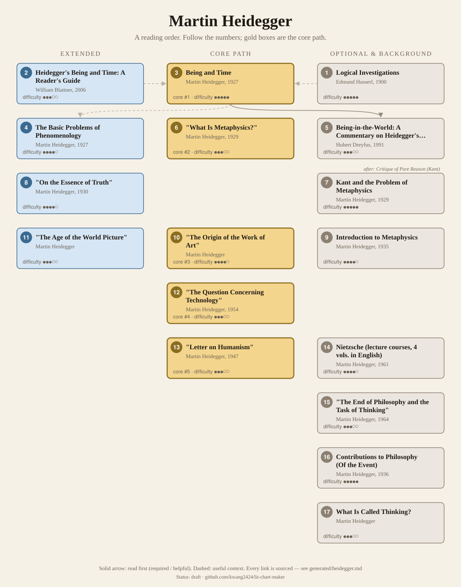

<!-- Generated by tools/build.py from lists/heidegger.yaml. Do not edit by hand. -->
# Martin Heidegger: reading order

**Status:** draft · **Citations checked:** 28/28

**Scope:** Being and Time, the lectures around it, and the later essays on art, technology and language that shaped French philosophy after the war. His support for National Socialism "has been amply documented" (SEP §3); the Black Notebooks (published from 2014) belong to any serious study of him.

## Core path

The shortest route through the essentials.

1. **Being and Time** (1927) · difficulty ●●●●● · first book in 3 surveyed sources
2. **"What Is Metaphysics?"** (1929) · difficulty ●●●○○ · first book in 1 surveyed source
3. **"The Origin of the Work of Art"** · difficulty ●●●●○ · first book in 1 surveyed source
4. **"The Question Concerning Technology"** (1954) · difficulty ●●●○○
5. **"Letter on Humanism"** (1947) · difficulty ●●●○○

## What the sources say

We surveyed 6 independent sources (6 course syllabi and teaching lists) and recorded which books each one assigns or recommends, and where it starts.

| Book | Recommended by | First book in |
|---|---|---|
| Being and Time | 4/6 | 3 |
| "The Origin of the Work of Art" | 3/6 | 1 |
| "The Question Concerning Technology" | 3/6 |  |
| "What Is Metaphysics?" | 2/6 | 1 |
| "The Age of the World Picture" | 2/6 |  |
| "On the Essence of Truth" | 2/6 |  |
| "Letter on Humanism" | 2/6 |  |
| The Basic Problems of Phenomenology | 1/6 |  |
| "The End of Philosophy and the Task of Thinking" | 1/6 |  |
| What Is Called Thinking? | 1/6 |  |

**Sources surveyed**

- **William Blattner, Georgetown University, PHIL 521: Heidegger's Being and Time** [teaching]: Being and Time → The Basic Problems of Phenomenology. ✓ checked in Course syllabus, accessed 2026-11
- **University of Windsor, Phil 470/570: Recent German Philosophy: Heidegger's Being and Time (Fall 2015)** [teaching]: "What Is Metaphysics?" → Being and Time → "On the Essence of Truth". ✓ checked in Course syllabus, accessed 2026-11
- **Villanova University, Philosophy 8220: Heidegger's Being and Time (Fall 2014)** [teaching]: Being and Time. ✓ checked in Course web page, accessed 2026-11
- **Tracy Colony, Bard College Berlin, PL318: The Thought of Martin Heidegger** [teaching]: Being and Time → "What Is Metaphysics?" → "On the Essence of Truth" → "The Origin of the Work of Art" → "The Age of the World Picture" → "Letter on Humanism" → "The Question Concerning Technology". ✓ checked in Course syllabus, accessed 2026-11
- **Melbourne School of Continental Philosophy, Fortunes of Philosophy: Heidegger on Art, Science, Technology, and Humanism** [teaching]: "The Origin of the Work of Art" → "The Age of the World Picture" → "The Question Concerning Technology" → "Letter on Humanism" → What Is Called Thinking? → "The End of Philosophy and the Task of Thinking". ✓ checked in Seminar web page, accessed 2026-11
- **UC Berkeley, Department of Philosophy, Philosophy 190: seminar on Heidegger's later philosophy** [teaching]: "The Origin of the Work of Art", "The Question Concerning Technology". ✓ checked in Course web page, accessed 2026-11

## Full path

Every work, in order. Extended and optional works are placed where they fit best.

### 1. Heidegger's Being and Time: A Reader's Guide (2006)

`extended · secondary · difficulty ●●●○○` · William Blattner

A section-by-section guide.

### 2. Being and Time (1927)

`core · primary · difficulty ●●●●●` · Martin Heidegger

The analysis of human existence (Dasein): being-in-the-world, care, death, authenticity, temporality. The SEP calls it his magnum opus.

**Translation:** Macquarrie & Robinson (Harper) or Stambaugh rev. Schmidt (SUNY)

**Reading tips:**

- It is unfinished: the published text covers the analysis of Dasein and a preliminary account of time, but not the planned later parts.
  - Stanford Encyclopedia of Philosophy, *"Martin Heidegger", Stanford Encyclopedia of Philosophy*, §2.8 The Unfinished Project of Being and Time [scholarly] ✓ checked in SEP online, accessed 2026-11
- Translations differ a lot. One Being and Time course tells students to use Macquarrie & Robinson and not Stambaugh's original translation.
  - William Blattner, Georgetown University, *PHIL 521: Heidegger's Being and Time*, required texts [teaching] ✓ checked in Course syllabus, accessed 2026-11

**Read first:**

- *Physics* (from the [Aristotle list](aristotle.md)) — *context*. Its planned Part 2 was to show that "the ontologies of Aristotle, Descartes, and Kant all rest on a conception of time"; Aristotle's account of time is in Physics IV.
  - Stanford Encyclopedia of Philosophy, *"Martin Heidegger", Stanford Encyclopedia of Philosophy*, §2 Being and Time [scholarly] ✓ checked in SEP entry, accessed 2026-11
- *Meditations on First Philosophy* (from the [René Descartes list](descartes.md)) — *context*. It contrasts Dasein's being-in-the-world with "the Cartesian distinction between disembodied subjects and a spatially-extended material world"; a planned Part 2 was to examine the ontology of Descartes.
  - Stanford Encyclopedia of Philosophy, *"Martin Heidegger", Stanford Encyclopedia of Philosophy*, §2 Being and Time; §2.2.1 The World and Spatiality [scholarly] ✓ checked in SEP entry, accessed 2026-11
- *Logical Investigations* (from the [Edmund Husserl list](husserl.md)) — *context*. Heidegger studied the Logical Investigations as a student and kept valuing it while he radically reinterpreted Husserl's phenomenology.
  - Internet Encyclopedia of Philosophy, *"Martin Heidegger (1889–1976)"*, §1 Life and Works [scholarly] ✓ checked in IEP online, accessed 2026-11
  - University of Oxford, Faculty of Philosophy, *Course Descriptions: Finals*, paper 113: Husserl's work 'serves to introduce one to phenomenology, the philosophical method later developed and refined by Heidegger' [teaching] ✓ checked in Course web page, accessed 2026-11
  - Tracy Colony, Bard College Berlin, *PL318: The Thought of Martin Heidegger*, course description ("radicalization of Husserlian phenomenology") [teaching] ✓ checked in Course syllabus, accessed 2026-11
- *Heidegger's Being and Time: A Reader's Guide* — *context*. Two of the surveyed courses recommend a reader's guide to read alongside it.
  - William Blattner, Georgetown University, *PHIL 521: Heidegger's Being and Time*, recommended texts [teaching] ✓ checked in Course syllabus, accessed 2026-11
  - University of Windsor, *Phil 470/570: Recent German Philosophy: Heidegger's Being and Time (Fall 2015)*, secondary texts [teaching] ✓ checked in Course syllabus, accessed 2026-11

### 3. The Basic Problems of Phenomenology (1927)

`extended · primary · difficulty ●●●●○` · Martin Heidegger

The 1927 lecture course, published in 1975.

**Read first:**

- *Being and Time* — *context*. Courses on Being and Time read parts of it alongside; one calls it "highly recommended".
  - William Blattner, Georgetown University, *PHIL 521: Heidegger's Being and Time*, course description [teaching] ✓ checked in Course syllabus, accessed 2026-11
  - Villanova University, *Philosophy 8220: Heidegger's Being and Time (Fall 2014)*, texts [teaching] ✓ checked in Course web page, accessed 2026-11

### 4. Being-in-the-World: A Commentary on Heidegger's Being and Time, Division I (1991)

`optional · secondary · difficulty ●●●○○` · Hubert Dreyfus

An influential commentary on the first half.

**Read first:**

- *Being and Time* — *helpful*. It is a commentary on Division I of Being and Time, as its title says.
  - University of Windsor, *Phil 470/570: Recent German Philosophy: Heidegger's Being and Time (Fall 2015)*, secondary texts [teaching] ✓ checked in Course syllabus, accessed 2026-11

### 5. "What Is Metaphysics?" (1929)

`core · primary · difficulty ●●●○○` · Martin Heidegger

A short 1929 lecture on the nothing and anxiety.

*Why this tier:* Kept core: half the surveyed courses cover only Being and Time; two of the three that go further assign it.

**Translation:** in Basic Writings (ed. Krell) or Pathmarks

### 6. The Presocratics: fragments of Anaximander, Heraclitus and Parmenides

`optional · background · difficulty ●●●○○` · Anaximander, Heraclitus, Parmenides

Background for the later Heidegger, not for Being and Time. He calls them the "first beginning" of Western thinking, "pre-metaphysical" thinkers who experienced being as unconcealment (alētheia) (SEP §5, The History of Being). Any edition of the fragments will do.

### 7. Kant and the Problem of Metaphysics (1929)

`optional · primary · difficulty ●●●●●` · Martin Heidegger

His reading of Kant's first Critique.

**Read first:**

- *Critique of Pure Reason* (from the [Immanuel Kant list](kant.md)) — *helpful*. It is an interpretation of the Critique of Pure Reason.
  - Stanford Encyclopedia of Philosophy, *"Martin Heidegger", Stanford Encyclopedia of Philosophy*, Bibliography, GA3 [scholarly] ✓ checked in SEP online, accessed 2026-11

### 8. "On the Essence of Truth" (1930)

`extended · primary · difficulty ●●●●○` · Martin Heidegger

Truth as unconcealment. Courses read it after Being and Time.

### 9. Introduction to Metaphysics (1935)

`optional · primary · difficulty ●●●●○` · Martin Heidegger

The 1935 lecture course, published in 1953.

**Translation:** Fried & Polt (Yale)

**Read first:**

- *The Presocratics: fragments of Anaximander, Heraclitus and Parmenides* — *helpful*. The IEP calls it "a bridge between earlier and later Heidegger": here "the Presocratics were no longer a subject of mere passing remarks as in Heidegger's earlier" work.
  - Internet Encyclopedia of Philosophy, *"Martin Heidegger (1889–1976)"*, on the turn to Presocratic thought (Introduction to Metaphysics) [scholarly] ✓ checked in IEP entry, accessed 2026-11

### 10. "The Origin of the Work of Art"

`core · primary · difficulty ●●●●○` · Martin Heidegger

Art as the happening of truth; the Greek temple and Van Gogh's shoes.

**Translation:** in Basic Writings or Poetry, Language, Thought

**Read first:**

- *Being and Time* — *context*. The SEP treats its new "attention to the role that artworks and poetry play in disclosing being" as a mark of the "turning" after Being and Time.
  - Stanford Encyclopedia of Philosophy, *"Martin Heidegger", Stanford Encyclopedia of Philosophy*, §4 The “Turning” and Heidegger’s Later Thought [scholarly] ✓ checked in SEP online, accessed 2026-11

### 11. "The Age of the World Picture"

`extended · primary · difficulty ●●●○○` · Martin Heidegger

Modern science and the world grasped as a picture.

### 12. "The Question Concerning Technology" (1954)

`core · primary · difficulty ●●●○○` · Martin Heidegger

Technology as a way of revealing that treats everything as "standing reserve", mere material.

**Translation:** in Basic Writings or The Question Concerning Technology and Other Essays (Lovitt)

### 13. "Letter on Humanism" (1947)

`core · primary · difficulty ●●●○○` · Martin Heidegger

His postwar essay on humanism, language and thinking, written as a letter in 1946.

*Why this tier:* Kept core: half the surveyed courses cover only Being and Time; two of the three that go further assign it.

### 14. Nietzsche (lecture courses, 4 vols. in English) (1961)

`optional · primary · difficulty ●●●●○` · Martin Heidegger

His lecture courses on Nietzsche. PhilPapers calls them the "canonical reading of Nietzsche in the 20th century".

**Read first:**

- *The Will to Power* (from the [Friedrich Nietzsche list](nietzsche.md)) — *helpful*. The first and third courses are "The Will to Power as Art" (1936–37) and "The Will to Power as Knowledge" (1939).
  - Stanford Encyclopedia of Philosophy, *"Martin Heidegger", Stanford Encyclopedia of Philosophy*, Bibliography (N1, N3) [scholarly] ✓ checked in SEP entry, accessed 2026-11
- *Twilight of the Idols* (from the [Friedrich Nietzsche list](nietzsche.md)) — *context*. It argues that Nietzsche "over-turns Platonism and completes Western metaphysics"; Twilight's "true world" fable is the short version of that overturning.
  - PhilPapers (ed. Paul Catanu), *Friedrich Nietzsche: category summary and key works*, key works (Heidegger 1979) [scholarly] ✓ checked in PhilPapers category page, accessed 2026-11
  - Friedrich Nietzsche, *Twilight of the Idols*, "How the True World Ultimately Became a Fable" [author] ✓ checked in Ludovici trans. (1911), Project Gutenberg

### 15. "The End of Philosophy and the Task of Thinking" (1964)

`optional · primary · difficulty ●●●○○` · Martin Heidegger

A late essay, written in 1964.

### 16. Early Greek Thinking (The Anaximander Fragment, Logos, Moira, Aletheia) (1975)

`optional · primary · difficulty ●●●●●` · Martin Heidegger

Four essays from the 1940s and 50s, each on a Presocratic fragment: Anaximander, Heraclitus B 50 and B 16, and Parmenides VIII 34–41. The English collection appeared in 1975.

**Translation:** Krell & Capuzzi (Harper & Row)

**Read first:**

- *The Presocratics: fragments of Anaximander, Heraclitus and Parmenides* — *required*. Each essay is a reading of a Presocratic fragment: "The Anaximander Fragment", "Logos (Heraclitus, Fragment B 50)", "Moira (Parmenides VIII, 34-41)", "Aletheia (Heraclitus, Fragment B 16)".
  - Internet Encyclopedia of Philosophy, *"Martin Heidegger (1889–1976)"*, References (Early Greek Thinking) [scholarly] ✓ checked in IEP entry, accessed 2026-11

### 17. Hegel's Phenomenology of Spirit (lecture course, 1930–31) (1980)

`optional · primary · difficulty ●●●●●` · Martin Heidegger

His 1930–31 lecture course on Hegel's Phenomenology, published in 1980 as GA32.

**Translation:** Emad and Maly (Indiana 1988)

**Read first:**

- *Phenomenology of Spirit* (from the [G. W. F. Hegel list](hegel.md)) — *required*. It is a lecture course on Hegel's Phenomenology of Spirit.
  - Stanford Encyclopedia of Philosophy, *"Martin Heidegger", Stanford Encyclopedia of Philosophy*, Bibliography (GA32) [scholarly] ✓ checked in SEP entry, accessed 2026-11

### 18. The Metaphysics of German Idealism: Schelling's Freedom essay (lecture course, 1941) (1991)

`optional · primary · difficulty ●●●●●` · Martin Heidegger

His 1941 lecture course on Schelling's 1809 Freedom essay, published in 1991 as GA49.

**Translation:** Moore and Therezo (Polity 2021)

**Read first:**

- *Philosophical Investigations into the Essence of Human Freedom* (from the [F. W. J. Schelling list](schelling.md)) — *required*. It is a lecture course interpreting Schelling's Philosophical Investigations into the Essence of Human Freedom (1809).
  - Stanford Encyclopedia of Philosophy, *"Martin Heidegger", Stanford Encyclopedia of Philosophy*, Bibliography (GA49) [scholarly] ✓ checked in SEP entry, accessed 2026-11

### 19. Plato's Sophist (lecture course, 1924–25) (1992)

`optional · primary · difficulty ●●●●●` · Martin Heidegger

His 1924–25 lecture course on Plato's Sophist, published in 1992 as GA19.

**Translation:** Rojcewicz and Schuwer (Indiana 1997)

**Read first:**

- *Sophist* (from the [Plato list](plato.md)) — *required*. It is a lecture course on Plato's Sophist.
  - Stanford Encyclopedia of Philosophy, *"Martin Heidegger", Stanford Encyclopedia of Philosophy*, Bibliography (GA19) [scholarly] ✓ checked in SEP entry, accessed 2026-11

### 20. Contributions to Philosophy (Of the Event) (1936)

`optional · primary · difficulty ●●●●●` · Martin Heidegger

A private manuscript of 1936–38, published in 1989. For specialists.

### 21. What Is Called Thinking?

`optional · primary · difficulty ●●●○○` · Martin Heidegger

A late lecture course on thinking.

## Map

Solid arrows: required or helpful. Dotted: context.

```mermaid
graph TD
  blattner_guide["Heidegger's Being and Time: A Reader's Guide"]:::extended
  being_and_time["Being and Time"]:::core
  basic_problems["The Basic Problems of Phenomenology"]:::extended
  dreyfus_being_in_world["Being-in-the-World: A Commentary on Heidegger's Being and Time, Division I"]:::optional
  what_is_metaphysics["'What Is Metaphysics?'"]:::core
  presocratics["The Presocratics: fragments of Anaximander, Heraclitus and Parmenides"]:::optional
  kant_problem["Kant and the Problem of Metaphysics"]:::optional
  essence_of_truth["'On the Essence of Truth'"]:::extended
  introduction_to_metaphysics["Introduction to Metaphysics"]:::optional
  origin_work_of_art["'The Origin of the Work of Art'"]:::core
  age_world_picture["'The Age of the World Picture'"]:::extended
  question_technology["'The Question Concerning Technology'"]:::core
  letter_humanism["'Letter on Humanism'"]:::core
  nietzsche_lectures["Nietzsche (lecture courses, 4 vols. in English)"]:::optional
  end_of_philosophy["'The End of Philosophy and the Task of Thinking'"]:::optional
  early_greek_thinking["Early Greek Thinking (The Anaximander Fragment, Logos, Moira, Aletheia)"]:::optional
  hegels_phenomenology["Hegel's Phenomenology of Spirit (lecture course, 1930–31)"]:::optional
  schelling_lectures["The Metaphysics of German Idealism: Schelling's Freedom essay (lecture course, 1941)"]:::optional
  platos_sophist["Plato's Sophist (lecture course, 1924–25)"]:::optional
  contributions["Contributions to Philosophy (Of the Event)"]:::optional
  what_is_called_thinking["What Is Called Thinking?"]:::optional
  blattner_guide -.-> being_and_time
  being_and_time --> dreyfus_being_in_world
  being_and_time -.-> basic_problems
  presocratics --> introduction_to_metaphysics
  presocratics --> early_greek_thinking
  being_and_time -.-> origin_work_of_art
  classDef core fill:#f4d58d,stroke:#8a6d1f,color:#000
  classDef extended fill:#cfe3f5,stroke:#3b6a91,color:#000
  classDef optional fill:#eeeeee,stroke:#888,color:#000
```

## Connections

**Builds on**

- *Physics* (Aristotle) → *Being and Time* — context. Its planned Part 2 was to show that "the ontologies of Aristotle, Descartes, and Kant all rest on a conception of time"; Aristotle's account of time is in Physics IV.
- *Meditations on First Philosophy* (René Descartes) → *Being and Time* — context. It contrasts Dasein's being-in-the-world with "the Cartesian distinction between disembodied subjects and a spatially-extended material world"; a planned Part 2 was to examine the ontology of Descartes.
- *Logical Investigations* (Edmund Husserl) → *Being and Time* — context. Heidegger studied the Logical Investigations as a student and kept valuing it while he radically reinterpreted Husserl's phenomenology.
- *Critique of Pure Reason* (Immanuel Kant) → *Kant and the Problem of Metaphysics* — helpful. It is an interpretation of the Critique of Pure Reason.
- *Philosophical Investigations into the Essence of Human Freedom* (F. W. J. Schelling) → *The Metaphysics of German Idealism: Schelling's Freedom essay (lecture course, 1941)* — required. It is a lecture course interpreting Schelling's Philosophical Investigations into the Essence of Human Freedom (1809).
- *Sophist* (Plato) → *Plato's Sophist (lecture course, 1924–25)* — required. It is a lecture course on Plato's Sophist.
- *Phenomenology of Spirit* (G. W. F. Hegel) → *Hegel's Phenomenology of Spirit (lecture course, 1930–31)* — required. It is a lecture course on Hegel's Phenomenology of Spirit.
- *The Will to Power* (Friedrich Nietzsche) → *Nietzsche (lecture courses, 4 vols. in English)* — helpful. The first and third courses are "The Will to Power as Art" (1936–37) and "The Will to Power as Knowledge" (1939).
- *Twilight of the Idols* (Friedrich Nietzsche) → *Nietzsche (lecture courses, 4 vols. in English)* — context. It argues that Nietzsche "over-turns Platonism and completes Western metaphysics"; Twilight's "true world" fable is the short version of that overturning.

**Who builds on Martin Heidegger**

- *Being and Time* → *The Human Condition* (Hannah Arendt) — context. Heidegger's phenomenology had "the greater... lasting influence upon Arendt's work", and one Arendt course opens with Being and Time.
- *Being and Time* → *Difference and Repetition* (Gilles Deleuze) — context. Its history of how difference was subordinated to identity runs "from Plato (DR 59-63) to Heidegger (DR 64-6)".
- *Being and Time* → *Of Grammatology* (Jacques Derrida) — context. "Deconstruction", the word all three 1967 books use for his project: "He seems to have appropriated the term from Heidegger's use of 'destruction' in Being and Time."
- *Being and Time* → *Phenomenology of Perception* (Maurice Merleau-Ponty) — context. It reflects "his deepened engagement with other thinkers in this tradition, such as Eugen Fink and Martin Heidegger".
- *Being and Time* → *Being and Nothingness: An Essay on Phenomenological Ontology* (Jean-Paul Sartre) — context. Its "human reality" is "his gloss on Heidegger's conception of Dasein", and its account of nothingness answers Heidegger's.

## Sources

- **[author]** Friedrich Nietzsche, *Twilight of the Idols*, 1889
- **[scholarly]** Internet Encyclopedia of Philosophy, *"Martin Heidegger (1889–1976)"* — <https://iep.utm.edu/heidegge/>
- **[scholarly]** PhilPapers (ed. Paul Catanu), *Friedrich Nietzsche: category summary and key works* — <https://philpapers.org/browse/friedrich-nietzsche>
- **[scholarly]** Stanford Encyclopedia of Philosophy, *"Martin Heidegger", Stanford Encyclopedia of Philosophy* — <https://plato.stanford.edu/entries/heidegger/>
- **[teaching]** Melbourne School of Continental Philosophy, *Fortunes of Philosophy: Heidegger on Art, Science, Technology, and Humanism* — <https://mscp.org.au/past-courses/fortunes-of-philosophy-heidegger-on-art-science-technology-and-humanism>
- **[teaching]** University of Oxford, Faculty of Philosophy, *Course Descriptions: Finals* — <https://www.philosophy.ox.ac.uk/course-descriptions-finals>
- **[teaching]** Tracy Colony, Bard College Berlin, *PL318: The Thought of Martin Heidegger* — <https://tools.bard.edu/wwwmedia/files/7498724/44/PL318%20The%20Thought%20of%20Martin%20Heidegger%20T%20Colony.pdf>
- **[teaching]** UC Berkeley, Department of Philosophy, *Philosophy 190: seminar on Heidegger's later philosophy* — <https://philosophy.berkeley.edu/courses/detail/919>
- **[teaching]** William Blattner, Georgetown University, *PHIL 521: Heidegger's Being and Time* — <https://faculty.georgetown.edu/blattnew/heid/phil-521-syllabus.pdf>
- **[teaching]** Villanova University, *Philosophy 8220: Heidegger's Being and Time (Fall 2014)* — <https://heideggerbeingandtime.wordpress.com/2014/09/09/syllabus/>
- **[teaching]** University of Windsor, *Phil 470/570: Recent German Philosophy: Heidegger's Being and Time (Fall 2015)* — <https://www.uwindsor.ca/philosophy/sites/uwindsor.ca.philosophy/files/heideggersbeingandtime.pdf>
