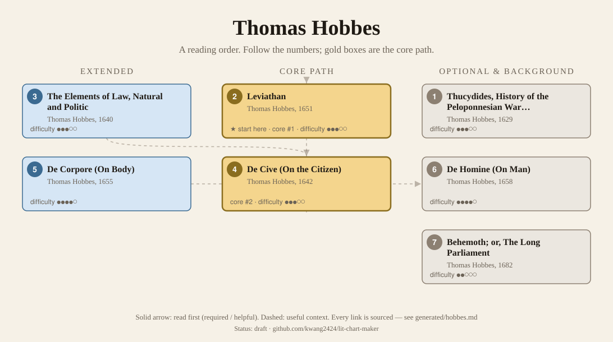
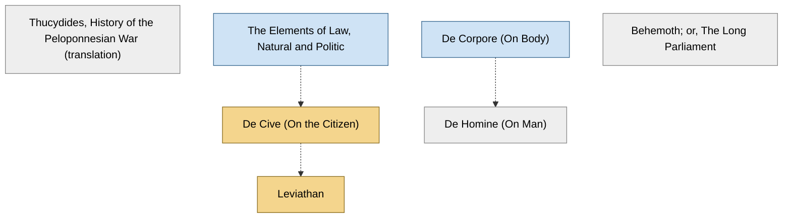

<!-- Generated by tools/build.py from lists/hobbes.yaml. Do not edit by hand. -->
# Thomas Hobbes: reading order

**Status:** draft · **Citations checked:** 13/13

**Scope:** Hobbes's political philosophy and the system it belongs to: the Elements of Law, De Cive and Leviathan, the other two parts of the Elements of Philosophy (De Corpore and De Homine), and Behemoth. His mathematics, physics and controversies are left out. Most courses read Leviathan alone, so the survey says little about the rest.

## Core path

The shortest route through the essentials.

1. **Leviathan** (1651) · difficulty ●●●○○ · ★ start here · first book in 3 surveyed sources
2. **De Cive (On the Citizen)** (1642) · difficulty ●●●○○

## What the sources say

We surveyed 4 independent sources (4 course syllabi and teaching lists) and recorded which books each one assigns or recommends, and where it starts.

| Book | Recommended by | First book in |
|---|---|---|
| Leviathan | 4/4 | 3 |
| De Cive (On the Citizen) | 2/4 |  |
| De Corpore (On Body) | 1/4 |  |
| De Homine (On Man) | 1/4 |  |
| The Elements of Law, Natural and Politic | 1/4 |  |

**Sources surveyed**

- **Directed Studies, Yale University, Historical and Political Thought (Spring 2023)** [teaching]: Leviathan. ✓ checked in Course syllabus (PDF), accessed 2026-11
- **Youngstown State University, POL 3786: Political Thought 2 (Fall 2026)** [teaching]: Leviathan. ✓ checked in Course syllabus (PDF), accessed 2026-11
- **Don Carmichael, University of Alberta, Political Science 406/515: Hobbes' Leviathan (2012–13)** [teaching]: Leviathan → De Cive (On the Citizen). ✓ checked in Course outline (web page), accessed 2026-11
- **Research Institute of the University of Bucharest (ICUB), Reading Group in Early Modern Philosophy, Spring 2021: Hobbes** [teaching]: The Elements of Law, Natural and Politic, De Cive (On the Citizen), Leviathan, De Corpore (On Body), De Homine (On Man). ✓ checked in Reading group page, accessed 2026-11

## Full path

Every work, in order. Extended and optional works are placed where they fit best.

### 1. Thucydides, History of the Peloponnesian War (translation) (1629)

`optional · primary · difficulty ●●●○○` · Thomas Hobbes (trans.)

His first publication, a translation from the Greek, published before any of his philosophy (SEP §1).

### 2. Leviathan (1651)

`core · primary · difficulty ●●●○○` · Thomas Hobbes

Written late in his exile in Paris. Its structure is like the Elements of Law's, with long discussions of scriptural interpretation; "probably the most overtly polemical of Hobbes's major works" (SEP §1). It "expands on the argument of De Cive, mostly in terms of its huge second half that deals with questions of religion" (IEP §1). Courses read Parts I and II.

**Translation:** Curley (Hackett), with variants from the Latin edition of 1668

**★ Good place to start.** The IEP calls it "his most famous work"; "to understand the essentials of Hobbes's ideas and system, one can rely on De Cive and Leviathan". Every course surveyed reads it, and three of the four start with it.

- Internet Encyclopedia of Philosophy, *"Thomas Hobbes: Moral and Political Philosophy"*, §1 Introduction [scholarly] ✓ checked in IEP entry, accessed 2026-11
- Directed Studies, Yale University, *Historical and Political Thought (Spring 2023)*, week 2 [teaching] ✓ checked in Course syllabus (PDF), accessed 2026-11

**Reading tips:**

- The IEP warns that "reading the opening chapters of Leviathan is a confusing business": the mechanistic picture in the Introduction is "something of a red herring", and his other starting point, "know thyself", is more useful.
  - Internet Encyclopedia of Philosophy, *"Thomas Hobbes: Moral and Political Philosophy"*, §4.a Materialism Versus Self-Knowledge [scholarly] ✓ checked in IEP entry, accessed 2026-11

**Read first:**

- *De Cive (On the Citizen)* — *context*. The IEP: Leviathan "expands on the argument of De Cive".
  - Internet Encyclopedia of Philosophy, *"Thomas Hobbes: Moral and Political Philosophy"*, §1 Introduction [scholarly] ✓ checked in IEP entry, accessed 2026-11
- *The Prince* (from the [Niccolò Machiavelli list](machiavelli.md)) — *context*. Yale's Directed Studies and Youngstown State's survey courses read Leviathan straight after Machiavelli.
  - Directed Studies, Yale University, *Historical and Political Thought (Spring 2023)*, weeks 1–3 [teaching] ✓ checked in Course syllabus (PDF), accessed 2026-11

### 3. The Elements of Law, Natural and Politic (1640)

`extended · primary · difficulty ●●●○○` · Thomas Hobbes

Circulated in 1640: "the first work in which Hobbes follows his typical systematic pattern of starting with the workings of the mind and language, and developing the discussion towards political matters" (SEP §1). Written to support the King against his challengers (IEP §1).

**Translation:** Gaskin (Oxford World's Classics)

### 4. De Cive (On the Citizen) (1642)

`core · primary · difficulty ●●●○○` · Thomas Hobbes

His "first published book of political philosophy", in three parts: Liberty, Empire and Religion (SEP §1). The IEP: it "offers a clear, concise statement of Hobbes's moral and political philosophy".

**Reading tips:**

- Planned as the third part of a system (body, man, citizen), it came out first because of the political crisis: "what was last in order, is yet come forth first in time", and "it would not stand in need of the former sections". It can be read on its own.
  - Thomas Hobbes, *De Cive (Philosophical Rudiments Concerning Government and Society), "Preface to the Reader"*, Preface to the Reader [author] ✓ checked in Molesworth, English Works vol. 2, Project Gutenberg
- The IEP: "although Leviathan is more famous and more often read, De Cive actually gives a much more straightforward account of Hobbes's ideas".
  - Internet Encyclopedia of Philosophy, *"Thomas Hobbes: Moral and Political Philosophy"*, §1 Introduction [scholarly] ✓ checked in IEP entry, accessed 2026-11

**Read first:**

- *The Elements of Law, Natural and Politic* — *context*. The IEP: De Cive "has much in common with Elements".
  - Internet Encyclopedia of Philosophy, *"Thomas Hobbes: Moral and Political Philosophy"*, §1 Introduction [scholarly] ✓ checked in IEP entry, accessed 2026-11

### 5. De Corpore (On Body) (1655)

`extended · primary · difficulty ●●●●○` · Thomas Hobbes

The first part of the Elements of Philosophy: logic, language, method, metaphysics, mathematics and physics, with his main statements on method and language (SEP §1).

### 6. De Homine (On Man) (1658)

`optional · primary · difficulty ●●●●○` · Thomas Hobbes

The second part of the Elements of Philosophy, on physiology and optics; it completed the plan (SEP §1).

**Read first:**

- *De Corpore (On Body)* — *context*. It is the second part of the Elements of Philosophy, after De Corpore and before De Cive.
  - Stanford Encyclopedia of Philosophy, *"Thomas Hobbes"*, §1 Life and Works [scholarly] ✓ checked in SEP entry (revision of Mar 2025), accessed 2026-11

### 7. Behemoth; or, The Long Parliament (1682)

`optional · primary · difficulty ●●○○○` · Thomas Hobbes

His history of the English civil wars, written in the late 1660s and published after his death (SEP §1; IEP §1 gives 1682).

## Map

Solid arrows: required or helpful. Dotted: context.

## Connections

**Builds on**

- *The Prince* (Niccolò Machiavelli) → *Leviathan* — context. Yale's Directed Studies and Youngstown State's survey courses read Leviathan straight after Machiavelli.

**Who builds on Thomas Hobbes**

- *The Elements of Law, Natural and Politic* → *A Treatise of Human Nature* (David Hume) — context. The SEP on Hobbes: "Russell (1985; 2008) argues convincingly that Hume modelled the structure of the Treatise on that of Hobbes's Elements of Law".
- *Leviathan* → *Discourse on the Origin of Inequality (Second Discourse)* (Jean-Jacques Rousseau) — context. It argues against Hobbes's state of nature: "let us beware concluding with Hobbes, that man, as having no idea of goodness, must be naturally bad".
- *Leviathan* → *The Social Contract* (Jean-Jacques Rousseau) — context. Book I ch. 2: "The reasoning of Caligula agrees with that of Hobbes and Grotius." The SEP: its natural freedom is "reminiscent of Hobbes's 'right of nature' in Leviathan".
- *Leviathan* → *Theological-Political Treatise* (Baruch Spinoza) — context. Its account of the state of nature (ch. 16) echoes Hobbes; the SEP: "Spinoza was clearly influenced by his reading of that British thinker".
- *Leviathan* → *The Political Philosophy of Hobbes: Its Basis and Its Genesis* (Leo Strauss) — context. A study of Hobbes, "whom he took to be the founding theorist of the liberal state".
- *Leviathan* → *Natural Right and History* (Leo Strauss) — context. It contrasts "modern conceptions of natural right, beginning with Hobbes, with ancient conceptions, beginning with Plato".

## Sources

- **[author]** Thomas Hobbes, *De Cive (Philosophical Rudiments Concerning Government and Society), "Preface to the Reader"*, 1642
- **[scholarly]** Internet Encyclopedia of Philosophy, *"Thomas Hobbes: Moral and Political Philosophy"* — <https://iep.utm.edu/hobmoral/>
- **[scholarly]** Stanford Encyclopedia of Philosophy, *"Thomas Hobbes"* — <https://plato.stanford.edu/entries/hobbes/>
- **[teaching]** Don Carmichael, University of Alberta, *Political Science 406/515: Hobbes' Leviathan (2012–13)* — <https://sites.ualberta.ca/~dcarmich/Hobbes-2012-13.htm>
- **[teaching]** Research Institute of the University of Bucharest (ICUB), *Reading Group in Early Modern Philosophy, Spring 2021: Hobbes* — <https://icub.unibuc.ro/research/research-seminars/reading-group-in-early-modern-philosophy-spring-2021-hobbes/>
- **[teaching]** Directed Studies, Yale University, *Historical and Political Thought (Spring 2023)* — <https://directedstudies.yale.edu/sites/default/files/files/HP%20spring%202023%20syllabus.pdf>
- **[teaching]** Youngstown State University, *POL 3786: Political Thought 2 (Fall 2026)* — <https://catalog.ysu.edu/syllabi/2026-fall/pol-3786-01-44080/syllabi-202640-pol-3786-01-44080.pdf>
