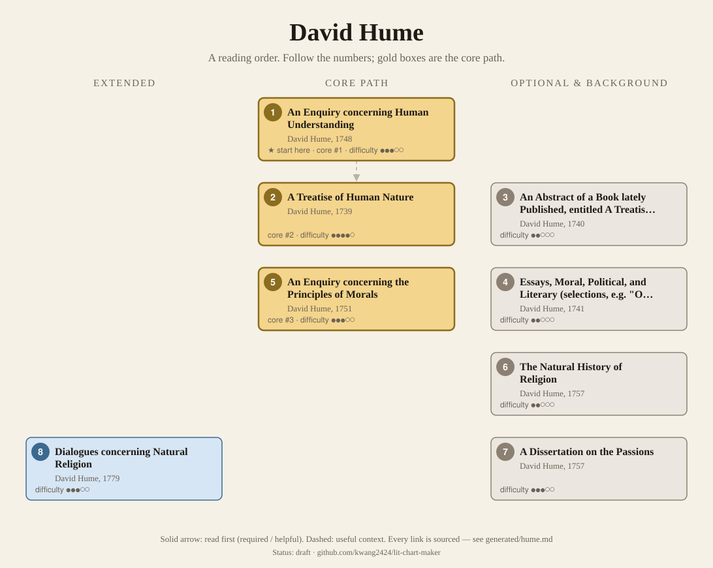
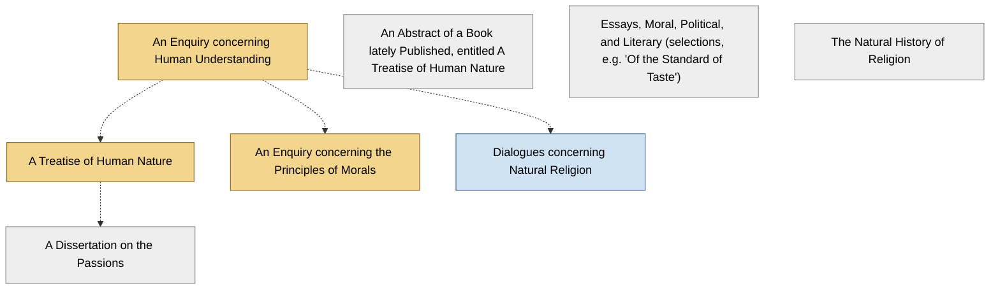

<!-- Generated by tools/build.py from lists/hume.yaml. Do not edit by hand. -->
# David Hume: reading order

**Status:** draft · **Citations checked:** 15/15

**Scope:** Hume's philosophical works. Courses mostly teach the Treatise; Hume himself asked to be judged by the later Enquiries. This list shows both and lets you choose.

## Core path

The shortest route through the essentials.

1. **An Enquiry concerning Human Understanding** (1748) · difficulty ●●●○○ · ★ start here · first book in 1 surveyed source
2. **A Treatise of Human Nature** (1739) · difficulty ●●●●○ · first book in 3 surveyed sources
3. **An Enquiry concerning the Principles of Morals** (1751) · difficulty ●●●○○

## What the sources say

We surveyed 5 independent sources (1 scholarly guide and 4 course syllabi and teaching lists) and recorded which books each one assigns or recommends, and where it starts.

| Book | Recommended by | First book in |
|---|---|---|
| An Enquiry concerning Human Understanding | 4/5 | 1 |
| A Treatise of Human Nature | 3/5 | 3 |
| An Enquiry concerning the Principles of Morals | 2/5 |  |
| An Abstract of a Book lately Published, entitled A Treatise of Human Nature | 1/5 |  |
| Dialogues concerning Natural Religion | 1/5 |  |
| The Natural History of Religion | 1/5 |  |

**Sources surveyed**

- **Kevin Zollman, Carnegie Mellon University, Hume (Fall 2013)** [teaching]: A Treatise of Human Nature. ✓ checked in Course syllabus (PDF), accessed 2026-11
- **Marie Jayasekera, PHIL 491/591: Hume's Treatise (Spring 2020)** [teaching]: A Treatise of Human Nature → An Enquiry concerning Human Understanding → An Enquiry concerning the Principles of Morals. ✓ checked in Course syllabus (PDF), accessed 2026-11
- **Patricia Sheridan, University of Guelph, PHIL 6930/4410: Hume** [teaching]: An Enquiry concerning Human Understanding → An Enquiry concerning the Principles of Morals. ✓ checked in Course syllabus (PDF), accessed 2026-11
- **Peter Millican, University of Oxford, Oxford Lectures on David Hume, 2024–25 (handouts)** [teaching]: A Treatise of Human Nature, An Enquiry concerning Human Understanding, An Abstract of a Book lately Published, entitled A Treatise of Human Nature. ✓ checked in Lecture handouts (PDF), accessed 2026-11
- **Simon Blackburn, interviewed by Five Books, The Best Books on David Hume (2013)** [scholarly] (expert's shortlist): An Enquiry concerning Human Understanding, Dialogues concerning Natural Religion, The Natural History of Religion. ✓ checked in Five Books interview (web page), accessed 2026-11

## Full path

Every work, in order. Extended and optional works are placed where they fit best.

### 1. An Enquiry concerning Human Understanding (1748)

`core · primary · difficulty ●●●○○` · David Hume

Ideas, causation, induction, free will, miracles and scepticism, in Hume's mature and readable form.

**Translation:** Beauchamp (Oxford) or Millican (Oxford World's Classics)

**★ Good place to start.** Hume's own instruction: he "cast the whole anew" in the Enquiries and asked that they "alone be regarded as containing his philosophical sentiments and principles."

- David Hume, *"Advertisement" to Essays and Treatises on Several Subjects*, Advertisement [author] ✓ checked in Open Court ed., Project Gutenberg
- Stanford Encyclopedia of Philosophy, *"David Hume", Stanford Encyclopedia of Philosophy*, §1 Life and Works [scholarly] ✓ checked in SEP online, accessed 2026-11

**Reading tips:**

- Simon Blackburn: it was "designed to make the doctrines of the Treatise... more accessible"; some of the Treatise's difficult doctrines get lost, "but at the same time it is a much more accessible and readable book".
  - Simon Blackburn, interviewed by Five Books, *The Best Books on David Hume (2013)*, pick 2 [scholarly] ✓ checked in Five Books interview (web page), accessed 2026-11
- It covers much the same ground as Book 1 of the Treatise.
  - Stanford Encyclopedia of Philosophy, *"David Hume", Stanford Encyclopedia of Philosophy*, §1 Life and Works [scholarly] ✓ checked in SEP online, accessed 2026-11

### 2. A Treatise of Human Nature (1739)

`core · primary · difficulty ●●●●○` · David Hume

Book 1 (understanding), Book 2 (passions), Book 3 (morals). The deeper and more detailed work, and the one most courses teach. Hume later disowned it.

**Translation:** Norton & Norton (Oxford) or Selby-Bigge

**Reading tips:**

- Books 1 and 2 were published first because, Hume said, "the subjects of the Understanding and Passions make a compleat chain of reasoning by themselves."
  - David Hume, *A Treatise of Human Nature, Advertisement to Books 1–2*, Advertisement [author] ✓ checked in Project Gutenberg

**Read first:**

- *Ethics* (from the [Baruch Spinoza list](spinoza.md)) — *context*. In "Of the Immateriality of the Soul" Hume argues against "the atheism of Spinoza", "the doctrine of the simplicity of the universe, and the unity of that substance".
  - David Hume, *A Treatise of Human Nature*, Book 1, Part 4, Section 5 [author] ✓ checked in Project Gutenberg
- *An Enquiry concerning Human Understanding* — *context*. Hume asked that the Enquiries "alone be regarded as containing his philosophical sentiments", calling the Treatise "that juvenile work, which the author never acknowledged". Many readers take the Enquiry first and the Treatise for depth.
  - David Hume, *"Advertisement" to Essays and Treatises on Several Subjects*, Advertisement [author] ✓ checked in Open Court ed., Project Gutenberg

### 3. An Abstract of a Book lately Published, entitled A Treatise of Human Nature (1740)

`optional · primary · difficulty ●●○○○` · David Hume

A very short summary of the Treatise's main argument, published in 1740.

### 4. Essays, Moral, Political, and Literary (selections, e.g. "Of the Standard of Taste") (1741)

`optional · primary · difficulty ●●○○○` · David Hume

Written for a wider public, and much better received in his day than the Treatise.

### 5. An Enquiry concerning the Principles of Morals (1751)

`core · primary · difficulty ●●●○○` · David Hume

Morality grounded in sentiment and usefulness; his mature ethics.

**Read first:**

- *An Enquiry concerning Human Understanding* — *context*. The two Enquiries recast Books 1 and 3 of the Treatise, and were published as companions.
  - Stanford Encyclopedia of Philosophy, *"David Hume", Stanford Encyclopedia of Philosophy*, §1 Life and Works [scholarly] ✓ checked in SEP online, accessed 2026-11

### 6. The Natural History of Religion (1757)

`optional · primary · difficulty ●●○○○` · David Hume

How religious belief arose, from polytheism to monotheism.

### 7. A Dissertation on the Passions (1757)

`optional · primary · difficulty ●●●○○` · David Hume

Short; scholars read it as his later reworking of Treatise Book 2.

**Read first:**

- *A Treatise of Human Nature* — *context*. It "repeats key points from Book 2, sometimes verbatim", as a later reworking.
  - Stanford Encyclopedia of Philosophy, *"David Hume", Stanford Encyclopedia of Philosophy*, §3.4 Treatise Book 2 versus A Dissertation on the Passions [scholarly] ✓ checked in SEP online, accessed 2026-11

### 8. Dialogues concerning Natural Religion (1779)

`extended · primary · difficulty ●●●○○` · David Hume

Three characters debate the argument from design. Published after his death; one of the few works not in his own voice, so be careful about who speaks for Hume.

**Read first:**

- *An Enquiry concerning Human Understanding* — *context*. The SEP treats it alongside his other religion writings (miracles in the Enquiry, the Natural History).
  - Stanford Encyclopedia of Philosophy, *"David Hume", Stanford Encyclopedia of Philosophy*, §5 Religion [scholarly] ✓ checked in SEP online, accessed 2026-11

## Map

Solid arrows: required or helpful. Dotted: context.

## Connections

**Builds on**

- *Ethics* (Baruch Spinoza) → *A Treatise of Human Nature* — context. In "Of the Immateriality of the Soul" Hume argues against "the atheism of Spinoza", "the doctrine of the simplicity of the universe, and the unity of that substance".

**Who builds on David Hume**

- *A Treatise of Human Nature* → *Empiricism and Subjectivity* (Gilles Deleuze) — context. It is a study of Hume.
- *An Enquiry concerning Human Understanding* → *Prolegomena to Any Future Metaphysics* (Immanuel Kant) — context. Kant: "the suggestion of David Hume was the very thing, which many years ago first interrupted my dogmatic slumber". Oxford recommends early modern philosophy first.

## Sources

- **[author]** David Hume, *"Advertisement" to Essays and Treatises on Several Subjects*, 1775
- **[author]** David Hume, *A Treatise of Human Nature, Advertisement to Books 1–2*, 1739
- **[author]** David Hume, *A Treatise of Human Nature* — <https://www.gutenberg.org/ebooks/4705>
- **[scholarly]** Simon Blackburn, interviewed by Five Books, *The Best Books on David Hume (2013)* — <https://fivebooks.com/best-books/david-hume-simon-blackburn/>
- **[scholarly]** Stanford Encyclopedia of Philosophy, *"David Hume", Stanford Encyclopedia of Philosophy* — <https://plato.stanford.edu/entries/hume/>
- **[teaching]** Peter Millican, University of Oxford, *Oxford Lectures on David Hume, 2024–25 (handouts)* — <https://davidhume.org/teaching/lectures/Hume_2025_Handouts.pdf>
- **[teaching]** Kevin Zollman, Carnegie Mellon University, *Hume (Fall 2013)* — <https://www.kevinzollman.com/uploads/5/0/3/6/50361245/hume-syllabus-2013.pdf>
- **[teaching]** Patricia Sheridan, University of Guelph, *PHIL 6930/4410: Hume* — <https://www.uoguelph.ca/arts/sites/default/files/syllabus/PHIL6930x4410_Sheridan.pdf>
- **[teaching]** Marie Jayasekera, *PHIL 491/591: Hume's Treatise (Spring 2020)* — <https://marie.jayasekera.org/files/syllabi/Jayasekera%20S20%20Hume.pdf>
