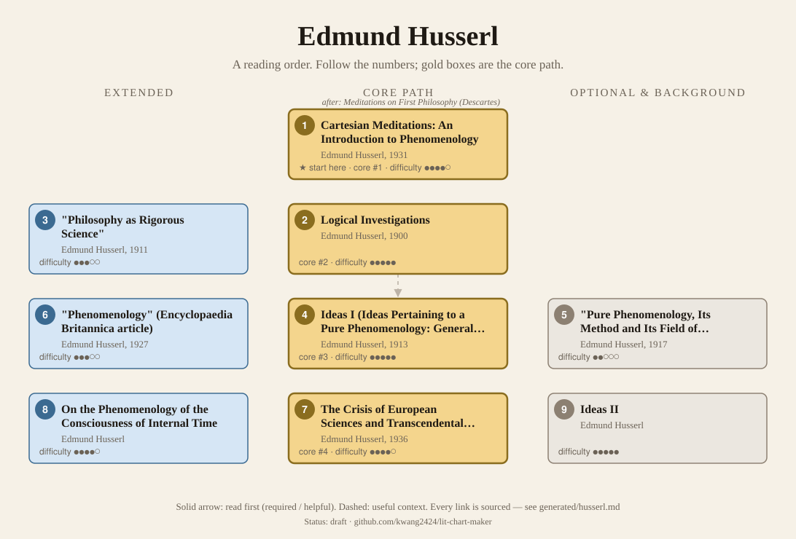
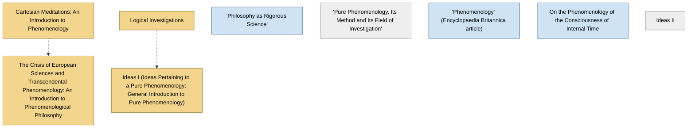

<!-- Generated by tools/build.py from lists/husserl.yaml. Do not edit by hand. -->
# Edmund Husserl: reading order

**Status:** draft · **Citations checked:** 9/9

**Scope:** The founder of phenomenology: his main published books and the introductions he kept writing to them. Background for Heidegger, and through him for Sartre, Merleau-Ponty, Derrida and others.

## Core path

The shortest route through the essentials.

1. **Cartesian Meditations: An Introduction to Phenomenology** (1931) · difficulty ●●●●○ · ★ start here
2. **Logical Investigations** (1900) · difficulty ●●●●●
3. **Ideas I (Ideas Pertaining to a Pure Phenomenology: General Introduction to Pure Phenomenology)** (1913) · difficulty ●●●●●
4. **The Crisis of European Sciences and Transcendental Phenomenology: An Introduction to Phenomenological Philosophy** (1936) · difficulty ●●●●○ · first book in 1 surveyed source

## What the sources say

We surveyed 3 independent sources (3 course syllabi and teaching lists) and recorded which books each one assigns or recommends, and where it starts.

| Book | Recommended by | First book in |
|---|---|---|
| The Crisis of European Sciences and Transcendental Phenomenology: An Introduction to Phenomenological Philosophy | 2/3 | 1 |
| Ideas I (Ideas Pertaining to a Pure Phenomenology: General Introduction to Pure Phenomenology) | 2/3 |  |
| Logical Investigations | 2/3 |  |
| "Pure Phenomenology, Its Method and Its Field of Investigation" | 1/3 | 1 |
| "Phenomenology" (Encyclopaedia Britannica article) | 1/3 |  |
| Cartesian Meditations: An Introduction to Phenomenology | 1/3 |  |
| "Philosophy as Rigorous Science" | 1/3 |  |
| On the Phenomenology of the Consciousness of Internal Time | 1/3 |  |

**Sources surveyed**

- **University of Guelph, Department of Philosophy, PHIL 3350: Introduction to Phenomenology (Winter 2013)** [teaching]: "Pure Phenomenology, Its Method and Its Field of Investigation" → "Phenomenology" (Encyclopaedia Britannica article) → Ideas I (Ideas Pertaining to a Pure Phenomenology: General Introduction to Pure Phenomenology) → On the Phenomenology of the Consciousness of Internal Time. ✓ checked in Course syllabus (PDF), accessed 2026-11
- **Deree – The American College of Greece, PH 4031: Phenomenology: Husserl and Heidegger** [teaching]: Cartesian Meditations: An Introduction to Phenomenology, The Crisis of European Sciences and Transcendental Phenomenology: An Introduction to Phenomenological Philosophy, "Philosophy as Rigorous Science", Ideas I (Ideas Pertaining to a Pure Phenomenology: General Introduction to Pure Phenomenology), Logical Investigations. ✓ checked in Course syllabus (PDF), accessed 2026-11
- **Harald Wiltsche, Philosophy 365: Phenomenology and Philosophy of Science (graduate seminar)** [teaching]: The Crisis of European Sciences and Transcendental Phenomenology: An Introduction to Phenomenological Philosophy → Logical Investigations. ✓ checked in Course syllabus (PDF), accessed 2026-11

## Full path

Every work, in order. Extended and optional works are placed where they fit best.

### 1. Cartesian Meditations: An Introduction to Phenomenology (1931)

`core · primary · difficulty ●●●●○` · Edmund Husserl

Includes his account of how objectivity is constituted intersubjectively, through our experience of others.

**Translation:** Cairns (Nijhoff)

**★ Good place to start.** It grew out of "a series of lectures meant to introduce a French audience to the basic ideas of phenomenology", one of the introductions Husserl kept writing.

- Stanford Encyclopedia of Philosophy, *"Edmund Husserl", Stanford Encyclopedia of Philosophy*, §1 Life and work [scholarly] ✓ checked in SEP online, accessed 2026-11

### 2. Logical Investigations (1900)

`core · primary · difficulty ●●●●●` · Edmund Husserl

Volume 1, the "Prolegomena to Pure Logic", attacks psychologism; volume 2's investigations of meaning and intentionality found phenomenology.

**Translation:** Findlay, ed. Moran (Routledge)

**Reading tips:**

- The SEP's account of his early thought centres on its theory of ideality and intentionality.
  - Stanford Encyclopedia of Philosophy, *"Edmund Husserl", Stanford Encyclopedia of Philosophy*, §2 Ideality and intentionality in the Logical Investigations [scholarly] ✓ checked in SEP online, accessed 2026-11

### 3. "Philosophy as Rigorous Science" (1911)

`extended · primary · difficulty ●●●○○` · Edmund Husserl

A programmatic essay on phenomenology as a rigorous science of consciousness.

**Translation:** Lauer, in Phenomenology and the Crisis of Philosophy

### 4. Ideas I (Ideas Pertaining to a Pure Phenomenology: General Introduction to Pure Phenomenology) (1913)

`core · primary · difficulty ●●●●●` · Edmund Husserl

The epoché, the phenomenological reduction and transcendental idealism.

**Translation:** Dahlstrom (Hackett) or Kersten (Nijhoff)

**Reading tips:**

- Its turn to transcendental idealism "caused consternation": many early phenomenologists saw it as "a betrayal of the core ideas of phenomenology".
  - Stanford Encyclopedia of Philosophy, *"Edmund Husserl", Stanford Encyclopedia of Philosophy*, §1 Life and work [scholarly] ✓ checked in SEP online, accessed 2026-11

**Read first:**

- *Logical Investigations* — *context*. The SEP reads it as his next major work after the Investigations, marking his explicit transcendental turn.
  - Stanford Encyclopedia of Philosophy, *"Edmund Husserl", Stanford Encyclopedia of Philosophy*, §1 Life and work; §3 [scholarly] ✓ checked in SEP online, accessed 2026-11
- *Critique of Pure Reason* (from the [Immanuel Kant list](kant.md)) — *context*. In calling his phenomenology "transcendental", Husserl "was precisely pointing to the Kantian legacy".
  - Stanford Encyclopedia of Philosophy, *"Edmund Husserl", Stanford Encyclopedia of Philosophy*, §3 The transcendental turn [scholarly] ✓ checked in SEP online, accessed 2026-11

### 5. "Pure Phenomenology, Its Method and Its Field of Investigation" (1917)

`optional · primary · difficulty ●●○○○` · Edmund Husserl

His 1917 inaugural lecture at Freiburg. Short.

### 6. "Phenomenology" (Encyclopaedia Britannica article) (1927)

`extended · primary · difficulty ●●●○○` · Edmund Husserl

His own short summary of phenomenology for a general encyclopedia.

### 7. The Crisis of European Sciences and Transcendental Phenomenology: An Introduction to Phenomenological Philosophy (1936)

`core · primary · difficulty ●●●●○` · Edmund Husserl

His last work, on the "lifeworld" and how modern science lost sight of it. Only its first two parts appeared in his lifetime.

**Translation:** Carr (Northwestern)

**Read first:**

- *Cartesian Meditations: An Introduction to Phenomenology* — *context*. It is the last of his attempts at an introduction to phenomenology, as its subtitle says.
  - Stanford Encyclopedia of Philosophy, *"Edmund Husserl", Stanford Encyclopedia of Philosophy*, §1 Life and work; Bibliography (Hua 6) [scholarly] ✓ checked in SEP online, accessed 2026-11

### 8. On the Phenomenology of the Consciousness of Internal Time

`extended · primary · difficulty ●●●●○` · Edmund Husserl

Lectures and notes from 1893–1917 on how we experience time.

### 9. Ideas II

`optional · primary · difficulty ●●●●●` · Edmund Husserl

Studies of the body, nature and the person, published after his death.

## Map

Solid arrows: required or helpful. Dotted: context.

## Connections

**Builds on**

- *Critique of Pure Reason* (Immanuel Kant) → *Ideas I (Ideas Pertaining to a Pure Phenomenology: General Introduction to Pure Phenomenology)* — context. In calling his phenomenology "transcendental", Husserl "was precisely pointing to the Kantian legacy".

**Who builds on Edmund Husserl**

- *Logical Investigations* → *Voice and Phenomenon (also translated as Speech and Phenomena)* (Jacques Derrida) — helpful. It reads Husserl's phenomenology; Oregon's course assigns Logical Investigations §§1–8 alongside its first chapters.
- *Logical Investigations* → *Being and Time* (Martin Heidegger) — context. Heidegger studied the Logical Investigations as a student and kept valuing it while he radically reinterpreted Husserl's phenomenology.
- *Ideas I (Ideas Pertaining to a Pure Phenomenology: General Introduction to Pure Phenomenology)* → *Phenomenology* (Jean-François Lyotard) — context. Its first part "introduces phenomenology through the work of Edmund Husserl"; the second turns to Merleau-Ponty.

## Sources

- **[scholarly]** Stanford Encyclopedia of Philosophy, *"Edmund Husserl", Stanford Encyclopedia of Philosophy* — <https://plato.stanford.edu/entries/husserl/>
- **[teaching]** Deree – The American College of Greece, *PH 4031: Phenomenology: Husserl and Heidegger* — <https://www.acg.edu/dereeacg/files/pdfs/PH4031.pdf>
- **[teaching]** University of Guelph, Department of Philosophy, *PHIL 3350: Introduction to Phenomenology (Winter 2013)* — <https://www.uoguelph.ca/arts/sites/default/files/syllabus/PHIL3350.pdf>
- **[teaching]** Harald Wiltsche, *Philosophy 365: Phenomenology and Philosophy of Science (graduate seminar)* — <https://www.haraldwiltsche.com/uploads/5/0/4/6/50464133/syllabusphenphilscience.pdf>
