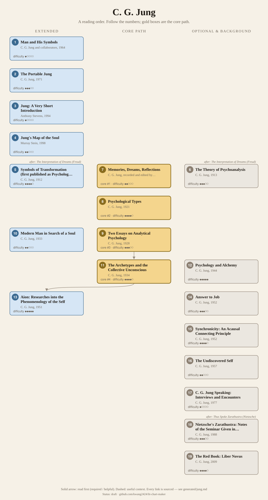

<!-- Generated by tools/build.py from lists/jung.yaml. Do not edit by hand. -->
# C. G. Jung: reading order

**Status:** draft · **Citations checked:** 18/18

**Scope:** Jung's main books and essay collections (cited by Collected Works volume where there is one), the Freud background he started from, a few popular books, and standard introductions. Links into the Nietzsche list mark where Jung reads Nietzsche.

## Core path

The shortest route through the essentials.

1. **Memories, Dreams, Reflections** (1962) · difficulty ●●○○○ · first book in 1 surveyed source
2. **Psychological Types** (1921) · difficulty ●●●●○
3. **Two Essays on Analytical Psychology** (1928) · difficulty ●●●○○ · first book in 1 surveyed source
4. **The Archetypes and the Collective Unconscious** (1934) · difficulty ●●●●○

## What the sources say

We surveyed 6 independent sources (1 scholarly guide and 5 course syllabi and teaching lists) and recorded which books each one assigns or recommends, and where it starts.

| Book | Recommended by | First book in |
|---|---|---|
| Memories, Dreams, Reflections | 5/6 | 1 |
| Jung's Map of the Soul | 3/6 | 1 |
| Modern Man in Search of a Soul | 3/6 |  |
| Aion: Researches into the Phenomenology of the Self | 2/6 |  |
| The Portable Jung | 2/6 |  |
| Two Essays on Analytical Psychology | 1/6 | 1 |
| The Undiscovered Self | 1/6 | 1 |
| The Archetypes and the Collective Unconscious | 1/6 |  |
| Man and His Symbols | 1/6 |  |
| The Red Book: Liber Novus | 1/6 |  |
| Jung: A Very Short Introduction | 1/6 |  |
| C. G. Jung Speaking: Interviews and Encounters | 1/6 |  |

**Sources surveyed**

- **Jung Society of Seattle, Recommended Reading ("For Absolute Beginners")** [teaching] (beginner's list): Memories, Dreams, Reflections → Jung's Map of the Soul. ✓ checked in Web page, accessed 2026-11
- **Jungian Center for the Spiritual Sciences, A Beginner's Guide to Reading Jung** [teaching] (beginner's list): The Undiscovered Self → Memories, Dreams, Reflections → C. G. Jung Speaking: Interviews and Encounters. ✓ checked in Web page, accessed 2026-11
- **David Baker, Rollins College, PSY 315M: Carl Jung and the Psychology of Soul (Fall 2008)** [teaching] (beginner's list): Jung's Map of the Soul, Memories, Dreams, Reflections, Modern Man in Search of a Soul. ✓ checked in Course syllabus (PDF), accessed 2026-11
- **Princeton University Press, Collected Works of C. G. Jung, Vol. 7 (Two Essays), volume description** [scholarly] (beginner's list): Two Essays on Analytical Psychology. ✓ checked in Princeton University Press website, accessed 2026-11
- **Inter-Regional Society of Jungian Analysts, Suggested Reading in Jungian Psychology (2022)** [teaching]: Memories, Dreams, Reflections, Jung: A Very Short Introduction, Man and His Symbols, The Portable Jung, The Archetypes and the Collective Unconscious, The Red Book: Liber Novus, Jung's Map of the Soul, Aion: Researches into the Phenomenology of the Self, Modern Man in Search of a Soul. ✓ checked in Reading list (PDF), accessed 2026-11
- **University of Essex, Basic Jungian Concepts (short course)** [teaching] (beginner's list): Memories, Dreams, Reflections, The Portable Jung, Modern Man in Search of a Soul, Aion: Researches into the Phenomenology of the Self. ✓ checked in Course web page, accessed 2026-11

## Full path

Every work, in order. Extended and optional works are placed where they fit best.

### 1. Man and His Symbols (1964)

`extended · primary · difficulty ●○○○○` · C. G. Jung and collaborators

Illustrated and written for general readers. Jung wrote only the first essay, "Approaching the Unconscious"; his collaborators wrote the rest.

### 2. The Portable Jung (1971)

`extended · primary · difficulty ●●●○○` · C. G. Jung (ed. Joseph Campbell)

A one-volume selection of key essays; used by the University of Essex and on the IRSJA's suggested list.

### 3. Jung: A Very Short Introduction (1994)

`extended · secondary · difficulty ●○○○○` · Anthony Stevens

A brief overview of his life and main ideas.

### 4. Jung's Map of the Soul (1998)

`extended · secondary · difficulty ●●○○○` · Murray Stein

A clear tour of the main concepts (ego, shadow, persona, anima/animus, Self).

### 5. Symbols of Transformation (first published as Psychology of the Unconscious) (1912)

`extended · primary · difficulty ●●●●○` · C. G. Jung

Collected Works vol. 5. Long and dense with mythology. Jung later revised it completely; read the Collected Works version unless you want the 1912 text.

**Read first:**

- *The Interpretation of Dreams* (from the [Sigmund Freud list](freud.md)) — *helpful*. It is Jung's "first important statement of his independent position"; it widens Freud's idea of libido from sexuality to psychic energy in general.
  - Princeton University Press, *Collected Works of C. G. Jung, Vol. 5 (Symbols of Transformation), volume description*, volume description [scholarly] ✓ checked in Princeton University Press website, accessed 2026-11
  - Beatrice M. Hinkle, *Translator's introduction to Psychology of the Unconscious*, Introduction (on libido) [scholarly] ✓ checked in Hinkle trans. (1916), Project Gutenberg

### 6. The Theory of Psychoanalysis (1913)

`optional · primary · difficulty ●●●○○` · C. G. Jung

Lectures given in New York in 1912. Now in Collected Works vol. 4 (Freud and Psychoanalysis).

**Read first:**

- *The Interpretation of Dreams* (from the [Sigmund Freud list](freud.md)) — *helpful*. Jung says these lectures are where he first defines his own theoretical position toward Freud's principles.
  - C. G. Jung, *The Theory of Psychoanalysis*, Introduction [author] ✓ checked in English trans. (1915), Project Gutenberg

### 7. Memories, Dreams, Reflections (1962)

`core · primary · difficulty ●●○○○` · C. G. Jung, recorded and edited by Aniela Jaffé

His late autobiography, mostly about his inner life. Not written by Jung alone: Aniela Jaffé recorded and edited much of it, so treat it as a memoir, not a statement of theory.

### 8. Psychological Types (1921)

`core · primary · difficulty ●●●●○` · C. G. Jung

Introversion/extraversion and the four functions. The first nine chapters trace the "type problem" through the history of ideas.

**Translation:** Baynes, rev. Hull (Collected Works vol. 6)

**Reading tips:**

- Jung put the definitions of his terms in the final chapter. Keep it at hand; many readers also read chapter X, the general description of the types, first.
  - C. G. Jung, *Psychological Types*, Introduction (last paragraph); table of contents [author] ✓ checked in Baynes trans. (1923), archive.org/details/psychological_types

**Read first:**

- *The Birth of Tragedy* (from the [Friedrich Nietzsche list](nietzsche.md)) — *context*. Chapter III, "The Apollonian and the Dionysian", is a reading of Nietzsche's Birth of Tragedy as a study of types.
  - C. G. Jung, *Psychological Types*, Chapter III [author] ✓ checked in Baynes trans. (1923), archive.org/details/psychological_types

### 9. Two Essays on Analytical Psychology (1928)

`core · primary · difficulty ●●●○○` · C. G. Jung

"On the Psychology of the Unconscious" and "The Relations between the Ego and the Unconscious": persona, shadow, anima/animus, individuation.

**Translation:** Hull (Collected Works vol. 7, Princeton)

**Reading tips:**

- Its publisher calls it "perhaps the best introduction to Jung's work", and the essays present "the essential core of his system". Most beginner guides still suggest the memoir or a secondary guide first.
  - Princeton University Press, *Collected Works of C. G. Jung, Vol. 7 (Two Essays), volume description*, volume description [scholarly] ✓ checked in Princeton University Press website, accessed 2026-11

### 10. Modern Man in Search of a Soul (1933)

`extended · primary · difficulty ●●○○○` · C. G. Jung

Lectures and essays for a general audience. Easy to dip into.

### 11. The Archetypes and the Collective Unconscious (1934)

`core · primary · difficulty ●●●●○` · C. G. Jung

Essays from the 1930s–50s. "Archetypes of the Collective Unconscious" and "The Concept of the Collective Unconscious" are the place to start.

**Translation:** Hull (Collected Works vol. 9i)

**Read first:**

- *Two Essays on Analytical Psychology* — *helpful*. Two Essays sets out the core of his system; these essays describe and elaborate its two central concepts, the archetypes and the collective unconscious.
  - Princeton University Press, *Collected Works of C. G. Jung, Vol. 7 (Two Essays), volume description*, volume description [scholarly] ✓ checked in Princeton University Press website, accessed 2026-11
  - Princeton University Press, *Collected Works of C. G. Jung, Vol. 9i (The Archetypes and the Collective Unconscious), volume description*, volume description [scholarly] ✓ checked in Princeton University Press website, accessed 2026-11

### 12. Psychology and Alchemy (1944)

`optional · primary · difficulty ●●●●●` · C. G. Jung

Reads alchemy as a symbolic record of individuation. Heavily illustrated.

**Translation:** Hull (Collected Works vol. 12)

### 13. Aion: Researches into the Phenomenology of the Self (1951)

`extended · primary · difficulty ●●●●●` · C. G. Jung

One of the major works of his later years, on the Self and its symbols in Christianity, Gnosticism and alchemy.

**Translation:** Hull (Collected Works vol. 9ii)

**Reading tips:**

- The first three chapters (the ego, the shadow, the syzygy: anima and animus) summarise key concepts of his psychology and work well on their own.
  - Princeton University Press, *Collected Works of C. G. Jung, Vol. 9ii (Aion), volume description*, volume description [scholarly] ✓ checked in Princeton University Press website, accessed 2026-11

**Read first:**

- *The Archetypes and the Collective Unconscious* — *helpful*. It treats the Self, shadow and anima/animus, archetypes that the essays in vol. 9i introduce, so it reads best after them.
  - Princeton University Press, *Collected Works of C. G. Jung, Vol. 9i (The Archetypes and the Collective Unconscious), volume description*, volume description [scholarly] ✓ checked in Princeton University Press website, accessed 2026-11
  - Princeton University Press, *Collected Works of C. G. Jung, Vol. 9ii (Aion), volume description*, volume description [scholarly] ✓ checked in Princeton University Press website, accessed 2026-11

### 14. Answer to Job (1952)

`optional · primary · difficulty ●●●○○` · C. G. Jung

A short, provocative psychological reading of the Book of Job. Now in Collected Works vol. 11.

### 15. Synchronicity: An Acausal Connecting Principle (1952)

`optional · primary · difficulty ●●●●○` · C. G. Jung

His most speculative idea, meaningful coincidence. Collected Works vol. 8.

### 16. The Undiscovered Self (1957)

`optional · primary · difficulty ●●○○○` · C. G. Jung

A short late essay on the individual and mass society.

### 17. C. G. Jung Speaking: Interviews and Encounters (1977)

`optional · primary · difficulty ●○○○○` · C. G. Jung (ed. William McGuire and R. F. C. Hull)

Interviews over fifty years, including the BBC "Face to Face" interview. Easy reading.

### 18. Nietzsche's Zarathustra: Notes of the Seminar Given in 1934–1939 (1988)

`optional · primary · difficulty ●●●○○` · C. G. Jung (ed. James L. Jarrett)

Transcripts of an informal seminar, given in English, that went through Zarathustra over five years. Very long; read selectively.

**Read first:**

- *Thus Spoke Zarathustra* (from the [Friedrich Nietzsche list](nietzsche.md)) — *required*. It is a running psychological commentary on Thus Spoke Zarathustra.
  - Princeton University Press, *Nietzsche's Zarathustra: Notes of the Seminar Given in 1934–1939, description*, book description [scholarly] ✓ checked in Princeton University Press website, accessed 2026-11

### 19. The Red Book: Liber Novus (2009)

`optional · primary · difficulty ●●●●○` · C. G. Jung (ed. Sonu Shamdasani)

Jung's private illustrated record of his visions (1913–1930), unpublished in his lifetime. Best approached after Memories, Dreams, Reflections and the core works.

## Map

Solid arrows: required or helpful. Dotted: context.

```mermaid
graph TD
  man_and_his_symbols["Man and His Symbols"]:::extended
  portable_jung["The Portable Jung"]:::extended
  stevens_vsi["Jung: A Very Short Introduction"]:::extended
  stein_map["Jung's Map of the Soul"]:::extended
  symbols_transformation["Symbols of Transformation (first published as Psychology of the Unconscious)"]:::extended
  theory_psychoanalysis["The Theory of Psychoanalysis"]:::optional
  memories_dreams["Memories, Dreams, Reflections"]:::core
  psychological_types["Psychological Types"]:::core
  two_essays["Two Essays on Analytical Psychology"]:::core
  modern_man["Modern Man in Search of a Soul"]:::extended
  archetypes_cu["The Archetypes and the Collective Unconscious"]:::core
  psychology_alchemy["Psychology and Alchemy"]:::optional
  aion["Aion: Researches into the Phenomenology of the Self"]:::extended
  answer_to_job["Answer to Job"]:::optional
  synchronicity["Synchronicity: An Acausal Connecting Principle"]:::optional
  undiscovered_self["The Undiscovered Self"]:::optional
  jung_speaking["C. G. Jung Speaking: Interviews and Encounters"]:::optional
  zarathustra_seminar["Nietzsche's Zarathustra: Notes of the Seminar Given in 1934–1939"]:::optional
  red_book["The Red Book: Liber Novus"]:::optional
  two_essays --> archetypes_cu
  archetypes_cu --> aion
  classDef core fill:#f4d58d,stroke:#8a6d1f,color:#000
  classDef extended fill:#cfe3f5,stroke:#3b6a91,color:#000
  classDef optional fill:#eeeeee,stroke:#888,color:#000
```

## Sources

- **[author]** C. G. Jung, *The Theory of Psychoanalysis*, 1913
- **[author]** C. G. Jung, *Psychological Types*, 1921
- **[scholarly]** Beatrice M. Hinkle, *Translator's introduction to Psychology of the Unconscious*, Moffat, Yard & Co., 1916
- **[scholarly]** Princeton University Press, *Collected Works of C. G. Jung, Vol. 5 (Symbols of Transformation), volume description* — <https://press.princeton.edu/isbn/9780691018157>
- **[scholarly]** Princeton University Press, *Collected Works of C. G. Jung, Vol. 7 (Two Essays), volume description* — <https://press.princeton.edu/isbn/9780691017822>
- **[scholarly]** Princeton University Press, *Collected Works of C. G. Jung, Vol. 9i (The Archetypes and the Collective Unconscious), volume description* — <https://press.princeton.edu/isbn/9780691018331>
- **[scholarly]** Princeton University Press, *Collected Works of C. G. Jung, Vol. 9ii (Aion), volume description* — <https://press.princeton.edu/isbn/9780691018263>
- **[scholarly]** Princeton University Press, *Nietzsche's Zarathustra: Notes of the Seminar Given in 1934–1939, description* — <https://press.princeton.edu/isbn/9780691099538>
- **[teaching]** University of Essex, *Basic Jungian Concepts (short course)* — <https://shortcoursesgateway.essex.ac.uk/Course?dates=0&courseref=PPS%3ABAS.JUNG.ONLINE>
- **[teaching]** Inter-Regional Society of Jungian Analysts, *Suggested Reading in Jungian Psychology (2022)* — <https://irsja.org/wp-content/uploads/2023/01/READING-LIST-2022.12.22.pdf>
- **[teaching]** Jungian Center for the Spiritual Sciences, *A Beginner's Guide to Reading Jung* — <https://jungiancenter.org/a-beginners-guide-to-reading-jung-2/>
- **[teaching]** Jung Society of Seattle, *Recommended Reading ("For Absolute Beginners")* — <https://jungseattle.org/learn/recommended-reading/>
- **[teaching]** David Baker, Rollins College, *PSY 315M: Carl Jung and the Psychology of Soul (Fall 2008)* — <https://rpublic.rollins.edu/sites/Syllabi/CourseSyllabi/PSY315MH2-200809.pdf>
