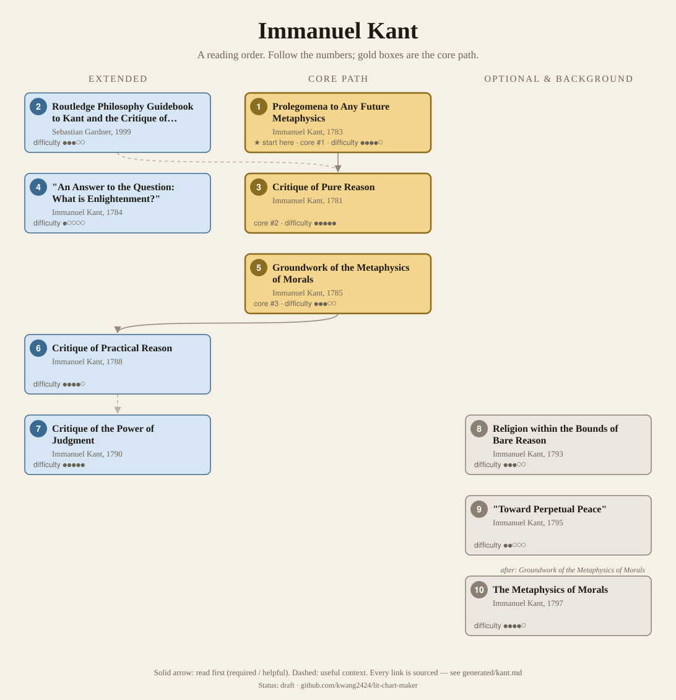
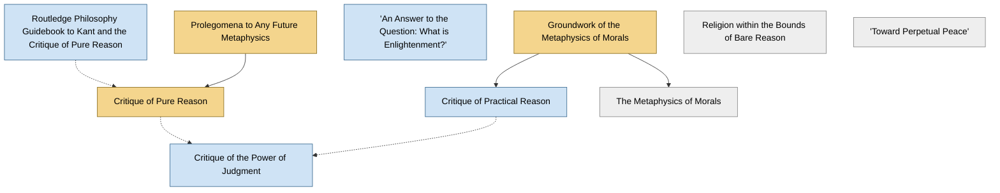

<!-- Generated by tools/build.py from lists/kant.yaml. Do not edit by hand. -->
# Immanuel Kant: reading order

**Status:** draft · **Citations checked:** 23/23

**Scope:** The three Critiques, the shorter works Kant wrote to introduce or extend them, a few popular essays, and the standard introductory guide to the first Critique.

## Core path

The shortest route through the essentials.

1. **Prolegomena to Any Future Metaphysics** (1783) · difficulty ●●●●○ · ★ start here
2. **Critique of Pure Reason** (1781) · difficulty ●●●●● · first book in 3 surveyed sources
3. **Groundwork of the Metaphysics of Morals** (1785) · difficulty ●●●○○ · first book in 1 surveyed source

## What the sources say

We surveyed 9 independent sources (1 scholarly guide and 8 course syllabi and teaching lists) and recorded which books each one assigns or recommends, and where it starts.

| Book | Recommended by | First book in |
|---|---|---|
| Critique of Pure Reason | 8/9 | 3 |
| Groundwork of the Metaphysics of Morals | 5/9 | 1 |
| Prolegomena to Any Future Metaphysics | 3/9 |  |
| Critique of the Power of Judgment | 2/9 |  |
| "An Answer to the Question: What is Enlightenment?" | 1/9 | 1 |
| Religion within the Bounds of Bare Reason | 1/9 |  |

**Sources surveyed**

- **Eric Watkins, UC San Diego, Phil 106: Kant (Fall 2018)** [teaching]: Groundwork of the Metaphysics of Morals → Prolegomena to Any Future Metaphysics. ✓ checked in Course syllabus (PDF), accessed 2026-11
- **University of Florida, PHH 4930: Seminar in a Major Philosopher: Kant (Spring 2026)** [teaching]: Critique of Pure Reason → Prolegomena to Any Future Metaphysics. ✓ checked in Course syllabus (PDF), accessed 2026-11
- **Charles Goldhaber, PHIL 335: Topics in Modern European Philosophy: Kant** [teaching]: Critique of Pure Reason → Groundwork of the Metaphysics of Morals. ✓ checked in Course syllabus (PDF), accessed 2026-11
- **Zambrana, University of Oregon, PHIL 453/553: Kant's Critique of Pure Reason** [teaching]: Critique of Pure Reason. ✓ checked in Course syllabus (PDF), accessed 2026-11
- **University of Edinburgh, Kant, course guide (2017–18)** [teaching]: Critique of Pure Reason, Prolegomena to Any Future Metaphysics. ✓ checked in Course syllabus (PDF), accessed 2026-11
- **J. Wolff, Kant seminar (Fall 2012)** [teaching]: "An Answer to the Question: What is Enlightenment?" → Critique of Pure Reason. ✓ checked in Course syllabus (PDF), accessed 2026-11
- **University of Cambridge, Faculty of Philosophy, Philosophy Tripos Guide to Courses (Syllabus) 2025–2026** [teaching]: Critique of Pure Reason, Groundwork of the Metaphysics of Morals, Critique of the Power of Judgment. ✓ checked in Guide to Courses 2025–26 (PDF), accessed 2026-11
- **University of Oxford, Faculty of Philosophy, Course Descriptions: Finals** [teaching]: Critique of Pure Reason, Groundwork of the Metaphysics of Morals. ✓ checked in Course web page, accessed 2026-11
- **Adrian Moore, interviewed by Nigel Warburton for Five Books, The Best Immanuel Kant Books (2016)** [scholarly] (expert's shortlist): Critique of Pure Reason, Groundwork of the Metaphysics of Morals, Critique of the Power of Judgment, Religion within the Bounds of Bare Reason. ✓ checked in Five Books interview (web page), accessed 2026-11

## Full path

Every work, in order. Extended and optional works are placed where they fit best.

### 1. Prolegomena to Any Future Metaphysics (1783)

`core · primary · difficulty ●●●●○` · Immanuel Kant

Kant's own short version of the Critique of Pure Reason. For most readers of Nietzsche, Deleuze or Jung this, plus a good guide, is enough Kant.

**Translation:** Hatfield (Cambridge) or Carus (free online)

**★ Good place to start.** Kant wrote it as "a preliminary exercise" and the "plan" of the Critique of Pure Reason, for readers who found the Critique too hard to follow.

- Immanuel Kant, *Prolegomena to Any Future Metaphysics (Preface)*, Preface [author] ✓ checked in Carus trans. (Open Court, 1912), Project Gutenberg

**Reading tips:**

- One course calls it Kant's "textbook version" of the Critique, and pairs each week's Critique reading with the matching Prolegomena sections.
  - University of Edinburgh, *Kant, course guide (2017–18)*, reading list and weekly primary readings [teaching] ✓ checked in Course syllabus (PDF), accessed 2026-11

**Read first:**

- *An Enquiry concerning Human Understanding* (from the [David Hume list](hume.md)) — *context*. Kant: "the suggestion of David Hume was the very thing, which many years ago first interrupted my dogmatic slumber". Oxford recommends early modern philosophy first.
  - Immanuel Kant, *Prolegomena to Any Future Metaphysics (Preface)*, Preface [author] ✓ checked in Carus trans. (Open Court, 1912), Project Gutenberg
  - University of Oxford, Faculty of Philosophy, *Course Descriptions: Finals*, paper 112 (recommended: paper 101, Early Modern Philosophy) [teaching] ✓ checked in Course web page, accessed 2026-11

### 2. Routledge Philosophy Guidebook to Kant and the Critique of Pure Reason (1999)

`extended · secondary · difficulty ●●●○○` · Sebastian Gardner

A guide that follows the Critique section by section. Read alongside it.

### 3. Critique of Pure Reason (1781)

`core · primary · difficulty ●●●●●` · Immanuel Kant

The book Schopenhauer and Deleuze rework. Courses start with the two Prefaces and the Introduction; the second (B) Preface states the "Copernican" turn.

**Translation:** Guyer & Wood (Cambridge) or Pluhar (Hackett)

**Read first:**

- *Republic* (from the [Plato list](plato.md)) — *context*. The Transcendental Dialectic opens its account of "ideas" with Plato's use of the word, and defends "the Platonic Republic" against the charge of being idle "imaginary perfection".
  - Immanuel Kant, *The Critique of Pure Reason (Meiklejohn trans.)*, Transcendental Dialectic, Book I, Section I, "Of Ideas in General" [author] ✓ checked in Meiklejohn trans., Project Gutenberg
- *Routledge Philosophy Guidebook to Kant and the Critique of Pure Reason* — *context*. Three of the surveyed courses recommend Gardner's guide as the accessible commentary, "presented in the same order as the text". Read it alongside.
  - University of Florida, *PHH 4930: Seminar in a Major Philosopher: Kant (Spring 2026)*, recommended secondary reading [teaching] ✓ checked in Course syllabus (PDF), accessed 2026-11
  - Charles Goldhaber, *PHIL 335: Topics in Modern European Philosophy: Kant*, recommended secondary reading [teaching] ✓ checked in Course syllabus (PDF), accessed 2026-11
  - Zambrana, University of Oregon, *PHIL 453/553: Kant's Critique of Pure Reason*, "On CPR – Introductory" [teaching] ✓ checked in Course syllabus (PDF), accessed 2026-11
- *Prolegomena to Any Future Metaphysics* — *helpful*. Kant wrote the Prolegomena as the Critique's "plan" and "a preliminary exercise", because readers found the Critique too diffuse to follow.
  - Immanuel Kant, *Prolegomena to Any Future Metaphysics (Preface)*, Preface [author] ✓ checked in Carus trans. (Open Court, 1912), Project Gutenberg

### 4. "An Answer to the Question: What is Enlightenment?" (1784)

`extended · primary · difficulty ●○○○○` · Immanuel Kant

A short essay ("Sapere aude!"). The easiest way to hear Kant's voice.

### 5. Groundwork of the Metaphysics of Morals (1785)

`core · primary · difficulty ●●●○○` · Immanuel Kant

The categorical imperative. Short, and the usual first book of Kant's ethics.

*Why this tier:* Kept core though only two surveyed courses assign it: most courses found are on Kant's theoretical philosophy, and his ethics is usually taught separately.

**Translation:** Gregor & Timmermann (Cambridge) or Abbott (free online, as "Fundamental Principles")

**Reading tips:**

- Adrian Moore: despite the "rather forbidding title... basically, this is an introduction to Kant's moral philosophy".
  - Adrian Moore, interviewed by Nigel Warburton for Five Books, *The Best Immanuel Kant Books (2016)*, pick 2 [scholarly] ✓ checked in Five Books interview (web page), accessed 2026-11

### 6. Critique of Practical Reason (1788)

`extended · primary · difficulty ●●●●○` · Immanuel Kant

The second Critique: freedom, the moral law and the highest good.

**Read first:**

- *Groundwork of the Metaphysics of Morals* — *required*. Kant says it "presupposes, indeed, the Fundamental Principles [Groundwork] of the Metaphysic of Morals", for its formula of duty.
  - Immanuel Kant, *Critique of Practical Reason, Preface*, Preface [author] ✓ checked in Abbott trans., Project Gutenberg

### 7. Critique of the Power of Judgment (1790)

`extended · primary · difficulty ●●●●●` · Immanuel Kant

Beauty, the sublime and purpose in nature. Matters for aesthetics and for Deleuze.

**Read first:**

- *Critique of Pure Reason* — *context*. Kant presents it as the end of the critical project ("Here then I end my whole critical undertaking").
  - Immanuel Kant, *Critique of Judgement, Preface*, Preface [author] ✓ checked in Bernard trans., Project Gutenberg
- *Critique of Practical Reason* — *context*. It is meant to bridge the "gulf" between the theoretical and practical parts of his system.
  - Michael Rohlf, *"Immanuel Kant", Stanford Encyclopedia of Philosophy*, §7.1 The great chasm [scholarly] ✓ checked in SEP online, accessed 2026-11

### 8. Religion within the Bounds of Bare Reason (1793)

`optional · primary · difficulty ●●●○○` · Immanuel Kant

Radical evil and a moral reading of Christianity.

### 9. "Toward Perpetual Peace" (1795)

`optional · primary · difficulty ●●○○○` · Immanuel Kant

A short sketch of a peaceful order among states.

### 10. The Metaphysics of Morals (1797)

`optional · primary · difficulty ●●●●○` · Immanuel Kant

The full system the Groundwork was written to found, covering rights and virtues.

**Read first:**

- *Groundwork of the Metaphysics of Morals* — *helpful*. The Groundwork was issued "in the first instance", as the foundation for this later metaphysics of morals.
  - Immanuel Kant, *Groundwork (Fundamental Principles) of the Metaphysics of Morals, Preface*, Preface [author] ✓ checked in Abbott trans., Project Gutenberg

## Map

Solid arrows: required or helpful. Dotted: context.

## Connections

**Builds on**

- *An Enquiry concerning Human Understanding* (David Hume) → *Prolegomena to Any Future Metaphysics* — context. Kant: "the suggestion of David Hume was the very thing, which many years ago first interrupted my dogmatic slumber". Oxford recommends early modern philosophy first.
- *Republic* (Plato) → *Critique of Pure Reason* — context. The Transcendental Dialectic opens its account of "ideas" with Plato's use of the word, and defends "the Platonic Republic" against the charge of being idle "imaginary perfection".

**Who builds on Immanuel Kant**

- *Critique of the Power of Judgment* → *Lectures on Kant's Political Philosophy* (Hannah Arendt) — helpful. She "based her theory of political judgment on Kant's aesthetics in his Critique of Judgment, which she claimed contained Kant's unwritten political philosophy".
- *Critique of Pure Reason* → *Time and Free Will: An Essay on the Immediate Data of Consciousness* (Henri Bergson) — context. Its conclusion: "Kant's great mistake was to take time as a homogeneous medium"; Kant "clung to freedom, but put the self which is free outside both space and time".
- *Critique of Pure Reason* → *Creative Evolution* (Henri Bergson) — context. Chapter IV argues with Kant's Critique of Pure Reason directly: Kant "did not consider, in his Critique of Pure Reason, that science became less and less objective" as it moved toward the vital.
- *Groundwork of the Metaphysics of Morals* → *"Two Concepts of Liberty"* (Isaiah Berlin) — context. Berlin traces positive liberty through Rousseau and Kant, who "identified 'positive' freedom with autonomy", to Kant's German successors.
- *Critique of Pure Reason* → *Kant's Critical Philosophy* (Gilles Deleuze) — context. It is a reading of Kant, and Deleuze's later work starts from this reading.
- *Critique of Pure Reason* → *The Order of Things: An Archaeology of the Human Sciences* (Michel Foucault) — context. For Foucault "the great 'turn' in modern philosophy occurs with Kant", who asks whether and how ideas represent their objects.
- *"An Answer to the Question: What is Enlightenment?"* → *"What Is Enlightenment?"* (Michel Foucault) — helpful. It "takes up the same question 200 years later"; Edinburgh's course reads the two essays together.
- *Critique of Pure Reason* → *Phenomenology of Spirit* (G. W. F. Hegel) — context. The SEP traces Hegel's idea of a "phenomenology" as a propaedeutic to Kant, and Edinburgh's course spends two weeks on Kant "setting us up to see how Hegel's Phenomenology is shaped by it".
- *Critique of Pure Reason* → *Encyclopaedia of the Philosophical Sciences (esp. Part I, the "Lesser Logic")* (G. W. F. Hegel) — helpful. The Logic's preliminary part has a chapter on "The Critical Philosophy" (§§40–60), a sustained critique of Kant's first Critique, starting from Hume's criticism.
- *The Metaphysics of Morals* → *Elements of the Philosophy of Right* (G. W. F. Hegel) — context. Its account of punishment continues Kant's: "Kant too, in his Metaphysics of Morals had employed the idea of the state's punitive action as a negating of the original criminal act".
- *Critique of Pure Reason* → *Kant and the Problem of Metaphysics* (Martin Heidegger) — helpful. It is an interpretation of the Critique of Pure Reason.
- *Critique of Pure Reason* → *Ideas I (Ideas Pertaining to a Pure Phenomenology: General Introduction to Pure Phenomenology)* (Edmund Husserl) — context. In calling his phenomenology "transcendental", Husserl "was precisely pointing to the Kantian legacy".
- *Critique of Pure Reason* → *Psychological Types* (C. G. Jung) — context. Chapter I, on the ontological argument, says "Kant's reasoning should be final" and quotes the Critique of Pure Reason at length.
- *Critique of the Power of Judgment* → *The Differend: Phrases in Dispute* (Jean-François Lyotard) — context. He analyses the feeling that signals a differend "in terms of Kant's idea of the sublime".
- *Critique of the Power of Judgment* → *The Inhuman: Reflections on Time* (Jean-François Lyotard) — context. Its account of the event draws on "the terror and pleasure found in Immanuel Kant's account of the sublime in The Critique of Judgment".
- *Critique of the Power of Judgment* → *Lessons on the Analytic of the Sublime: Kant's Critique of Judgment, 23–29* (Jean-François Lyotard) — required. It is a commentary on §§23–29 of Kant's Critique of Judgment, as its title says.
- *Critique of Pure Reason* → *Daybreak* (Friedrich Nietzsche) — context. The 1886 Preface argues that all philosophers, "including Kant himself", built "under the seductive influence of morality", quoting the Critique of Pure Reason's "majestic moral edifices".
- *Groundwork of the Metaphysics of Morals* → *The Antichrist* (Friedrich Nietzsche) — context. §11 begins "A word now against Kant as a moralist": a virtue rooted in "mere respect for the concept of 'virtue'", in "duty" and "good for its own sake", is "pernicious".
- *Prolegomena to Any Future Metaphysics* → *On the Fourfold Root of the Principle of Sufficient Reason* (Arthur Schopenhauer) — helpful. Its claim that the subject–object distinction is the condition of all knowledge comes from Kant's first Critique.
- *Prolegomena to Any Future Metaphysics* → *The World as Will and Representation, vol. 1* (Arthur Schopenhauer) — required. "The philosophy of Kant ... is the only philosophy with which a thorough acquaintance is directly presupposed." The Prolegomena is Kant's own summary.
- *Critique of Pure Reason* → *The World as Will and Representation, vol. 1* (Arthur Schopenhauer) — helpful. The Kant he presupposes and criticizes in his appendix is above all the Critique.

## Sources

- **[author]** Immanuel Kant, *Critique of Judgement, Preface*, 1790
- **[author]** Immanuel Kant, *The Critique of Pure Reason (Meiklejohn trans.)* — <https://www.gutenberg.org/ebooks/4280>
- **[author]** Immanuel Kant, *Critique of Practical Reason, Preface*, 1788
- **[author]** Immanuel Kant, *Groundwork (Fundamental Principles) of the Metaphysics of Morals, Preface*, 1785
- **[author]** Immanuel Kant, *Prolegomena to Any Future Metaphysics (Preface)*, 1783
- **[scholarly]** Adrian Moore, interviewed by Nigel Warburton for Five Books, *The Best Immanuel Kant Books (2016)* — <https://fivebooks.com/best-books/kant/>
- **[scholarly]** Michael Rohlf, *"Immanuel Kant", Stanford Encyclopedia of Philosophy* — <https://plato.stanford.edu/entries/kant/>
- **[teaching]** University of Cambridge, Faculty of Philosophy, *Philosophy Tripos Guide to Courses (Syllabus) 2025–2026* — <https://www.phil.cam.ac.uk/files/gtc_2025-26_-_final_2025_07.pdf>
- **[teaching]** University of Oxford, Faculty of Philosophy, *Course Descriptions: Finals* — <https://www.philosophy.ox.ac.uk/course-descriptions-finals>
- **[teaching]** University of Edinburgh, *Kant, course guide (2017–18)* — <https://edwebcontent.ed.ac.uk/sites/default/files/atoms/files/kant_course_guide_2017-18.pdf>
- **[teaching]** Charles Goldhaber, *PHIL 335: Topics in Modern European Philosophy: Kant* — <https://charles-goldhaber.squarespace.com/s/Kant-Syllabus-v24.pdf>
- **[teaching]** Zambrana, University of Oregon, *PHIL 453/553: Kant's Critique of Pure Reason* — <https://pages.uoregon.edu/uophil/files/PHIL_453-553_Kant.pdf>
- **[teaching]** Eric Watkins, UC San Diego, *Phil 106: Kant (Fall 2018)* — <https://philosophy.ucsd.edu/_files/courses/18fall/Phil106_F18_Watkins.pdf>
- **[teaching]** University of Florida, *PHH 4930: Seminar in a Major Philosopher: Kant (Spring 2026)* — <https://phil.ufl.edu/wp-content/uploads/sites/145/2026/01/2026S-PHH4930-Kant-Syllabus-v1.0.pdf>
- **[teaching]** J. Wolff, *Kant seminar (Fall 2012)* — <https://jwolffphilosophy.net/wp-content/uploads/2013/04/syllabus-kant.pdf>
