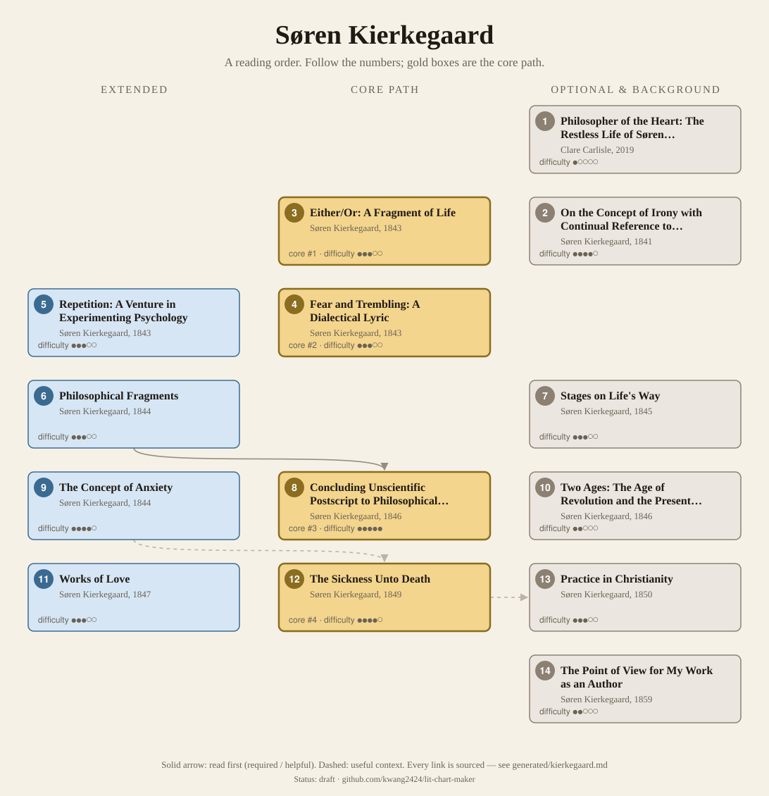
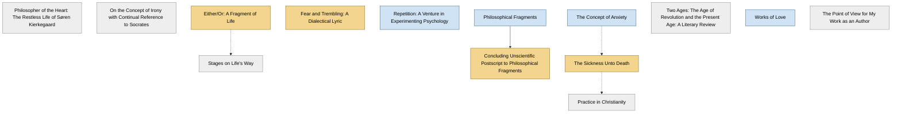

<!-- Generated by tools/build.py from lists/kierkegaard.yaml. Do not edit by hand. -->
# Søren Kierkegaard: reading order

**Status:** draft · **Citations:** 16 citations · 16 checked by Claude (AI) · 0 reviewed by a person

**Scope:** Kierkegaard's main pseudonymous works of 1843–46, the later "second authorship" (Works of Love, The Sickness Unto Death, Practice in Christianity), his dissertation on irony, his own account of his authorship, and one biography. Most of the upbuilding discourses and the late attack on the Church are left out. Years are first Danish publication, from the SEP's chronology.

> Citations marked "checked by Claude (AI)" were read against the named edition by an AI and have not yet been reviewed by a person. See [CONTRIBUTING.md](../CONTRIBUTING.md) to help review them.

## Core path

The shortest route through the essentials.

1. **Either/Or: A Fragment of Life** (1843) · difficulty ●●●○○ · first book in 3 surveyed sources
2. **Fear and Trembling: A Dialectical Lyric** (1843) · difficulty ●●●○○ · first book in 1 surveyed source
3. **Concluding Unscientific Postscript to Philosophical Fragments** (1846) · difficulty ●●●●● · first book in 1 surveyed source
4. **The Sickness Unto Death** (1849) · difficulty ●●●●○

## What the sources say

We surveyed 7 independent sources (1 scholarly guide and 6 course syllabi and teaching lists) and recorded which books each one assigns or recommends, and where it starts.

| Book | Recommended by | First book in |
|---|---|---|
| Fear and Trembling: A Dialectical Lyric | 6/7 | 1 |
| Either/Or: A Fragment of Life | 5/7 | 3 |
| The Sickness Unto Death | 4/7 |  |
| Concluding Unscientific Postscript to Philosophical Fragments | 3/7 | 1 |
| Philosophical Fragments | 2/7 |  |
| The Concept of Anxiety | 1/7 |  |
| Repetition: A Venture in Experimenting Psychology | 1/7 |  |

**Sources surveyed**

- **Anders Kraal, University of British Columbia, PHIL 385: Existentialism (Winter 2020, Term 2)** [teaching]: Either/Or: A Fragment of Life → Fear and Trembling: A Dialectical Lyric → The Sickness Unto Death. ✓ checked by Claude (AI) in Course syllabus (PDF), accessed 2026-11; not yet reviewed by a person
- **George di Giovanni, McGill University, RELG 495: Philosophy of Religion: Kierkegaard, the Pseudonymous Writings (2020)** [teaching]: Either/Or: A Fragment of Life → Fear and Trembling: A Dialectical Lyric → Repetition: A Venture in Experimenting Psychology → The Concept of Anxiety → Philosophical Fragments → Concluding Unscientific Postscript to Philosophical Fragments. ✓ checked by Claude (AI) in Course syllabus (PDF, 2020), accessed 2026-11; not yet reviewed by a person
- **Faculty of Theology, University of Copenhagen, Kierkegaard: The Individual in Modern Society (summer course 2023)** [teaching]: Either/Or: A Fragment of Life → Fear and Trembling: A Dialectical Lyric → Concluding Unscientific Postscript to Philosophical Fragments → The Sickness Unto Death. ✓ checked by Claude (AI) in Course syllabus (PDF, summer 2023), accessed 2026-11; not yet reviewed by a person
- **Christian Lotz, Michigan State University, PHL 421: Kierkegaard and Continental Philosophy (Spring 2022)** [teaching]: Concluding Unscientific Postscript to Philosophical Fragments → Fear and Trembling: A Dialectical Lyric → The Sickness Unto Death. ✓ checked by Claude (AI) in Course page (Spring 2022), accessed 2026-11; not yet reviewed by a person
- **Tracy Colony, Bard College Berlin, PL175: Introduction to Existentialism (Spring 2024)** [teaching]: Fear and Trembling: A Dialectical Lyric → The Sickness Unto Death. ✓ checked by Claude (AI) in Course syllabus (PDF, Spring 2024), accessed 2026-11; not yet reviewed by a person
- **Nigel Warburton, Philosophy: The Classics (4th ed.)** [scholarly] (expert's shortlist): Either/Or: A Fragment of Life. ✓ checked by Claude (AI) in Routledge book page (table of contents), accessed 2026-11; not yet reviewed by a person
- **St. John's College (Annapolis and Santa Fe), Undergraduate program reading list, by class year** [teaching] (expert's shortlist): Either/Or: A Fragment of Life, Philosophical Fragments, Fear and Trembling: A Dialectical Lyric. ✓ checked by Claude (AI) in Reading list web page, accessed 2026-11; not yet reviewed by a person

## Full path

Every work, in order. Extended and optional works are placed where they fit best.

### 1. Philosopher of the Heart: The Restless Life of Søren Kierkegaard (2019)

`optional · secondary · difficulty ●○○○○` · Clare Carlisle

A biography. McGill's course requires it "as preparation": "relatively brief in length, yet fully informative and engagingly written".

### 2. On the Concept of Irony with Continual Reference to Socrates (1841)

`optional · primary · difficulty ●●●●○` · Søren Kierkegaard

His Magister dissertation, on irony as practised by Socrates (SEP §1). Kierkegaard left it out of his "authorship", but it "functions as an important preface to that body of work" (IEP §2.a).

### 3. Either/Or: A Fragment of Life (1843)

`core · primary · difficulty ●●●○○` · Søren Kierkegaard (as "Victor Eremita")

The text "he considered properly to begin his authorship" (SEP §1). Volume 1 is the papers of the aesthete "A"; volume 2, the letters of Judge William for the ethical life (SEP §3.1–3.2).

**Translation:** Hannay (Penguin, abridged); Hong (Princeton, complete)

**Reading tips:**

- McGill's course: "There is an abridged Penguin edition which suffices." Copenhagen's opens with Victor Eremita's Preface and the "Diapsalmata".
  - George di Giovanni, McGill University, *RELG 495: Philosophy of Religion: Kierkegaard, the Pseudonymous Writings (2020)*, syllabus, work 1 [teaching] ✓ checked by Claude (AI) in Course syllabus (PDF, 2020), accessed 2026-11; not yet reviewed by a person
  - Faculty of Theology, University of Copenhagen, *Kierkegaard: The Individual in Modern Society (summer course 2023)*, first session [teaching] ✓ checked by Claude (AI) in Course syllabus (PDF, summer 2023), accessed 2026-11; not yet reviewed by a person

**Read first:**

- *Phenomenology of Spirit* (from the [G. W. F. Hegel list](hegel.md)) — *context*. The IEP: "The Unhappiest One", in volume 1, is "an echo of Hegel's 'unhappy consciousness'".
  - Internet Encyclopedia of Philosophy, *"Søren Kierkegaard (1813–1855)"*, §2.a On the Concept of Irony and Either/Or [scholarly] ✓ checked by Claude (AI) in IEP entry, accessed 2026-11; not yet reviewed by a person

### 4. Fear and Trembling: A Dialectical Lyric (1843)

`core · primary · difficulty ●●●○○` · Søren Kierkegaard (as "Johannes de silentio")

Abraham and Isaac, and the "teleological suspension of the ethical": it "explicitly problematizes the ethical" (IEP §2.b). Its pseudonymous author explores the life of faith from outside Christianity (SEP §1). Every course surveyed reads it.

**Translation:** Hannay (Penguin); Hong (Princeton)

### 5. Repetition: A Venture in Experimenting Psychology (1843)

`extended · primary · difficulty ●●●○○` · Søren Kierkegaard (as "Constantin Constantius")

Published the same day as Fear and Trembling (SEP chronology); the IEP treats the two together (§2.b).

### 6. Philosophical Fragments (1844)

`extended · primary · difficulty ●●●○○` · Søren Kierkegaard (as "Johannes Climacus")

"How there can be an historical point of departure for an eternal truth" (IEP §2.c): an ironic attempt to "invent" something like Christianity as an alternative to the Socratic view (SEP §3.3.1).

**Read first:**

- *Meno* (from the [Plato list](plato.md)) — *context*. It begins from "the Socratic view (understood very much in terms of Plato's Socrates)" that the truth can be found through "recollection", and seeks an alternative to it.
  - Stanford Encyclopedia of Philosophy, *"Søren Kierkegaard"*, §3.3.1 Faith [scholarly] ✓ checked by Claude (AI) in SEP entry, accessed 2026-11; not yet reviewed by a person

### 7. Stages on Life's Way (1845)

`optional · primary · difficulty ●●●○○` · Søren Kierkegaard (as "Hilarius Bookbinder")

Nested narrators, with characters from Either/Or and Repetition (IEP §2.d).

**Read first:**

- *Either/Or: A Fragment of Life* — *context*. It "repeats characters from Either/Or and Repetition".
  - Internet Encyclopedia of Philosophy, *"Søren Kierkegaard (1813–1855)"*, §2.d Stages on Life's Way and Concluding Unscientific Postscript [scholarly] ✓ checked by Claude (AI) in IEP entry, accessed 2026-11; not yet reviewed by a person

### 8. Concluding Unscientific Postscript to Philosophical Fragments (1846)

`core · primary · difficulty ●●●●●` · Søren Kierkegaard (as "Johannes Climacus")

Subjectivity and existence: reflection, though necessary, "by itself cannot lead to choices" (SEP §2). Danish Hegelianism is attacked "particularly in Prefaces (1844) and in Concluding Unscientific Postscript" (IEP §1.d). He had intended it to end his authorship (SEP §1). Long; courses read chapters.

**Translation:** Hong (Princeton); Hannay (Cambridge)

**Read first:**

- *Philosophical Fragments* — *helpful*. It is, as its title says, the "Concluding Unscientific Postscript to Philosophical Fragments", by the same pseudonym, Johannes Climacus.
  - Stanford Encyclopedia of Philosophy, *"Søren Kierkegaard"*, Chronology of Kierkegaard's Works (1846) [scholarly] ✓ checked by Claude (AI) in SEP entry, accessed 2026-11; not yet reviewed by a person

### 9. The Concept of Anxiety (1844)

`extended · primary · difficulty ●●●●○` · Søren Kierkegaard (as "Vigilius Haufniensis")

On the surface an inquiry into original sin, "but in reality it probes the nature of human choice in general, particularly the origins of evil" (SEP §2).

### 10. Two Ages: The Age of Revolution and the Present Age: A Literary Review (1846)

`optional · primary · difficulty ●●○○○` · Søren Kierkegaard

A review of a novel by Thomasine Gyllembourg (IEP §1.c). The SEP finds his "influential critique of modern societies", shaped by "the press", in such essays as this (§2).

### 11. Works of Love (1847)

`extended · primary · difficulty ●●●○○` · Søren Kierkegaard

Fifteen "deliberations" on the New Testament command to love one's neighbour as oneself, published under his own name (SEP §3.3.2).

*Why this tier:* None of the five courses surveyed assigns it, but the SEP calls it "arguably the most important work of Kierkegaard's mature Christian ethics".

### 12. The Sickness Unto Death (1849)

`core · primary · difficulty ●●●●○` · Søren Kierkegaard (as "Anti-Climacus")

Despair and the self. "Kierkegaard's picture of selfhood is perhaps most clearly on display" here (SEP §2). Four of the five courses surveyed read it.

**Translation:** Hannay (Penguin); Hong (Princeton)

**Read first:**

- *The Concept of Anxiety* — *context*. The IEP: it is "a Christian repetition of the central themes of The Concept of Anxiety, with 'despair' supplanting 'anxiety'".
  - Internet Encyclopedia of Philosophy, *"Søren Kierkegaard (1813–1855)"*, §4.b Anti-Climacus [scholarly] ✓ checked by Claude (AI) in IEP entry, accessed 2026-11; not yet reviewed by a person
- *Phenomenology of Spirit* (from the [G. W. F. Hegel list](hegel.md)) — *context*. The SEP: "Like Hegel, Anti-Climacus holds both that human beings are to be understood as 'spirit', and that spirit must become itself through a process"; unlike Hegel, he focuses on the individual self.
  - Stanford Encyclopedia of Philosophy, *"Søren Kierkegaard"*, §2 Kierkegaard's Analysis of Human Existence [scholarly] ✓ checked by Claude (AI) in SEP entry, accessed 2026-11; not yet reviewed by a person

### 13. Practice in Christianity (1850)

`optional · primary · difficulty ●●●○○` · Søren Kierkegaard (as "Anti-Climacus")

The appropriate Christian response to divine grace (IEP §4.b).

**Read first:**

- *The Sickness Unto Death* — *context*. The IEP: it "complements The Sickness Unto Death thematically", by the same pseudonym.
  - Internet Encyclopedia of Philosophy, *"Søren Kierkegaard (1813–1855)"*, §4.b Anti-Climacus [scholarly] ✓ checked by Claude (AI) in IEP entry, accessed 2026-11; not yet reviewed by a person

### 14. The Point of View for My Work as an Author (1859)

`optional · primary · difficulty ●●○○○` · Søren Kierkegaard

Written 1848, published after his death (SEP §1). In his own voice he claims he was "from first to last a religious author"; this claim "has been hotly contested" (SEP §1).

## Map

Solid arrows: required or helpful. Dotted: context.

## Connections

**Builds on**

- *Phenomenology of Spirit* (G. W. F. Hegel) → *Either/Or: A Fragment of Life* — context. The IEP: "The Unhappiest One", in volume 1, is "an echo of Hegel's 'unhappy consciousness'".
- *Meno* (Plato) → *Philosophical Fragments* — context. It begins from "the Socratic view (understood very much in terms of Plato's Socrates)" that the truth can be found through "recollection", and seeks an alternative to it.
- *Phenomenology of Spirit* (G. W. F. Hegel) → *The Sickness Unto Death* — context. The SEP: "Like Hegel, Anti-Climacus holds both that human beings are to be understood as 'spirit', and that spirit must become itself through a process"; unlike Hegel, he focuses on the individual self.

**Who builds on Søren Kierkegaard**

- *Repetition: A Venture in Experimenting Psychology* → *Being and Time* (Martin Heidegger) — context. Taking over a received possibility of existence in an individual way: "Following Kierkegaard, Heidegger calls this process … 'repetition'".

## Sources

- **[scholarly]** Internet Encyclopedia of Philosophy, *"Søren Kierkegaard (1813–1855)"* — <https://iep.utm.edu/kierkega/>
- **[scholarly]** Stanford Encyclopedia of Philosophy, *"Søren Kierkegaard"* — <https://plato.stanford.edu/entries/kierkegaard/>
- **[scholarly]** Nigel Warburton, *Philosophy: The Classics (4th ed.)*, Routledge, 2014 — <https://www.routledge.com/Philosophy-The-Classics/Warburton/p/book/9780415534666>
- **[teaching]** St. John's College (Annapolis and Santa Fe), *Undergraduate program reading list, by class year* — <https://www.sjc.edu/reading-list>
- **[teaching]** Tracy Colony, Bard College Berlin, *PL175: Introduction to Existentialism (Spring 2024)* — <https://tools.bard.edu/wwwmedia/resources/files/1832/PL175_Spring%202024_Syllabus_Colony.pdf>
- **[teaching]** Faculty of Theology, University of Copenhagen, *Kierkegaard: The Individual in Modern Society (summer course 2023)* — <https://teol.ku.dk/english/programmes/summer_courses/kierkegaard--the-individual-in-global-society/Kierkegaard_course_syllabus_summer_2023_FINAL.pdf>
- **[teaching]** George di Giovanni, McGill University, *RELG 495: Philosophy of Religion: Kierkegaard, the Pseudonymous Writings (2020)* — <https://www.mcgill.ca/religiousstudies/files/religiousstudies/relg_495_syllabusphilosophy_of_religion.pdf>
- **[teaching]** Christian Lotz, Michigan State University, *PHL 421: Kierkegaard and Continental Philosophy (Spring 2022)* — <https://christianlotz.info/2021/12/02/spring-2022-phl-420-kierkegaard-and-continental-philosophy/>
- **[teaching]** Anders Kraal, University of British Columbia, *PHIL 385: Existentialism (Winter 2020, Term 2)* — <https://phil.cms.arts.ubc.ca/wp-content/uploads/sites/19/2021/06/PHIL-385-002_Anders-Kraal_2021W2revised.pdf>
