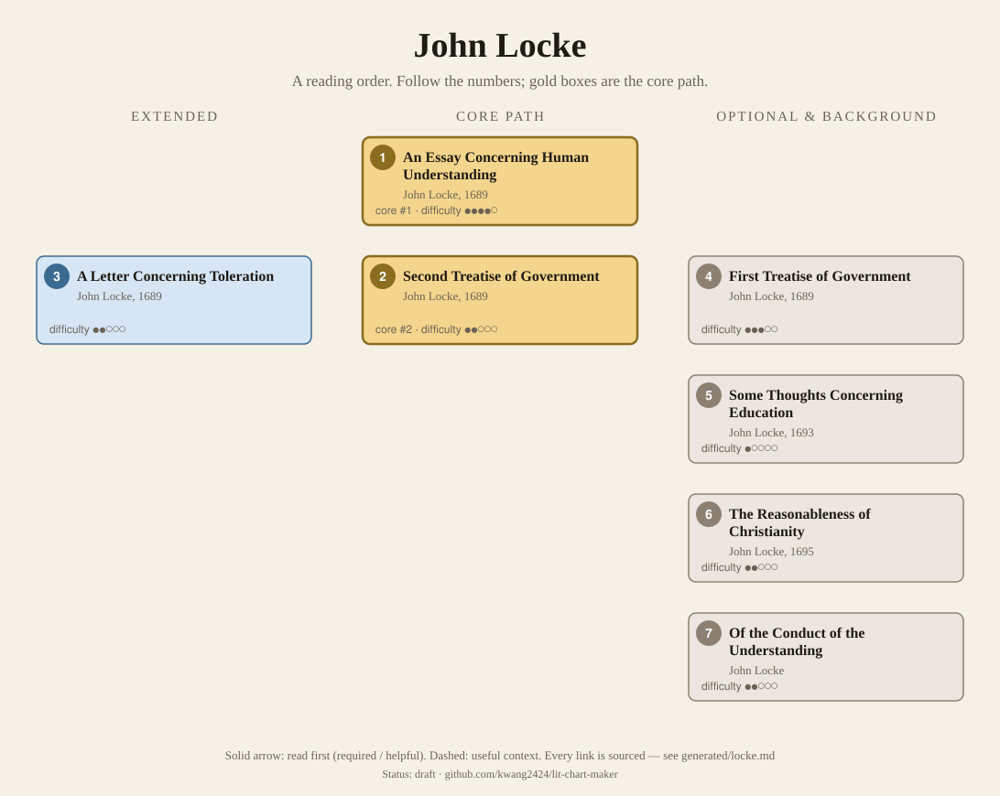

<!-- Generated by tools/build.py from lists/locke.yaml. Do not edit by hand. -->
# John Locke: reading order

**Status:** draft · **Citations:** 15 citations · 15 checked by Claude (AI) · 0 reviewed by a person

**Scope:** Locke's philosophical, political and religious works: the Essay Concerning Human Understanding, the Two Treatises of Government and the Letter Concerning Toleration (all 1689), and the later writings on education and religion. His economic papers are left out. Courses split between the Essay (philosophy) and the Second Treatise (politics), so the survey has two starting points.

> Citations marked "checked by Claude (AI)" were read against the named edition by an AI and have not yet been reviewed by a person. See [CONTRIBUTING.md](../CONTRIBUTING.md) to help review them.

## Core path

The shortest route through the essentials.

1. **An Essay Concerning Human Understanding** (1689) · difficulty ●●●●○ · first book in 3 surveyed sources
2. **Second Treatise of Government** (1689) · difficulty ●●○○○ · first book in 2 surveyed sources

## What the sources say

We surveyed 7 independent sources (1 scholarly guide and 6 course syllabi and teaching lists) and recorded which books each one assigns or recommends, and where it starts.

| Book | Recommended by | First book in |
|---|---|---|
| Second Treatise of Government | 5/7 | 2 |
| An Essay Concerning Human Understanding | 4/7 | 3 |

**Sources surveyed**

- **Samuel C. Rickless, UC San Diego, PHIL 111: History of Philosophy—Early Modern (Winter 2024)** [teaching]: An Essay Concerning Human Understanding. ✓ checked by Claude (AI) in Course syllabus (PDF, Winter 2024), accessed 2026-11; not yet reviewed by a person
- **James Young, University of Victoria, PHIL 308: The British Empiricists (Fall 2025)** [teaching]: An Essay Concerning Human Understanding. ✓ checked by Claude (AI) in Course syllabus (PDF, Fall 2025), accessed 2026-11; not yet reviewed by a person
- **Chuck Goldhaber, University of Florida, PHH 5406: Modern Philosophy II – The Empiricists: Reason, Passion, and Politics in Hobbes, Locke, and Hume (Spring 2025)** [teaching]: An Essay Concerning Human Understanding → Second Treatise of Government. ✓ checked by Claude (AI) in Course syllabus (PDF, Spring 2025), accessed 2026-11; not yet reviewed by a person
- **Directed Studies, Yale University, Historical and Political Thought (Spring 2023)** [teaching]: Second Treatise of Government. ✓ checked by Claude (AI) in Course syllabus (PDF), accessed 2026-11; not yet reviewed by a person
- **Youngstown State University, POL 3786: Political Thought 2 (Fall 2026)** [teaching]: Second Treatise of Government. ✓ checked by Claude (AI) in Course syllabus (PDF), accessed 2026-11; not yet reviewed by a person
- **Nigel Warburton, Philosophy: The Classics (4th ed.)** [scholarly] (expert's shortlist): An Essay Concerning Human Understanding, Second Treatise of Government. ✓ checked by Claude (AI) in Routledge book page (table of contents), accessed 2026-11; not yet reviewed by a person
- **St. John's College (Annapolis and Santa Fe), Undergraduate program reading list, by class year** [teaching] (expert's shortlist): Second Treatise of Government. ✓ checked by Claude (AI) in Reading list web page, accessed 2026-11; not yet reviewed by a person

## Full path

Every work, in order. Extended and optional works are placed where they fit best.

### 1. An Essay Concerning Human Understanding (1689)

`core · primary · difficulty ●●●●○` · John Locke

"One of the first great defenses of modern empiricism", concerned with "the limits of human understanding" (SEP preamble). Book I argues that we have no innate knowledge; Book II traces ideas to experience; Book III treats language; Book IV, knowledge and probability (SEP §2; IEP §2). It grew out of a discussion among friends at Exeter House and was finished in exile in Holland (SEP §1.2).

**Translation:** English original; Nidditch's Clarendon edition is standard

**Reading tips:**

- Locke admits it is longer than it needs to be: "possibly it might be reduced to a narrower compass than it is … But to confess the truth, I am now too lazy, or too busy, to make it shorter." Courses read selections from Books I, II and IV; Florida's uses an abridged edition.
  - John Locke, *An Essay Concerning Human Understanding ("The Epistle to the Reader"; Book IV)*, The Epistle to the Reader [author] ✓ checked by Claude (AI) in Project Gutenberg #10615; not yet reviewed by a person
- Two of the courses surveyed open with The Epistle to the Reader, Locke's account of how the book began in a discussion among "five or six friends".
  - John Locke, *An Essay Concerning Human Understanding ("The Epistle to the Reader"; Book IV)*, The Epistle to the Reader [author] ✓ checked by Claude (AI) in Project Gutenberg #10615; not yet reviewed by a person
  - James Young, University of Victoria, *PHIL 308: The British Empiricists (Fall 2025)*, first readings [teaching] ✓ checked by Claude (AI) in Course syllabus (PDF, Fall 2025), accessed 2026-11; not yet reviewed by a person
  - Chuck Goldhaber, University of Florida, *PHH 5406: Modern Philosophy II – The Empiricists: Reason, Passion, and Politics in Hobbes, Locke, and Hume (Spring 2025)*, week 5 [teaching] ✓ checked by Claude (AI) in Course syllabus (PDF, Spring 2025), accessed 2026-11; not yet reviewed by a person

**Read first:**

- *Meditations on First Philosophy* (from the [René Descartes list](descartes.md)) — *context*. The SEP: "In writing An Essay Concerning Human Understanding Locke adopted Descartes' 'way of ideas'", though it is "transformed so as to become an organic part of Locke's philosophy".
  - Stanford Encyclopedia of Philosophy, *"John Locke"*, §1.1 Locke's Life up to His Meeting with Lord Ashley in 1666 [scholarly] ✓ checked by Claude (AI) in SEP entry, accessed 2026-11; not yet reviewed by a person

### 2. Second Treatise of Government (1689)

`core · primary · difficulty ●●○○○` · John Locke

The state of nature, property, consent and the right to rebel: "sovereignty resides in the people" (SEP preamble). Published anonymously with the First Treatise as the Two Treatises of Government (SEP §1.3).

**Translation:** English original; ed. Laslett (Cambridge) or Macpherson (Hackett)

**Reading tips:**

- It can be read on its own: chapter I opens by summing up what "the foregoing discourse" (the First Treatise) had shown, and the Preface says what is lost from the middle need not be missed.
  - John Locke, *Second Treatise of Government (Preface and ch. I)*, Preface; ch. I, §1 [author] ✓ checked by Claude (AI) in Project Gutenberg #7370; not yet reviewed by a person

**Read first:**

- *Leviathan* (from the [Thomas Hobbes list](hobbes.md)) — *context*. The language of natural rights "gained prominence through the writings of thinkers in the generation before Locke, such as Grotius and Hobbes". Yale's Directed Studies and Florida's course read Locke straight after Hobbes.
  - Stanford Encyclopedia of Philosophy, *"Locke's Political Philosophy"*, §1 Natural Law and Natural Rights [scholarly] ✓ checked by Claude (AI) in SEP entry, accessed 2026-11; not yet reviewed by a person
  - Directed Studies, Yale University, *Historical and Political Thought (Spring 2023)*, weeks 2–4 [teaching] ✓ checked by Claude (AI) in Course syllabus (PDF), accessed 2026-11; not yet reviewed by a person

### 3. A Letter Concerning Toleration (1689)

`extended · primary · difficulty ●●○○○` · John Locke

Written in Latin in exile in Holland and published anonymously in 1689 (IEP §1): governments should be "much more tolerant of religious diversity than was common at the time".

### 4. First Treatise of Government (1689)

`optional · primary · difficulty ●●●○○` · John Locke

A detailed critique of Robert Filmer's Patriarcha, a defence of divine-right monarchy. The IEP: "now of primarily historical interest" (§4.a).

### 5. Some Thoughts Concerning Education (1693)

`optional · primary · difficulty ●○○○○` · John Locke

Advice first given in letters to his friend Edward Clarke on the education of Clarke's children (IEP §6). The SEP: with the Conduct of the Understanding it forms "a nice bridge between An Essay Concerning Human Understanding and his political works" (§3).

### 6. The Reasonableness of Christianity (1695)

`optional · primary · difficulty ●●○○○` · John Locke

His major work on theology, published anonymously; controversial for arguing that many beliefs held necessary for Christians were not (IEP §1).

### 7. Of the Conduct of the Understanding

`optional · primary · difficulty ●●○○○` · John Locke

Begun as a chapter for the fourth edition of the Essay, it grew too long, was never finished, and was published by his literary executors (SEP §3).

## Map

Solid arrows: required or helpful. Dotted: context.

```mermaid
graph TD
  essay["An Essay Concerning Human Understanding"]:::core
  second_treatise["Second Treatise of Government"]:::core
  letter_toleration["A Letter Concerning Toleration"]:::extended
  first_treatise["First Treatise of Government"]:::optional
  thoughts_education["Some Thoughts Concerning Education"]:::optional
  reasonableness["The Reasonableness of Christianity"]:::optional
  conduct_understanding["Of the Conduct of the Understanding"]:::optional
  classDef core fill:#f4d58d,stroke:#8a6d1f,color:#000
  classDef extended fill:#cfe3f5,stroke:#3b6a91,color:#000
  classDef optional fill:#eeeeee,stroke:#888,color:#000
```

## Connections

**Builds on**

- *Meditations on First Philosophy* (René Descartes) → *An Essay Concerning Human Understanding* — context. The SEP: "In writing An Essay Concerning Human Understanding Locke adopted Descartes' 'way of ideas'", though it is "transformed so as to become an organic part of Locke's philosophy".
- *Leviathan* (Thomas Hobbes) → *Second Treatise of Government* — context. The language of natural rights "gained prominence through the writings of thinkers in the generation before Locke, such as Grotius and Hobbes". Yale's Directed Studies and Florida's course read Locke straight after Hobbes.

**Who builds on John Locke**

- *An Essay Concerning Human Understanding* → *A Treatise of Human Nature* (David Hume) — context. It recasts Locke's terms: "Perhaps I rather restore the word, idea, to its original sense, from which Mr Locke had perverted it, in making it stand for all our perceptions."
- *An Essay Concerning Human Understanding* → *An Enquiry concerning Human Understanding* (David Hume) — context. Its account of the idea of power answers Locke: "Mr. Locke, in his chapter of power, says that, finding from experience, that there are several new productions in nature…"
- *An Essay Concerning Human Understanding* → *Critique of Pure Reason* (Immanuel Kant) — context. The Preface recalls the hope of settling metaphysics "by a kind of physiology of the human understanding—that of the celebrated Locke"; the Deduction thanks "the celebrated Locke for having first opened the way for this inquiry".
- *An Essay Concerning Human Understanding* → *Discourse on the Origin of Inequality (Second Discourse)* (Jean-Jacques Rousseau) — context. Part II invokes "the axiom of the wise Locke, Where there is no property, there can be no injury", from the Essay (IV.iii.18).
- *Second Treatise of Government* → *Natural Right and History* (Leo Strauss) — context. The SEP: "Leo Strauss (1953), and many of his followers, take rights to be paramount, going so far as to portray Locke's position as essentially similar to that of Hobbes."

## Sources

- **[author]** John Locke, *An Essay Concerning Human Understanding ("The Epistle to the Reader"; Book IV)*, 1689
- **[author]** John Locke, *Second Treatise of Government (Preface and ch. I)*, 1689
- **[scholarly]** Stanford Encyclopedia of Philosophy, *"John Locke"* — <https://plato.stanford.edu/entries/locke/>
- **[scholarly]** Stanford Encyclopedia of Philosophy, *"Locke's Political Philosophy"* — <https://plato.stanford.edu/entries/locke-political/>
- **[scholarly]** Nigel Warburton, *Philosophy: The Classics (4th ed.)*, Routledge, 2014 — <https://www.routledge.com/Philosophy-The-Classics/Warburton/p/book/9780415534666>
- **[teaching]** St. John's College (Annapolis and Santa Fe), *Undergraduate program reading list, by class year* — <https://www.sjc.edu/reading-list>
- **[teaching]** Samuel C. Rickless, UC San Diego, *PHIL 111: History of Philosophy—Early Modern (Winter 2024)* — <https://hh-philosophy.ucsd.edu/_files/courses/24winter/Syllabus111-2024W.pdf>
- **[teaching]** Chuck Goldhaber, University of Florida, *PHH 5406: Modern Philosophy II – The Empiricists: Reason, Passion, and Politics in Hobbes, Locke, and Hume (Spring 2025)* — <https://phil.ufl.edu/wp-content/uploads/sites/145/2025/01/PHH5406-Modern-Philosophy-II-Syllabus-v1.0.pdf>
- **[teaching]** James Young, University of Victoria, *PHIL 308: The British Empiricists (Fall 2025)* — <https://www.uvic.ca/humanities/philosophy/assets/docs/james-young-phil-308-2025-syllabus.pdf>
- **[teaching]** Directed Studies, Yale University, *Historical and Political Thought (Spring 2023)* — <https://directedstudies.yale.edu/sites/default/files/files/HP%20spring%202023%20syllabus.pdf>
- **[teaching]** Youngstown State University, *POL 3786: Political Thought 2 (Fall 2026)* — <https://catalog.ysu.edu/syllabi/2026-fall/pol-3786-01-44080/syllabi-202640-pol-3786-01-44080.pdf>
