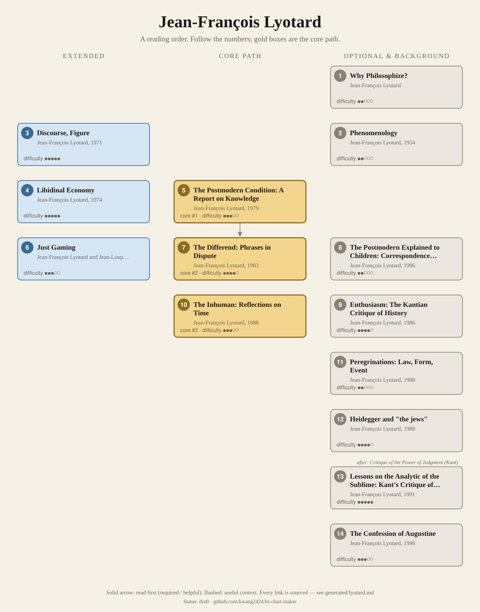

<!-- Generated by tools/build.py from lists/lyotard.yaml. Do not edit by hand. -->
# Jean-François Lyotard: reading order

**Status:** draft · **Citations checked:** 13/13

**Scope:** Lyotard's books from the 1954 Phenomenology to the unfinished Confession of Augustine: the libidinal works of the 1970s, the "postmodern" works around 1980, and the later books on time, the sublime and Kant. Few public Lyotard syllabi exist, so the survey is thin and the order leans on the SEP and IEP.

## Core path

The shortest route through the essentials.

1. **The Postmodern Condition: A Report on Knowledge** (1979) · difficulty ●●●○○ · first book in 1 surveyed source
2. **The Differend: Phrases in Dispute** (1983) · difficulty ●●●●○
3. **The Inhuman: Reflections on Time** (1988) · difficulty ●●●○○

## What the sources say

We surveyed 3 independent sources (3 course syllabi and teaching lists) and recorded which books each one assigns or recommends, and where it starts.

| Book | Recommended by | First book in |
|---|---|---|
| Libidinal Economy | 2/3 |  |
| The Postmodern Condition: A Report on Knowledge | 1/3 | 1 |
| Phenomenology | 1/3 | 1 |
| The Differend: Phrases in Dispute | 1/3 |  |
| The Inhuman: Reflections on Time | 1/3 |  |
| Discourse, Figure | 1/3 |  |
| Why Philosophize? | 1/3 |  |

**Sources surveyed**

- **Department of Philosophy, Lingnan University, PHI4369: Postmodern Philosophy (course outline)** [teaching]: The Postmodern Condition: A Report on Knowledge, The Differend: Phrases in Dispute, The Inhuman: Reflections on Time. ✓ checked in Course outline (PDF), accessed 2026-11
- **University of Auckland, FRENCH 711: Special Topic: Theory and Text (2019)** [teaching]: Libidinal Economy. ✓ checked in Course syllabus (web page), accessed 2026-11
- **Graham Jones, Melbourne School of Continental Philosophy, The Works of Lyotard, Part 1 (Summer School 2023)** [teaching] (beginner's list): Phenomenology → Why Philosophize? → Discourse, Figure → Libidinal Economy. ✓ checked in Course page, accessed 2026-11

## Full path

Every work, in order. Extended and optional works are placed where they fit best.

### 1. Why Philosophize?

`optional · primary · difficulty ●●○○○` · Jean-François Lyotard

A short early work; MSCP's Lyotard course opens with it and Phenomenology.

### 2. Phenomenology (1954)

`optional · primary · difficulty ●●○○○` · Jean-François Lyotard

His first book, a short introduction to and examination of phenomenology that went through some ten editions. It then asks what phenomenology can say to the human sciences and to Marxism.

**Translation:** Beakley (SUNY 1991)

**Read first:**

- *Ideas I (Ideas Pertaining to a Pure Phenomenology: General Introduction to Pure Phenomenology)* (from the [Edmund Husserl list](husserl.md)) — *context*. Its first part "introduces phenomenology through the work of Edmund Husserl"; the second turns to Merleau-Ponty.
  - Internet Encyclopedia of Philosophy, *"Jean-François Lyotard (1924—1998)"*, §2.a Phenomenology [scholarly] ✓ checked in IEP entry, accessed 2026-11

### 3. Discourse, Figure (1971)

`extended · primary · difficulty ●●●●●` · Jean-François Lyotard

His doctoral thesis, against structuralism: discourse (the written text studied by semiotics) against the figural (the visual), first through Merleau-Ponty's phenomenology, then through Freud (SEP §3.1, IEP §2.c). Translated into English only in 2011.

**Translation:** Hudek and Lydon (Minnesota 2011)

**Read first:**

- *The Interpretation of Dreams* (from the [Sigmund Freud list](freud.md)) — *context*. The second part "uses Freudian psychoanalysis to undermine both Lacanian psychoanalysis and certain aspects of phenomenology".
  - Internet Encyclopedia of Philosophy, *"Jean-François Lyotard (1924—1998)"*, §2.c Discourse, Figure [scholarly] ✓ checked in IEP entry, accessed 2026-11

### 4. Libidinal Economy (1974)

`extended · primary · difficulty ●●●●●` · Jean-François Lyotard

Political economy rethought as libidinal economy. Lyotard later called it "my evil book" and repudiated it. The SEP: "not an easy read"; the IEP: "an unusual and difficult work".

**Translation:** Grant (Athlone 1993)

**Read first:**

- *Anti-Oedipus (Capitalism and Schizophrenia, vol. 1)* (from the [Gilles Deleuze list](deleuze.md)) — *context*. The SEP calls it "very much a reflection of its era": Deleuze and Guattari's Anti-Oedipus (1972) came out two years earlier, and its account of desire is "quite similar".
  - Stanford Encyclopedia of Philosophy, *"Jean François Lyotard"*, §3.1 The Limits of Representation [scholarly] ✓ checked in SEP entry, accessed 2026-11
- *Capital, Volume 1* (from the [Karl Marx list](marx.md)) — *context*. It looks at "the desire or libido behind the so-called scientific works of the later Marx", and argues against Marx that desire is not alienated in capitalism.
  - Stanford Encyclopedia of Philosophy, *"Jean François Lyotard"*, §3.1 [scholarly] ✓ checked in SEP entry, accessed 2026-11

### 5. The Postmodern Condition: A Report on Knowledge (1979)

`core · primary · difficulty ●●●○○` · Jean-François Lyotard

A report on knowledge in the contemporary age that defines the postmodern as "incredulity towards metanarratives" (SEP §3.2). Its language games come from the later Wittgenstein.

**Translation:** Bennington and Massumi (Minnesota 1984)

**Reading tips:**

- The IEP: he is "best known" for this book, but "this book is in fact one of his more minor works". Read it as an entry point, not the summit.
  - Internet Encyclopedia of Philosophy, *"Jean-François Lyotard (1924—1998)"*, opening summary [scholarly] ✓ checked in IEP entry, accessed 2026-11

### 6. Just Gaming (1979)

`extended · primary · difficulty ●●●○○` · Jean-François Lyotard and Jean-Loup Thébaud

With Jean-Loup Thébaud. It analyses questions of justice and judgement as language games, from his "paganism" period (IEP §4.a).

**Translation:** Godzich (Minnesota 1985)

### 7. The Differend: Phrases in Dispute (1983)

`core · primary · difficulty ●●●●○` · Jean-François Lyotard

On conflicts that cannot be fairly resolved for lack of a rule of judgement both sides share. In 264 numbered paragraphs, it moves from language games to "phrases". The SEP calls it his "masterwork"; by Lyotard's own estimate it was his "most philosophical and most important" book (IEP §4.c).

**Translation:** Van Den Abbeele (Minnesota 1988)

**Reading tips:**

- Begin with the opening "Reading Dossier", which sets out the book's question, theses, context and addressee in separate short paragraphs.
  - Stanford Encyclopedia of Philosophy, *"Jean François Lyotard"*, §3.3 The Differend [scholarly] ✓ checked in SEP entry, accessed 2026-11

**Read first:**

- *The Postmodern Condition: A Report on Knowledge* — *helpful*. It develops "most fully" the philosophy of language underlying his work on paganism and postmodernism.
  - Internet Encyclopedia of Philosophy, *"Jean-François Lyotard (1924—1998)"*, §4.c The Differend [scholarly] ✓ checked in IEP entry, accessed 2026-11
- *Critique of the Power of Judgment* (from the [Immanuel Kant list](kant.md)) — *context*. He analyses the feeling that signals a differend "in terms of Kant's idea of the sublime".
  - Internet Encyclopedia of Philosophy, *"Jean-François Lyotard (1924—1998)"*, §5 Reason and Representation [scholarly] ✓ checked in IEP entry, accessed 2026-11

### 8. The Postmodern Explained to Children: Correspondence 1982–1985 (1986)

`optional · primary · difficulty ●●○○○` · Jean-François Lyotard

Letters from 1982–1985 (Le Postmoderne expliqué aux enfants).

### 9. Enthusiasm: The Kantian Critique of History (1986)

`optional · primary · difficulty ●●●●○` · Jean-François Lyotard

On Kant's critique of history, as its title says.

**Translation:** Van Den Abbeele (Stanford 2009)

### 10. The Inhuman: Reflections on Time (1988)

`core · primary · difficulty ●●●○○` · Jean-François Lyotard

Essays, most first given as lectures, on time, capitalism and the event, and on art and the "postmodern sublime" (SEP §3.4).

**Translation:** Bennington and Bowlby (Polity 1991)

**Read first:**

- *Critique of the Power of Judgment* (from the [Immanuel Kant list](kant.md)) — *context*. Its account of the event draws on "the terror and pleasure found in Immanuel Kant's account of the sublime in The Critique of Judgment".
  - Stanford Encyclopedia of Philosophy, *"Jean François Lyotard"*, §3.4 The Inhuman and the Event [scholarly] ✓ checked in SEP entry, accessed 2026-11

### 11. Peregrinations: Law, Form, Event (1988)

`optional · primary · difficulty ●●○○○` · Jean-François Lyotard

Opens with an autobiographical essay, which the SEP draws on for his life.

### 12. Heidegger and "the jews" (1988)

`optional · primary · difficulty ●●●●○` · Jean-François Lyotard

On Heidegger.

**Translation:** Michel and Roberts (Minnesota 1990)

### 13. Lessons on the Analytic of the Sublime: Kant's Critique of Judgment, 23–29 (1991)

`optional · primary · difficulty ●●●●●` · Jean-François Lyotard

A commentary on Kant's Analytic of the Sublime.

**Translation:** Rottenberg (Stanford 1994)

**Read first:**

- *Critique of the Power of Judgment* (from the [Immanuel Kant list](kant.md)) — *required*. It is a commentary on §§23–29 of Kant's Critique of Judgment, as its title says.
  - Internet Encyclopedia of Philosophy, *"Jean-François Lyotard (1924—1998)"*, §11.a Books by Lyotard [scholarly] ✓ checked in IEP entry, accessed 2026-11

### 14. The Confession of Augustine (1998)

`optional · primary · difficulty ●●●○○` · Jean-François Lyotard

Incomplete at his death and published posthumously with working notes. Reads Augustine as a precursor of the phenomenology of time (IEP §10.b).

**Translation:** Beardsworth (Stanford 2000)

## Map

Solid arrows: required or helpful. Dotted: context.

```mermaid
graph TD
  why_philosophize["Why Philosophize?"]:::optional
  phenomenology["Phenomenology"]:::optional
  discourse_figure["Discourse, Figure"]:::extended
  libidinal_economy["Libidinal Economy"]:::extended
  postmodern_condition["The Postmodern Condition: A Report on Knowledge"]:::core
  just_gaming["Just Gaming"]:::extended
  differend["The Differend: Phrases in Dispute"]:::core
  postmodern_explained["The Postmodern Explained to Children: Correspondence 1982–1985"]:::optional
  enthusiasm["Enthusiasm: The Kantian Critique of History"]:::optional
  inhuman["The Inhuman: Reflections on Time"]:::core
  peregrinations["Peregrinations: Law, Form, Event"]:::optional
  heidegger_jews["Heidegger and 'the jews'"]:::optional
  lessons_sublime["Lessons on the Analytic of the Sublime: Kant's Critique of Judgment, 23–29"]:::optional
  confession_augustine["The Confession of Augustine"]:::optional
  postmodern_condition --> differend
  classDef core fill:#f4d58d,stroke:#8a6d1f,color:#000
  classDef extended fill:#cfe3f5,stroke:#3b6a91,color:#000
  classDef optional fill:#eeeeee,stroke:#888,color:#000
```

## Connections

**Builds on**

- *Ideas I (Ideas Pertaining to a Pure Phenomenology: General Introduction to Pure Phenomenology)* (Edmund Husserl) → *Phenomenology* — context. Its first part "introduces phenomenology through the work of Edmund Husserl"; the second turns to Merleau-Ponty.
- *The Interpretation of Dreams* (Sigmund Freud) → *Discourse, Figure* — context. The second part "uses Freudian psychoanalysis to undermine both Lacanian psychoanalysis and certain aspects of phenomenology".
- *Anti-Oedipus (Capitalism and Schizophrenia, vol. 1)* (Gilles Deleuze) → *Libidinal Economy* — context. The SEP calls it "very much a reflection of its era": Deleuze and Guattari's Anti-Oedipus (1972) came out two years earlier, and its account of desire is "quite similar".
- *Capital, Volume 1* (Karl Marx) → *Libidinal Economy* — context. It looks at "the desire or libido behind the so-called scientific works of the later Marx", and argues against Marx that desire is not alienated in capitalism.
- *Critique of the Power of Judgment* (Immanuel Kant) → *The Differend: Phrases in Dispute* — context. He analyses the feeling that signals a differend "in terms of Kant's idea of the sublime".
- *Critique of the Power of Judgment* (Immanuel Kant) → *The Inhuman: Reflections on Time* — context. Its account of the event draws on "the terror and pleasure found in Immanuel Kant's account of the sublime in The Critique of Judgment".
- *Critique of the Power of Judgment* (Immanuel Kant) → *Lessons on the Analytic of the Sublime: Kant's Critique of Judgment, 23–29* — required. It is a commentary on §§23–29 of Kant's Critique of Judgment, as its title says.

## Sources

- **[scholarly]** Internet Encyclopedia of Philosophy, *"Jean-François Lyotard (1924—1998)"* — <https://iep.utm.edu/lyotard/>
- **[scholarly]** Stanford Encyclopedia of Philosophy, *"Jean François Lyotard"* — <https://plato.stanford.edu/entries/lyotard/>
- **[teaching]** Graham Jones, Melbourne School of Continental Philosophy, *The Works of Lyotard, Part 1 (Summer School 2023)* — <https://mscp.org.au/past-courses/the-works-of-lyotard-part-1>
- **[teaching]** University of Auckland, *FRENCH 711: Special Topic: Theory and Text (2019)* — <https://canvas.auckland.ac.nz/courses/41429/assignments/syllabus>
- **[teaching]** Department of Philosophy, Lingnan University, *PHI4369: Postmodern Philosophy (course outline)* — <https://ln.edu.hk/philoso/f/page/103887/309161/PHI4369.pdf>
