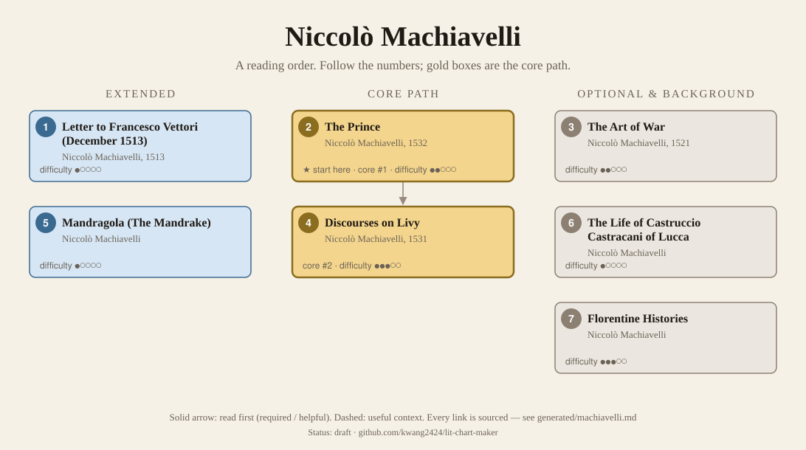
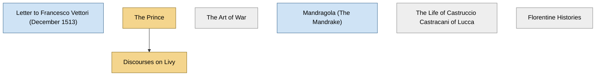

<!-- Generated by tools/build.py from lists/machiavelli.yaml. Do not edit by hand. -->
# Niccolò Machiavelli: reading order

**Status:** draft · **Citations checked:** 11/11

**Scope:** Machiavelli's political and historical works: The Prince and the Discourses on Livy, with the letter that describes writing The Prince, The Art of War, the Florentine Histories and the play Mandragola. Years are first publication; both main books appeared only after his death in 1527.

## Core path

The shortest route through the essentials.

1. **The Prince** (1532) · difficulty ●●○○○ · ★ start here · first book in 2 surveyed sources
2. **Discourses on Livy** (1531) · difficulty ●●●○○

## What the sources say

We surveyed 5 independent sources (5 course syllabi and teaching lists) and recorded which books each one assigns or recommends, and where it starts.

| Book | Recommended by | First book in |
|---|---|---|
| The Prince | 5/5 | 2 |
| Discourses on Livy | 4/5 |  |
| Letter to Francesco Vettori (December 1513) | 3/5 | 3 |
| Mandragola (The Mandrake) | 3/5 |  |
| The Art of War | 1/5 |  |
| The Life of Castruccio Castracani of Lucca | 1/5 |  |
| Florentine Histories | 1/5 |  |

**Sources surveyed**

- **Directed Studies, Yale University, Historical and Political Thought (Spring 2023)** [teaching]: Letter to Francesco Vettori (December 1513) → The Prince → Discourses on Livy. ✓ checked in Course syllabus (PDF), accessed 2026-11
- **Youngstown State University, POL 3786: Political Thought 2 (Fall 2026)** [teaching]: The Prince. ✓ checked in Course syllabus (PDF), accessed 2026-11
- **Ewa Atanassow, Bard College Berlin, PL215: Machiavelli's Arts (Spring 2024)** [teaching]: Letter to Francesco Vettori (December 1513) → The Prince → The Life of Castruccio Castracani of Lucca → The Art of War → Discourses on Livy → Mandragola (The Mandrake). ✓ checked in Course syllabus (PDF), accessed 2026-11
- **Andrea Moudarres, John Cabot University, PL 312: Machiavelli (Spring 2026)** [teaching]: Letter to Francesco Vettori (December 1513) → The Prince → Discourses on Livy → Florentine Histories → Mandragola (The Mandrake). ✓ checked in Course syllabus (web page), accessed 2026-11
- **Julian Jason Haladyn, Western University (Centre for the Study of Theory and Criticism), THEOCRIT 9211: Machiavelli and Us (Fall 2024)** [teaching]: The Prince → Mandragola (The Mandrake) → Discourses on Livy. ✓ checked in Course outline (PDF), accessed 2026-11

## Full path

Every work, in order. Extended and optional works are placed where they fit best.

### 1. Letter to Francesco Vettori (December 1513) (1513)

`extended · primary · difficulty ●○○○○` · Niccolò Machiavelli

A letter from his retirement at San Casciano describing his days, his evenings with "the ancient courts of the men of old", and the "small work on 'Principalities'" he had just written (quoted in the Marriott edition's introduction). Three of the five courses surveyed open with it.

### 2. The Prince (1532)

`core · primary · difficulty ●●○○○` · Niccolò Machiavelli

Written at the end of 1513, published posthumously in 1532 (SEP §1). Advice to a new prince on gaining and keeping power, which breaks the link earlier writers drew between moral goodness and legitimate authority (SEP §2). "Doubtless the most widely read of his works" (SEP §6).

**Translation:** Mansfield (Chicago); Skinner and Price (Cambridge)

**★ Good place to start.** The SEP calls it "doubtless the most widely read of his works"; every course surveyed reads it first, or straight after the letter describing its writing.

- Stanford Encyclopedia of Philosophy, *"Niccolò Machiavelli"*, §1 Biography; §6 ("doubtless the most widely read of his works") [scholarly] ✓ checked in SEP entry (revision of Dec 2023), accessed 2026-11
- Directed Studies, Yale University, *Historical and Political Thought (Spring 2023)*, week 1 [teaching] ✓ checked in Course syllabus (PDF), accessed 2026-11

**Reading tips:**

- Three of the five courses surveyed read his December 1513 letter to Francesco Vettori first; it describes how and why he wrote the book.
  - Andrea Moudarres, John Cabot University, *PL 312: Machiavelli (Spring 2026)*, week 2 [teaching] ✓ checked in Course syllabus (web page), accessed 2026-11

**Read first:**

- *Republic* (from the [Plato list](plato.md)) — *context*. The SEP: "Machiavelli's critique of utopian philosophical schemes (such as those of Plato) challenges an entire tradition of political philosophy".
  - Stanford Encyclopedia of Philosophy, *"Niccolò Machiavelli"*, preamble [scholarly] ✓ checked in SEP entry (revision of Dec 2023), accessed 2026-11

### 3. The Art of War (1521)

`optional · primary · difficulty ●●○○○` · Niccolò Machiavelli

His study of warfare, published in 1521, in his lifetime (SEP §1).

**Translation:** Lynch (Chicago)

### 4. Discourses on Livy (1531)

`core · primary · difficulty ●●●○○` · Niccolò Machiavelli

An exposition of the principles of republican rule "masquerading as a commentary" on Livy's history of Rome, written over several years from about 1514 and published in 1531 (SEP §1). The SEP: it "perhaps most honestly expresses" his own republican commitments (§6). Courses read selected chapters.

**Translation:** Mansfield and Tarcov (Chicago)

**Read first:**

- *The Prince* — *helpful*. The Prince sets aside republics, "inasmuch as in another place I have written of them at length"; the SEP reads the two works together and contrasts their conclusions. Every course surveyed that assigns both reads The Prince first.
  - Niccolò Machiavelli, *The Prince (with the Marriott edition's introduction)*, ch. II, opening sentence [author] ✓ checked in Marriott trans., Project Gutenberg
  - Stanford Encyclopedia of Philosophy, *"Niccolò Machiavelli"*, §6 The Discourses on Livy [scholarly] ✓ checked in SEP entry (revision of Dec 2023), accessed 2026-11

### 5. Mandragola (The Mandrake)

`extended · primary · difficulty ●○○○○` · Niccolò Machiavelli

A prose comedy. Courses read it alongside the political works.

*Why this tier:* Three of the five courses assign it, but the SEP mentions his plays only in passing; the courses that read it are seminars on Machiavelli alone.

### 6. The Life of Castruccio Castracani of Lucca

`optional · primary · difficulty ●○○○○` · Niccolò Machiavelli

A short biography of a fourteenth-century ruler of Lucca, dated 1520 in the Marriott edition's list of works, which prints it after The Prince. Bard's course reads it straight after The Prince.

### 7. Florentine Histories

`optional · primary · difficulty ●●●○○` · Niccolò Machiavelli

A history of Florence commissioned in 1520 by Cardinal Giulio de' Medici and presented to him, by then Pope Clement VII, in 1525 (SEP §1).

**Translation:** Banfield and Mansfield (Princeton)

## Map

Solid arrows: required or helpful. Dotted: context.

## Connections

**Builds on**

- *Republic* (Plato) → *The Prince* — context. The SEP: "Machiavelli's critique of utopian philosophical schemes (such as those of Plato) challenges an entire tradition of political philosophy".

**Who builds on Niccolò Machiavelli**

- *The Prince* → *Leviathan* (Thomas Hobbes) — context. Yale's Directed Studies and Youngstown State's survey courses read Leviathan straight after Machiavelli.
- *The Prince* → *The Social Contract* (Jean-Jacques Rousseau) — context. Book III ch. 6, on monarchy: Machiavelli "professed to teach kings; but it was the people he really taught. His Prince is the book of Republicans."
- *Discourses on Livy* → *Thoughts on Machiavelli* (Leo Strauss) — context. Yale's political theory exam list sets it among the readings on The Prince and The Discourses.
- *The Prince* → *Thoughts on Machiavelli* (Leo Strauss) — context. A study of Machiavelli, in which he "pronounced Machiavelli's 'anti- theological ire' the source of modernity".

## Sources

- **[author]** Niccolò Machiavelli, *The Prince (with the Marriott edition's introduction)*, 1532
- **[scholarly]** Stanford Encyclopedia of Philosophy, *"Niccolò Machiavelli"* — <https://plato.stanford.edu/entries/machiavelli/>
- **[teaching]** Ewa Atanassow, Bard College Berlin, *PL215: Machiavelli's Arts (Spring 2024)* — <https://tools.bard.edu/wwwmedia/resources/files/1826/PL215_Spring%202024_Syllabus_Atanassow.pdf>
- **[teaching]** Andrea Moudarres, John Cabot University, *PL 312: Machiavelli (Spring 2026)* — <https://myjcu.johncabot.edu/syllabus/syllabus_print.aspx?IDS=26058>
- **[teaching]** Julian Jason Haladyn, Western University (Centre for the Study of Theory and Criticism), *THEOCRIT 9211: Machiavelli and Us (Fall 2024)* — <https://uwo.ca/theory/current_students/course_descriptions/Haladyn---Machiavelli-and-Us.pdf>
- **[teaching]** Directed Studies, Yale University, *Historical and Political Thought (Spring 2023)* — <https://directedstudies.yale.edu/sites/default/files/files/HP%20spring%202023%20syllabus.pdf>
- **[teaching]** Youngstown State University, *POL 3786: Political Thought 2 (Fall 2026)* — <https://catalog.ysu.edu/syllabi/2026-fall/pol-3786-01-44080/syllabi-202640-pol-3786-01-44080.pdf>
