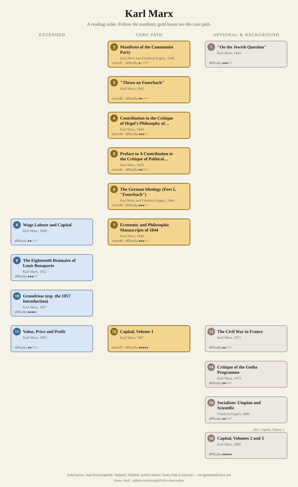

<!-- Generated by tools/build.py from lists/marx.yaml. Do not edit by hand. -->
# Karl Marx: reading order

**Status:** draft · **Citations checked:** 17/17

**Scope:** Marx's main writings (some with Engels), from the early critiques of Hegel to Capital. Background for Adorno and the Frankfurt School, Althusser, and Deleuze and Guattari's Anti-Oedipus.

## Core path

The shortest route through the essentials.

1. **Manifesto of the Communist Party** (1848) · difficulty ●○○○○ · first book in 2 surveyed sources
2. **"Theses on Feuerbach"** (1845) · difficulty ●●○○○ · first book in 1 surveyed source
3. **Contribution to the Critique of Hegel's Philosophy of Right: Introduction** (1844) · difficulty ●●●○○
4. **Preface to A Contribution to the Critique of Political Economy** (1859) · difficulty ●●○○○ · first book in 1 surveyed source
5. **The German Ideology (Part I, "Feuerbach")** (1846) · difficulty ●●●○○
6. **Economic and Philosophic Manuscripts of 1844** (1844) · difficulty ●●●○○
7. **Capital, Volume 1** (1867) · difficulty ●●●●●

## What the sources say

We surveyed 5 independent sources (5 course syllabi and teaching lists) and recorded which books each one assigns or recommends, and where it starts.

| Book | Recommended by | First book in |
|---|---|---|
| Manifesto of the Communist Party | 5/5 | 2 |
| Preface to A Contribution to the Critique of Political Economy | 4/5 | 1 |
| "Theses on Feuerbach" | 4/5 | 1 |
| Contribution to the Critique of Hegel's Philosophy of Right: Introduction | 4/5 |  |
| The German Ideology (Part I, "Feuerbach") | 4/5 |  |
| Economic and Philosophic Manuscripts of 1844 | 4/5 |  |
| Capital, Volume 1 | 3/5 |  |
| The Eighteenth Brumaire of Louis Bonaparte | 3/5 |  |
| The Civil War in France | 2/5 |  |
| Grundrisse (esp. the 1857 Introduction) | 2/5 |  |
| "On the Jewish Question" | 1/5 | 1 |
| Critique of the Gotha Programme | 1/5 |  |
| Socialism: Utopian and Scientific | 1/5 |  |

**Sources surveyed**

- **Vladimir Tismaneanu, University of Maryland, GVPT 445H: Marxism and Post-Marxism (Fall 2018)** [teaching]: "Theses on Feuerbach" → Manifesto of the Communist Party → Contribution to the Critique of Hegel's Philosophy of Right: Introduction → Socialism: Utopian and Scientific → Economic and Philosophic Manuscripts of 1844 → The German Ideology (Part I, "Feuerbach") → Critique of the Gotha Programme → The Eighteenth Brumaire of Louis Bonaparte. ✓ checked in Course syllabus (PDF), accessed 2026-11
- **Bruno Leipold, 217: Marx and Marxism** [teaching]: "On the Jewish Question" → Economic and Philosophic Manuscripts of 1844 → Contribution to the Critique of Hegel's Philosophy of Right: Introduction → The German Ideology (Part I, "Feuerbach") → Manifesto of the Communist Party → Preface to A Contribution to the Critique of Political Economy → Grundrisse (esp. the 1857 Introduction) → Capital, Volume 1. ✓ checked in Course syllabus (PDF), accessed 2026-11
- **Bard College, PL180 (Spring 2023)** [teaching]: Preface to A Contribution to the Critique of Political Economy → Contribution to the Critique of Hegel's Philosophy of Right: Introduction → "Theses on Feuerbach" → Economic and Philosophic Manuscripts of 1844 → The German Ideology (Part I, "Feuerbach") → Manifesto of the Communist Party → The Eighteenth Brumaire of Louis Bonaparte → The Civil War in France → Capital, Volume 1. ✓ checked in Course syllabus (PDF), accessed 2026-11
- **University of York, Department of Politics, Karl Marx (second year, Summer Term 2005)** [teaching]: Manifesto of the Communist Party → The German Ideology (Part I, "Feuerbach") → Preface to A Contribution to the Critique of Political Economy → "Theses on Feuerbach" → Economic and Philosophic Manuscripts of 1844. ✓ checked in Course syllabus (PDF), accessed 2026-11
- **Melbourne School of Continental Philosophy, Winter School 2009: Marx & Marxism** [teaching]: Manifesto of the Communist Party → The Civil War in France → "Theses on Feuerbach" → Grundrisse (esp. the 1857 Introduction) → Preface to A Contribution to the Critique of Political Economy → Contribution to the Critique of Hegel's Philosophy of Right: Introduction → The Eighteenth Brumaire of Louis Bonaparte → Capital, Volume 1. ✓ checked in Course syllabus (PDF), accessed 2026-11

## Full path

Every work, in order. Extended and optional works are placed where they fit best.

### 1. "On the Jewish Question" (1843)

`optional · primary · difficulty ●●●○○` · Karl Marx

Political versus human emancipation.

### 2. Manifesto of the Communist Party (1848)

`core · primary · difficulty ●○○○○` · Karl Marx and Friedrich Engels

Short and vivid. "The history of all hitherto existing society is the history of class struggles."

### 3. "Theses on Feuerbach" (1845)

`core · primary · difficulty ●●○○○` · Karl Marx

Eleven short theses; the last is "The philosophers have only interpreted the world, in various ways; the point is to change it."

**Reading tips:**

- The SEP reads them as the background to his theory of history, objecting to all earlier materialism and idealism.
  - Jonathan Wolff and David Leopold, *"Karl Marx", Stanford Encyclopedia of Philosophy*, §2.2 Early Formulations [scholarly] ✓ checked in SEP online, accessed 2026-11

### 4. Contribution to the Critique of Hegel's Philosophy of Right: Introduction (1844)

`core · primary · difficulty ●●●○○` · Karl Marx

Short. Religion as "the opium of the people", and the proletariat as the class that will realize philosophy.

**Read first:**

- *Elements of the Philosophy of Right* (from the [G. W. F. Hegel list](hegel.md)) — *context*. It is a critique of Hegel's Philosophy of Right, as its title says.
  - Bruno Leipold, *217: Marx and Marxism*, week 1 readings (title) [teaching] ✓ checked in Course syllabus (PDF), accessed 2026-11

### 5. Preface to A Contribution to the Critique of Political Economy (1859)

`core · primary · difficulty ●●○○○` · Karl Marx

Two pages summarising the "guiding principle" of his studies, base and superstructure.

**Reading tips:**

- The SEP says this "1859 Preface" has "achieved canonical status" as the statement of his theory of history.
  - Jonathan Wolff and David Leopold, *"Karl Marx", Stanford Encyclopedia of Philosophy*, §2.1 Sources [scholarly] ✓ checked in SEP online, accessed 2026-11

### 6. The German Ideology (Part I, "Feuerbach") (1846)

`core · primary · difficulty ●●●○○` · Karl Marx and Friedrich Engels

The first statement of historical materialism. Part I is what courses assign.

**Reading tips:**

- Marx says they abandoned the manuscript "to the gnawing criticism of the mice" once it had served its purpose, "self-clarification". It was published long after.
  - Karl Marx, *Preface to A Contribution to the Critique of Political Economy*, Preface [author] ✓ checked in marxists.org (MECW-based English text), accessed 2026-11

**Read first:**

- *"Theses on Feuerbach"* — *context*. The Theses were written as the groundwork for it, and the SEP treats them together.
  - Jonathan Wolff and David Leopold, *"Karl Marx", Stanford Encyclopedia of Philosophy*, §2.2 Early Formulations [scholarly] ✓ checked in SEP online, accessed 2026-11

### 7. Economic and Philosophic Manuscripts of 1844 (1844)

`core · primary · difficulty ●●●○○` · Karl Marx

Unpublished notebooks; the main source for his theory of alienated labour.

### 8. Wage Labour and Capital (1849)

`extended · primary · difficulty ●●○○○` · Karl Marx

Lectures to workers on wages and capital. A short way into his economics.

**Reading tips:**

- Engels revised the 1891 edition so the worker sells "labour-power" rather than "labour", bringing it into line with Capital; read that edition.
  - Frederick Engels, *Introduction to Marx's Wage Labour and Capital (1891)*, Introduction [author] ✓ checked in marxists.org (MECW-based English text), accessed 2026-11

### 9. The Eighteenth Brumaire of Louis Bonaparte (1852)

`extended · primary · difficulty ●●●○○` · Karl Marx

Class analysis of a coup. Opens with history repeating itself, "the first time as tragedy, the second time as farce."

### 10. Grundrisse (esp. the 1857 Introduction) (1857)

`extended · primary · difficulty ●●●●○` · Karl Marx

Vast draft notebooks for Capital, published long after his death.

**Reading tips:**

- Courses assign the Introduction, including "The Method of Political Economy", rather than the whole.
  - Melbourne School of Continental Philosophy, *Winter School 2009: Marx & Marxism*, prescribed text 4 [teaching] ✓ checked in Course syllabus (PDF), accessed 2026-11
  - Bruno Leipold, *217: Marx and Marxism*, readings (Penguin ed., esp. Introduction, pp. 83–111) [teaching] ✓ checked in Course syllabus (PDF), accessed 2026-11

### 11. Value, Price and Profit (1865)

`extended · primary · difficulty ●●○○○` · Karl Marx

A lecture to the International Workingmen's Association, given while he was writing Capital.

### 12. Capital, Volume 1 (1867)

`core · primary · difficulty ●●●●●` · Karl Marx

Commodities, value, exploitation and the history of capitalism. The SEP calls it his masterpiece; how to read it (economics or political theory) is still debated.

**Translation:** Fowkes (Penguin) or Moore & Aveling (free online)

**Reading tips:**

- Marx warns that the first chapter, "especially the section that contains the analysis of commodities", will "present the greatest difficulty", and that "there is no royal road to science". The later historical chapters are easier.
  - Karl Marx, *Capital, vol. 1, prefaces and afterword (1867, 1872, 1873)*, Preface to the first German edition; Preface to the French edition [author] ✓ checked in marxists.org (MECW-based English text), accessed 2026-11

**Read first:**

- *Preface to A Contribution to the Critique of Political Economy* — *context*. Marx calls it "the continuation" of the 1859 Contribution, whose substance is "summarised in the first three chapters of this volume".
  - Karl Marx, *Capital, vol. 1, prefaces and afterword (1867, 1872, 1873)*, Preface to the first German edition [author] ✓ checked in marxists.org (MECW-based English text), accessed 2026-11
- *Science of Logic* (from the [G. W. F. Hegel list](hegel.md)) — *context*. He "openly avowed myself the pupil of that mighty thinker" Hegel, whose dialectic "is standing on its head. It must be turned right side up again."
  - Karl Marx, *Capital, vol. 1, prefaces and afterword (1867, 1872, 1873)*, Afterword to the second German edition (1873) [author] ✓ checked in marxists.org (MECW-based English text), accessed 2026-11

### 13. The Civil War in France (1871)

`optional · primary · difficulty ●●○○○` · Karl Marx

On the Paris Commune.

### 14. Critique of the Gotha Programme (1875)

`optional · primary · difficulty ●●○○○` · Karl Marx

"From each according to his ability, to each according to his needs!"

### 15. Socialism: Utopian and Scientific (1880)

`optional · primary · difficulty ●●○○○` · Friedrich Engels

Engels's short popular summary of their views.

### 16. Capital, Volumes 2 and 3 (1885)

`optional · primary · difficulty ●●●●●` · Karl Marx (ed. Engels)

Published after his death from his manuscripts.

**Read first:**

- *Capital, Volume 1* — *required*. Marx planned them as the continuation: "the process of the circulation of capital (Book II.), and ... the varied forms assumed by capital in the course of its development (Book III.)".
  - Karl Marx, *Capital, vol. 1, prefaces and afterword (1867, 1872, 1873)*, Preface to the first German edition [author] ✓ checked in marxists.org (MECW-based English text), accessed 2026-11

## Map

Solid arrows: required or helpful. Dotted: context.

## Connections

**Builds on**

- *Elements of the Philosophy of Right* (G. W. F. Hegel) → *Contribution to the Critique of Hegel's Philosophy of Right: Introduction* — context. It is a critique of Hegel's Philosophy of Right, as its title says.
- *Science of Logic* (G. W. F. Hegel) → *Capital, Volume 1* — context. He "openly avowed myself the pupil of that mighty thinker" Hegel, whose dialectic "is standing on its head. It must be turned right side up again."

**Who builds on Karl Marx**

- *Capital, Volume 1* → *The Human Condition* (Hannah Arendt) — context. She is "highly critical of Marx's elevation of animal laborans" to the highest end of human life.
- *Manifesto of the Communist Party* → *Karl Marx: His Life and Environment* (Isaiah Berlin) — context. It is an intellectual biography of Marx; the SEP notes it is still in print in its fifth edition (2013).
- *Preface to A Contribution to the Critique of Political Economy* → *Anti-Oedipus (Capitalism and Schizophrenia, vol. 1)* (Gilles Deleuze) — context. Its central idea, "desiring-production", is a critique of both Marx and Freud. A Deleuze and Guattari course suggests reading Marx's 1859 Preface beforehand.
- *Value, Price and Profit* → *Anti-Oedipus (Capitalism and Schizophrenia, vol. 1)* (Gilles Deleuze) — context. The same course also suggests Marx's Value, Price and Profit as preparation.

## Sources

- **[author]** Frederick Engels, *Introduction to Marx's Wage Labour and Capital (1891)* — <https://www.marxists.org/archive/marx/works/1847/wage-labour/intro.htm>
- **[author]** Karl Marx, *Preface to A Contribution to the Critique of Political Economy*, 1859 — <https://www.marxists.org/archive/marx/works/1859/critique-pol-economy/preface.htm>
- **[author]** Karl Marx, *Capital, vol. 1, prefaces and afterword (1867, 1872, 1873)* — <https://www.marxists.org/archive/marx/works/1867-c1/>
- **[scholarly]** Jonathan Wolff and David Leopold, *"Karl Marx", Stanford Encyclopedia of Philosophy* — <https://plato.stanford.edu/entries/marx/>
- **[teaching]** Melbourne School of Continental Philosophy, *Winter School 2009: Marx & Marxism* — <https://www.marxists.org/archive/marx/works/sw/course/mscp.pdf>
- **[teaching]** Bard College, *PL180 (Spring 2023)* — <https://tools.bard.edu/wwwmedia/resources/files/1360/PL180_Spring%202023_Syllabus_Khan%20(1).pdf>
- **[teaching]** Bruno Leipold, *217: Marx and Marxism* — <https://brunoleipold.com/wp-content/uploads/2015/08/marx-and-marxism-syllabus-website1.pdf>
- **[teaching]** Vladimir Tismaneanu, University of Maryland, *GVPT 445H: Marxism and Post-Marxism (Fall 2018)* — <https://gvpt.umd.edu/sites/gvpt.umd.edu/files/GVPT445H%20Tismaneanu%20Fall%202018.pdf>
- **[teaching]** University of York, Department of Politics, *Karl Marx (second year, Summer Term 2005)* — <https://marxistsociology.org/wp-content/uploads/2018/10/Karl-Marx.pdf>
