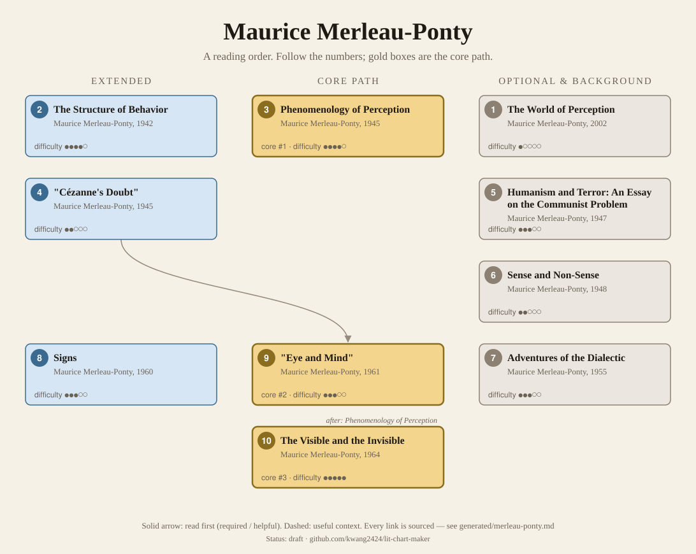
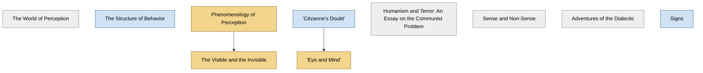

<!-- Generated by tools/build.py from lists/merleau-ponty.yaml. Do not edit by hand. -->
# Maurice Merleau-Ponty: reading order

**Status:** draft · **Citations checked:** 13/13

**Scope:** Merleau-Ponty's two theses on behaviour and perception, the essays on art, language and politics, and the late, unfinished ontology. Most courses found teach only the Phenomenology of Perception, so the later works' tiers rest on the SEP and one course on his aesthetics.

## Core path

The shortest route through the essentials.

1. **Phenomenology of Perception** (1945) · difficulty ●●●●○ · first book in 2 surveyed sources
2. **"Eye and Mind"** (1961) · difficulty ●●●○○
3. **The Visible and the Invisible** (1964) · difficulty ●●●●●

## What the sources say

We surveyed 5 independent sources (5 course syllabi and teaching lists) and recorded which books each one assigns or recommends, and where it starts.

| Book | Recommended by | First book in |
|---|---|---|
| Phenomenology of Perception | 4/5 | 2 |
| "Cézanne's Doubt" | 1/5 | 1 |
| "Eye and Mind" | 1/5 |  |
| Signs | 1/5 |  |

**Sources surveyed**

- **Department of Philosophy, UC Berkeley, Philosophy 290-3: Merleau-Ponty's Phenomenology of Perception (graduate seminar, Spring 2015)** [teaching]: Phenomenology of Perception. ✓ checked in Course page (Spring 2015), accessed 2026-11
- **John Russon, University of Guelph, PHIL 6140: Continental Theory I (Fall 2010)** [teaching]: Phenomenology of Perception. ✓ checked in Course syllabus (PDF, Fall 2010), accessed 2026-11
- **University of Warwick, Department of Philosophy, PH9HA: Merleau-Ponty's Phenomenology (2024)** [teaching]: Phenomenology of Perception. ✓ checked in Module page (PDF, 2024), accessed 2026-11
- **Noah Moss Brender, McGill University, PHIL 375: Existentialism (Fall 2013)** [teaching]: Phenomenology of Perception. ✓ checked in Course syllabus (PDF, Fall 2013), accessed 2026-11
- **Anya Daly, Melbourne School of Continental Philosophy, Merleau-Ponty: Aesthetics and Primordial Percipience (Summer School 2014)** [teaching]: "Cézanne's Doubt" → Signs → "Eye and Mind". ✓ checked in Course page (Summer School 2014), accessed 2026-11

## Full path

Every work, in order. Extended and optional works are placed where they fit best.

### 1. The World of Perception (2002)

`optional · primary · difficulty ●○○○○` · Maurice Merleau-Ponty

Seven short radio lectures given on French national radio in 1948, published later (SEP §1).

### 2. The Structure of Behavior (1942)

`extended · primary · difficulty ●●●●○` · Maurice Merleau-Ponty

His complementary thesis (completed 1938), on behaviour, drawing on Gestalt psychology (SEP §1, §2).

### 3. Phenomenology of Perception (1945)

`core · primary · difficulty ●●●●○` · Maurice Merleau-Ponty

His main thesis: perception, the lived body, space, others and freedom. It draws extensively on Gestalt theory, psychology and neurology, including the case of the brain-damaged patient Schneider (SEP §3).

**Translation:** Landes (Routledge 2012); Smith (1962)

**Reading tips:**

- Berkeley's seminar begins with the "famous" Preface, on what phenomenology is, and rereads it at the end.
  - Department of Philosophy, UC Berkeley, *Philosophy 290-3: Merleau-Ponty's Phenomenology of Perception (graduate seminar, Spring 2015)*, course description [teaching] ✓ checked in Course page (Spring 2015), accessed 2026-11

**Read first:**

- *The Crisis of European Sciences and Transcendental Phenomenology: An Introduction to Phenomenological Philosophy* (from the [Edmund Husserl list](husserl.md)) — *context*. It was "informed by his new familiarity with Husserl's unpublished manuscripts": in 1939 he was the first outside visitor to the Husserl Archives, reading "Ideen II and later sections of Die Krisis".
  - Stanford Encyclopedia of Philosophy, *"Maurice Merleau-Ponty"*, §1 Life and Works; §3 Phenomenology of Perception [scholarly] ✓ checked in SEP entry, accessed 2026-11
- *Ideas II* (from the [Edmund Husserl list](husserl.md)) — *context*. He read Husserl's unpublished Ideen II at the Archives in 1939, before writing it.
  - Stanford Encyclopedia of Philosophy, *"Maurice Merleau-Ponty"*, §1 Life and Works [scholarly] ✓ checked in SEP entry, accessed 2026-11
- *Being and Time* (from the [Martin Heidegger list](heidegger.md)) — *context*. It reflects "his deepened engagement with other thinkers in this tradition, such as Eugen Fink and Martin Heidegger".
  - Stanford Encyclopedia of Philosophy, *"Maurice Merleau-Ponty"*, §3 Phenomenology of Perception [scholarly] ✓ checked in SEP entry, accessed 2026-11
- *Being and Nothingness: An Essay on Phenomenological Ontology* (from the [Jean-Paul Sartre list](sartre.md)) — *context*. McGill's existentialism course reads its chapter on freedom (Part III, ch. 3) straight after Sartre's pages on freedom in Being and Nothingness.
  - Noah Moss Brender, McGill University, *PHIL 375: Existentialism (Fall 2013)*, schedule, Oct. 16–23 [teaching] ✓ checked in Course syllabus (PDF, Fall 2013), accessed 2026-11

### 4. "Cézanne's Doubt" (1945)

`extended · primary · difficulty ●●○○○` · Maurice Merleau-Ponty

A short essay that finds in Cézanne "a proto-phenomenological effort to capture the birth of perception through painting" (SEP §4).

### 5. Humanism and Terror: An Essay on the Communist Problem (1947)

`optional · primary · difficulty ●●●○○` · Maurice Merleau-Ponty

His first book of political philosophy, counselling a "wait-and-see" attitude toward Marxism (SEP §1).

### 6. Sense and Non-Sense (1948)

`optional · primary · difficulty ●●○○○` · Maurice Merleau-Ponty

Essays on the arts, philosophy and politics (SEP §1).

### 7. Adventures of the Dialectic (1955)

`optional · primary · difficulty ●●●○○` · Maurice Merleau-Ponty

His break with revolutionary Marxism, in which he "sharply criticized Sartre for 'ultrabolshevism'" (SEP §1).

### 8. Signs (1960)

`extended · primary · difficulty ●●●○○` · Maurice Merleau-Ponty

Essays on art, language, the history of philosophy and politics spanning more than a decade, including "Indirect Language and the Voices of Silence" (SEP §1, §4).

**Read first:**

- *What Is Literature?* (from the [Jean-Paul Sartre list](sartre.md)) — *context*. "Indirect Language and the Voices of Silence" brings his view of language "into conversation with Sartre's What is Literature?" and Malraux's Voices of Silence.
  - Stanford Encyclopedia of Philosophy, *"Maurice Merleau-Ponty"*, §4 Expression, Language, and Art [scholarly] ✓ checked in SEP entry, accessed 2026-11

### 9. "Eye and Mind" (1961)

`core · primary · difficulty ●●●○○` · Maurice Merleau-Ponty

His last published essay, on the ontological implications of painting. Sartre said "Eye and Mind says all if one knows how to decipher it" (quoted in MSCP's course).

*Why this tier:* Only the aesthetics course assigns it; courses on Merleau-Ponty mostly read the Phenomenology alone. It is his last published essay and, with The Visible and the Invisible, the way into the late philosophy.

**Read first:**

- *"Cézanne's Doubt"* — *helpful*. MSCP's course "tracks the progression" of his thought on art from "the more phenomenological essay Cézanne's Doubt" to this final essay.
  - Anya Daly, Melbourne School of Continental Philosophy, *Merleau-Ponty: Aesthetics and Primordial Percipience (Summer School 2014)*, course description [teaching] ✓ checked in Course page (Summer School 2014), accessed 2026-11

### 10. The Visible and the Invisible (1964)

`core · primary · difficulty ●●●●●` · Maurice Merleau-Ponty

The unfinished manuscript he was working on when he died in 1961, published posthumously; it introduces "flesh" and "chiasm" (SEP §6).

*Why this tier:* No surveyed course assigns it. It stays core because the SEP counts its concepts of "flesh" and "chiasm" among what "many consider to be his most fruitful philosophical contributions".

**Read first:**

- *Phenomenology of Perception* — *helpful*. It aims "to clarify the ontological implications of a phenomenology that would self-critically account for its own limitations", reworking the earlier book.
  - Stanford Encyclopedia of Philosophy, *"Maurice Merleau-Ponty"*, preamble; §6 [scholarly] ✓ checked in SEP entry, accessed 2026-11

## Map

Solid arrows: required or helpful. Dotted: context.

## Connections

**Builds on**

- *The Crisis of European Sciences and Transcendental Phenomenology: An Introduction to Phenomenological Philosophy* (Edmund Husserl) → *Phenomenology of Perception* — context. It was "informed by his new familiarity with Husserl's unpublished manuscripts": in 1939 he was the first outside visitor to the Husserl Archives, reading "Ideen II and later sections of Die Krisis".
- *Ideas II* (Edmund Husserl) → *Phenomenology of Perception* — context. He read Husserl's unpublished Ideen II at the Archives in 1939, before writing it.
- *Being and Time* (Martin Heidegger) → *Phenomenology of Perception* — context. It reflects "his deepened engagement with other thinkers in this tradition, such as Eugen Fink and Martin Heidegger".
- *Being and Nothingness: An Essay on Phenomenological Ontology* (Jean-Paul Sartre) → *Phenomenology of Perception* — context. McGill's existentialism course reads its chapter on freedom (Part III, ch. 3) straight after Sartre's pages on freedom in Being and Nothingness.
- *What Is Literature?* (Jean-Paul Sartre) → *Signs* — context. "Indirect Language and the Voices of Silence" brings his view of language "into conversation with Sartre's What is Literature?" and Malraux's Voices of Silence.

**Who builds on Maurice Merleau-Ponty**

- *Phenomenology of Perception* → *Phenomenology* (Jean-François Lyotard) — context. In its second part, on phenomenology and the human sciences, "the focus shifts from Husserl to the work of Maurice Merleau-Ponty".
- *Phenomenology of Perception* → *Discourse, Figure* (Jean-François Lyotard) — context. It sets discourse against "the figural, that is, the visual, which he discusses through the phenomenology of Merleau-Ponty".

## Sources

- **[scholarly]** Stanford Encyclopedia of Philosophy, *"Maurice Merleau-Ponty"* — <https://plato.stanford.edu/entries/merleau-ponty/>
- **[teaching]** Anya Daly, Melbourne School of Continental Philosophy, *Merleau-Ponty: Aesthetics and Primordial Percipience (Summer School 2014)* — <https://mscp.org.au/past-courses/merleau-ponty-aesthetics-and-primordial-percipience>
- **[teaching]** Department of Philosophy, UC Berkeley, *Philosophy 290-3: Merleau-Ponty's Phenomenology of Perception (graduate seminar, Spring 2015)* — <https://philosophy.berkeley.edu/courses/detail/826>
- **[teaching]** John Russon, University of Guelph, *PHIL 6140: Continental Theory I (Fall 2010)* — <https://www.uoguelph.ca/arts/sites/default/files/syllabus/F10_PHIL6140_russon_syllabus.pdf>
- **[teaching]** Noah Moss Brender, McGill University, *PHIL 375: Existentialism (Fall 2013)* — <https://www.mcgill.ca/philosophy/files/philosophy/phil375_syllabus.pdf>
- **[teaching]** University of Warwick, Department of Philosophy, *PH9HA: Merleau-Ponty's Phenomenology (2024)* — <https://courses.warwick.ac.uk/modules/2024/PH9HA-30.pdf>
