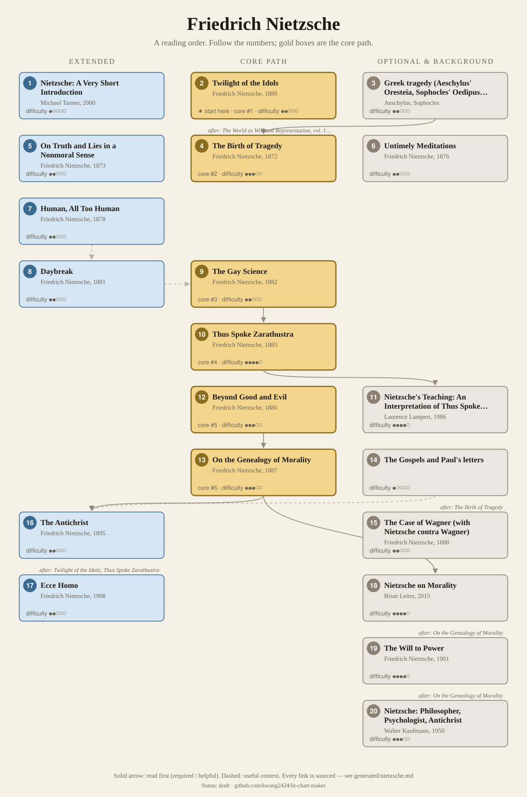
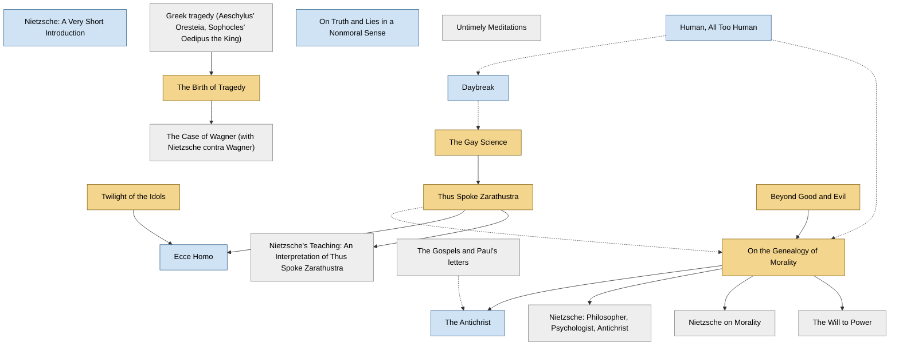

<!-- Generated by tools/build.py from lists/nietzsche.yaml. Do not edit by hand. -->
# Friedrich Nietzsche: reading order

**Status:** draft · **Citations checked:** 34/34

**Scope:** Nietzsche's published books, the background he assumes, and a few standard secondary guides. Not his unpublished notebooks (Nachlass).

## Core path

The shortest route through the essentials.

1. **Twilight of the Idols** (1889) · difficulty ●●○○○ · ★ start here
2. **The Birth of Tragedy** (1872) · difficulty ●●●○○ · first book in 3 surveyed sources
3. **The Gay Science** (1882) · difficulty ●●○○○ · first book in 1 surveyed source
4. **Thus Spoke Zarathustra** (1885) · difficulty ●●●●○
5. **Beyond Good and Evil** (1886) · difficulty ●●●○○ · first book in 1 surveyed source
6. **On the Genealogy of Morality** (1887) · difficulty ●●●○○

## What the sources say

We surveyed 8 independent sources (1 scholarly guide and 7 course syllabi and teaching lists) and recorded which books each one assigns or recommends, and where it starts.

| Book | Recommended by | First book in |
|---|---|---|
| On the Genealogy of Morality | 8/8 |  |
| Beyond Good and Evil | 7/8 | 1 |
| The Gay Science | 6/8 | 1 |
| The Birth of Tragedy | 5/8 | 3 |
| Thus Spoke Zarathustra | 5/8 |  |
| Twilight of the Idols | 4/8 |  |
| On Truth and Lies in a Nonmoral Sense | 3/8 | 1 |
| Ecce Homo | 3/8 |  |
| Untimely Meditations | 3/8 |  |
| Daybreak | 2/8 | 1 |
| The Antichrist | 2/8 |  |
| The Case of Wagner (with Nietzsche contra Wagner) | 2/8 |  |
| Human, All Too Human | 2/8 |  |

**Sources surveyed**

- **Tracy Colony, Bard College, PL 320 Nietzsche: Philosophy at the Limit (Fall 2025)** [teaching]: The Birth of Tragedy → On Truth and Lies in a Nonmoral Sense → Untimely Meditations → Human, All Too Human → Daybreak → The Gay Science → Thus Spoke Zarathustra → Beyond Good and Evil → On the Genealogy of Morality → Twilight of the Idols → The Antichrist → Ecce Homo. ✓ checked in Course syllabus (PDF), accessed 2026-11
- **University of Maryland, Baltimore County, Philosophy 452: Nietzsche (Spring 2016)** [teaching]: Daybreak → The Gay Science → Beyond Good and Evil → On the Genealogy of Morality → Thus Spoke Zarathustra. ✓ checked in Course syllabus (PDF), accessed 2026-11
- **Western University, Department of Philosophy, Philosophy 3030G: Nietzsche (2023–24)** [teaching]: The Birth of Tragedy, On the Genealogy of Morality, Ecce Homo, The Gay Science, Beyond Good and Evil. ✓ checked in Course syllabus (PDF), accessed 2026-11
- **Harvey Mudd College (Beckman), Phil 170: Nietzsche, schedule** [teaching]: The Birth of Tragedy → Untimely Meditations → The Case of Wagner (with Nietzsche contra Wagner) → The Gay Science → Thus Spoke Zarathustra → Beyond Good and Evil → On the Genealogy of Morality → Twilight of the Idols → The Antichrist → Ecce Homo. ✓ checked in Course web page, accessed 2026-11
- **David Wellbery, University of Chicago, Nietzsche: Culture, Critique, Self-Transcendence (Winter 2018)** [teaching]: The Birth of Tragedy → On Truth and Lies in a Nonmoral Sense → Untimely Meditations → Human, All Too Human → Thus Spoke Zarathustra → The Gay Science → Beyond Good and Evil → On the Genealogy of Morality → Twilight of the Idols → The Case of Wagner (with Nietzsche contra Wagner). ✓ checked in Course syllabus (PDF), accessed 2026-11
- **University of Warwick, PH334 Nietzsche (2025 module page)** [teaching]: The Gay Science → Thus Spoke Zarathustra → The Birth of Tragedy → On the Genealogy of Morality → Beyond Good and Evil. ✓ checked in Module web page, accessed 2026-11
- **University of Edinburgh, PHIL10047: The Early Continentals: Hegel and Nietzsche, course guide (2017–18)** [teaching]: On Truth and Lies in a Nonmoral Sense → On the Genealogy of Morality → Twilight of the Idols. ✓ checked in Course guide (PDF), accessed 2026-11
- **Brian Leiter, interviewed by Five Books, The Best Nietzsche Books (2011)** [scholarly] (expert's shortlist): Beyond Good and Evil, On the Genealogy of Morality. ✓ checked in Five Books interview (web page), accessed 2026-11

## Full path

Every work, in order. Extended and optional works are placed where they fit best.

### 1. Nietzsche: A Very Short Introduction (2000)

`extended · secondary · difficulty ●○○○○` · Michael Tanner

A short overview before or alongside your first Nietzsche book.

### 2. Twilight of the Idols (1889)

`core · primary · difficulty ●●○○○` · Friedrich Nietzsche

Short and fast; a summary of his late views. "The Problem of Socrates" and "How the 'True World' Finally Became a Fable" are key.

**Translation:** Hollingdale (Penguin) or Large (Oxford)

**★ Good place to start.** Nietzsche's own advice: anyone wanting "a rapid sketch" of his thought "should begin reading me in this book".

- Friedrich Nietzsche, *Ecce Homo*, "The Twilight of the Idols" §1 [author] ✓ checked in Ludovici trans. (1911), Project Gutenberg

**Read first:**

- *Phaedo* (from the [Plato list](plato.md)) — *context*. "The Problem of Socrates" opens with Socrates' dying words ("I owe a cock to the god Asclepius"), from the end of the Phaedo.
  - Friedrich Nietzsche, *Twilight of the Idols*, "The Problem of Socrates" §1 [author] ✓ checked in Ludovici trans. (1911), Project Gutenberg
  - Plato, *Phaedo*, ending [author] ✓ checked in Jowett trans., Project Gutenberg
- *Republic* (from the [Plato list](plato.md)) — *context*. "How the 'True World' Finally Became a Fable" begins from Plato: its first stage is "a paraphrase of the proposition 'I, Plato, am the truth.'"
  - Friedrich Nietzsche, *Twilight of the Idols*, "How the True World Ultimately Became a Fable" §1 [author] ✓ checked in Ludovici trans. (1911), Project Gutenberg

### 3. Greek tragedy (Aeschylus' Oresteia, Sophocles' Oedipus the King)

`optional · background · difficulty ●●○○○` · Aeschylus, Sophocles

The art form The Birth of Tragedy is about. One or two plays is plenty.

### 4. The Birth of Tragedy (1872)

`core · primary · difficulty ●●●○○` · Friedrich Nietzsche

His first book: Apollonian vs. Dionysian. Read the 1886 preface ("Attempt at a Self-Criticism") last, since it is his later verdict on the book.

**Translation:** Kaufmann (in Basic Writings of Nietzsche)

**Read first:**

- *Greek tragedy (Aeschylus' Oresteia, Sophocles' Oedipus the King)* — *helpful*. The book is a speculative account of how Greek tragic culture rose and collapsed.
  - R. Lanier Anderson, *"Friedrich Nietzsche", Stanford Encyclopedia of Philosophy*, §1 Life and Works [scholarly] ✓ checked in SEP online, accessed 2026-11
- *Symposium* (from the [Plato list](plato.md)) — *context*. Its picture of Socrates draws on Plato: it recalls him leaving "the symposium at break of day" and makes "the dying Socrates" the new Greek ideal.
  - Friedrich Nietzsche, *The Birth of Tragedy (with its "Foreword to Richard Wagner")*, §13 [author] ✓ checked in Haussmann trans. (1909), Project Gutenberg
- *The World as Will and Representation, vol. 1* (from the [Arthur Schopenhauer list](schopenhauer.md)) — *helpful*. It is written in Schopenhauer's terms, which Nietzsche later regretted using ("Kantian and Schopenhauerian formulae").
  - Friedrich Nietzsche, *"Attempt at a Self-Criticism" (1886 preface to The Birth of Tragedy)*, §6 [author] ✓ checked in Haussmann trans. (1909), Project Gutenberg

### 5. On Truth and Lies in a Nonmoral Sense (1873)

`extended · primary · difficulty ●●○○○` · Friedrich Nietzsche

A short early essay, unpublished in his lifetime, on language, concepts and truth. Often taught right after The Birth of Tragedy.

### 6. Untimely Meditations (1876)

`optional · primary · difficulty ●●○○○` · Friedrich Nietzsche

Four essays. "On the Uses and Disadvantages of History for Life" and "Schopenhauer as Educator" are the ones worth reading.

**Translation:** Hollingdale (Cambridge)

**Read first:**

- *The World as Will and Representation, vol. 1* (from the [Arthur Schopenhauer list](schopenhauer.md)) — *context*. The third essay, "Schopenhauer as Educator", holds Schopenhauer up as a model philosopher.
  - Friedrich Nietzsche, *"Schopenhauer as Educator" (Untimely Meditations III)*, whole essay [author] ✓ checked in Collins trans. (Thoughts out of Season II), Project Gutenberg

### 7. Human, All Too Human (1878)

`extended · primary · difficulty ●●○○○` · Friedrich Nietzsche

The break with Wagner and Schopenhauer; first book of short aphorisms.

**Translation:** Hollingdale (Cambridge)

### 8. Daybreak (1881)

`extended · primary · difficulty ●●○○○` · Friedrich Nietzsche

Nietzsche wrote that with this book "I open my campaign against morality" (Ecce Homo).

**Translation:** Hollingdale (Cambridge)

**Read first:**

- *Human, All Too Human* — *context*. Both belong to his aphoristic "middle period" (Human, All Too Human, Daybreak, The Gay Science), a critique of morality and its psychology.
  - R. Lanier Anderson, *"Friedrich Nietzsche", Stanford Encyclopedia of Philosophy*, §1 Life and Works [scholarly] ✓ checked in SEP online, accessed 2026-11

### 9. The Gay Science (1882)

`core · primary · difficulty ●●○○○` · Friedrich Nietzsche

"God is dead" (§125) and the first statement of eternal recurrence (§341). Book V was added in 1887; it is worth reading after Beyond Good and Evil.

**Translation:** Kaufmann (Vintage)

**Read first:**

- *Daybreak* — *context*. The last book of his middle period, following straight on from Daybreak.
  - R. Lanier Anderson, *"Friedrich Nietzsche", Stanford Encyclopedia of Philosophy*, §1 Life and Works [scholarly] ✓ checked in SEP online, accessed 2026-11

### 10. Thus Spoke Zarathustra (1885)

`core · primary · difficulty ●●●●○` · Friedrich Nietzsche

Poetic and allusive; it reads better once you know the ideas from The Gay Science. Don't start here.

**Translation:** Kaufmann (Viking/Penguin) or Del Caro (Cambridge)

**Read first:**

- *The Gay Science* — *helpful*. The Gay Science introduces eternal recurrence (§341), and §342 is nearly word for word the opening of Zarathustra. Nietzsche said it "shows the beginning of Zarathustra".
  - Friedrich Nietzsche, *The Gay Science*, §341–342 [author] ✓ checked in Cohn trans. (The Joyful Wisdom), Project Gutenberg
  - Friedrich Nietzsche, *Ecce Homo*, "Thus Spoke Zarathustra" §1 [author] ✓ checked in Ludovici trans. (1911), Project Gutenberg

### 11. Nietzsche's Teaching: An Interpretation of Thus Spoke Zarathustra (1986)

`optional · secondary · difficulty ●●●●○` · Laurence Lampert

A section-by-section commentary on Zarathustra.

**Read first:**

- *Thus Spoke Zarathustra* — *required*. It is a running commentary on Zarathustra.
  - Laurence Lampert, *Nietzsche's Teaching: An Interpretation of Thus Spoke Zarathustra*, title and subtitle [scholarly] ✓ checked in Yale University Press edition (1986)

### 12. Beyond Good and Evil (1886)

`core · primary · difficulty ●●●○○` · Friedrich Nietzsche

Nietzsche told Jacob Burckhardt it says "the same things as my Zarathustra, but differently, very differently" (letter of 22 Sept 1886), and in Ecce Homo called it the start of the "negative portion" of his task.

**Translation:** Kaufmann (Vintage) or Norman (Cambridge)

**Reading tips:**

- Brian Leiter: if you start with a primary text, "Beyond Good and Evil would be a great choice, because it covers all the distinctive and important Nietzschean themes and as it's broken into bite-size pieces you don't get overwhelmed." For readers new to philosophy he suggests Safranski's biography first.
  - Brian Leiter, interviewed by Five Books, *The Best Nietzsche Books (2011)*, on where to start [scholarly] ✓ checked in Five Books interview (web page), accessed 2026-11

### 13. On the Genealogy of Morality (1887)

`core · primary · difficulty ●●●○○` · Friedrich Nietzsche

Three connected essays and his most systematic book. Especially good for readers interested in ethics.

**Translation:** Kaufmann & Hollingdale (Vintage) or Clark & Swensen (Hackett)

**Read first:**

- *Beyond Good and Evil* — *helpful*. Its title page says it was added to Beyond Good and Evil "as a supplement and clarification" ("zur Ergänzung und Verdeutlichung").
  - Friedrich Nietzsche, *On the Genealogy of Morality (title page and Preface)*, title page [author] ✓ checked in German edition, C. G. Naumann (Leipzig, 1892), archive.org/details/zurgenealogieder00niet
- *Human, All Too Human* — *context*. The Preface says its ideas first appeared, in rough form, in Human, All Too Human.
  - Friedrich Nietzsche, *On the Genealogy of Morality (title page and Preface)*, Preface §2 [author] ✓ checked in Samuel trans. (1913), Project Gutenberg
- *Thus Spoke Zarathustra* — *context*. The Preface says it assumes you have read his earlier writings, and names Zarathustra.
  - Friedrich Nietzsche, *On the Genealogy of Morality (title page and Preface)*, Preface §8 [author] ✓ checked in Samuel trans. (1913), Project Gutenberg

### 14. The Gospels and Paul's letters

`optional · background · difficulty ●○○○○`

The Antichrist assumes you know them.

### 15. The Case of Wagner (with Nietzsche contra Wagner) (1888)

`optional · primary · difficulty ●●○○○` · Friedrich Nietzsche

Short polemics against his former friend.

**Translation:** Kaufmann (in Basic Writings / The Portable Nietzsche)

**Read first:**

- *The Birth of Tragedy* — *helpful*. The Birth of Tragedy opens with a foreword to Wagner and champions him; these attack him. They read as a reversal.
  - Friedrich Nietzsche, *The Birth of Tragedy (with its "Foreword to Richard Wagner")*, "Foreword to Richard Wagner" [author] ✓ checked in Haussmann trans. (1909), Project Gutenberg
  - R. Lanier Anderson, *"Friedrich Nietzsche", Stanford Encyclopedia of Philosophy*, §1 Life and Works (the friendship and the break) [scholarly] ✓ checked in SEP online, accessed 2026-11

### 16. The Antichrist (1895)

`extended · primary · difficulty ●●○○○` · Friedrich Nietzsche

Written in 1888, published 1895. His attack on Christianity.

**Translation:** Hollingdale (Penguin, with Twilight)

**Read first:**

- *The Gospels and Paul's letters* — *context*. Much of it is a reading of Jesus, the Gospels and Paul.
  - Friedrich Nietzsche, *The Antichrist*, §41 (and the surrounding sections) [author] ✓ checked in Mencken trans. (1918), Project Gutenberg
- *On the Genealogy of Morality* — *helpful*. It relies on the Genealogy's account of "noble" vs. "ressentiment" morality, and refers the reader back to it.
  - Friedrich Nietzsche, *The Antichrist*, §24 [author] ✓ checked in Mencken trans. (1918), Project Gutenberg

### 17. Ecce Homo (1908)

`extended · primary · difficulty ●●○○○` · Friedrich Nietzsche

Written in 1888, published 1908. His self-portrait and his comments on each earlier book. Read it last; it means little without the books it discusses.

**Translation:** Kaufmann (in Basic Writings) or Large (Oxford)

**Read first:**

- *Twilight of the Idols* — *helpful*. It reviews each of his earlier books one by one, including Twilight.
  - Friedrich Nietzsche, *Ecce Homo*, "Why I Write Such Good Books" [author] ✓ checked in Ludovici trans. (1911), Project Gutenberg
- *Thus Spoke Zarathustra* — *helpful*. It treats Zarathustra as his central work and comments on it at length.
  - Friedrich Nietzsche, *Ecce Homo*, "Thus Spoke Zarathustra" §§1–8 [author] ✓ checked in Ludovici trans. (1911), Project Gutenberg

### 18. Nietzsche on Morality (2015)

`optional · secondary · difficulty ●●●●○` · Brian Leiter

A close, analytic reading of the Genealogy, essay by essay.

**Read first:**

- *On the Genealogy of Morality* — *required*. It is a commentary on the Genealogy, with a chapter on each of its three essays.
  - Brian Leiter, *Nietzsche on Morality (2nd ed.)*, table of contents [scholarly] ✓ checked in Routledge catalog listing, 2nd ed. (2015)

### 19. The Will to Power (1901)

`optional · primary · difficulty ●●●●○` · Friedrich Nietzsche (compiled by Elisabeth Förster-Nietzsche)

Not a book Nietzsche wrote. His sister assembled it from his notebooks after his death. Read it only once you know the published works, and with caution.

**Read first:**

- *On the Genealogy of Morality* — *helpful*. The SEP calls the editing "not well founded in Nietzsche's surviving plans" and says it gives "a somewhat misleading impression" of his notebooks.
  - R. Lanier Anderson, *"Friedrich Nietzsche", Stanford Encyclopedia of Philosophy*, §1 Life and Works [scholarly] ✓ checked in SEP online, accessed 2026-11

### 20. Nietzsche: Philosopher, Psychologist, Antichrist (1950)

`optional · secondary · difficulty ●●●○○` · Walter Kaufmann

The book that rehabilitated Nietzsche in the English-speaking world.

**Read first:**

- *On the Genealogy of Morality* — *helpful*. It is an argument about how to read his ideas on power (against the "might makes right" reading), so it helps to know the books first.
  - R. Lanier Anderson, *"Friedrich Nietzsche", Stanford Encyclopedia of Philosophy*, §5 (on Kaufmann's reading of power) [scholarly] ✓ checked in SEP online, accessed 2026-11

## Map

Solid arrows: required or helpful. Dotted: context.

## Connections

**Builds on**

- *Symposium* (Plato) → *The Birth of Tragedy* — context. Its picture of Socrates draws on Plato: it recalls him leaving "the symposium at break of day" and makes "the dying Socrates" the new Greek ideal.
- *The World as Will and Representation, vol. 1* (Arthur Schopenhauer) → *The Birth of Tragedy* — helpful. It is written in Schopenhauer's terms, which Nietzsche later regretted using ("Kantian and Schopenhauerian formulae").
- *The World as Will and Representation, vol. 1* (Arthur Schopenhauer) → *Untimely Meditations* — context. The third essay, "Schopenhauer as Educator", holds Schopenhauer up as a model philosopher.
- *Phaedo* (Plato) → *Twilight of the Idols* — context. "The Problem of Socrates" opens with Socrates' dying words ("I owe a cock to the god Asclepius"), from the end of the Phaedo.
- *Republic* (Plato) → *Twilight of the Idols* — context. "How the 'True World' Finally Became a Fable" begins from Plato: its first stage is "a paraphrase of the proposition 'I, Plato, am the truth.'"

**Who builds on Friedrich Nietzsche**

- *On the Genealogy of Morality* → *Nietzsche and Philosophy* (Gilles Deleuze) — helpful. It reads the Genealogy's method and its "noble" forces as the core of Nietzsche's philosophy.
- *On the Genealogy of Morality* → *Anti-Oedipus (Capitalism and Schizophrenia, vol. 1)* (Gilles Deleuze) — context. A Deleuze and Guattari course recommends reading Nietzsche's Genealogy beforehand, and assigns it alongside Anti-Oedipus.
- *The Birth of Tragedy* → *History of Madness* (Michel Foucault) — context. The IEP: it "resembles Friedrich Nietzsche's Birth of Tragedy in style and form", with a reason/unreason split like the Apollonian/Dionysian one.
- *On the Genealogy of Morality* → *"Nietzsche, Genealogy, History"* (Michel Foucault) — helpful. His term "genealogy" was meant "to evoke Nietzsche's genealogy of morals"; UBC's course reads this essay straight after On the Genealogy of Morality.
- *On the Genealogy of Morality* → *Discipline and Punish: The Birth of the Prison* (Michel Foucault) — context. Genealogy, "first deployed in Discipline and Punish", was meant to evoke Nietzsche's genealogy of morals.
- *Twilight of the Idols* → *Nietzsche (lecture courses, 4 vols. in English)* (Martin Heidegger) — context. It argues that Nietzsche "over-turns Platonism and completes Western metaphysics"; Twilight's "true world" fable is the short version of that overturning.
- *The Birth of Tragedy* → *Psychological Types* (C. G. Jung) — context. Chapter III, "The Apollonian and the Dionysian", is a reading of Nietzsche's Birth of Tragedy as a study of types.
- *Thus Spoke Zarathustra* → *Nietzsche's Zarathustra: Notes of the Seminar Given in 1934–1939* (C. G. Jung) — required. It is a running psychological commentary on Thus Spoke Zarathustra.

## Sources

- **[author]** Friedrich Nietzsche, *The Antichrist*, 1895
- **[author]** Friedrich Nietzsche, *The Birth of Tragedy (with its "Foreword to Richard Wagner")*, 1872
- **[author]** Friedrich Nietzsche, *Ecce Homo*, 1888
- **[author]** Friedrich Nietzsche, *The Gay Science*, 1882
- **[author]** Friedrich Nietzsche, *On the Genealogy of Morality (title page and Preface)*, 1887
- **[author]** Friedrich Nietzsche, *"Attempt at a Self-Criticism" (1886 preface to The Birth of Tragedy)*, 1886
- **[author]** Friedrich Nietzsche, *Twilight of the Idols*, 1889
- **[author]** Friedrich Nietzsche, *"Schopenhauer as Educator" (Untimely Meditations III)*, 1874
- **[author]** Plato, *Phaedo*
- **[scholarly]** Brian Leiter, interviewed by Five Books, *The Best Nietzsche Books (2011)* — <https://fivebooks.com/best-books/nietzsche-brian-leiter/>
- **[scholarly]** Laurence Lampert, *Nietzsche's Teaching: An Interpretation of Thus Spoke Zarathustra*, Yale University Press, 1986
- **[scholarly]** Brian Leiter, *Nietzsche on Morality (2nd ed.)*, Routledge, 2015
- **[scholarly]** R. Lanier Anderson, *"Friedrich Nietzsche", Stanford Encyclopedia of Philosophy* — <https://plato.stanford.edu/entries/nietzsche/>
- **[teaching]** University of Edinburgh, *PHIL10047: The Early Continentals: Hegel and Nietzsche, course guide (2017–18)* — <https://edwebcontent.ed.ac.uk/sites/default/files/atoms/files/the_early_continentals_course_guide_2017_18.pdf>
- **[teaching]** Tracy Colony, Bard College, *PL 320 Nietzsche: Philosophy at the Limit (Fall 2025)* — <https://tools.bard.edu/wwwmedia/resources/files/3076/PL%20320_F25_Syllabus_Colony.pdf>
- **[teaching]** David Wellbery, University of Chicago, *Nietzsche: Culture, Critique, Self-Transcendence (Winter 2018)* — <https://humanities-web.s3.us-east-2.amazonaws.com/college-prod/s3fs-public/documents/signature-courses/Wellbery%20Nietzsche%20Syllabus.pdf>
- **[teaching]** Harvey Mudd College (Beckman), *Phil 170: Nietzsche, schedule* — <https://pages.hmc.edu/beckman/philosophy/Nietzsche/sch170.htm>
- **[teaching]** University of Maryland, Baltimore County, *Philosophy 452: Nietzsche (Spring 2016)* — <https://ugc.umbc.edu/wp-content/uploads/sites/232/2017/02/PHIL485Nietzsche-syllabus-1.pdf>
- **[teaching]** University of Warwick, *PH334 Nietzsche (2025 module page)* — <https://courses.warwick.ac.uk/modules/2025/PH334-15>
- **[teaching]** Western University, Department of Philosophy, *Philosophy 3030G: Nietzsche (2023–24)* — <https://www.uwo.ca/philosophy/undergraduate/courses/Outlines/2023_24/3030G.pdf>
