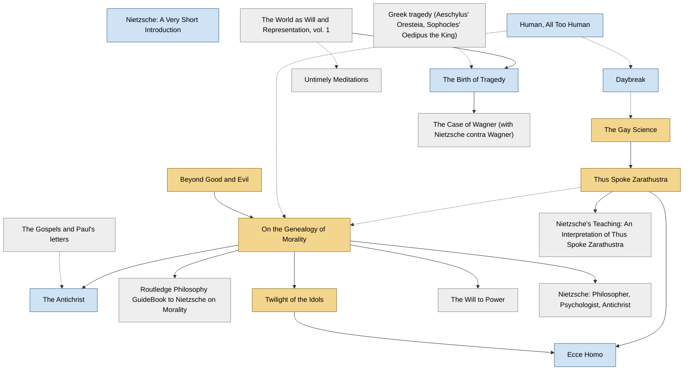

<!-- Generated by tools/build.py from lists/nietzsche.yaml. Do not edit by hand. -->
# Friedrich Nietzsche: reading order

**Status:** draft · **Citations checked:** 0/20

**Scope:** Nietzsche's published books, the background he assumes, and a few standard secondary guides. Not his unpublished notebooks (Nachlass).

> ⚠️ Some citations haven't been checked against the actual text yet. See [CONTRIBUTING.md](../CONTRIBUTING.md) to help verify them.

## Core path

The shortest route through the essentials.

1. **The Gay Science** (1882) · difficulty ●●○○○
2. **Beyond Good and Evil** (1886) · difficulty ●●●○○
3. **On the Genealogy of Morality** (1887) · difficulty ●●●○○
4. **Twilight of the Idols** (1889) · difficulty ●●○○○
5. **Thus Spoke Zarathustra** (1885) · difficulty ●●●●○

## Full path

Every work, in order. Extended and optional works are placed where they fit best.

### 1. Nietzsche: A Very Short Introduction (2000)

`extended · secondary · difficulty ●○○○○` · Michael Tanner

A short overview before or alongside your first Nietzsche book.

### 2. The World as Will and Representation, vol. 1 (1818)

`optional · background · difficulty ●●●●○` · Arthur Schopenhauer

Nietzsche's starting point, which he later turned against. Book IV (on the will and pessimism) matters most. A summary is enough for most readers.

### 3. Greek tragedy (Aeschylus' Oresteia, Sophocles' Oedipus the King)

`optional · background · difficulty ●●○○○` · Aeschylus, Sophocles

The art form The Birth of Tragedy is about. One or two plays is plenty.

### 4. The Birth of Tragedy (1872)

`extended · primary · difficulty ●●●○○` · Friedrich Nietzsche

His first book: Apollonian vs. Dionysian. Read the 1886 preface ("Attempt at a Self-Criticism") last, since it is his later verdict on the book.

**Translation:** Kaufmann (in Basic Writings of Nietzsche)

**Read first:**

- *Greek tragedy (Aeschylus' Oresteia, Sophocles' Oedipus the King)* — *context*. The book is an argument about where tragedy came from and why it died.
  - R. Lanier Anderson, *"Friedrich Nietzsche", Stanford Encyclopedia of Philosophy*, section on The Birth of Tragedy [scholarly] ⚠️ unverified
- *The World as Will and Representation, vol. 1* — *helpful*. It leans on Schopenhauer's ideas, as Nietzsche himself later complained.
  - Friedrich Nietzsche, *"Attempt at a Self-Criticism" (1886 preface to The Birth of Tragedy)*, §6 [author] ⚠️ unverified

### 5. Untimely Meditations (1876)

`optional · primary · difficulty ●●○○○` · Friedrich Nietzsche

Four essays. "On the Uses and Disadvantages of History for Life" and "Schopenhauer as Educator" are the ones worth reading.

**Translation:** Hollingdale (Cambridge)

**Read first:**

- *The World as Will and Representation, vol. 1* — *context*. The third essay is a tribute to Schopenhauer as a model philosopher.
  - Friedrich Nietzsche, *"Schopenhauer as Educator" (Untimely Meditations III)* [author] ⚠️ unverified

### 6. Human, All Too Human (1878)

`extended · primary · difficulty ●●○○○` · Friedrich Nietzsche

The break with Wagner and Schopenhauer; first book of short aphorisms.

**Translation:** Hollingdale (Cambridge)

### 7. Daybreak (1881)

`extended · primary · difficulty ●●○○○` · Friedrich Nietzsche

Nietzsche dates the start of his "campaign against morality" to this book.

**Translation:** Hollingdale (Cambridge)

**Read first:**

- *Human, All Too Human* — *context*. Same aphoristic style, continuing the same project.
  - Walter Kaufmann, *Nietzsche: Philosopher, Psychologist, Antichrist* [scholarly] ⚠️ unverified

### 8. The Gay Science (1882)

`core · primary · difficulty ●●○○○` · Friedrich Nietzsche

"God is dead" (§125) and the first statement of eternal recurrence (§341). Book V was added in 1887; it is worth reading after Beyond Good and Evil.

**Translation:** Kaufmann (Vintage)

**Read first:**

- *Daybreak* — *context*. The last book of his aphoristic middle period, continuing Daybreak.
  - Walter Kaufmann, *Nietzsche: Philosopher, Psychologist, Antichrist* [scholarly] ⚠️ unverified

### 9. Beyond Good and Evil (1886)

`core · primary · difficulty ●●●○○` · Friedrich Nietzsche

A good first book for many readers. Nietzsche said it says the same things as Zarathustra, "but differently, very differently."

**Translation:** Kaufmann (Vintage) or Norman (Cambridge)

### 10. On the Genealogy of Morality (1887)

`core · primary · difficulty ●●●○○` · Friedrich Nietzsche

Three connected essays and his most systematic book. Often the best single place to start, especially for readers interested in ethics.

**Translation:** Kaufmann & Hollingdale (Vintage) or Clark & Swensen (Hackett)

**Read first:**

- *Beyond Good and Evil* — *helpful*. Its title page calls it a supplement to and clarification of Beyond Good and Evil.
  - Friedrich Nietzsche, *On the Genealogy of Morality (title page and Preface)*, title page [author] ⚠️ unverified
- *Human, All Too Human* — *context*. The Preface says its central ideas were first sketched in Human, All Too Human.
  - Friedrich Nietzsche, *On the Genealogy of Morality (title page and Preface)*, Preface §2 [author] ⚠️ unverified
- *Thus Spoke Zarathustra* — *context*. The Preface says the book assumes you have read his earlier writings, and names Zarathustra.
  - Friedrich Nietzsche, *On the Genealogy of Morality (title page and Preface)*, Preface §8 [author] ⚠️ unverified

### 11. The Gospels and Paul's letters

`optional · background · difficulty ●○○○○`

The Antichrist assumes you know them.

### 12. The Case of Wagner (with Nietzsche contra Wagner) (1888)

`optional · primary · difficulty ●●○○○` · Friedrich Nietzsche

Short polemics against his former friend.

**Translation:** Kaufmann (in Basic Writings / The Portable Nietzsche)

**Read first:**

- *The Birth of Tragedy* — *helpful*. The Birth of Tragedy praised Wagner; these attack him. They read as a reversal.
  - Julian Young, *Friedrich Nietzsche: A Philosophical Biography* [scholarly] ⚠️ unverified

### 13. The Antichrist (1895)

`extended · primary · difficulty ●●○○○` · Friedrich Nietzsche

Written in 1888, published 1895. His attack on Christianity.

**Translation:** Hollingdale (Penguin, with Twilight)

**Read first:**

- *The Gospels and Paul's letters* — *context*. Much of it is a reading of Jesus and Paul.
  - R. Lanier Anderson, *"Friedrich Nietzsche", Stanford Encyclopedia of Philosophy* [scholarly] ⚠️ unverified
- *On the Genealogy of Morality* — *helpful*. The Genealogy's account of "slave morality" and the ascetic ideal is the theory behind this book's attack.
  - Walter Kaufmann, *Nietzsche: Philosopher, Psychologist, Antichrist* [scholarly] ⚠️ unverified

### 14. Routledge Philosophy GuideBook to Nietzsche on Morality (2015)

`optional · secondary · difficulty ●●●●○` · Brian Leiter

A close, analytic reading of the Genealogy.

**Read first:**

- *On the Genealogy of Morality* — *required*. It is a guide to the Genealogy and assumes you have it open.
  - Brian Leiter, *Routledge Philosophy GuideBook to Nietzsche on Morality*, Introduction [scholarly] ⚠️ unverified

### 15. Twilight of the Idols (1889)

`core · primary · difficulty ●●○○○` · Friedrich Nietzsche

Short and fast; a summary of his late views. Some readers start here. "The Problem of Socrates" and "How the 'True World' Finally Became a Fable" are key.

**Translation:** Hollingdale (Penguin) or Large (Oxford)

**Read first:**

- *On the Genealogy of Morality* — *helpful*. It compresses positions argued at length in Beyond Good and Evil and the Genealogy, so it lands harder after them.
  - Michael Tanner, *Nietzsche: A Very Short Introduction* [scholarly] ⚠️ unverified

### 16. Thus Spoke Zarathustra (1885)

`core · primary · difficulty ●●●●○` · Friedrich Nietzsche

Poetic and allusive; it reads better once you know the ideas from The Gay Science. Don't start here.

**Translation:** Kaufmann (Viking/Penguin) or Del Caro (Cambridge)

**Read first:**

- *The Gay Science* — *helpful*. The Gay Science introduces eternal recurrence (§341), and §342 is nearly word for word the opening of Zarathustra.
  - Friedrich Nietzsche, *The Gay Science*, §341–342 [author] ⚠️ unverified
  - Friedrich Nietzsche, *Ecce Homo*, "Thus Spoke Zarathustra" §1 [author] ⚠️ unverified

### 17. Ecce Homo (1908)

`extended · primary · difficulty ●●○○○` · Friedrich Nietzsche

Written in 1888, published 1908. His self-portrait and his comments on each earlier book. Read it last; it means little without the books it discusses.

**Translation:** Kaufmann (in Basic Writings) or Large (Oxford)

**Read first:**

- *Twilight of the Idols* — *helpful*. It reviews each of his earlier books one by one, including Twilight.
  - Friedrich Nietzsche, *Ecce Homo*, "Why I Write Such Good Books" [author] ⚠️ unverified
- *Thus Spoke Zarathustra* — *helpful*. It treats Zarathustra as his central work and comments on it at length.
  - Friedrich Nietzsche, *Ecce Homo*, "Thus Spoke Zarathustra" [author] ⚠️ unverified

### 18. Nietzsche's Teaching: An Interpretation of Thus Spoke Zarathustra (1986)

`optional · secondary · difficulty ●●●●○` · Laurence Lampert

A section-by-section commentary on Zarathustra.

**Read first:**

- *Thus Spoke Zarathustra* — *required*. It is a running commentary on Zarathustra.
  - Laurence Lampert, *Nietzsche's Teaching: An Interpretation of Thus Spoke Zarathustra* [scholarly] ⚠️ unverified

### 19. The Will to Power (1901)

`optional · primary · difficulty ●●●●○` · Friedrich Nietzsche (compiled by Elisabeth Förster-Nietzsche)

Not a book Nietzsche wrote. His sister assembled it from notebooks after his death. Read it only once you know the published works, and with caution.

**Read first:**

- *On the Genealogy of Morality* — *helpful*. Scholars warn against reading the notebooks before, or in place of, the books he chose to publish.
  - R. Lanier Anderson, *"Friedrich Nietzsche", Stanford Encyclopedia of Philosophy*, discussion of the Nachlass [scholarly] ⚠️ unverified

### 20. Nietzsche: Philosopher, Psychologist, Antichrist (1950)

`optional · secondary · difficulty ●●●○○` · Walter Kaufmann

The book that rehabilitated Nietzsche in the English-speaking world.

**Read first:**

- *On the Genealogy of Morality* — *helpful*. It assumes you have read the main works and argues about how to read them.
  - R. Lanier Anderson, *"Friedrich Nietzsche", Stanford Encyclopedia of Philosophy* [scholarly] ⚠️ unverified

## Map

Solid arrows: required or helpful. Dotted: context.

## Sources

- **[author]** Friedrich Nietzsche, *Ecce Homo*, 1888
- **[author]** Friedrich Nietzsche, *The Gay Science*, 1882
- **[author]** Friedrich Nietzsche, *On the Genealogy of Morality (title page and Preface)*, 1887
- **[author]** Friedrich Nietzsche, *"Attempt at a Self-Criticism" (1886 preface to The Birth of Tragedy)*, 1886
- **[author]** Friedrich Nietzsche, *"Schopenhauer as Educator" (Untimely Meditations III)*, 1874
- **[scholarly]** Walter Kaufmann, *Nietzsche: Philosopher, Psychologist, Antichrist*, Princeton University Press, 1950
- **[scholarly]** Laurence Lampert, *Nietzsche's Teaching: An Interpretation of Thus Spoke Zarathustra*, Yale University Press, 1986
- **[scholarly]** Brian Leiter, *Routledge Philosophy GuideBook to Nietzsche on Morality*, Routledge, 2015
- **[scholarly]** R. Lanier Anderson, *"Friedrich Nietzsche", Stanford Encyclopedia of Philosophy* — <https://plato.stanford.edu/entries/nietzsche/>
- **[scholarly]** Michael Tanner, *Nietzsche: A Very Short Introduction*, Oxford University Press, 2000
- **[scholarly]** Julian Young, *Friedrich Nietzsche: A Philosophical Biography*, Cambridge University Press, 2010
