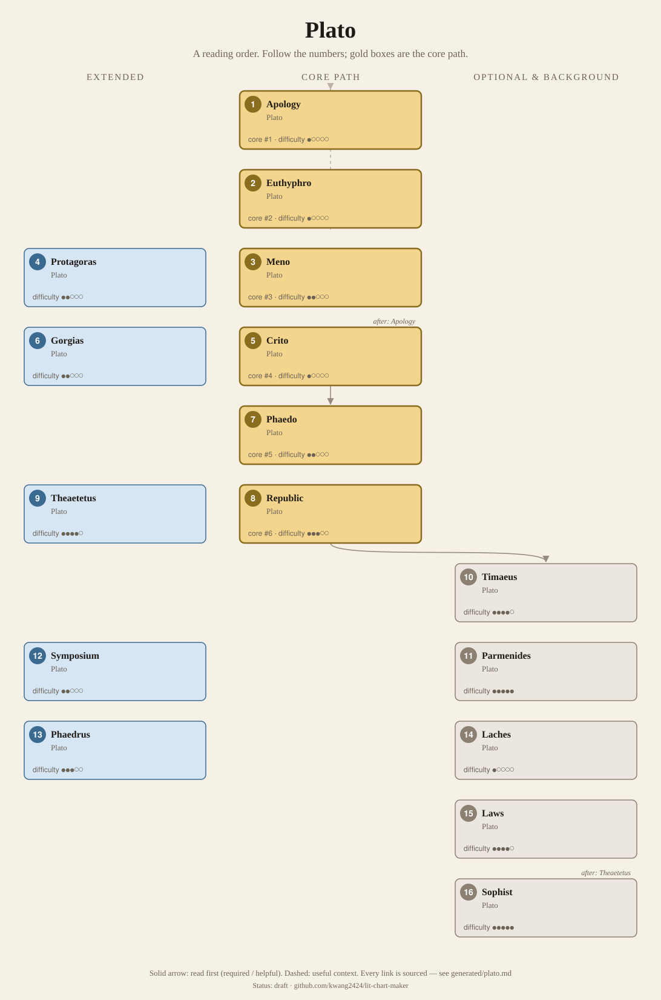
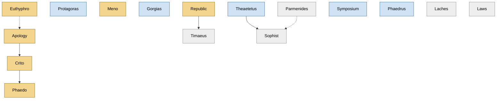

<!-- Generated by tools/build.py from lists/plato.yaml. Do not edit by hand. -->
# Plato: reading order

**Status:** draft · **Citations checked:** 16/16

**Scope:** The dialogues most read and taught, grouped as the SEP describes the common (and disputed) early, middle and late division. Plato's dates are uncertain, so works carry no years and the order comes from the links and the survey.

## Core path

The shortest route through the essentials.

1. **Euthyphro** · difficulty ●○○○○ · first book in 3 surveyed sources
2. **Apology** · difficulty ●○○○○ · first book in 2 surveyed sources
3. **Meno** · difficulty ●●○○○
4. **Crito** · difficulty ●○○○○
5. **Phaedo** · difficulty ●●○○○
6. **Republic** · difficulty ●●●○○

## What the sources say

We surveyed 6 independent sources (1 scholarly guide and 5 course syllabi and teaching lists) and recorded which books each one assigns or recommends, and where it starts.

| Book | Recommended by | First book in |
|---|---|---|
| Apology | 6/6 | 2 |
| Euthyphro | 5/6 | 3 |
| Meno | 4/6 |  |
| Phaedo | 4/6 |  |
| Crito | 4/6 |  |
| Republic | 3/6 |  |
| Gorgias | 2/6 |  |
| Parmenides | 2/6 |  |
| Protagoras | 2/6 |  |
| Theaetetus | 2/6 |  |
| Laches | 1/6 |  |
| Phaedrus | 1/6 |  |
| Sophist | 1/6 |  |
| Symposium | 1/6 |  |
| Timaeus | 1/6 |  |

**Sources surveyed**

- **Samuel Rickless, UC San Diego, Philosophy 100: Plato (Fall 2017)** [teaching]: Apology → Euthyphro → Meno → Protagoras → Republic → Laches → Gorgias → Parmenides → Theaetetus. ✓ checked in Course syllabus (PDF), accessed 2026-11
- **University of Colorado Colorado Springs, Plato seminar (Spring 2019)** [teaching]: Apology → Protagoras → Phaedo → Symposium → Republic → Phaedrus. ✓ checked in Course syllabus (.doc), accessed 2026-11
- **Richard Taylor, Marquette University, Ancient Philosophy (Spring 2016), detailed syllabus** [teaching]: Euthyphro → Apology → Crito → Gorgias → Meno → Phaedo → Republic → Parmenides → Timaeus → Theaetetus → Sophist. ✓ checked in Course web page, accessed 2026-11
- **Bruce Hauptli, Midcoast Senior College, What Is This Thing Called Philosophy? (Fall 2016)** [teaching] (beginner's list): Euthyphro → Apology → Crito → Meno. ✓ checked in Course web page, accessed 2026-11
- **Plato, trans. G. M. A. Grube, rev. John M. Cooper (Hackett), Five Dialogues: Euthyphro, Apology, Crito, Meno, Phaedo** [teaching] (beginner's list): Euthyphro → Apology → Crito → Meno → Phaedo. ✓ checked in Book title (cited in the Midcoast syllabus)
- **Diogenes Laertius (trans. R. D. Hicks), Lives of the Eminent Philosophers, Book III (Plato)** [scholarly] (beginner's list): Euthyphro → Apology → Crito → Phaedo. ✓ checked in Hicks trans. (1925), Wikisource

## Full path

Every work, in order. Extended and optional works are placed where they fit best.

### 1. Euthyphro

`core · primary · difficulty ●○○○○` · Plato

Socrates on his way to his indictment asks what piety is. The model of a Socratic dialogue.

### 2. Apology

`core · primary · difficulty ●○○○○` · Plato

Socrates' defence at his trial, and the Socrates Nietzsche argues with.

**Translation:** Grube (Hackett, Five Dialogues) or Jowett (free online)

**Reading tips:**

- Where to begin Plato was already debated in antiquity: some put the Republic first, others the Alcibiades, the Timaeus or the Phaedrus, "while many begin with the Apology".
  - Diogenes Laertius (trans. R. D. Hicks), *Lives of the Eminent Philosophers, Book III (Plato)*, III.62 [scholarly] ✓ checked in Hicks trans. (1925), Wikisource

**Read first:**

- *Euthyphro* — *context*. Thrasyllus' ancient arrangement puts the Euthyphro first and the Apology second; the Euthyphro is set at the court where the indictment was lodged.
  - Diogenes Laertius (trans. R. D. Hicks), *Lives of the Eminent Philosophers, Book III (Plato)*, III.58 [scholarly] ✓ checked in Hicks trans. (1925), Wikisource
  - Plato, *Euthyphro (with Jowett's introduction)*, scene heading; Jowett's introduction [author] ✓ checked in Jowett trans., Project Gutenberg

### 3. Protagoras

`extended · primary · difficulty ●●○○○` · Plato

Socrates against the most famous sophist, on whether virtue is one and can be taught.

### 4. Meno

`core · primary · difficulty ●●○○○` · Plato

Can virtue be taught? Introduces learning as recollection, with the slave-boy geometry lesson.

### 5. Crito

`core · primary · difficulty ●○○○○` · Plato

Socrates in prison refuses to escape. Very short.

**Read first:**

- *Apology* — *helpful*. It is set in prison after the trial, while Socrates waits for "the ship from Delos" whose return means his execution.
  - Plato, *Crito (with Jowett's introduction)*, opening exchange; Jowett's introduction (on the trial) [author] ✓ checked in Jowett trans., Project Gutenberg

### 6. Phaedo

`core · primary · difficulty ●●○○○` · Plato

Socrates' last day: arguments that the soul is immortal and belongs to a truer world than the body. Ends with his death.

**Read first:**

- *Crito* — *helpful*. It tells how the sacred ship's voyage delayed the execution, then narrates the death.
  - Plato, *Phaedo*, opening (the ship to Delos) and ending [author] ✓ checked in Jowett trans., Project Gutenberg

### 7. Gorgias

`extended · primary · difficulty ●●○○○` · Plato

Rhetoric, power and justice; Callicles argues that the stronger should rule.

### 8. Republic

`core · primary · difficulty ●●●○○` · Plato

Justice, the ideal city, and the Forms. Books VI–VII (sun, line, cave) and X (Ideas and copies) are the "true world" Nietzsche mocks and Deleuze sets out to overturn.

**Translation:** Grube rev. Reeve (Hackett) or Jowett (free online)

**Reading tips:**

- Book VII opens with the cave; Book X explains Ideas and copies with the example of beds and tables.
  - Plato, *Republic*, Book VII opening; Book X [author] ✓ checked in Jowett trans., Project Gutenberg

### 9. Theaetetus

`extended · primary · difficulty ●●●●○` · Plato

What is knowledge? Three definitions tested and none survives.

**Reading tips:**

- It ends with Socrates leaving "to go to the porch of the King Archon, where I am to meet Meletus and his indictment", the scene where the Euthyphro begins.
  - Plato, *Theaetetus*, closing lines [author] ✓ checked in Jowett trans., Project Gutenberg

### 10. Timaeus

`optional · primary · difficulty ●●●●○` · Plato

Plato's account of the cosmos and its making.

**Read first:**

- *Republic* — *helpful*. It opens with a reminder of the principal ethical and political doctrines of the Republic.
  - Richard Kraut, *"Plato", Stanford Encyclopedia of Philosophy*, §11 The historical Socrates: early, middle, and late dialogues [scholarly] ✓ checked in SEP online, accessed 2026-11

### 11. Parmenides

`optional · primary · difficulty ●●●●●` · Plato

A young Socrates' theory of Forms is put through hard objections. Very difficult.

### 12. Symposium

`extended · primary · difficulty ●●○○○` · Plato

Speeches on love at a drinking party, crashed at the end by a drunk Alcibiades. Matters most for The Birth of Tragedy.

### 13. Phaedrus

`extended · primary · difficulty ●●●○○` · Plato

Love, madness and the soul as a charioteer; ends with a critique of writing.

### 14. Laches

`optional · primary · difficulty ●○○○○` · Plato

A short search for a definition of courage.

### 15. Laws

`optional · primary · difficulty ●●●●○` · Plato

Plato's longest and probably last work, a second, more practical political philosophy.

### 16. Sophist

`optional · primary · difficulty ●●●●●` · Plato

Being, not-being, images and appearances; the Eleatic Stranger hunts for a definition of the sophist.

**Read first:**

- *Theaetetus* — *helpful*. It opens "true to our agreement of yesterday", continuing the Theaetetus's conversation.
  - Plato, *Sophist*, opening line [author] ✓ checked in Jowett trans., Project Gutenberg
- *Parmenides* — *context*. The SEP suggests Plato signals that the lessons of the Parmenides should be brought to bear on the Sophist.
  - Richard Kraut, *"Plato", Stanford Encyclopedia of Philosophy*, §11 The historical Socrates: early, middle, and late dialogues [scholarly] ✓ checked in SEP online, accessed 2026-11

## Map

Solid arrows: required or helpful. Dotted: context.

## Sources

- **[author]** Plato, *Crito (with Jowett's introduction)*
- **[author]** Plato, *Euthyphro (with Jowett's introduction)*
- **[author]** Plato, *Phaedo*
- **[author]** Plato, *Republic*
- **[author]** Plato, *Sophist*
- **[author]** Plato, *Theaetetus*
- **[scholarly]** Diogenes Laertius (trans. R. D. Hicks), *Lives of the Eminent Philosophers, Book III (Plato)* — <https://en.wikisource.org/wiki/Lives_of_the_Eminent_Philosophers/Book_III>
- **[scholarly]** Richard Kraut, *"Plato", Stanford Encyclopedia of Philosophy* — <https://plato.stanford.edu/entries/plato/>
- **[teaching]** Plato, trans. G. M. A. Grube, rev. John M. Cooper (Hackett), *Five Dialogues: Euthyphro, Apology, Crito, Meno, Phaedo*
- **[teaching]** Richard Taylor, Marquette University, *Ancient Philosophy (Spring 2016), detailed syllabus* — <https://academic.mu.edu/taylorr/Ancient_Philosophy_Spring_2016/Detailed_Course_Syllabus_part_2.html>
- **[teaching]** Bruce Hauptli, Midcoast Senior College, *What Is This Thing Called Philosophy? (Fall 2016)* — <https://faculty.fiu.edu/~hauptli/Syllabus_For_What_Is_This_Thing_Called_Philosophy.htm>
- **[teaching]** University of Colorado Colorado Springs, *Plato seminar (Spring 2019)* — <https://philosophy.uccs.edu/sites/g/files/kjihxj2381/files/inline-files/PlatoSyllabusSpr19.doc>
- **[teaching]** Samuel Rickless, UC San Diego, *Philosophy 100: Plato (Fall 2017)* — <https://philosophy.ucsd.edu/_files/courses/17fall/phil-100_f17_rickless.pdf>
