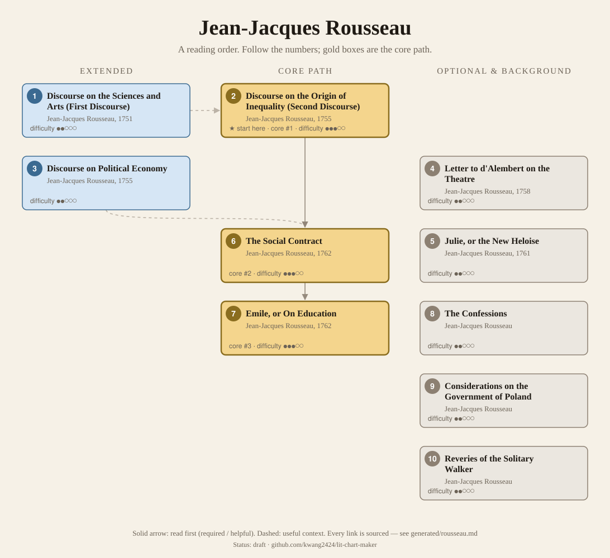
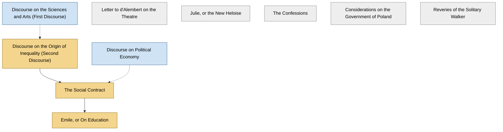

<!-- Generated by tools/build.py from lists/rousseau.yaml. Do not edit by hand. -->
# Jean-Jacques Rousseau: reading order

**Status:** draft · **Citations:** 20 citations · 20 checked by Claude (AI) · 0 reviewed by a person

**Scope:** Rousseau's philosophical and political works, from the two Discourses to the Social Contract and Emile, with the novel, the letter on the theatre and the autobiographical writings. His music and botany are left out. Years are first publication, from the SEP's list of principal works; works it dates only by composition are left undated.

> Citations marked "checked by Claude (AI)" were read against the named edition by an AI and have not yet been reviewed by a person. See [CONTRIBUTING.md](../CONTRIBUTING.md) to help review them.

## Core path

The shortest route through the essentials.

1. **Discourse on the Origin of Inequality (Second Discourse)** (1755) · difficulty ●●●○○ · ★ start here · first book in 3 surveyed sources
2. **The Social Contract** (1762) · difficulty ●●●○○ · first book in 1 surveyed source
3. **Emile, or On Education** (1762) · difficulty ●●●○○

## What the sources say

We surveyed 7 independent sources (1 scholarly guide and 6 course syllabi and teaching lists) and recorded which books each one assigns or recommends, and where it starts.

| Book | Recommended by | First book in |
|---|---|---|
| The Social Contract | 6/7 | 1 |
| Discourse on the Origin of Inequality (Second Discourse) | 5/7 | 3 |
| Emile, or On Education | 3/7 |  |
| Discourse on Political Economy | 2/7 |  |
| Discourse on the Sciences and Arts (First Discourse) | 1/7 | 1 |
| Reveries of the Solitary Walker | 1/7 |  |

**Sources surveyed**

- **Directed Studies, Yale University, Historical and Political Thought (Spring 2023)** [teaching]: Discourse on the Origin of Inequality (Second Discourse) → The Social Contract. ✓ checked by Claude (AI) in Course syllabus (PDF), accessed 2026-11; not yet reviewed by a person
- **Youngstown State University, POL 3786: Political Thought 2 (Fall 2026)** [teaching]: The Social Contract. ✓ checked by Claude (AI) in Course syllabus (PDF), accessed 2026-11; not yet reviewed by a person
- **Peter Dietsch, University of Victoria, PHIL 433/535: The political philosophy of Jean-Jacques Rousseau (Spring 2024)** [teaching]: Discourse on the Origin of Inequality (Second Discourse) → Discourse on Political Economy → The Social Contract. ✓ checked by Claude (AI) in Course outline (PDF, Spring 2024), accessed 2026-11; not yet reviewed by a person
- **Paul Franco, Bowdoin College, Government 3210: Jean-Jacques Rousseau (Spring 2019)** [teaching]: Discourse on the Sciences and Arts (First Discourse) → Discourse on the Origin of Inequality (Second Discourse) → Discourse on Political Economy → The Social Contract → Emile, or On Education → Reveries of the Solitary Walker. ✓ checked by Claude (AI) in Course syllabus (PDF, Spring 2019), accessed 2026-11; not yet reviewed by a person
- **Michelle Schwarze, University of Wisconsin–Madison, PS 931: Rousseau on Education (Spring 2020, draft)** [teaching]: Discourse on the Origin of Inequality (Second Discourse) → Emile, or On Education. ✓ checked by Claude (AI) in Course syllabus (PDF draft, Spring 2020), accessed 2026-11; not yet reviewed by a person
- **Nigel Warburton, Philosophy: The Classics (4th ed.)** [scholarly] (expert's shortlist): The Social Contract. ✓ checked by Claude (AI) in Routledge book page (table of contents), accessed 2026-11; not yet reviewed by a person
- **St. John's College (Annapolis and Santa Fe), Undergraduate program reading list, by class year** [teaching] (expert's shortlist): The Social Contract, Discourse on the Origin of Inequality (Second Discourse), Emile, or On Education. ✓ checked by Claude (AI) in Reading list web page, accessed 2026-11; not yet reviewed by a person

## Full path

Every work, in order. Extended and optional works are placed where they fit best.

### 1. Discourse on the Sciences and Arts (First Discourse) (1751)

`extended · primary · difficulty ●●○○○` · Jean-Jacques Rousseau

His prize-winning entry to the Academy of Dijon's competition, arguing that the arts and sciences corrode civic virtue and moral character. It made him famous; the SEP: it "is mainly important because Rousseau used it to introduce themes that he developed further in later work" (§1).

**Translation:** Gourevitch (Cambridge)

### 2. Discourse on the Origin of Inequality (Second Discourse) (1755)

`core · primary · difficulty ●●●○○` · Jean-Jacques Rousseau

Written for a second Dijon competition, which it did not win. A conjectural history of human development from the state of nature, in which Rousseau "begins to develop his theories of human social development and moral psychology" (SEP §1).

**Translation:** Gourevitch (Cambridge); Cole (Everyman)

**★ Good place to start.** The IEP: it "remains one of Rousseau's most famous works, and lays the foundation for much of his political thought as it is expressed in the Discourse on Political Economy and Social Contract". Four of the five courses surveyed read it first or after the First Discourse.

- Internet Encyclopedia of Philosophy, *"Jean-Jacques Rousseau"*, §3.b Discourse on the Origin of Inequality [scholarly] ✓ checked by Claude (AI) in IEP entry, accessed 2026-11; not yet reviewed by a person
- Directed Studies, Yale University, *Historical and Political Thought (Spring 2023)*, week 4 [teaching] ✓ checked by Claude (AI) in Course syllabus (PDF), accessed 2026-11; not yet reviewed by a person

**Read first:**

- *An Essay Concerning Human Understanding* (from the [John Locke list](locke.md)) — *context*. Part II invokes "the axiom of the wise Locke, Where there is no property, there can be no injury", from the Essay (IV.iii.18).
  - Jean-Jacques Rousseau, *Discourse on the Origin of Inequality*, Part II [author] ✓ checked by Claude (AI) in Project Gutenberg #11136; not yet reviewed by a person
- *Discourse on the Sciences and Arts (First Discourse)* — *context*. The IEP: Rousseau "thought this work to be superior to the First Discourse because the Second Discourse was significantly longer and more philosophically daring".
  - Internet Encyclopedia of Philosophy, *"Jean-Jacques Rousseau"*, §3.b [scholarly] ✓ checked by Claude (AI) in IEP entry, accessed 2026-11; not yet reviewed by a person
- *Leviathan* (from the [Thomas Hobbes list](hobbes.md)) — *context*. It argues against Hobbes's state of nature: "let us beware concluding with Hobbes, that man, as having no idea of goodness, must be naturally bad".
  - Jean-Jacques Rousseau, *Discourse on the Origin of Inequality*, Part I [author] ✓ checked by Claude (AI) in Project Gutenberg #11136; not yet reviewed by a person

### 3. Discourse on Political Economy (1755)

`extended · primary · difficulty ●●○○○` · Jean-Jacques Rousseau

First printed in the Encyclopédie in 1755. Cole: it is "important as giving the first sketch of the theory of the 'General Will'".

### 4. Letter to d'Alembert on the Theatre (1758)

`optional · primary · difficulty ●●○○○` · Jean-Jacques Rousseau

Against building a theatre in Geneva: theatre weakens attachment to the political community. It cemented his break with the Encyclopédistes (SEP §1).

### 5. Julie, or the New Heloise (1761)

`optional · primary · difficulty ●●○○○` · Jean-Jacques Rousseau

An epistolary novel, an immediate success; the SEP calls it "an important supplementary source for the interpretation of Rousseau's social philosophy" (§1).

### 6. The Social Contract (1762)

`core · primary · difficulty ●●●○○` · Jean-Jacques Rousseau

The general will, sovereignty and the claim to reconcile freedom with authority (SEP §3). Its Foreword calls it "part of a longer work" he had abandoned. Condemned in Geneva with Emile the year it appeared (SEP §1).

**Translation:** Gourevitch (Cambridge); Cole (Everyman)

**Read first:**

- *Discourse on the Origin of Inequality (Second Discourse)* — *helpful*. The Discourse on Inequality "lays the foundation for much of his political thought as it is expressed in the Discourse on Political Economy and Social Contract"; the SEP presents the Social Contract as setting out "an alternative to this dystopia". Every course surveyed that assigns both reads the Discourse first.
  - Internet Encyclopedia of Philosophy, *"Jean-Jacques Rousseau"*, §3.b [scholarly] ✓ checked by Claude (AI) in IEP entry, accessed 2026-11; not yet reviewed by a person
  - Stanford Encyclopedia of Philosophy, *"Jean Jacques Rousseau"*, §3 Political Philosophy [scholarly] ✓ checked by Claude (AI) in SEP entry (revision of Apr 2023), accessed 2026-11; not yet reviewed by a person
- *Discourse on Political Economy* — *context*. Cole: the Discourse on Political Economy, "probably written before the Discourse on Inequality", contains "the germs of the theory given in full in the Social Contract".
  - G. D. H. Cole, *Introduction to The Social Contract and Discourses (Everyman, 1913)*, Introduction [scholarly] ✓ checked by Claude (AI) in Project Gutenberg #46333; not yet reviewed by a person
- *Leviathan* (from the [Thomas Hobbes list](hobbes.md)) — *context*. Book I ch. 2: "The reasoning of Caligula agrees with that of Hobbes and Grotius." The SEP: its natural freedom is "reminiscent of Hobbes's 'right of nature' in Leviathan".
  - Jean-Jacques Rousseau, *The Social Contract*, Book I, ch. 2 [author] ✓ checked by Claude (AI) in Cole trans., Project Gutenberg #46333; not yet reviewed by a person
  - Stanford Encyclopedia of Philosophy, *"Jean Jacques Rousseau"*, §3.3 [scholarly] ✓ checked by Claude (AI) in SEP entry (revision of Apr 2023), accessed 2026-11; not yet reviewed by a person
- *The Prince* (from the [Niccolò Machiavelli list](machiavelli.md)) — *context*. Book III ch. 6, on monarchy: Machiavelli "professed to teach kings; but it was the people he really taught. His Prince is the book of Republicans."
  - Jean-Jacques Rousseau, *The Social Contract*, Book III, ch. 6 [author] ✓ checked by Claude (AI) in Cole trans., Project Gutenberg #46333; not yet reviewed by a person
- *Politics* (from the [Aristotle list](aristotle.md)) — *context*. Book I ch. 2 answers Aristotle's claim that "some are born for slavery, and others for dominion": "Aristotle was right; but he took the effect for the cause."
  - Jean-Jacques Rousseau, *The Social Contract*, Book I, ch. 2 [author] ✓ checked by Claude (AI) in Cole trans., Project Gutenberg #46333; not yet reviewed by a person

### 7. Emile, or On Education (1762)

`core · primary · difficulty ●●●○○` · Jean-Jacques Rousseau

His project for child development and education that "nurtures autonomy and avoids the genesis of the most destructive forms of self-interest" (SEP preamble). It contains the Profession of Faith of the Savoyard Vicar, among the fullest accounts of his morality (SEP §2.1). Condemned in Paris and Geneva (SEP §1).

**Translation:** Bloom (Basic Books)

**Read first:**

- *The Social Contract* — *helpful*. Book V summarises the Social Contract for Emile; Rousseau's footnote: "These problems and theorems are mostly taken from the Treatise on the Social Contract".
  - Jean-Jacques Rousseau, *Emile, or On Education*, Book V, footnote to the summary of political principles [author] ✓ checked by Claude (AI) in Foxley trans., Project Gutenberg #5427; not yet reviewed by a person

### 8. The Confessions

`optional · primary · difficulty ●●○○○` · Jean-Jacques Rousseau

Autobiography, worked on during his stay in England from 1766 (SEP §1). The SEP calls him "the pioneer of modern autobiography".

### 9. Considerations on the Government of Poland

`optional · primary · difficulty ●●○○○` · Jean-Jacques Rousseau

Written in 1770–1, late in his life (SEP §1, principal works).

### 10. Reveries of the Solitary Walker

`optional · primary · difficulty ●●○○○` · Jean-Jacques Rousseau

Written 1776–8, in the last years of his life (SEP §1 and principal works). Bowdoin's course ends with Walks 1–3 and 5.

## Map

Solid arrows: required or helpful. Dotted: context.

## Connections

**Builds on**

- *An Essay Concerning Human Understanding* (John Locke) → *Discourse on the Origin of Inequality (Second Discourse)* — context. Part II invokes "the axiom of the wise Locke, Where there is no property, there can be no injury", from the Essay (IV.iii.18).
- *Leviathan* (Thomas Hobbes) → *Discourse on the Origin of Inequality (Second Discourse)* — context. It argues against Hobbes's state of nature: "let us beware concluding with Hobbes, that man, as having no idea of goodness, must be naturally bad".
- *Leviathan* (Thomas Hobbes) → *The Social Contract* — context. Book I ch. 2: "The reasoning of Caligula agrees with that of Hobbes and Grotius." The SEP: its natural freedom is "reminiscent of Hobbes's 'right of nature' in Leviathan".
- *The Prince* (Niccolò Machiavelli) → *The Social Contract* — context. Book III ch. 6, on monarchy: Machiavelli "professed to teach kings; but it was the people he really taught. His Prince is the book of Republicans."
- *Politics* (Aristotle) → *The Social Contract* — context. Book I ch. 2 answers Aristotle's claim that "some are born for slavery, and others for dominion": "Aristotle was right; but he took the effect for the cause."

**Who builds on Jean-Jacques Rousseau**

- *The Social Contract* → *"Two Concepts of Liberty"* (Isaiah Berlin) — context. Berlin found Rousseau's theory of liberty "particularly dangerous": "Rousseau transformed the concept of the self's will" from what the individual desires to what the citizen ought to desire, the general will.
- *The Confessions* → *Of Grammatology* (Jacques Derrida) — context. Its logic of the supplement reads Rousseau, including his laments in The Confessions (OG 153–4).
- *The Social Contract* → *Elements of the Philosophy of Right* (G. W. F. Hegel) — context. The SEP reads its account of the rational state as a way of answering "Rousseau's question of the form of association needed for the formation and expression of the general will".
- *The Social Contract* → *Groundwork of the Metaphysics of Morals* (Immanuel Kant) — context. The SEP on Rousseau: the third formulation of the categorical imperative in the Groundwork, the formula of the kingdom of ends, "recalls Rousseau's discussion of the general will in The Social Contract".

## Sources

- **[author]** Jean-Jacques Rousseau, *Emile, or On Education*, 1762
- **[author]** Jean-Jacques Rousseau, *Discourse on the Origin of Inequality*, 1755
- **[author]** Jean-Jacques Rousseau, *The Social Contract*, 1762
- **[scholarly]** G. D. H. Cole, *Introduction to The Social Contract and Discourses (Everyman, 1913)*, 1913
- **[scholarly]** Internet Encyclopedia of Philosophy, *"Jean-Jacques Rousseau"* — <https://iep.utm.edu/rousseau/>
- **[scholarly]** Stanford Encyclopedia of Philosophy, *"Jean Jacques Rousseau"* — <https://plato.stanford.edu/entries/rousseau/>
- **[scholarly]** Nigel Warburton, *Philosophy: The Classics (4th ed.)*, Routledge, 2014 — <https://www.routledge.com/Philosophy-The-Classics/Warburton/p/book/9780415534666>
- **[teaching]** St. John's College (Annapolis and Santa Fe), *Undergraduate program reading list, by class year* — <https://www.sjc.edu/reading-list>
- **[teaching]** Paul Franco, Bowdoin College, *Government 3210: Jean-Jacques Rousseau (Spring 2019)* — <https://www.bowdoin.edu/academic-affairs/resources-for-department-chairs-and-program-directors/department-program-reviews/pdf/gov3210-franco-s19.pdf>
- **[teaching]** Peter Dietsch, University of Victoria, *PHIL 433/535: The political philosophy of Jean-Jacques Rousseau (Spring 2024)* — <https://www.uvic.ca/humanities/philosophy/assets/docs/courseoutlines/2024_spring/433deitsch.pdf>
- **[teaching]** Michelle Schwarze, University of Wisconsin–Madison, *PS 931: Rousseau on Education (Spring 2020, draft)* — <https://cems.wisc.edu/wp-content/uploads/sites/1040/2019/11/PS931-Syllabus-Version1.pdf>
- **[teaching]** Directed Studies, Yale University, *Historical and Political Thought (Spring 2023)* — <https://directedstudies.yale.edu/sites/default/files/files/HP%20spring%202023%20syllabus.pdf>
- **[teaching]** Youngstown State University, *POL 3786: Political Thought 2 (Fall 2026)* — <https://catalog.ysu.edu/syllabi/2026-fall/pol-3786-01-44080/syllabi-202640-pol-3786-01-44080.pdf>
