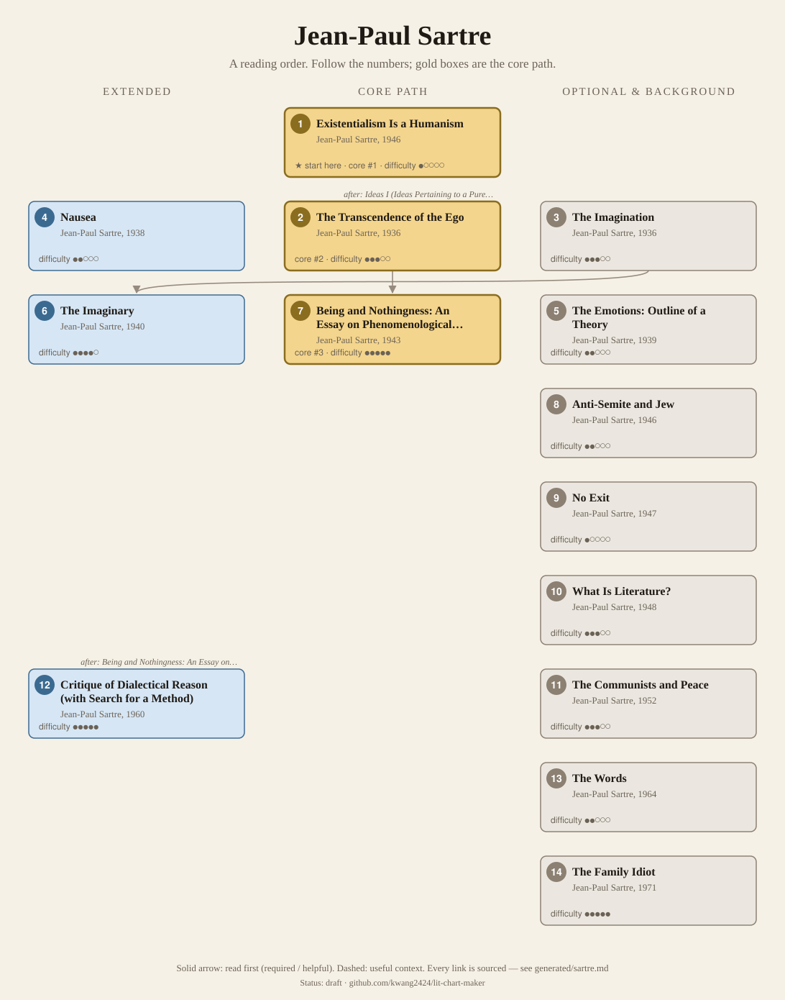
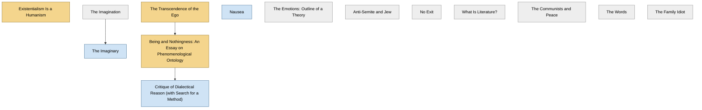

<!-- Generated by tools/build.py from lists/sartre.yaml. Do not edit by hand. -->
# Jean-Paul Sartre: reading order

**Status:** draft · **Citations checked:** 12/12

**Scope:** Sartre's philosophical works from the 1930s phenomenological essays to the Critique of Dialectical Reason, with the lecture that made existentialism famous and a few of the novels, plays and biographies that carry his philosophy. His texts are in copyright, so the evidence is the SEP and IEP and course syllabi.

## Core path

The shortest route through the essentials.

1. **Existentialism Is a Humanism** (1946) · difficulty ●○○○○ · ★ start here · first book in 1 surveyed source
2. **The Transcendence of the Ego** (1936) · difficulty ●●●○○ · first book in 1 surveyed source
3. **Being and Nothingness: An Essay on Phenomenological Ontology** (1943) · difficulty ●●●●● · first book in 1 surveyed source

## What the sources say

We surveyed 4 independent sources (4 course syllabi and teaching lists) and recorded which books each one assigns or recommends, and where it starts.

| Book | Recommended by | First book in |
|---|---|---|
| Being and Nothingness: An Essay on Phenomenological Ontology | 3/4 | 1 |
| Existentialism Is a Humanism | 2/4 | 1 |
| The Transcendence of the Ego | 2/4 | 1 |
| The Imaginary | 1/4 |  |
| Nausea | 1/4 |  |
| No Exit | 1/4 |  |

**Sources surveyed**

- **Noah Moss Brender, McGill University, PHIL 375: Existentialism (Fall 2013)** [teaching]: Existentialism Is a Humanism → Being and Nothingness: An Essay on Phenomenological Ontology. ✓ checked in Course syllabus (PDF, Fall 2013), accessed 2026-11
- **Tracy Colony, Bard College Berlin, PL175: Introduction to Existentialism (Spring 2024)** [teaching]: Being and Nothingness: An Essay on Phenomenological Ontology → Existentialism Is a Humanism → No Exit → Nausea. ✓ checked in Course syllabus (PDF, Spring 2024), accessed 2026-11
- **Allison Barnes, University of Victoria, PHIL 311: Sartre's early philosophy (Spring 2017)** [teaching]: The Transcendence of the Ego → The Imaginary. ✓ checked in Course outline (PDF, Spring 2017), accessed 2026-11
- **Berislav Marušić, University of Edinburgh, PHIL10200: The Philosophy of Jean-Paul Sartre (2026/27)** [teaching]: The Transcendence of the Ego, Being and Nothingness: An Essay on Phenomenological Ontology. ✓ checked in Course catalogue entry (2026/27), accessed 2026-11

## Full path

Every work, in order. Extended and optional works are placed where they fit best.

### 1. Existentialism Is a Humanism (1946)

`core · primary · difficulty ●○○○○` · Jean-Paul Sartre

The packed public lecture of late 1945, published 1946, which also answered Marxist and Christian critics of "existentialism".

**Translation:** Macomber (Yale)

**★ Good place to start.** The SEP: the lecture "offered an accessible version of his difficult treatise, Being and Nothingness". McGill's existentialism course opens with it.

- Stanford Encyclopedia of Philosophy, *"Jean-Paul Sartre"*, preamble [scholarly] ✓ checked in SEP entry, accessed 2026-11
- Noah Moss Brender, McGill University, *PHIL 375: Existentialism (Fall 2013)*, schedule, Sept. 9–11 [teaching] ✓ checked in Course syllabus (PDF, Fall 2013), accessed 2026-11

### 2. The Transcendence of the Ego (1936)

`core · primary · difficulty ●●●○○` · Jean-Paul Sartre

An essay against the "transcendental ego" of Husserl's Ideas, defending a realistic reading of intentionality (SEP §2).

**Translation:** Brown (Routledge 2004); Williams and Kirkpatrick (Noonday 1957)

**Read first:**

- *Ideas I (Ideas Pertaining to a Pure Phenomenology: General Introduction to Pure Phenomenology)* (from the [Edmund Husserl list](husserl.md)) — *helpful*. It "engages in a much more critical way with the conception of the 'transcendental ego' presented in Husserl's Ideas" and defends a realistic reading of intentionality.
  - Stanford Encyclopedia of Philosophy, *"Jean-Paul Sartre"*, §2 Transcendence of the Ego [scholarly] ✓ checked in SEP entry, accessed 2026-11

### 3. The Imagination (1936)

`optional · primary · difficulty ●●●○○` · Jean-Paul Sartre

One of his "earlier, psychologically motivated philosophical works" (SEP preamble).

**Translation:** Williford and Rudrauf (Routledge)

### 4. Nausea (1938)

`extended · primary · difficulty ●●○○○` · Jean-Paul Sartre

His "great philosophical novel", written while he was working out his early philosophy (SEP §1).

**Translation:** Baldick (Penguin)

### 5. The Emotions: Outline of a Theory (1939)

`optional · primary · difficulty ●●○○○` · Jean-Paul Sartre

Discussed by the SEP with The Imaginary as part of his phenomenological psychology (§3).

### 6. The Imaginary (1940)

`extended · primary · difficulty ●●●●○` · Jean-Paul Sartre

For many readers "one of the most rigorous and fruitful developments of his Husserl-inspired phenomenological investigations" (SEP §3).

**Translation:** Webber (Routledge)

**Read first:**

- *The Imagination* — *helpful*. The SEP calls The Imaginary the "sequel" to Imagination (1936).
  - Stanford Encyclopedia of Philosophy, *"Jean-Paul Sartre"*, preamble [scholarly] ✓ checked in SEP entry, accessed 2026-11

### 7. Being and Nothingness: An Essay on Phenomenological Ontology (1943)

`core · primary · difficulty ●●●●●` · Jean-Paul Sartre

Being-for-itself and being-in-itself, negation and freedom, bad faith, the look of the other, and existential psychoanalysis. Long and difficult; courses read selected sections (McGill: negation, anguish, bad faith, freedom, the look).

**Translation:** Barnes (1956); Richmond (Routledge 2018)

**Read first:**

- *The Transcendence of the Ego* — *helpful*. UVic's course reads The Transcendence of the Ego and The Imaginary as the early account of consciousness that "appeared a few years later in Being and Nothingness".
  - Allison Barnes, University of Victoria, *PHIL 311: Sartre's early philosophy (Spring 2017)*, course description [teaching] ✓ checked in Course outline (PDF, Spring 2017), accessed 2026-11
- *Being and Time* (from the [Martin Heidegger list](heidegger.md)) — *context*. Its "human reality" is "his gloss on Heidegger's conception of Dasein", and its account of nothingness answers Heidegger's.
  - Stanford Encyclopedia of Philosophy, *"Jean-Paul Sartre"*, §4.1 Negation and Freedom [scholarly] ✓ checked in SEP entry, accessed 2026-11
- *Phenomenology of Spirit* (from the [G. W. F. Hegel list](hegel.md)) — *context*. Its chapter on concrete relations with others is "essentially a restatement of the 'master-slave' stage of Hegel's struggle for recognition without the possibility of its overcoming".
  - Stanford Encyclopedia of Philosophy, *"Jean-Paul Sartre"*, §4.3 The Look, Shame and Intersubjectivity [scholarly] ✓ checked in SEP entry, accessed 2026-11

### 8. Anti-Semite and Jew (1946)

`optional · primary · difficulty ●●○○○` · Jean-Paul Sartre

An essay from the same post-war years (SEP §1).

**Translation:** Becker (Schocken)

### 9. No Exit (1947)

`optional · primary · difficulty ●○○○○` · Jean-Paul Sartre

A play, first produced in 1944; Bard's course reads it after the Humanism lecture.

### 10. What Is Literature? (1948)

`optional · primary · difficulty ●●●○○` · Jean-Paul Sartre

Published in Les Temps modernes and collected in Situations II.

**Translation:** Frechtman (Harvard)

### 11. The Communists and Peace (1952)

`optional · primary · difficulty ●●●○○` · Jean-Paul Sartre

Essays collected in Situations VI.

### 12. Critique of Dialectical Reason (with Search for a Method) (1960)

`extended · primary · difficulty ●●●●●` · Jean-Paul Sartre

His "existentialist Marxism": a massive two-volume work, with Search for a Method setting out the progressive-regressive method (SEP §6, §5).

**Read first:**

- *Being and Nothingness: An Essay on Phenomenological Ontology* — *helpful*. Its progressive-regressive method was "first sketched and experimented" in his existential psychoanalysis, which Being and Nothingness introduces.
  - Stanford Encyclopedia of Philosophy, *"Jean-Paul Sartre"*, §5 Existential Psychoanalysis and the Fundamental Project [scholarly] ✓ checked in SEP entry, accessed 2026-11

### 13. The Words (1964)

`optional · primary · difficulty ●●○○○` · Jean-Paul Sartre

His account of his childhood, in which he applies his method of existential psychoanalysis to himself (SEP §1).

### 14. The Family Idiot (1971)

`optional · primary · difficulty ●●●●●` · Jean-Paul Sartre

His "multi-volume masterpiece on Flaubert", a work of existential psychoanalysis (SEP preamble, §5).

## Map

Solid arrows: required or helpful. Dotted: context.

## Connections

**Builds on**

- *Ideas I (Ideas Pertaining to a Pure Phenomenology: General Introduction to Pure Phenomenology)* (Edmund Husserl) → *The Transcendence of the Ego* — helpful. It "engages in a much more critical way with the conception of the 'transcendental ego' presented in Husserl's Ideas" and defends a realistic reading of intentionality.
- *Being and Time* (Martin Heidegger) → *Being and Nothingness: An Essay on Phenomenological Ontology* — context. Its "human reality" is "his gloss on Heidegger's conception of Dasein", and its account of nothingness answers Heidegger's.
- *Phenomenology of Spirit* (G. W. F. Hegel) → *Being and Nothingness: An Essay on Phenomenological Ontology* — context. Its chapter on concrete relations with others is "essentially a restatement of the 'master-slave' stage of Hegel's struggle for recognition without the possibility of its overcoming".

**Who builds on Jean-Paul Sartre**

- *Being and Nothingness: An Essay on Phenomenological Ontology* → *Phenomenology of Perception* (Maurice Merleau-Ponty) — context. McGill's existentialism course reads its chapter on freedom (Part III, ch. 3) straight after Sartre's pages on freedom in Being and Nothingness.
- *What Is Literature?* → *Signs* (Maurice Merleau-Ponty) — context. "Indirect Language and the Voices of Silence" brings his view of language "into conversation with Sartre's What is Literature?" and Malraux's Voices of Silence.

## Sources

- **[scholarly]** Stanford Encyclopedia of Philosophy, *"Jean-Paul Sartre"* — <https://plato.stanford.edu/entries/sartre/>
- **[teaching]** Tracy Colony, Bard College Berlin, *PL175: Introduction to Existentialism (Spring 2024)* — <https://tools.bard.edu/wwwmedia/resources/files/1832/PL175_Spring%202024_Syllabus_Colony.pdf>
- **[teaching]** Berislav Marušić, University of Edinburgh, *PHIL10200: The Philosophy of Jean-Paul Sartre (2026/27)* — <https://www.drps.ed.ac.uk/26-27/dpt/cxphil10200.htm>
- **[teaching]** Noah Moss Brender, McGill University, *PHIL 375: Existentialism (Fall 2013)* — <https://www.mcgill.ca/philosophy/files/philosophy/phil375_syllabus.pdf>
- **[teaching]** Allison Barnes, University of Victoria, *PHIL 311: Sartre's early philosophy (Spring 2017)* — <https://uvic.ca/humanities/philosophy/assets/docs/courseoutlines/2017_spring/311%20Barnes1.pdf>
