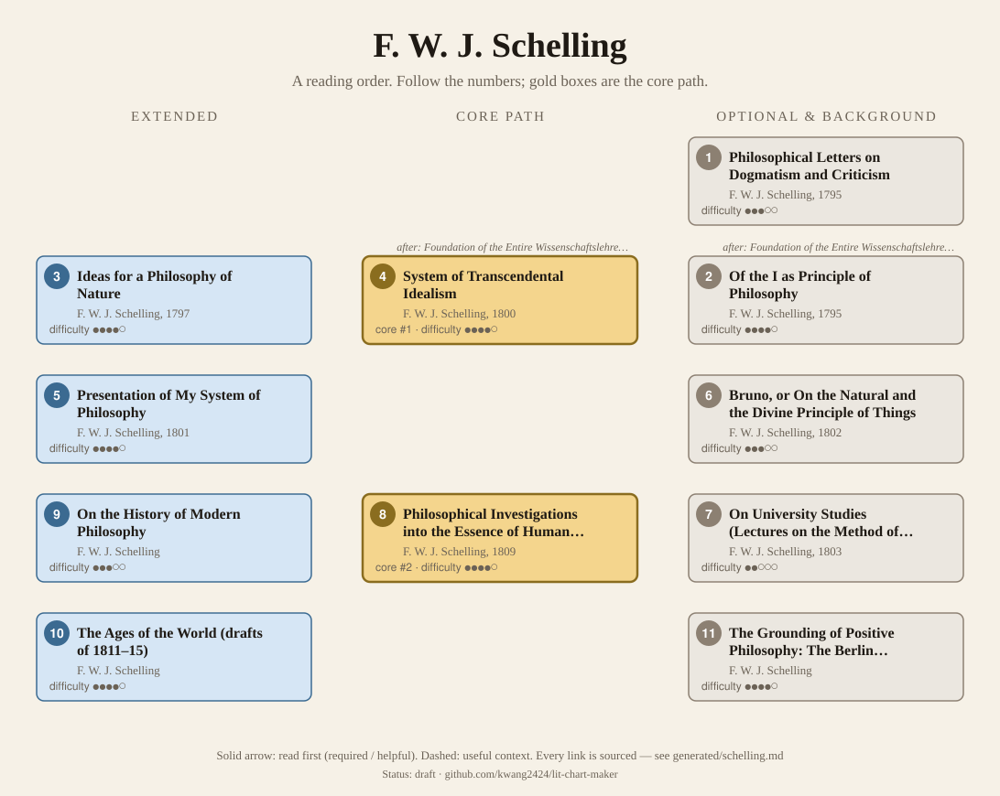

<!-- Generated by tools/build.py from lists/schelling.yaml. Do not edit by hand. -->
# F. W. J. Schelling: reading order

**Status:** draft · **Citations checked:** 9/9

**Scope:** Schelling's main works across his changing positions: the early essays answering Fichte and Jacobi, the philosophy of nature and transcendental idealism, the identity philosophy, the 1809 Freedom essay, the Ages of the World drafts and the late Munich and Berlin lectures. No course found is devoted to Schelling alone; each surveyed course reads one text in a wider German Idealism course, so the tiers lean on the SEP and IEP.

## Core path

The shortest route through the essentials.

1. **System of Transcendental Idealism** (1800) · difficulty ●●●●○
2. **Philosophical Investigations into the Essence of Human Freedom** (1809) · difficulty ●●●●○

## What the sources say

We surveyed 4 independent sources (4 course syllabi and teaching lists) and recorded which books each one assigns or recommends, and where it starts.

| Book | Recommended by | First book in |
|---|---|---|
| On University Studies (Lectures on the Method of Academic Study) | 1/4 |  |
| On the History of Modern Philosophy | 1/4 |  |
| Presentation of My System of Philosophy | 1/4 |  |
| System of Transcendental Idealism | 1/4 |  |

**Sources surveyed**

- **Georgy Chernavin, Higher School of Economics (Moscow), Transcendental Philosophy: From German Idealism to Phenomenology (2015)** [teaching]: System of Transcendental Idealism. ✓ checked in Course syllabus (PDF, 2015), accessed 2026-11
- **Matthew T. Segall, California Institute of Integral Studies, PARP 6393: Mind and Nature in German Idealism (Spring 2017)** [teaching]: On the History of Modern Philosophy. ✓ checked in Course syllabus (PDF, Spring 2017), accessed 2026-11
- **Simon R. Gurofsky, Carleton University, PHIL 3005 (Winter 2020)** [teaching]: Presentation of My System of Philosophy. ✓ checked in Course syllabus (PDF, Winter 2020), accessed 2026-11
- **Benjamin Wilck, Humboldt-Universität zu Berlin, Philosophy in Berlin: Educational Theory in the German Tradition (Spring 2022)** [teaching]: On University Studies (Lectures on the Method of Academic Study). ✓ checked in Course syllabus (PDF, Spring 2022), accessed 2026-11

## Full path

Every work, in order. Extended and optional works are placed where they fit best.

### 1. Philosophical Letters on Dogmatism and Criticism (1795)

`optional · primary · difficulty ●●●○○` · F. W. J. Schelling

The second of the 1795 essays on the issues raised by Jacobi and Fichte (SEP §2).

**Translation:** Marti, in The Unconditional in Human Knowledge

### 2. Of the I as Principle of Philosophy (1795)

`optional · primary · difficulty ●●●●○` · F. W. J. Schelling

One of two essays of 1795 in which he takes up "the issues raised by Jacobi and Fichte" (SEP §2).

**Translation:** Marti, in The Unconditional in Human Knowledge

**Read first:**

- *Foundation of the Entire Wissenschaftslehre (Science of Knowledge)* (from the [J. G. Fichte list](fichte.md)) — *helpful*. Fichte's Wissenschaftslehre, "along with Kant's Critique of Judgment ... proved to be of decisive importance for Schelling's early philosophical career".
  - Internet Encyclopedia of Philosophy, *"Friedrich Wilhelm Joseph von Schelling (1775—1854)"*, §1 Life [scholarly] ✓ checked in IEP entry, accessed 2026-11

### 3. Ideas for a Philosophy of Nature (1797)

`extended · primary · difficulty ●●●●○` · F. W. J. Schelling

The start of his Naturphilosophie, which "emerges in 1797 and develops in the succeeding years" (SEP §2).

**Translation:** Harris and Heath (Cambridge)

**Read first:**

- *Critique of the Power of Judgment* (from the [Immanuel Kant list](kant.md)) — *context*. The IEP names Kant's Critique of Judgment, with Fichte's Wissenschaftslehre, as "of decisive importance for Schelling's early philosophical career".
  - Internet Encyclopedia of Philosophy, *"Friedrich Wilhelm Joseph von Schelling (1775—1854)"*, §1 Life [scholarly] ✓ checked in IEP entry, accessed 2026-11

### 4. System of Transcendental Idealism (1800)

`core · primary · difficulty ●●●●○` · F. W. J. Schelling

In the System "nature begins unconsciously and ends in conscious philosophical and scientific knowledge"; in the work of art "the I is conscious according to the production, unconscious with regard to the product" (SEP §2).

*Why this tier:* Only one surveyed course assigns it, because none of the courses found is about Schelling alone; the SEP and IEP treat it as a main work of his early period.

**Translation:** Heath (Virginia)

**Read first:**

- *Foundation of the Entire Wissenschaftslehre (Science of Knowledge)* (from the [J. G. Fichte list](fichte.md)) — *helpful*. With the Naturphilosophie it "wavers between a Spinozist and a Fichtean approach to the 'unconditioned'"; the SEP's Fichte here is the Wissenschaftslehre of 1794.
  - Stanford Encyclopedia of Philosophy (Andrew Bowie), *"Friedrich Wilhelm Joseph von Schelling"*, §2 Transcendental Philosophy and Naturphilosophie [scholarly] ✓ checked in SEP entry, accessed 2026-11
- *Ethics* (from the [Baruch Spinoza list](spinoza.md)) — *context*. Spinoza is the other pole between which it "wavers"; Schelling's concern with Spinoza comes from the pantheism controversy, which "brought Spinoza's monism into the mainstream of German philosophy".
  - Stanford Encyclopedia of Philosophy (Andrew Bowie), *"Friedrich Wilhelm Joseph von Schelling"*, §2 [scholarly] ✓ checked in SEP entry, accessed 2026-11

### 5. Presentation of My System of Philosophy (1801)

`extended · primary · difficulty ●●●●○` · F. W. J. Schelling

The text from which his "identity philosophy" is usually dated, until sometime before the 1809 Freedom essay (SEP §3).

### 6. Bruno, or On the Natural and the Divine Principle of Things (1802)

`optional · primary · difficulty ●●●○○` · F. W. J. Schelling

From the identity period (1802).

**Translation:** Vater (SUNY)

### 7. On University Studies (Lectures on the Method of Academic Study) (1803)

`optional · primary · difficulty ●●○○○` · F. W. J. Schelling

Lectures on the idea of the university, written shortly after, and in reaction to, Kant's Conflict of the Faculties (HU Berlin's course).

### 8. Philosophical Investigations into the Essence of Human Freedom (1809)

`core · primary · difficulty ●●●●○` · F. W. J. Schelling

Freedom understood not as the rational will's mastery but "as the capacity to do evil", and whether there can be a "system of freedom" at all (IEP §2.c).

*Why this tier:* No surveyed course assigns it, for the same reason as the System; the IEP calls it "perhaps the most important book that Schelling published in his life time".

**Translation:** Gutmann (Open Court, 1936), as Of Human Freedom

**Read first:**

- *Ethics* (from the [Baruch Spinoza list](spinoza.md)) — *context*. "This attempt at the system of freedom arose in the wake of ... the 'pantheism controversy'", which "is centred on the supposedly atheistic figure of Spinoza".
  - Internet Encyclopedia of Philosophy, *"Friedrich Wilhelm Joseph von Schelling (1775—1854)"*, §2.c The Middle period [scholarly] ✓ checked in IEP entry, accessed 2026-11

### 9. On the History of Modern Philosophy

`extended · primary · difficulty ●●●○○` · F. W. J. Schelling

Lectures, "probably 1833–4" (SEP bibliography); CIIS's course reads them for his critique of Hegel.

**Translation:** Bowie (Cambridge)

### 10. The Ages of the World (drafts of 1811–15)

`extended · primary · difficulty ●●●●○` · F. W. J. Schelling

Unfinished drafts (1811–15), the subject of SEP §4.

**Translation:** Wirth (SUNY)

### 11. The Grounding of Positive Philosophy: The Berlin Lectures

`optional · primary · difficulty ●●●●○` · F. W. J. Schelling

From the Berlin lectures of 1841–2, once attended by Kierkegaard, Engels and Bakunin (SEP §1), on "positive" and "negative" philosophy and his critique of Hegel (SEP §5).

**Translation:** Matthews (SUNY)

## Map

Solid arrows: required or helpful. Dotted: context.

```mermaid
graph TD
  letters_dogmatism["Philosophical Letters on Dogmatism and Criticism"]:::optional
  of_the_i["Of the I as Principle of Philosophy"]:::optional
  ideas_nature["Ideas for a Philosophy of Nature"]:::extended
  sti["System of Transcendental Idealism"]:::core
  presentation["Presentation of My System of Philosophy"]:::extended
  bruno["Bruno, or On the Natural and the Divine Principle of Things"]:::optional
  academic_study["On University Studies (Lectures on the Method of Academic Study)"]:::optional
  freedom["Philosophical Investigations into the Essence of Human Freedom"]:::core
  history_modern["On the History of Modern Philosophy"]:::extended
  ages_world["The Ages of the World (drafts of 1811–15)"]:::extended
  positive_philosophy["The Grounding of Positive Philosophy: The Berlin Lectures"]:::optional
  classDef core fill:#f4d58d,stroke:#8a6d1f,color:#000
  classDef extended fill:#cfe3f5,stroke:#3b6a91,color:#000
  classDef optional fill:#eeeeee,stroke:#888,color:#000
```

## Connections

**Builds on**

- *Foundation of the Entire Wissenschaftslehre (Science of Knowledge)* (J. G. Fichte) → *Of the I as Principle of Philosophy* — helpful. Fichte's Wissenschaftslehre, "along with Kant's Critique of Judgment ... proved to be of decisive importance for Schelling's early philosophical career".
- *Critique of the Power of Judgment* (Immanuel Kant) → *Ideas for a Philosophy of Nature* — context. The IEP names Kant's Critique of Judgment, with Fichte's Wissenschaftslehre, as "of decisive importance for Schelling's early philosophical career".
- *Foundation of the Entire Wissenschaftslehre (Science of Knowledge)* (J. G. Fichte) → *System of Transcendental Idealism* — helpful. With the Naturphilosophie it "wavers between a Spinozist and a Fichtean approach to the 'unconditioned'"; the SEP's Fichte here is the Wissenschaftslehre of 1794.
- *Ethics* (Baruch Spinoza) → *System of Transcendental Idealism* — context. Spinoza is the other pole between which it "wavers"; Schelling's concern with Spinoza comes from the pantheism controversy, which "brought Spinoza's monism into the mainstream of German philosophy".
- *Ethics* (Baruch Spinoza) → *Philosophical Investigations into the Essence of Human Freedom* — context. "This attempt at the system of freedom arose in the wake of ... the 'pantheism controversy'", which "is centred on the supposedly atheistic figure of Spinoza".

**Who builds on F. W. J. Schelling**

- *Presentation of My System of Philosophy* → *Phenomenology of Spirit* (G. W. F. Hegel) — context. Its Preface mocks an Absolute that is "the night in which all cows are black"; the IEP and SEP read this as aimed at Schelling's identity philosophy (Schelling asked Hegel whether it was meant for him).
- *Philosophical Investigations into the Essence of Human Freedom* → *The Metaphysics of German Idealism: Schelling's Freedom essay (lecture course, 1941)* (Martin Heidegger) — required. It is a lecture course interpreting Schelling's Philosophical Investigations into the Essence of Human Freedom (1809).

## Sources

- **[scholarly]** Internet Encyclopedia of Philosophy, *"Friedrich Wilhelm Joseph von Schelling (1775—1854)"* — <https://iep.utm.edu/schellin/>
- **[scholarly]** Stanford Encyclopedia of Philosophy (Andrew Bowie), *"Friedrich Wilhelm Joseph von Schelling"* — <https://plato.stanford.edu/entries/schelling/>
- **[teaching]** Simon R. Gurofsky, Carleton University, *PHIL 3005 (Winter 2020)* — <https://carleton.ca/philosophy/wp-content/uploads/sites/200/Phil-3005-S.-Gurofsky-W.20-1.pdf>
- **[teaching]** Matthew T. Segall, California Institute of Integral Studies, *PARP 6393: Mind and Nature in German Idealism (Spring 2017)* — <https://footnotes2plato.com/wp-content/uploads/2016/10/syllabus-mind-and-nature-in-german-idealism.pdf>
- **[teaching]** Georgy Chernavin, Higher School of Economics (Moscow), *Transcendental Philosophy: From German Idealism to Phenomenology (2015)* — <https://www.hse.ru/data/2015/10/09/1097657033/Chernavin_Transcendental_Philosophy_3.07.15.pdf>
- **[teaching]** Benjamin Wilck, Humboldt-Universität zu Berlin, *Philosophy in Berlin: Educational Theory in the German Tradition (Spring 2022)* — <https://www2.hu-berlin.de/aia/hic/resources/hic/psa/documents/2022/Wilck_HPSA_syllabus_Spring2022.pdf>
