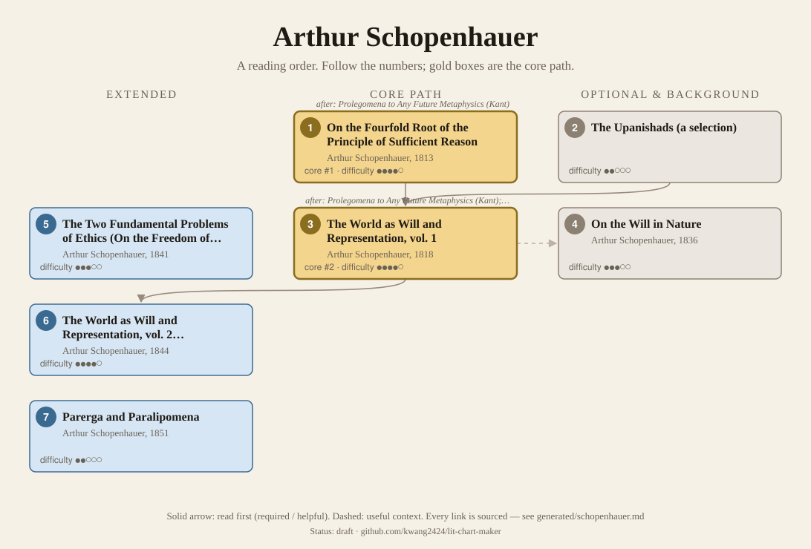
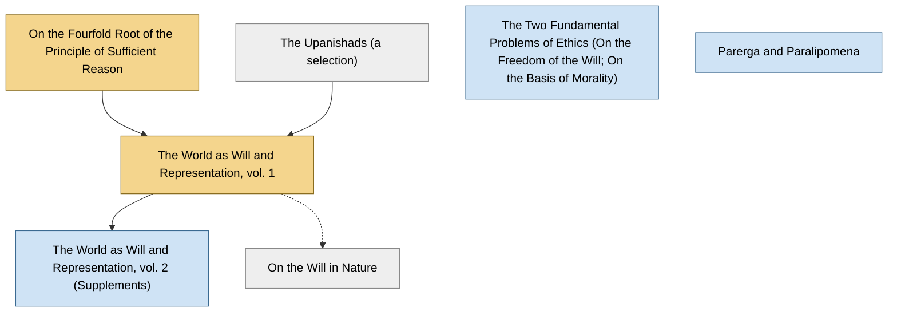

<!-- Generated by tools/build.py from lists/schopenhauer.yaml. Do not edit by hand. -->
# Arthur Schopenhauer: reading order

**Status:** draft · **Citations checked:** 11/11

**Scope:** Schopenhauer's books in the order he asked readers to take them, plus the later essays that made him famous. He left unusually explicit instructions, so most links here come from his own prefaces.

## Core path

The shortest route through the essentials.

1. **On the Fourfold Root of the Principle of Sufficient Reason** (1813) · difficulty ●●●●○
2. **The World as Will and Representation, vol. 1** (1818) · difficulty ●●●●○ · first book in 1 surveyed source

## What the sources say

We surveyed 2 independent sources (2 course syllabi and teaching lists) and recorded which books each one assigns or recommends, and where it starts.

| Book | Recommended by | First book in |
|---|---|---|
| The World as Will and Representation, vol. 1 | 2/2 | 1 |
| On the Fourfold Root of the Principle of Sufficient Reason | 1/2 |  |

**Sources surveyed**

- **University of Auckland, PHIL 209/329: Schopenhauer and Nietzsche (Semester 1, 2014)** [teaching]: The World as Will and Representation, vol. 1. ✓ checked in Course outline (PDF), accessed 2026-11
- **Osher Lifelong Learning Institute (OLLI-DC), Study group 861: Hegel and Schopenhauer** [teaching]: On the Fourfold Root of the Principle of Sufficient Reason, The World as Will and Representation, vol. 1. ✓ checked in Study group web page, accessed 2026-11

## Full path

Every work, in order. Extended and optional works are placed where they fit best.

### 1. On the Fourfold Root of the Principle of Sufficient Reason (1813)

`core · primary · difficulty ●●●●○` · Arthur Schopenhauer

His dissertation, and the "centerpiece of his later philosophy" according to the SEP: everything we explain falls under one of four kinds of ground.

**Translation:** Payne (Open Court)

**Read first:**

- *Prolegomena to Any Future Metaphysics* (from the [Immanuel Kant list](kant.md)) — *helpful*. Its claim that the subject–object distinction is the condition of all knowledge comes from Kant's first Critique.
  - Robert Wicks, *"Arthur Schopenhauer", Stanford Encyclopedia of Philosophy*, §2 The Fourfold Root [scholarly] ✓ checked in SEP online, accessed 2026-11

### 2. The Upanishads (a selection)

`optional · background · difficulty ●●○○○`

Ancient Indian philosophical texts Schopenhauer read nightly and called the greatest gift of his century.

### 3. The World as Will and Representation, vol. 1 (1818)

`core · primary · difficulty ●●●●○` · Arthur Schopenhauer

Four books: the world as representation, as will, art, and ethics. Nietzsche's starting point and a major influence on Jung.

**Translation:** Payne (Dover) or Norman, Welchman & Janaway (Cambridge)

**Reading tips:**

- He advises reading his appendix, "Criticism of the Kantian Philosophy", first, and warns that the appendix and the book "must be read twice".
  - Arthur Schopenhauer, *The World as Will and Representation, Preface to the first edition*, Preface to the first edition [author] ✓ checked in Haldane & Kemp trans., Project Gutenberg

**Read first:**

- *On the Fourfold Root of the Principle of Sufficient Reason* — *required*. He says that without this "introduction and propaedeutic" it is "absolutely impossible to understand the present work properly".
  - Arthur Schopenhauer, *The World as Will and Representation, Preface to the first edition*, Preface to the first edition [author] ✓ checked in Haldane & Kemp trans., Project Gutenberg
- *Prolegomena to Any Future Metaphysics* (from the [Immanuel Kant list](kant.md)) — *required*. "The philosophy of Kant ... is the only philosophy with which a thorough acquaintance is directly presupposed." The Prolegomena is Kant's own summary.
  - Arthur Schopenhauer, *The World as Will and Representation, Preface to the first edition*, Preface to the first edition [author] ✓ checked in Haldane & Kemp trans., Project Gutenberg
- *Critique of Pure Reason* (from the [Immanuel Kant list](kant.md)) — *helpful*. The Kant he presupposes and criticizes in his appendix is above all the Critique.
  - Arthur Schopenhauer, *The World as Will and Representation, Preface to the first edition*, Preface to the first edition [author] ✓ checked in Haldane & Kemp trans., Project Gutenberg
- *Republic* (from the [Plato list](plato.md)) — *helpful*. A reader who "has lingered in the school of the divine Plato" will be "so much the better prepared".
  - Arthur Schopenhauer, *The World as Will and Representation, Preface to the first edition*, Preface to the first edition [author] ✓ checked in Haldane & Kemp trans., Project Gutenberg
- *The Upanishads (a selection)* — *helpful*. The third preparation he names: a reader who "is a partaker of the benefit conferred by the Vedas" through the Upanishads is best prepared of all.
  - Arthur Schopenhauer, *The World as Will and Representation, Preface to the first edition*, Preface to the first edition [author] ✓ checked in Haldane & Kemp trans., Project Gutenberg

### 4. On the Will in Nature (1836)

`optional · primary · difficulty ●●●○○` · Arthur Schopenhauer

A short book confirming his metaphysics with the science of his day.

**Read first:**

- *The World as Will and Representation, vol. 1* — *context*. The SEP describes it as aiming "to confirm and reiterate his metaphysical views in light of scientific evidence".
  - Robert Wicks, *"Arthur Schopenhauer", Stanford Encyclopedia of Philosophy*, §1 Life [scholarly] ✓ checked in SEP online, accessed 2026-11

### 5. The Two Fundamental Problems of Ethics (On the Freedom of the Will; On the Basis of Morality) (1841)

`extended · primary · difficulty ●●●○○` · Arthur Schopenhauer

Two prize essays, published together. Clear and self-contained; the Basis of Morality grounds ethics in compassion.

### 6. The World as Will and Representation, vol. 2 (Supplements) (1844)

`extended · primary · difficulty ●●●●○` · Arthur Schopenhauer

Fifty chapters of supplements, each tied to a book of volume 1. More mature and often clearer.

**Read first:**

- *The World as Will and Representation, vol. 1* — *required*. He advises newcomers to "first of all read the first volume without using the supplementary books", and to use them only on a second reading.
  - Arthur Schopenhauer, *The World as Will and Representation, Preface to the second edition*, Preface to the second edition [author] ✓ checked in Haldane & Kemp trans., Project Gutenberg

### 7. Parerga and Paralipomena (1851)

`extended · primary · difficulty ●●○○○` · Arthur Schopenhauer

Essays and aphorisms (including "Aphorisms on the Wisdom of Life"), the book that finally brought him recognition. Easy to dip into at any point.

## Map

Solid arrows: required or helpful. Dotted: context.

## Sources

- **[author]** Arthur Schopenhauer, *The World as Will and Representation, Preface to the first edition*, 1818
- **[author]** Arthur Schopenhauer, *The World as Will and Representation, Preface to the second edition*, 1844
- **[scholarly]** Robert Wicks, *"Arthur Schopenhauer", Stanford Encyclopedia of Philosophy* — <https://plato.stanford.edu/entries/schopenhauer/>
- **[teaching]** Osher Lifelong Learning Institute (OLLI-DC), *Study group 861: Hegel and Schopenhauer* — <https://www.olli-dc.org/StudyGroupDetail?studyGroupID=7420>
- **[teaching]** University of Auckland, *PHIL 209/329: Schopenhauer and Nietzsche (Semester 1, 2014)* — <https://www.artsfaculty.auckland.ac.nz/courses/docs/PHIL-209-329-Course-Outline-S1-2014.pdf>
