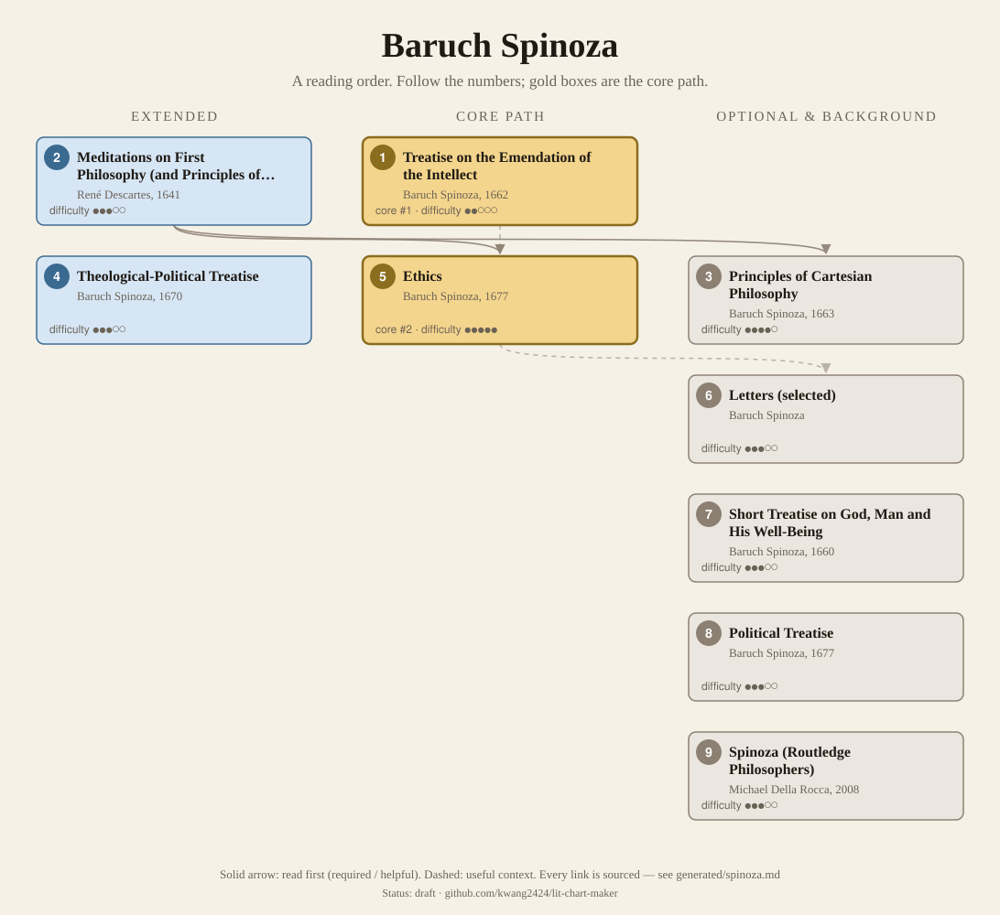
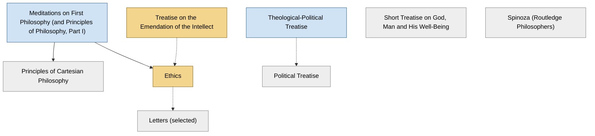

<!-- Generated by tools/build.py from lists/spinoza.yaml. Do not edit by hand. -->
# Baruch Spinoza: reading order

**Status:** draft · **Citations checked:** 15/15

**Scope:** Spinoza's works, the Descartes he started from, and one modern guide. The Ethics is the centre; courses split on whether to open with his short essay on method.

## Core path

The shortest route through the essentials.

1. **Treatise on the Emendation of the Intellect** (1662) · difficulty ●●○○○ · first book in 2 surveyed sources
2. **Ethics** (1677) · difficulty ●●●●● · first book in 1 surveyed source

## What the sources say

We surveyed 5 independent sources (5 course syllabi and teaching lists) and recorded which books each one assigns or recommends, and where it starts.

| Book | Recommended by | First book in |
|---|---|---|
| Ethics | 5/5 | 1 |
| Treatise on the Emendation of the Intellect | 2/5 | 2 |
| Meditations on First Philosophy (and Principles of Philosophy, Part I) | 2/5 | 1 |
| Theological-Political Treatise | 2/5 |  |
| Letters (selected) | 1/5 |  |
| Political Treatise | 1/5 |  |

**Sources surveyed**

- **UC San Diego, PHIL 201A: Core Course in History of Philosophy: Spinoza's Ethics (Spring 2011)** [teaching]: Treatise on the Emendation of the Intellect → Ethics → Letters (selected). ✓ checked in Course syllabus, accessed 2026-11
- **Don Garrett (NYU), at Columbia, Spinoza's Metaphysics (Fall 2017)** [teaching]: Ethics → Meditations on First Philosophy (and Principles of Philosophy, Part I). ✓ checked in Course syllabus, accessed 2026-11
- **Michael Rosenthal, University of Washington, PHIL 522: Spinoza (Spring 2012)** [teaching]: Treatise on the Emendation of the Intellect → Theological-Political Treatise → Ethics. ✓ checked in Course syllabus, accessed 2026-11
- **Kenneth Surin, Duke University, LIT 284: Descartes, Spinoza, and Leibniz (Fall 2001)** [teaching]: Meditations on First Philosophy (and Principles of Philosophy, Part I) → Ethics → Theological-Political Treatise → Political Treatise. ✓ checked in Course syllabus, accessed 2026-11
- **University of Cambridge, Faculty of Philosophy, Philosophy Tripos Guide to Courses (Syllabus) 2025–2026** [teaching]: Ethics. ✓ checked in Guide to Courses 2025–26 (PDF), accessed 2026-11

## Full path

Every work, in order. Extended and optional works are placed where they fit best.

### 1. Treatise on the Emendation of the Intellect (1662)

`core · primary · difficulty ●●○○○` · Baruch Spinoza

Unfinished essay on method, written in the early 1660s and published after his death. Its opening sections, on why he turned to philosophy, are the usual way in.

**Reading tips:**

- Courses that start here assign just the opening sections (§§1–17).
  - UC San Diego, *PHIL 201A: Core Course in History of Philosophy: Spinoza's Ethics (Spring 2011)*, Meeting 1 [teaching] ✓ checked in Course syllabus, accessed 2026-11

### 2. Meditations on First Philosophy (and Principles of Philosophy, Part I) (1641)

`extended · background · difficulty ●●●○○` · René Descartes

The philosophy Spinoza learned first and rebuilt. The Meditations are short.

### 3. Principles of Cartesian Philosophy (1663)

`optional · primary · difficulty ●●●●○` · Baruch Spinoza

The only work he published under his own name in his lifetime.

**Read first:**

- *Meditations on First Philosophy (and Principles of Philosophy, Part I)* — *helpful*. It is his critical exposition of Descartes's Principles of Philosophy.
  - Steven Nadler, *"Baruch Spinoza", Stanford Encyclopedia of Philosophy*, §1 Biography [scholarly] ✓ checked in SEP online, accessed 2026-11

### 4. Theological-Political Treatise (1670)

`extended · primary · difficulty ●●●○○` · Baruch Spinoza

Scripture read as history, and a defence of the freedom to philosophize. Published anonymously, and the most scandalous book of its day.

### 5. Ethics (1677)

`core · primary · difficulty ●●●●●` · Baruch Spinoza

His masterpiece, set out "in geometrical order": God or Nature (I), mind (II), the emotions (III–IV) and freedom (V). Read slowly, one Part at a time.

**Translation:** Curley (Princeton / Penguin) or Elwes (free online)

**Reading tips:**

- The Appendix to Part I is a vivid, readable attack on the idea that nature acts for ends, and is often assigned with the Part I propositions.
  - Steven Nadler, *"Baruch Spinoza", Stanford Encyclopedia of Philosophy*, §2.1 God or Nature [scholarly] ✓ checked in SEP online, accessed 2026-11
  - Don Garrett (NYU), at Columbia, *Spinoza's Metaphysics (Fall 2017)*, schedule (Part I, Propositions 16–36 and Appendix) [teaching] ✓ checked in Course syllabus, accessed 2026-11

**Read first:**

- *Meditations on First Philosophy (and Principles of Philosophy, Part I)* — *helpful*. Courses read Part I's definitions alongside Descartes's Principles, or read the Meditations first; Spinoza's vocabulary of substance and attribute is Cartesian.
  - Don Garrett (NYU), at Columbia, *Spinoza's Metaphysics (Fall 2017)*, schedule (Ethics I definitions with Descartes, Principles I §§51–64) [teaching] ✓ checked in Course syllabus, accessed 2026-11
  - Kenneth Surin, Duke University, *LIT 284: Descartes, Spinoza, and Leibniz (Fall 2001)*, schedule [teaching] ✓ checked in Course syllabus, accessed 2026-11
- *Treatise on the Emendation of the Intellect* — *context*. Two of four surveyed courses open with the Emendation's first sections before Part I.
  - UC San Diego, *PHIL 201A: Core Course in History of Philosophy: Spinoza's Ethics (Spring 2011)*, Meeting 1 [teaching] ✓ checked in Course syllabus, accessed 2026-11
  - Michael Rosenthal, University of Washington, *PHIL 522: Spinoza (Spring 2012)*, schedule [teaching] ✓ checked in Course syllabus, accessed 2026-11

### 6. Letters (selected)

`optional · primary · difficulty ●●●○○` · Baruch Spinoza

His correspondence answers objections to the Ethics; read the relevant letters alongside each Part.

**Read first:**

- *Ethics* — *context*. One course assigns selected letters with each Part of the Ethics.
  - UC San Diego, *PHIL 201A: Core Course in History of Philosophy: Spinoza's Ethics (Spring 2011)*, Meetings 1 and 3 [teaching] ✓ checked in Course syllabus, accessed 2026-11

### 7. Short Treatise on God, Man and His Well-Being (1660)

`optional · primary · difficulty ●●●○○` · Baruch Spinoza

The SEP calls it "an initial but aborted effort" to lay out the views of the Ethics.

### 8. Political Treatise (1677)

`optional · primary · difficulty ●●●○○` · Baruch Spinoza

Unfinished at his death.

**Read first:**

- *Theological-Political Treatise* — *context*. Courses that read it take it after the Theological-Political Treatise.
  - Kenneth Surin, Duke University, *LIT 284: Descartes, Spinoza, and Leibniz (Fall 2001)*, schedule [teaching] ✓ checked in Course syllabus, accessed 2026-11

### 9. Spinoza (Routledge Philosophers) (2008)

`optional · secondary · difficulty ●●●○○` · Michael Della Rocca

A guide to the whole philosophy, listed in the SEP's recommended secondary literature.

## Map

Solid arrows: required or helpful. Dotted: context.

## Connections

**Who builds on Baruch Spinoza**

- *Ethics* → *Expressionism in Philosophy: Spinoza* (Gilles Deleuze) — context. It is a reading of Spinoza, whom Deleuze called the "prince" of philosophers.

## Sources

- **[scholarly]** Steven Nadler, *"Baruch Spinoza", Stanford Encyclopedia of Philosophy* — <https://plato.stanford.edu/entries/spinoza/>
- **[teaching]** University of Cambridge, Faculty of Philosophy, *Philosophy Tripos Guide to Courses (Syllabus) 2025–2026* — <https://www.phil.cam.ac.uk/files/gtc_2025-26_-_final_2025_07.pdf>
- **[teaching]** Kenneth Surin, Duke University, *LIT 284: Descartes, Spinoza, and Leibniz (Fall 2001)* — <https://people.duke.edu/~ksurin/Lit284fall01.html>
- **[teaching]** Don Garrett (NYU), at Columbia, *Spinoza's Metaphysics (Fall 2017)* — <https://columbia.edu/~jrm2182/GR9670.pdf>
- **[teaching]** UC San Diego, *PHIL 201A: Core Course in History of Philosophy: Spinoza's Ethics (Spring 2011)* — <https://philosophy.ucsd.edu/_files/courses/11spring/phil201a_sp11.pdf>
- **[teaching]** Michael Rosenthal, University of Washington, *PHIL 522: Spinoza (Spring 2012)* — <https://faculty.washington.edu/rosentha/PHIL522S12.html>
