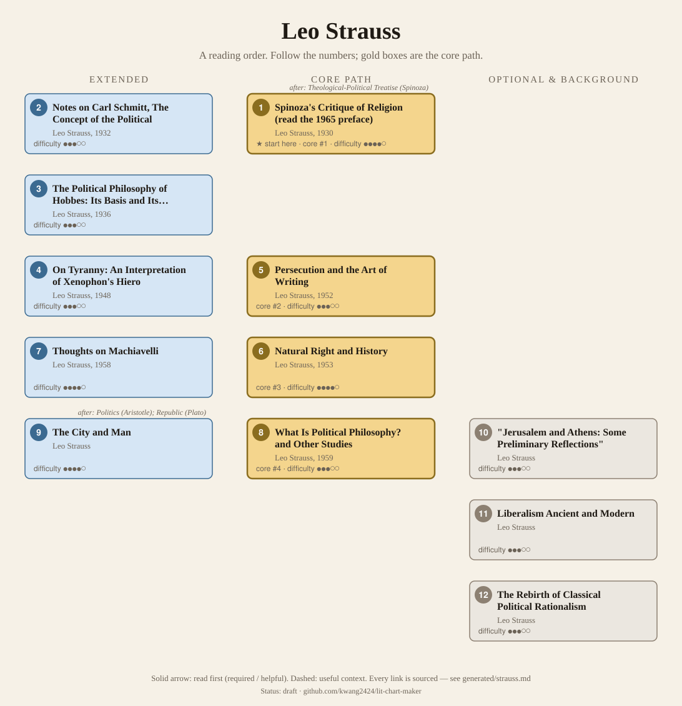

<!-- Generated by tools/build.py from lists/strauss.yaml. Do not edit by hand. -->
# Leo Strauss: reading order

**Status:** draft · **Citations:** 19 citations · 19 checked by Claude (AI) · 0 reviewed by a person

**Scope:** Strauss's books and best-known essays, from the Spinoza study and the Schmitt review of his German years to the Chicago books on natural right, Machiavelli and classical political philosophy. Only two independent courses with a reading order were found (Yale and Cornell), so the consensus section is thin.

> Citations marked "checked by Claude (AI)" were read against the named edition by an AI and have not yet been reviewed by a person. See [CONTRIBUTING.md](../CONTRIBUTING.md) to help review them.

## Core path

The shortest route through the essentials.

1. **Spinoza's Critique of Religion (read the 1965 preface)** (1930) · difficulty ●●●●○ · ★ start here · first book in 2 surveyed sources
2. **Persecution and the Art of Writing** (1952) · difficulty ●●●○○
3. **Natural Right and History** (1953) · difficulty ●●●●○ · first book in 1 surveyed source
4. **What Is Political Philosophy? and Other Studies** (1959) · difficulty ●●●○○

## What the sources say

We surveyed 3 independent sources (3 course syllabi and teaching lists) and recorded which books each one assigns or recommends, and where it starts.

| Book | Recommended by | First book in |
|---|---|---|
| Natural Right and History | 3/3 | 1 |
| Spinoza's Critique of Religion (read the 1965 preface) | 2/3 | 2 |
| Notes on Carl Schmitt, The Concept of the Political | 2/3 |  |
| Persecution and the Art of Writing | 2/3 |  |
| What Is Political Philosophy? and Other Studies | 2/3 |  |
| "Jerusalem and Athens: Some Preliminary Reflections" | 1/3 |  |
| Liberalism Ancient and Modern | 1/3 |  |
| The Rebirth of Classical Political Rationalism | 1/3 |  |
| Thoughts on Machiavelli | 1/3 |  |

**Sources surveyed**

- **Steven B. Smith, Yale University, PLSC 330b/598b: Leo Strauss & Straussianism (Spring 2008)** [teaching]: Spinoza's Critique of Religion (read the 1965 preface) → Notes on Carl Schmitt, The Concept of the Political → The Rebirth of Classical Political Rationalism → Persecution and the Art of Writing → What Is Political Philosophy? and Other Studies → Natural Right and History → "Jerusalem and Athens: Some Preliminary Reflections" → Liberalism Ancient and Modern. ✓ checked by Claude (AI) in Course syllabus (PDF), accessed 2026-11; not yet reviewed by a person
- **Jason Frank, Cornell University, Government 6586: Schmitt, Strauss, Arendt (Spring 2017)** [teaching]: Spinoza's Critique of Religion (read the 1965 preface) → Notes on Carl Schmitt, The Concept of the Political → Persecution and the Art of Writing → What Is Political Philosophy? and Other Studies → Natural Right and History. ✓ checked by Claude (AI) in Course syllabus (PDF), accessed 2026-11; not yet reviewed by a person
- **Louisiana State University, Department of Political Science, POLI 7995: graduate seminar on émigré political philosophers (Fall 2016)** [teaching]: Natural Right and History → Thoughts on Machiavelli. ✓ checked by Claude (AI) in Course syllabus (PDF, Fall 2016), accessed 2026-11; not yet reviewed by a person

## Full path

Every work, in order. Extended and optional works are placed where they fit best.

### 1. Spinoza's Critique of Religion (read the 1965 preface) (1930)

`core · primary · difficulty ●●●●○` · Leo Strauss

His first book, on Spinoza's Theologico-Political Treatise. The long preface he added to the 1965 English translation, also reprinted in Liberalism Ancient and Modern, is what courses assign.

**Translation:** Sinclair (Schocken 1965)

**★ Good place to start.** In the 1965 preface Strauss "describes the beginnings of his intellectual journey" and the "theologico-political predicament" that the SEP calls his most basic question. Both ordered courses found open with it.

- Stanford Encyclopedia of Philosophy, *"Leo Strauss" (rev. 2021)*, §4 The Theologico-Political Predicament of Modernity [scholarly] ✓ checked by Claude (AI) in SEP entry (rev. 2021), accessed 2026-11; not yet reviewed by a person
- Steven B. Smith, Yale University, *PLSC 330b/598b: Leo Strauss & Straussianism (Spring 2008)*, outline II, "How Did Strauss Become Strauss?" [teaching] ✓ checked by Claude (AI) in Course syllabus (PDF), accessed 2026-11; not yet reviewed by a person

**Read first:**

- *Theological-Political Treatise* (from the [Baruch Spinoza list](spinoza.md)) — *helpful*. Strauss: "This study of Spinoza's Theologico-Political Treatise was written during the years 1925–28 in Germany" (preface, quoted in the SEP).
  - Stanford Encyclopedia of Philosophy, *"Leo Strauss" (rev. 2021)*, §4 [scholarly] ✓ checked by Claude (AI) in SEP entry (rev. 2021), accessed 2026-11; not yet reviewed by a person

### 2. Notes on Carl Schmitt, The Concept of the Political (1932)

`extended · primary · difficulty ●●●○○` · Leo Strauss

A review essay arguing that Schmitt remained "within the horizon of modern liberalism". Strauss later said reading Schmitt changed his orientation toward philosophy and politics (SEP §1).

### 3. The Political Philosophy of Hobbes: Its Basis and Its Genesis (1936)

`extended · primary · difficulty ●●●○○` · Leo Strauss

Written in Paris and England on a Rockefeller fellowship. Treats Hobbes as the founding theorist of the liberal state (SEP §1).

**Translation:** Sinclair (Oxford 1936)

**Read first:**

- *Leviathan* (from the [Thomas Hobbes list](hobbes.md)) — *context*. A study of Hobbes, "whom he took to be the founding theorist of the liberal state".
  - Stanford Encyclopedia of Philosophy, *"Leo Strauss" (rev. 2021)*, §1 Life and Work [scholarly] ✓ checked by Claude (AI) in SEP entry, accessed 2026-11; not yet reviewed by a person

### 4. On Tyranny: An Interpretation of Xenophon's Hiero (1948)

`extended · primary · difficulty ●●●○○` · Leo Strauss

A close reading of Xenophon's dialogue on the tension between the philosophical quest for truth and the requirements of society (SEP §1). The 2000 edition adds the Strauss–Kojève correspondence.

**Translation:** Gourevitch and Roth ed., with the Strauss–Kojève correspondence (Chicago 2000)

### 5. Persecution and the Art of Writing (1952)

`core · primary · difficulty ●●●○○` · Leo Strauss

Essays arguing that some pre-modern thinkers must be read "between the lines": the threat of persecution produced writing with one message for most readers and another for a few (SEP §1, §3). Includes "How to Read Spinoza's Theologico-Political Treatise".

**Reading tips:**

- Courses assign the opening pages: the Introduction and the title essay (Cornell pp. 7–37; Yale's political theory exam list pp. 22–37).
  - Jason Frank, Cornell University, *Government 6586: Schmitt, Strauss, Arendt (Spring 2017)*, week 8 [teaching] ✓ checked by Claude (AI) in Course syllabus (PDF), accessed 2026-11; not yet reviewed by a person
  - Department of Political Science, Yale University, *Political Theory Exam List 2015*, Appendix A [teaching] ✓ checked by Claude (AI) in Exam reading list (PDF), accessed 2026-11; not yet reviewed by a person

**Read first:**

- *Theological-Political Treatise* (from the [Baruch Spinoza list](spinoza.md)) — *context*. One of its essays is "How to Read Spinoza's Theologico-Political Treatise", which Yale's Strauss course reads as "esotericism in practice".
  - Steven B. Smith, Yale University, *PLSC 330b/598b: Leo Strauss & Straussianism (Spring 2008)*, outline V [teaching] ✓ checked by Claude (AI) in Course syllabus (PDF), accessed 2026-11; not yet reviewed by a person

### 6. Natural Right and History (1953)

`core · primary · difficulty ●●●●○` · Leo Strauss

His "best-known American work". It starts from Max Weber and historicism, then contrasts modern natural right, beginning with Hobbes, with ancient natural right, beginning with Plato (SEP §1).

**Reading tips:**

- The introduction and first two chapters (pp. 1–80), on historicism and the fact–value distinction, stand on their own; Yale's exam list assigns them as a reading on method.
  - Department of Political Science, Yale University, *Political Theory Exam List 2015*, Appendix A ("Interpretation and Methods") [teaching] ✓ checked by Claude (AI) in Exam reading list (PDF), accessed 2026-11; not yet reviewed by a person

**Read first:**

- *Second Treatise of Government* (from the [John Locke list](locke.md)) — *context*. The SEP: "Leo Strauss (1953), and many of his followers, take rights to be paramount, going so far as to portray Locke's position as essentially similar to that of Hobbes."
  - Stanford Encyclopedia of Philosophy, *"Locke's Political Philosophy"*, §1 Natural Law and Natural Rights [scholarly] ✓ checked by Claude (AI) in SEP entry, accessed 2026-11; not yet reviewed by a person
- *Leviathan* (from the [Thomas Hobbes list](hobbes.md)) — *context*. It contrasts "modern conceptions of natural right, beginning with Hobbes, with ancient conceptions, beginning with Plato".
  - Stanford Encyclopedia of Philosophy, *"Leo Strauss" (rev. 2021)*, §1 Life and Work [scholarly] ✓ checked by Claude (AI) in SEP entry, accessed 2026-11; not yet reviewed by a person
- *Republic* (from the [Plato list](plato.md)) — *context*. The book contrasts modern natural right with the ancient conception "beginning with Plato".
  - Stanford Encyclopedia of Philosophy, *"Leo Strauss" (rev. 2021)*, §1 Life and Work [scholarly] ✓ checked by Claude (AI) in SEP entry (rev. 2021), accessed 2026-11; not yet reviewed by a person

### 7. Thoughts on Machiavelli (1958)

`extended · primary · difficulty ●●●●○` · Leo Strauss

"Likely his most controversial study"; it makes Machiavelli's "anti-theological ire" the source of modernity (SEP §1).

**Read first:**

- *Discourses on Livy* (from the [Niccolò Machiavelli list](machiavelli.md)) — *context*. Yale's political theory exam list sets it among the readings on The Prince and The Discourses.
  - Department of Political Science, Yale University, *Political Theory Exam List 2015*, Machiavelli section (The Prince, The Discourses) [teaching] ✓ checked by Claude (AI) in Exam list (PDF), accessed 2026-11; not yet reviewed by a person
- *The Prince* (from the [Niccolò Machiavelli list](machiavelli.md)) — *context*. A study of Machiavelli, in which he "pronounced Machiavelli's 'anti- theological ire' the source of modernity".
  - Stanford Encyclopedia of Philosophy, *"Leo Strauss" (rev. 2021)*, §1 Life and Work [scholarly] ✓ checked by Claude (AI) in SEP entry, accessed 2026-11; not yet reviewed by a person

### 8. What Is Political Philosophy? and Other Studies (1959)

`core · primary · difficulty ●●●○○` · Leo Strauss

Yale's course reads the title essay in two parts, on classical political philosophy and on the modern break; the volume also holds "On a Forgotten Kind of Writing" and "Political Philosophy and History".

### 9. The City and Man

`extended · primary · difficulty ●●●●○` · Leo Strauss

Essays on Aristotle's Politics, Plato's Republic and Thucydides.

**Read first:**

- *Politics* (from the [Aristotle list](aristotle.md)) — *helpful*. Its first essay is on Aristotle's Politics, "especially important as one of Strauss's few writings on the philosopher who largely shaped Strauss's conception of antiquity".
  - University of Chicago Press, *The City and Man (book page)*, book description [scholarly] ✓ checked by Claude (AI) in University of Chicago Press website, accessed 2026-11; not yet reviewed by a person
- *Republic* (from the [Plato list](plato.md)) — *helpful*. "The center of the book is Strauss's dialogue with Plato's Republic"; its essay on Plato is "a full-scale discussion of Platonic political philosophy".
  - Heinrich Meier, Department of Philosophy, University of Chicago, *Seminar: Politics and Philosophy: Leo Strauss's The City and Man*, course description [teaching] ✓ checked by Claude (AI) in Department web page, accessed 2026-11; not yet reviewed by a person
  - University of Chicago Press, *The City and Man (book page)*, book description [scholarly] ✓ checked by Claude (AI) in University of Chicago Press website, accessed 2026-11; not yet reviewed by a person

### 10. "Jerusalem and Athens: Some Preliminary Reflections"

`optional · primary · difficulty ●●●○○` · Leo Strauss

On reason and revelation; Yale's course reads it under that heading.

### 11. Liberalism Ancient and Modern

`optional · primary · difficulty ●●●○○` · Leo Strauss

Essays, including "Liberal Education" and the Spinoza preface.

### 12. The Rebirth of Classical Political Rationalism

`optional · primary · difficulty ●●●○○` · Leo Strauss (ed. Thomas L. Pangle)

A selection of essays and lectures edited by Thomas Pangle, including "Exoteric Teaching" and "Progress or Return?".

## Map

Solid arrows: required or helpful. Dotted: context.

```mermaid
graph TD
  spinoza_critique["Spinoza's Critique of Religion (read the 1965 preface)"]:::core
  notes_schmitt["Notes on Carl Schmitt, The Concept of the Political"]:::extended
  philosophy_hobbes["The Political Philosophy of Hobbes: Its Basis and Its Genesis"]:::extended
  on_tyranny["On Tyranny: An Interpretation of Xenophon's Hiero"]:::extended
  persecution["Persecution and the Art of Writing"]:::core
  natural_right["Natural Right and History"]:::core
  thoughts_machiavelli["Thoughts on Machiavelli"]:::extended
  what_is_pp["What Is Political Philosophy? and Other Studies"]:::core
  city_and_man["The City and Man"]:::extended
  jerusalem_athens["'Jerusalem and Athens: Some Preliminary Reflections'"]:::optional
  liberalism_ancient_modern["Liberalism Ancient and Modern"]:::optional
  rebirth["The Rebirth of Classical Political Rationalism"]:::optional
  classDef core fill:#f4d58d,stroke:#8a6d1f,color:#000
  classDef extended fill:#cfe3f5,stroke:#3b6a91,color:#000
  classDef optional fill:#eeeeee,stroke:#888,color:#000
```

## Connections

**Builds on**

- *Theological-Political Treatise* (Baruch Spinoza) → *Spinoza's Critique of Religion (read the 1965 preface)* — helpful. Strauss: "This study of Spinoza's Theologico-Political Treatise was written during the years 1925–28 in Germany" (preface, quoted in the SEP).
- *Leviathan* (Thomas Hobbes) → *The Political Philosophy of Hobbes: Its Basis and Its Genesis* — context. A study of Hobbes, "whom he took to be the founding theorist of the liberal state".
- *Theological-Political Treatise* (Baruch Spinoza) → *Persecution and the Art of Writing* — context. One of its essays is "How to Read Spinoza's Theologico-Political Treatise", which Yale's Strauss course reads as "esotericism in practice".
- *Second Treatise of Government* (John Locke) → *Natural Right and History* — context. The SEP: "Leo Strauss (1953), and many of his followers, take rights to be paramount, going so far as to portray Locke's position as essentially similar to that of Hobbes."
- *Leviathan* (Thomas Hobbes) → *Natural Right and History* — context. It contrasts "modern conceptions of natural right, beginning with Hobbes, with ancient conceptions, beginning with Plato".
- *Republic* (Plato) → *Natural Right and History* — context. The book contrasts modern natural right with the ancient conception "beginning with Plato".
- *Discourses on Livy* (Niccolò Machiavelli) → *Thoughts on Machiavelli* — context. Yale's political theory exam list sets it among the readings on The Prince and The Discourses.
- *The Prince* (Niccolò Machiavelli) → *Thoughts on Machiavelli* — context. A study of Machiavelli, in which he "pronounced Machiavelli's 'anti- theological ire' the source of modernity".
- *Politics* (Aristotle) → *The City and Man* — helpful. Its first essay is on Aristotle's Politics, "especially important as one of Strauss's few writings on the philosopher who largely shaped Strauss's conception of antiquity".
- *Republic* (Plato) → *The City and Man* — helpful. "The center of the book is Strauss's dialogue with Plato's Republic"; its essay on Plato is "a full-scale discussion of Platonic political philosophy".

## Sources

- **[scholarly]** Stanford Encyclopedia of Philosophy, *"Locke's Political Philosophy"* — <https://plato.stanford.edu/entries/locke-political/>
- **[scholarly]** Stanford Encyclopedia of Philosophy, *"Leo Strauss" (rev. 2021)* — <https://plato.stanford.edu/entries/strauss-leo/>
- **[scholarly]** University of Chicago Press, *The City and Man (book page)* — <https://press.uchicago.edu/ucp/books/book/chicago/C/bo3637986.html>
- **[teaching]** Jason Frank, Cornell University, *Government 6586: Schmitt, Strauss, Arendt (Spring 2017)* — <https://jasonfrank.info/wp-content/uploads/2017/05/Schmitt-Strauss-Arendt-Syllabus.pdf>
- **[teaching]** Louisiana State University, Department of Political Science, *POLI 7995: graduate seminar on émigré political philosophers (Fall 2016)* — <https://faculty.lsu.edu/poston/files/poli_7995_f16.pdf>
- **[teaching]** Steven B. Smith, Yale University, *PLSC 330b/598b: Leo Strauss & Straussianism (Spring 2008)* — <https://cpb-us-w2.wpmucdn.com/campuspress.yale.edu/dist/d/3326/files/2020/02/Leo-Strauss-Straussianism.pdf>
- **[teaching]** Heinrich Meier, Department of Philosophy, University of Chicago, *Seminar: Politics and Philosophy: Leo Strauss's The City and Man* — <https://philosophy.uchicago.edu/node/9868>
- **[teaching]** Department of Political Science, Yale University, *Political Theory Exam List 2015* — <https://politicalscience.yale.edu/sites/default/files/political_theory-reading_list-2015.pdf>
